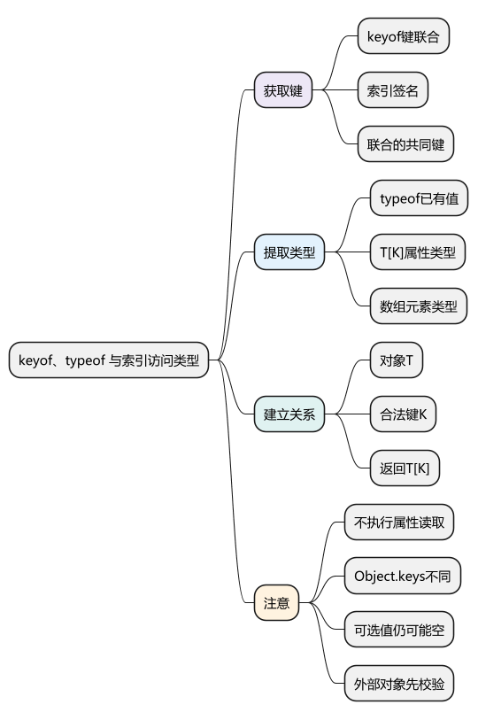
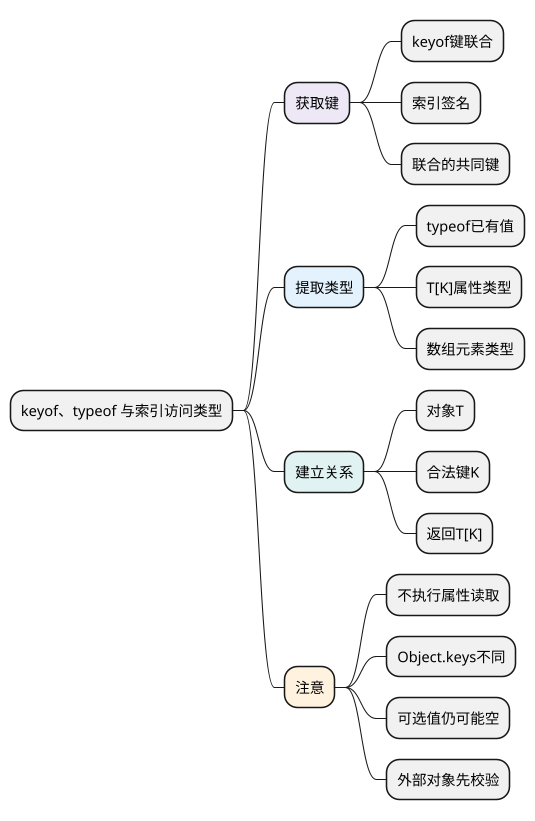

# keyof、typeof 与索引访问类型

<!-- core-mindmap:start -->
[](examples/ts10-mindmap.svg)

<details>
<summary>PlantUML 源码</summary>



</details>

<!-- core-mindmap:end -->

**口述总览：** keyof 从类型中取得允许的键，类型位置的 typeof 从已有值取得静态类型，T[K] 从类型中取得指定属性的值类型。把三者与泛型组合，就能描述“这个对象、这个键和读取结果”之间的关系，减少重复声明。

这些运算主要在类型检查时发生，不是在运行时遍历对象。先分别使用，再组合成安全的 get；前置知识见[泛型](09_泛型与类型关系.md)。各示例独立运行。

<a id="k01"></a>

## keyof：从类型取得键的集合

**口述：** keyof T 得到可以作为属性名使用的类型，通常是几个字符串、数字或 Symbol 键组成的联合。它不返回数组，也不执行属性枚举。

<!-- example: ts10-keyof -->
```ts
export {};
interface User { id: string; age: number }
type UserKey = keyof User;
const key: UserKey = 'age';
console.log(key); // age
if (false) {
  // @ts-expect-error email 不在 User 的键类型中。
  const wrong: UserKey = 'email';
}
```

这里 UserKey 是 `'id' | 'age'`。若 T 带字符串索引签名，keyof 可能包含 string | number，因为普通对象的数字键也会转换为字符串；不能把所有 keyof 的结果都当作固定字符串列表。

### 联合值只能直接使用共同可用的键

<!-- example: ts10-union-keys -->
```ts
export {};
type A = { id: string; name: string };
type B = { id: string; age: number };
type CommonKey = keyof (A | B);
const key: CommonKey = 'id';
console.log(key); // id
if (false) {
  // @ts-expect-error A | B 未收窄时，不保证具有 name。
  const wrong: CommonKey = 'name';
}
```

实际值可能是 A，也可能是 B，id 才是这里共同可用的键。若要逐成员收集全部键，需要另一种类型运算；即便取得全部键，也不能把任意键直接拿去访问未收窄的联合值。

<a id="k02"></a>

## typeof：区分运行时分类和静态类型提取

**口述：** JavaScript 的 typeof 返回 `'string'` 等字符串。写在类型位置时，TypeScript 的 typeof 表示“使用这个值已经拥有的静态类型”，不会实际执行一次类型查询。

<!-- example: ts10-typeof -->
```ts
export {};
const defaults = { mode: 'production', retries: 3 };
type Settings = typeof defaults;
const custom: Settings = { mode: 'development', retries: 1 };
console.log(typeof defaults, custom.mode); // object development
```

Settings 得到含 mode: string、retries: number 的结构，因此 custom 不必与 defaults 使用相同值。若 defaults 使用 as const，提取出来的字面量与只读要求也会更具体，是否合适要由契约决定。

类型位置的 typeof 通常引用标识符或属性访问，不能任意执行一个函数调用再把外部结果当成可信类型。类名作为类型通常表示实例，`typeof SomeClass` 表示构造器及静态侧；见[类与接口](08_类、接口实现与枚举.md)。

<a id="k03"></a>

## T[K]：提取属性类型，再组合安全的 get

**口述：** 类型中的方括号读取的是“属性值的类型”，不是实际属性值。K 如果是多个键的联合，结果也包含对应属性的可能类型。

<!-- example: ts10-indexed-access -->
```ts
export {};
interface User { id: string; age: number }
type Age = User['age'];
type UserValue = User[keyof User];
type UserItem = User[][number];
const age: Age = 20;
const value: UserValue = 'u1';
const item: UserItem = { id: value, age };
console.log(item.id, item.age); // u1 20
```

Age 是 number，UserValue 是 string | number，UserItem 是数组元素类型 User。也可以写 `(typeof items)[number]` 从已有数组的类型提取元素；不必先学习 infer 才完成这件事。

### 用泛型把对象、键和结果联系起来

<!-- example: ts10-safe-get -->
```ts
export {};
function get<T, K extends keyof T>(object: T, key: K): T[K] {
  return object[key];
}
const user = { id: 'u1', age: 20 };
const id = get(user, 'id');
const age = get(user, 'age');
console.log(id.toUpperCase(), age.toFixed(1)); // U1 20.0
if (false) {
  // @ts-expect-error 键必须来自这个对象的类型。
  get(user, 'missing');
}
```

T 来自对象，K 来自本次传入的键，extends 限制 K 必须属于 keyof T，T[K] 再给出这个键对应的返回类型。真正的属性读取由函数体 `object[key]` 执行，类型声明只描述并检查关系。

可选属性的读取仍可能得到 undefined。上面的精确关联适合类型已知的字段；若 T 是 Record<string, number>，查询不存在的键时，泛型返回类型 T[K] 可能仍是 number，而实际值为 undefined。noUncheckedIndexedAccess 不会自动把 undefined 加到这个泛型返回声明上。动态字典查询应另行返回 V | undefined，或先证明键存在；不要因为写了 get，就把未知对象强行断言成 T。

<a id="k04"></a>

## Object.keys：运行时枚举与静态键类型不能混用

**口述：** Object.keys 返回实际对象的自有可枚举字符串键；keyof 来自静态类型。静态视图可能省略对象实际拥有的字段，也可能包含不由 Object.keys 返回的 Symbol 键。

<!-- example: ts10-runtime-keys -->
```ts
export {};
interface User { id: string }
const detailed = { id: 'u1', debug: true };
const publicView: User = detailed;
console.log(Object.keys(publicView).join(',')); // id,debug
const token = Symbol('token');
const tagged = { id: 'u2', [token]: 1 };
console.log(Object.keys(tagged).join(',')); // id
```

publicView 的类型只写 id，运行时仍是原来的对象，没有删除 debug。另一方面，tagged 的 Symbol 键属于它的静态结构，却不会出现在 Object.keys 的结果中。

因此，不能普遍把 Object.keys(object) 断言成精确的 `(keyof T)[]`。受控配置可以明确列出允许的键，外部输入则先做运行时校验；类型工具不会自动补上这道边界。

<a id="summary"></a>

keyof 取得键类型，typeof 把已有值的类型带入声明，T[K] 取得对应属性类型。组合时保留真实关联，遇到运行时枚举或外部数据时，重新检查静态契约是否足够。

<a id="interview"></a>

## 试题与答案

<a id="ts10-01"></a>

### TS10-01 [P0·编码] 怎样写安全的get属性函数？

**回答：** 使用 `get<T, K extends keyof T>(object: T, key: K): T[K]`，在函数体返回 object[key]。它把合法键与结果类型关联，但不替代外部数据校验。

<a id="ts10-02"></a>

### TS10-02 [P0·基础] keyof T和Object.keys(object)是一回事吗？

**回答：** 不是。keyof 是静态类型运算；Object.keys 在运行时枚举自有可枚举字符串键。实际对象可能有静态类型未列出的属性，Symbol 键也不由 Object.keys 返回。

<a id="ts10-03"></a>

### TS10-03 [P0·原理] 类型位置typeof与运行时typeof有何不同？

**回答：** 运行时 typeof 返回类别字符串，类型位置的 typeof 引用已有值的静态类型。后者不会执行网络请求、验证 JSON 或生成运行时检查。

<a id="ts10-04"></a>

### TS10-04 [P1·原理] keyof(A|B)为何通常不是所有键的并集？

**回答：** 联合值可能来自任何成员，未收窄时只能直接使用共同可用的键。逐成员取得所有键需要另外的类型操作，结果也不能在任意联合值上不加判断地使用。

<a id="ts10-05"></a>

### TS10-05 [P0·原理] T[K]怎样把属性名与返回类型关联起来？

**回答：** K 受 keyof T 约束后，T[K] 提取相应属性的值类型；不同合法键能对应不同返回类型。类型提取不会执行读取，也不证明外部对象实际符合 T。

参考：[TypeScript：Keyof](https://www.typescriptlang.org/docs/handbook/2/keyof-types.html)、[Indexed Access Types](https://www.typescriptlang.org/docs/handbook/2/indexed-access-types.html)。
