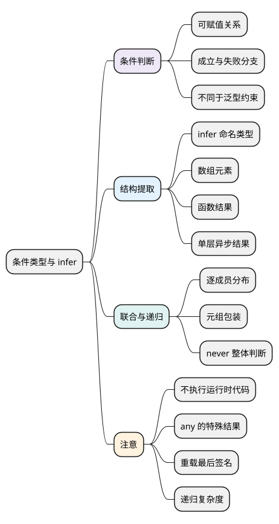

# 条件类型与 infer

<!-- core-mindmap:start -->
[](examples/ts11-mindmap.svg)

<details>
<summary>PlantUML 源码</summary>



</details>

<!-- core-mindmap:end -->

**口述总览：** 有时结果类型需要随输入类型变化：输入字符串得到一种结果，输入其他类型得到另一种结果。条件类型负责这次选择；infer 则在匹配数组、函数等结构时，给其中的一部分类型起名。它们计算的是类型，不会执行 JavaScript 分支或调用函数。

先掌握[泛型](09_泛型与类型关系.md)和[索引访问类型](10_keyof、typeof与索引访问类型.md)。以下各例是独立模块，按 TypeScript 5.9.3 的严格选项检查；预期错误放在不执行的分支中。

<a id="k01"></a>

## 按可赋值关系选择一种类型

**口述：** `T extends U ? X : Y` 可以读成：“T 能赋给 U，就选择 X；否则选择 Y。”它像三元表达式的外形，但参与判断和返回的都是类型。

<!-- example: ts11-conditional-basic -->
```ts
export {};
type Label<T> = T extends string ? 'text' : 'other';
const text: Label<string> = 'text';
const number: Label<number> = 'other';
if (false) {
  // @ts-expect-error Label<string> 得到的是 'text'。
  const wrong: Label<string> = 'other';
}
console.log(text, number); // text other
```

把 string 代入 T 后，string 可以赋给 string，所以 `Label<string>` 得到字面量类型 `'text'`。number 不满足这项关系，所以 `Label<number>` 得到 `'other'`。日志只是输出已经声明的值，真正验证类型选择的是编译器。

这里的 extends 不检查原型，也不等于运行时 instanceof。它还可以按对象需要的字段判断，例如 `T extends { id: string }` 检查 T 是否提供兼容的 id 字段，不要求 T 只能有这一个字段。

另一个常见写法 `type Box<T extends string> = ...` 是限制允许传入的 T；条件类型则允许传入不同类型，再选择结果。不要把“拒绝不符合约束的输入”和“为输入选择不同分支”混为一谈。

<a id="k03"></a>

## 匹配成功后，用 infer 提取里面的类型

**口述：** 如果知道输入是一组元素，却不知道元素类型是什么，可以在条件中写 `infer Item`。它相当于说：“匹配这部分结构，并把匹配到的类型叫 Item。”这个名字可以在成立分支中使用。

<!-- example: ts11-infer-parts -->
```ts
export {};
type ElementOf<T> = T extends readonly (infer Item)[] ? Item : never;
type ResultOf<F> = F extends (...args: any[]) => infer Result ? Result : never;
type OneLayer<T> = T extends Promise<infer Value> ? Value : T;

const element: ElementOf<readonly string[]> = 'A';
const result: ResultOf<(id: string) => number> = 3;
const value: OneLayer<Promise<boolean>> = true;
if (false) {
  // @ts-expect-error 提取到的数组元素类型是 string。
  const wrong: ElementOf<string[]> = 1;
}
```

逐个看输入与结果：

- `readonly string[]` 能匹配只读数组结构，Item 被推导为 string；普通可写数组也可以匹配这个只读视图。
- 函数类型匹配后，Result 是 number。例中的 `any[]` 只用于容纳不同参数列表，不表示实际调用函数，也不是把业务参数改成 any。
- `Promise<boolean>` 中的 Value 是 boolean。OneLayer 只拆这一层，不能代替标准工具 Awaited 的递归等待规则。

T 通常由外部提供，infer 引入的名字则由结构匹配得到。若 ElementOf 收到非数组，条件不成立，选择 never；整个过程没有创建或读取一个真实数组。

<a id="k02"></a>

## 联合类型为什么有时会被逐个处理

**口述：** 条件左侧直接是类型参数 T 时，传入联合类型通常会逐个成员计算，再把结果合起来。这叫分布式条件类型。把 T 包进元组后，就可以改成对整个类型做判断。

<!-- example: ts11-distribution -->
```ts
export {};
type Separate<T> = T extends unknown ? T[] : never;
type Together<T> = [T] extends [unknown] ? T[] : never;
const words: Separate<string | number> = ['A'];
const numbers: Separate<string | number> = [1];
const mixed: Together<string | number> = ['A', 1];
if (false) {
  // @ts-expect-error Separate 的结果是 string[] | number[]。
  const wrong: Separate<string | number> = ['A', 1];
}
```

Separate 先算 string 得 string[]，再算 number 得 number[]，最终是 `string[] | number[]`。Together 整体选择 T[]，得到 `(string | number)[]`，允许同一个数组含两种元素。

这里“裸类型参数”指条件左侧直接写 T，而不是 `[T]`、`T[]` 等结构。不是看见任意联合加 extends 就都会分布；直接写 `string | number extends string` 是整体关系判断。

### never 参与分布时，没有成员可计算

<!-- example: ts11-never-check -->
```ts
export {};
type WrongNever<T> = T extends never ? true : false;
type IsNever<T> = [T] extends [never] ? true : false;
const empty: IsNever<never> = true;
const present: IsNever<string> = false;
if (false) {
  // @ts-expect-error WrongNever<never> 得到 never，不是 true。
  const wrong: WrongNever<never> = true;
  // @ts-expect-error string 整体不是 never。
  const alsoWrong: IsNever<string> = true;
}
```

never 在分布时相当于没有成员的联合，所以 WrongNever 没有逐项产生 true，最终仍是 never。IsNever 包装后比较整个类型，才得到我们要的布尔字面量。

any 是另一种特殊输入，可能使条件结果包含两边。例如本篇 `Label<any>` 得到 `'text' | 'other'`。不要把 any 当作精确信息交给复杂类型运算。

<a id="k04"></a>

## 递归与重载：知道工具的边界

**口述：** 条件类型也能调用自己，逐层拆结构；但必须有结束条件。函数有多个重载时，提取类型也不会模拟每一种真实调用来选择结果。

<!-- example: ts11-recursion-overloads -->
```ts
export {};
type DeepElement<T> = T extends readonly (infer Item)[] ? DeepElement<Item> : T;
const value: DeepElement<readonly (readonly string[])[]> = 'A';

declare function convert(value: string): number;
declare function convert(value: number): string;
declare function convert(value: string | number): string | number;
type Result = ReturnType<typeof convert>;
const result: Result = 'ready';
if (false) {
  // @ts-expect-error 逐层取出的最终元素是 string。
  const wrong: DeepElement<string[][]> = 1;
  // @ts-expect-error 最后一个公开签名返回 string | number。
  const wrongResult: Result = true;
}
```

DeepElement 遇到数组继续取元素，遇到非数组返回 T，这就是结束分支。对重载的 ReturnType 提取通常依据最后一个公开调用签名；它不等于调用 convert('A') 时选出的那个返回类型。

**注意：** 递归层数、联合成员数与模板字符串组合都会增加检查成本。优先使用清晰的类型和标准工具；确实需要自定义转换时，限定输入、拆出中间类型并给边界写类型检查。

<a id="summary"></a>

理解顺序是：extends 检查什么关系 → 成立时返回什么类型 → infer 提取哪部分 → 是否按联合成员分布。最后再分析 never、any、递归与重载，避免只凭语法外形猜结果。

<a id="interview"></a>

## 试题与答案


<a id="ts11-01"></a>

### TS11-01 [P1·原理] infer是什么，和泛型参数有何不同？

**回答：** 泛型参数通常由调用或类型应用提供，infer在条件类型匹配结构时引入待推导类型变量，例如函数返回值或数组元素。它只在对应成立分支使用，不进行运行时操作。

对应讲解：[相关机制](#k03)。

<a id="ts11-02"></a>

### TS11-02 [P1·原理] 为什么T extends unknown会把联合拆开？

**回答：** 条件左侧是裸类型参数，满足分布式条件规则，编译器逐个联合成员计算并合并。用[T]等包装改为整体判断可抑制分布，结果形状可能不同。

对应讲解：[相关机制](#k02)。

<a id="ts11-03"></a>

### TS11-03 [P1·编码] 怎样判断一个类型整体是不是never？

**回答：** 可用[T] extends [never] ? true : false，包装避免T=never作为空联合被分布后直接得到never。直接T extends never容易得到与预期布尔结果不同的类型。

对应讲解：[相关机制](#k02)。

<a id="ts11-04"></a>

### TS11-04 [P1·工程取舍] 高级类型越复杂越好吗？

**回答：** 不是。递归、分布和模板联合可能拖慢编译并产生难懂错误。先使用清晰结构和标准工具，复杂转换需限定输入、终止条件及类型测试，不能让公共API变成谜题。

对应讲解：[相关机制](#k04)。

<a id="ts11-05"></a>

### TS11-05 [P1·基础] 条件类型里的extends与运行时instanceof一样吗？

**回答：** 不一样，它在类型空间检查可赋值关系并选择分支，不创建对象或执行运行时分支。泛型约束限制可传入类型，条件类型则可按关系产生不同结果，二者用途不同。

对应讲解：[相关机制](#k01)。

参考：[TypeScript 类型操作](https://www.typescriptlang.org/docs/handbook/2/types-from-types.html)。
