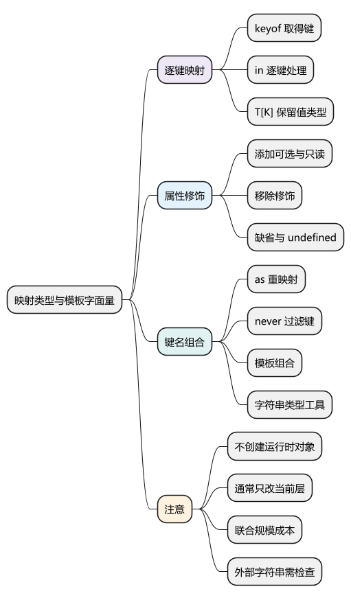
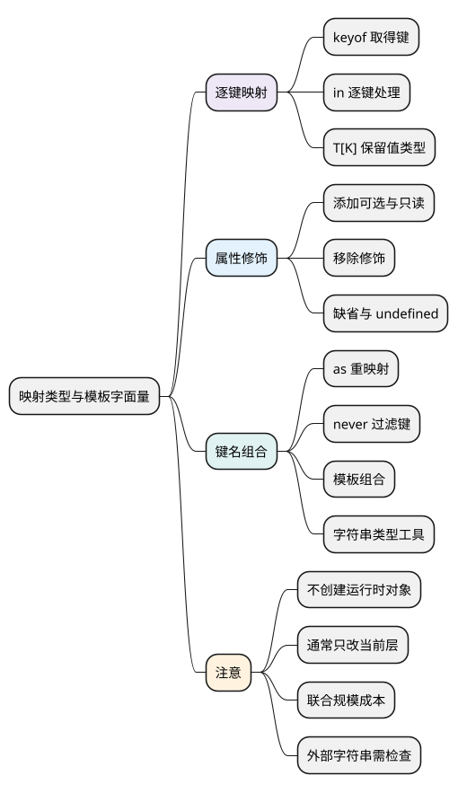

# 映射类型与模板字面量

<!-- core-mindmap:start -->
[](examples/ts12-mindmap.svg)

<details>
<summary>PlantUML 源码</summary>



</details>

<!-- core-mindmap:end -->

**口述总览：** 如果一个已有类型里有若干字段，我们可以按这些字段生成另一种类型，例如把每个字段改成开关、设为只读，或生成对应的方法名。映射类型负责逐个处理键，模板字面量类型负责拼出允许的字符串；它们都不会自动创建或修改运行时对象。

先读[keyof、typeof 与索引访问类型](10_keyof、typeof与索引访问类型.md)。以下代码块各自是独立 TypeScript 模块，使用严格选项检查。

<a id="k01"></a>

## 逐个处理对象类型里的键

**口述：** `[K in keyof T]` 可以读成：“对 T 的每一个键 K，生成一个同名属性。”冒号后决定这个新属性的类型。这里是类型运算，不是 JavaScript 的 for...in 循环。

<!-- example: ts12-map-properties -->
```ts
export {};
type Settings = { sound: number; theme: string };
type Flags<T> = { [K in keyof T]: boolean };
const enabled: Flags<Settings> = { sound: true, theme: false };
if (false) {
  // @ts-expect-error Flags 保留 theme 这个键，但把值类型改为 boolean。
  const wrong: Flags<Settings> = { sound: true, theme: 'dark' };
}
console.log(enabled.sound, enabled.theme); // true false
```

先算 keyof Settings，得到 `'sound' | 'theme'`；然后 K 先后代表这些键，每个键的属性类型都被写成 boolean。得到的形状等价于 `{ sound: boolean; theme: boolean }`。

如果冒号后写 T[K]，就保留每个键原来的属性类型。这里用的是类型中可表达的键，不是枚举某个对象的实际自有属性；它也不会自动为 enabled 填入默认值。

<a id="k03"></a>

## 添加或移除可选、只读修饰

**口述：** 属性名前的 readonly 限制赋值，属性后的问号允许缺省。映射时可以添加这些标记；前面加减号，则移除对应标记。

<!-- example: ts12-modifiers -->
```ts
export {};
type Optional<T> = { [K in keyof T]?: T[K] };
type FrozenView<T> = { readonly [K in keyof T]: T[K] };
type EditableRequired<T> = { -readonly [K in keyof T]-?: T[K] };
type User = { readonly id: string; name?: string };

const patch: Optional<User> = {};
const fixed: FrozenView<{ count: number }> = { count: 1 };
const user: EditableRequired<User> = { id: 'u1', name: 'Lin' };
user.id = 'u2';
if (false) {
  // @ts-expect-error readonly 视图不允许这样赋值。
  fixed.count = 2;
  // @ts-expect-error -? 移除了 name 的可选标记。
  const missing: EditableRequired<User> = { id: 'u1' };
}
```

Optional 给每个属性加问号，FrozenView 增加只读限制。EditableRequired 同时去掉 readonly 和可选标记，所以 user.id 可以修改，但 name 必须提供。

这种直接按 keyof T 变换的写法通常保留没有主动修改的属性修饰。不要把“字段变可选”和“字段可以显式赋 undefined”视为同一件事。

### 缺省和显式 undefined 要按配置区分

<!-- example: ts12-exact-optional -->
```ts
export {};
type OptionalName = { name?: string };
type RequiredFields<T> = { [K in keyof T]-?: T[K] };
const absent: OptionalName = {};
const explicit: RequiredFields<{ name?: string | undefined }> = { name: undefined };
if (false) {
  // @ts-expect-error exactOptionalPropertyTypes 下未声明显式 undefined。
  const wrong: OptionalName = { name: undefined };
}
```

本教材启用 exactOptionalPropertyTypes。name?: string 可以不提供；若提供，就应是 string。第二种写法明确把 undefined 列入值类型，去掉问号后仍允许该值，但必须提供 name 这个键。

<a id="k02"></a>

## 通过 as 改键名，再用模板类型组合字符串

**口述：** 映射类型中的 as 用于指定新键名；它不是值表达式中的类型断言。模板字面量类型使用反引号和插值，描述由已知字符串组成的名字。

<!-- example: ts12-remap-getters -->
```ts
export {};
type Getters<T> = {
  [K in keyof T as K extends string ? `get${Capitalize<K>}` : never]: () => T[K]
};
type User = { name: string; age: number };
const getters: Getters<User> = {
  getName: () => 'Lin',
  getAge: () => 20
};
if (false) {
  // @ts-expect-error getAge 对应 age，必须返回 number。
  const wrong: Getters<User> = { getName: () => 'Lin', getAge: () => '20' };
}
console.log(getters.getName(), getters.getAge()); // Lin 20
```

按 name 这个键推导：K 是 `'name'`，满足 string 条件；Capitalize 把它变成类型 `'Name'`；模板得到 `'getName'`；属性类型则是 `() => User['name']`，也就是返回 string 的函数。

K 可能包含数字或 Symbol，所以例中先筛出字符串键。映射成 never 表示不生成那个键。Capitalize、Uncapitalize、Uppercase、Lowercase 都是字符串类型变换，不会实际执行大小写转换，也不是面向用户语言环境的国际化规则。

<!-- example: ts12-template-unions -->
```ts
export {};
type Resource = 'user' | 'order';
type Action = 'created' | 'deleted';
type EventName = `${Resource}:${Action}`;
const event: EventName = 'user:created';
if (false) {
  // @ts-expect-error 组合中没有 updated。
  const wrong: EventName = 'user:updated';
}
```

两个资源名与两个动作名组合成四个允许值。若两个位置分别有 100 个成员，组合可能达到 10000 种；模板简短不代表检查成本小。

<a id="k04"></a>

## 类型变了，实际对象不会自动改变

**口述：** 映射得到的是新的类型视图，不是运行时转换函数。可选映射不会补默认值，readonly 不会冻结对象，键重映射也不会替你实现 getName。

这些变化通常只作用当前一层。嵌套对象内部的字段是否可选、是否只读，仍由其自身类型决定。若要递归转换，必须另行定义数组、元组、函数等如何处理，而不是机械地把所有对象继续展开。

**注意：** 外部传入的普通 string 不能因为看起来像事件名，就直接当 EventName 使用。运行时先检查允许值或解析协议，再让类型收窄；单纯写 as EventName 不提供验证。

常见变换已有 Partial、Required、Readonly 等标准工具，日常优先使用它们；本篇手写是为了理解规则。具体用法见[常用工具类型](13_常用工具类型.md)。

<a id="summary"></a>

先看输入有哪些键，再看每个键的新值类型、可选与只读标记，最后看 as 是否改变名字。模板类型约束的是字符串集合；所有类型变化都要与实际数据处理分开理解。

<a id="interview"></a>

## 试题与答案


<a id="ts12-01"></a>

### TS12-01 [P1·工程取舍] 模板字面量类型适合哪些场景？

**回答：** 适合受控事件名、配置键或有限路径组合；需控制联合规模，避免类型爆炸。它只约束静态字符串集合，不能自动验证外部任意字符串或执行国际化转换。

对应讲解：[相关机制](#k02)。

<a id="ts12-02"></a>

### TS12-02 [P0·原理] 映射类型里的 in 与 as 分别做什么？

**回答：** in 让类型参数逐个代表输入键，冒号后定义对应属性类型；as 指定生成的新键，映射为 never 可以过滤键。这些都是类型运算，不会遍历真实对象或重命名运行时属性。

<a id="ts12-03"></a>

### TS12-03 [P1·原理] 去掉可选标记就一定排除了 undefined 吗？

**回答：** 不一定。开启 exactOptionalPropertyTypes 时，name?: string 表示可以缺省，不能显式写 undefined；name?: string | undefined 则明确允许这个值。去掉问号要求键存在，后者仍保留显式声明的 undefined。

参考：[TypeScript 类型操作](https://www.typescriptlang.org/docs/handbook/2/types-from-types.html)。
