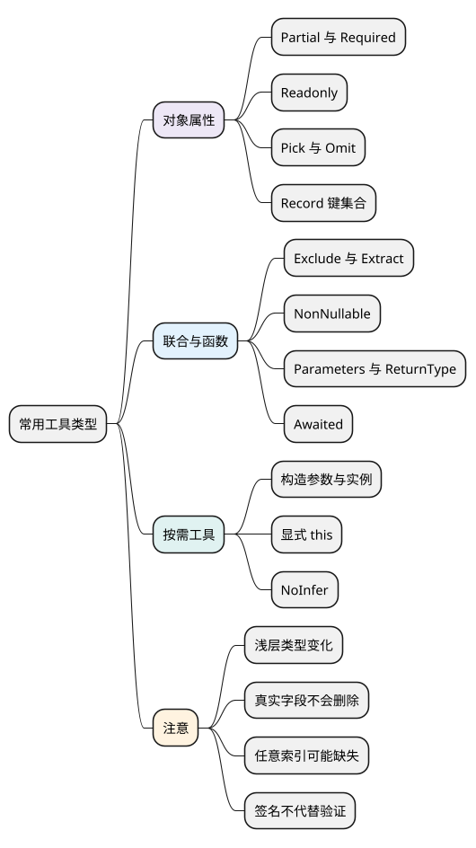

# 常用工具类型

<!-- core-mindmap:start -->
[](examples/ts13-mindmap.svg)

<details>
<summary>PlantUML 源码</summary>



</details>

<!-- core-mindmap:end -->

**口述总览：** 工具类型把常见类型变换封装好了。传入对象类型，可以得到可选字段、只读字段或部分字段；传入联合类型，可以筛选成员；传入函数类型，可以提取参数和结果。先明确输入与产出，再判断是否还需要实际转换数据。

这些名字可以直接在类型位置使用，不需要导入或 new。每个示例是独立模块，按 TypeScript 5.9.3、strict、exactOptionalPropertyTypes 与 noUncheckedIndexedAccess 检查。

<a id="k01"></a>

## 调整属性要求：Partial、Required、Readonly

`Partial<T>` 接收对象类型 T，得到当前一层属性都可缺省的类型，常用于描述局部修改。`Required<T>` 去掉当前一层的可选标记；`Readonly<T>` 提供当前一层属性不能重新赋值的视图。

<!-- example: ts13-property-tools -->
```ts
export {};
type User = { name: string; address: { city: string }; nickname?: string };
const patch: Partial<User> = { name: 'Lin' };
const complete: Required<User> = { name: 'Lin', address: { city: '杭州' }, nickname: 'L' };
const view: Readonly<User> = complete;
view.address.city = '上海';
if (false) {
  // @ts-expect-error Partial 只改变外层，address 内的 city 仍必需。
  const wrongPatch: Partial<User> = { address: {} };
  // @ts-expect-error 不能通过该只读视图重新赋值 name。
  view.name = 'Other';
  // @ts-expect-error exactOptionalPropertyTypes 下 nickname 未允许显式 undefined。
  const wrongName: Partial<User> = { nickname: undefined };
}
console.log(patch.name, view.address.city); // Lin 上海
```

Partial 不递归，Required 不填默认值，Readonly 不调用 Object.freeze。例中只读的是 address 这个属性的赋值权；address 指向的对象仍允许修改 city。需要真正不可变数据时，应单独设计运行时处理。

<a id="k02"></a>

## 选择属性与描述键集合：Pick、Omit、Record

`Pick<T, K>` 从 T 选择 K 指定的键，K 必须属于 keyof T；`Omit<T, K>` 排除这些键，保留其余属性。两者得到新类型，不会从真实对象中移除字段。

<!-- example: ts13-pick-omit -->
```ts
export {};
type User = { id: string; name: string; password: string };
type Identity = Pick<User, 'id' | 'name'>;
type PublicUser = Omit<User, 'password'>;
const raw: User = { id: 'u1', name: 'Lin', password: 'demo-only' };
const view: PublicUser = raw;
const safe: Identity = { id: raw.id, name: raw.name };
console.log(Object.hasOwn(view, 'password')); // true
console.log(Object.hasOwn(safe, 'password')); // false
if (false) {
  // @ts-expect-error Pick 的键必须属于 User。
  const wrong: Pick<User, 'missing'> = {};
}
```

view 的类型没有 password，但它仍指向 raw，所以运行时属性还在。safe 是显式新建的响应对象，才真正只包含允许字段。类型隐藏不能代替数据脱敏或服务端输出控制。

`Record<K, V>` 接收键类型 K 与值类型 V，得到这些键都对应 V 的对象类型。K 可以是字符串、数字或 Symbol 类型；有限字面量键集合与宽泛 string 索引要分别理解。

<!-- example: ts13-record -->
```ts
export {};
type Role = 'reader' | 'editor';
const enabled: Record<Role, boolean> = { reader: true, editor: false };
const counts: Record<string, number> = { apple: 2 };
const missing = counts['pear']; // number | undefined
console.log(enabled.reader, missing); // true undefined
if (false) {
  // @ts-expect-error 有限键集合要求同时提供 reader 与 editor。
  const incomplete: Record<Role, boolean> = { reader: true };
  // @ts-expect-error noUncheckedIndexedAccess 提醒任意索引可能不存在。
  const sure: number = counts['pear'];
}
```

Record<string, number> 不会给所有字符串键填上数字。读取任意索引时先处理缺失情况；本教材开启的检查选项会让类型提示 number | undefined。

<a id="k05"></a>

## 筛选联合成员：Exclude、Extract、NonNullable

`Exclude<T, U>` 从联合 T 中排除能赋给 U 的成员；`Extract<T, U>` 只保留能赋给 U 的成员。`NonNullable<T>` 则移除 null 与 undefined。

<!-- example: ts13-union-tools -->
```ts
export {};
type Input = string | number | null | undefined;
const number: Exclude<Input, string | null | undefined> = 3;
const text: Extract<Input, string> = 'A';
const present: NonNullable<Input> = 0;
if (false) {
  // @ts-expect-error Extract 的结果只有 string。
  const wrong: Extract<Input, string> = 1;
  // @ts-expect-error NonNullable 已排除 null。
  const absent: NonNullable<Input> = null;
}
```

它们筛的是联合成员，不是对象字段；要删对象类型里的 password，应考虑 Omit。NonNullable 也不会替某个真实变量检查空值，访问外部数据时仍需相应运行时判断。

<a id="k03"></a>

## 从函数签名得到参数与结果

`Parameters<F>` 接收函数类型 F，产出参数元组；`ReturnType<F>` 产出返回类型。普通函数值要先用 typeof 取得其类型。`Awaited<T>` 接收一个类型，按等待语义递归提取 Promise 或合适 thenable 的结果，并保留非异步成员。

<!-- example: ts13-function-tools -->
```ts
export {};
async function load(id: string, limit = 2) {
  return { id, limit };
}
type Args = Parameters<typeof load>; // [id: string, limit?: number]
type Pending = ReturnType<typeof load>; // Promise<{ id: string; limit: number }>
type Loaded = Awaited<Pending>; // { id: string; limit: number }
const args: Args = ['u1'];
const loaded: Loaded = { id: 'u1', limit: 2 };
if (false) {
  // @ts-expect-error 第一个参数必须是 string。
  const wrong: Args = [1];
}
console.log(args[0], loaded.limit); // u1 2
```

`Awaited<ReturnType<typeof load>>` 先取得 Promise 返回类型，再取得最终结果类型，减少重复声明。它没有调用 load、等待网络或验证响应；若函数声明不可信，工具也不会恢复出正确业务契约。

**注意：** 从重载函数提取 Parameters、ReturnType 时，通常依据最后一个公开签名；这不等于对某个具体实参进行重载解析。细节见[条件类型](11_条件类型与infer.md#k04)。

<a id="k04"></a>

## 选读：构造器、this 与推断控制

`ConstructorParameters<C>` 接收构造器类型，产出构造参数元组；`InstanceType<C>` 产出该构造器的实例类型。类名在类型位置通常已经表示实例，typeof 类名才表示这里所需的构造器类型。

<!-- example: ts13-constructor-tools -->
```ts
export {};
class User {
  constructor(public name: string, public active = true) {}
}
const args: ConstructorParameters<typeof User> = ['Lin'];
const user: InstanceType<typeof User> = new User(...args);
if (false) {
  // @ts-expect-error User 的首个构造参数是 string。
  const wrong: ConstructorParameters<typeof User> = [1];
}
console.log(user.name, user.active); // Lin true
```

其余工具在确有需要时再读：

- `ThisParameterType<F>` 提取函数显式声明的 this 参数；`OmitThisParameter<F>` 从函数类型中移除它，但不会替真实函数执行 bind。
- `ThisType<T>` 是对象字面量的上下文 this 标记，需要合适的上下文类型与 noImplicitThis 检查；它不创建 this 对象。
- `NoInfer<T>` 阻止某个位置提供该类型参数的推断候选，不会关闭赋值检查。例如默认值应服从选项列表，而不应反过来扩大选项类型。

这些工具不必一次堆在一个接口里。输入、输出与使用理由说得清楚，通常比类型表达式更复杂重要。

<a id="summary"></a>

查工具时先区分：变对象属性、选对象键、筛联合成员，还是提取函数或构造器签名。类型变换完成后，继续确认是否需要运行时校验、构造安全对象、等待异步操作或绑定函数。

<a id="interview"></a>

## 试题与答案


<a id="ts13-01"></a>

### TS13-01 [P1·原理] `Record<string,number>`为何仍能读到undefined？

**回答：** 类型描述索引访问契约，不会在运行时填满所有键。启用noUncheckedIndexedAccess可提醒未验证读取，但仍需hasOwn或业务存在性检查。

对应讲解：[相关机制](#k02)。

<a id="ts13-02"></a>

### TS13-02 [P0·原理] Partial如何实现，是否递归？

**回答：** 通过 [K in keyof T]?: T[K] 对类型中的键生成可选属性，通常只改变当前一层。嵌套对象仍遵守原字段要求；深可选需要另定义对数组、函数等的支持规则。

对应讲解：[相关机制](#k01)。

<a id="ts13-03"></a>

### TS13-03 [P0·原理] `Omit<User,'password'>`会防止JSON泄露密码吗？

**回答：** 不会，它只改变静态视图。实际对象仍可能有password，JSON序列化照样能输出。必须显式构造响应对象或移除字段，并在服务端做权威数据输出控制。

对应讲解：[相关机制](#k02)。

<a id="ts13-04"></a>

### TS13-04 [P1·基础] Exclude和Omit的区别是什么？

**回答：** Exclude按可赋值关系过滤联合成员，Omit按键排除对象属性。两者处理的维度不同，不能用排除某个对象形状替代删除其一个字段。

对应讲解：[相关机制](#k05)。

<a id="ts13-05"></a>

### TS13-05 [P1·基础] `Awaited<ReturnType<F>>`解决什么？

**回答：** 先提取函数返回类型，再按等待语义得到异步结果类型，减少重复声明。它依赖F签名准确，不会验证真正的HTTP数据，也不能把any变成安全契约。

对应讲解：[相关机制](#k03)。

参考：[TypeScript 类型操作](https://www.typescriptlang.org/docs/handbook/2/types-from-types.html)。
