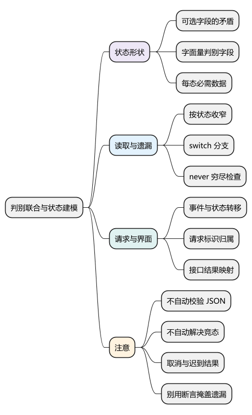
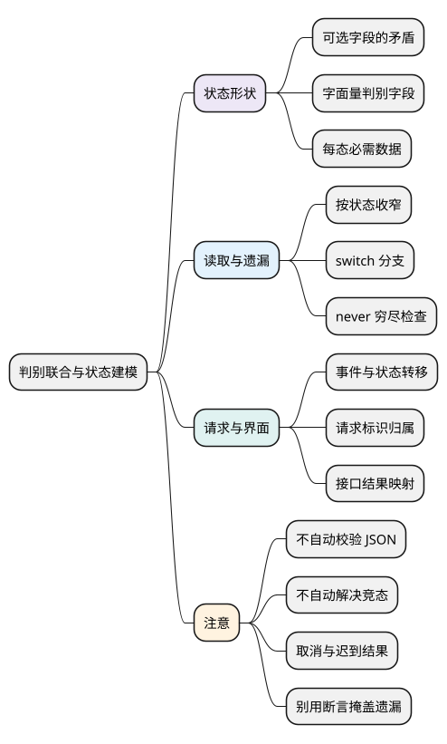

# 判别联合与状态建模

<!-- core-mindmap:start -->
[](examples/ts14-mindmap.svg)

<details>
<summary>PlantUML 源码</summary>



</details>

<!-- core-mindmap:end -->

**口述总览：** 一个请求可能尚未开始、正在加载、成功或失败，每种状态需要的数据不同。把状态名与对应数据写在一起，就能让编译器帮助检查缺字段和错误读取。这叫判别联合；它约束数据形状，状态怎样转移、结果属于哪次请求，仍要由运行时代码决定。

先理解[联合与类型收窄](06_联合、交叉与类型收窄.md)。以下代码块各自是独立模块，按严格 TypeScript 配置检查与运行。

<a id="k01"></a>

## 全部字段可选，为什么会放过矛盾组合

**口述：** 如果把 loading、data、error 全写成可选属性，类型只能说明这些字段可能出现，却不能说明什么时候必须出现，也不能解释互相冲突的组合。

<!-- example: ts14-optional-state -->
```ts
export {};
type LooseState = { loading?: boolean; data?: string[]; error?: string };
const ambiguous: LooseState = { loading: true, data: ['A'], error: 'failed' };
const missing: LooseState = {};
console.log(ambiguous.loading, missing.data); // true undefined
```

这两种值都能通过检查，但调用者无法从类型知道现在该显示加载、成功还是错误。保留旧数据同时加载也可能是合法业务；关键是把这种状态明确命名，而不是依靠无约束的字段组合猜测。

### 把状态名和当前必需的数据绑在一起

<!-- example: ts14-discriminated-state -->
```ts
export {};
type State =
  | { kind: 'idle' }
  | { kind: 'loading' }
  | { kind: 'success'; data: string[] }
  | { kind: 'error'; message: string };
const success: State = { kind: 'success', data: ['A'] };
if (false) {
  // @ts-expect-error success 状态必须提供 data。
  const missing: State = { kind: 'success' };
  // @ts-expect-error 新鲜字面量的 loading 分支没有 message。
  const mixed: State = { kind: 'loading', message: 'failed' };
}
```

四个成员都有 kind，但它们的值是不同的字符串字面量。kind 因而成为**判别字段**：检查它，就能确定当前属于哪个成员。

普通 string 无法区分这些分支。联合也不是运行时的精确对象验证器：外部 JSON、any 或额外字段仍需按实际边界校验，不能把静态约束当作数据清洗。

<a id="k02"></a>

## 根据状态读取字段，并检查分支是否齐全

**口述：** 在 success 分支读取 data，在 error 分支读取 message。处理完所有成员后，剩下的类型应当是 never，表示不应再有其他情况。

<!-- example: ts14-exhaustive -->
```ts
export {};
type State =
  | { kind: 'loading' }
  | { kind: 'success'; data: string[] }
  | { kind: 'error'; message: string };
function render(state: State): string {
  switch (state.kind) {
    case 'loading': return '加载中';
    case 'success': return state.data.join(',');
    case 'error': return state.message;
    default: {
      const impossible: never = state;
      throw new Error(String(impossible));
    }
  }
}
if (false) {
  function readTooEarly(state: State) {
    // @ts-expect-error 尚未检查 kind，不能保证存在 data。
    return state.data;
  }
}
console.log(render({ kind: 'success', data: ['A', 'B'] })); // A,B
```

进入 success 分支后，state 被收窄为带 data 的成员；default 的 never 检查证明剩余成员已处理。readTooEarly 只用于展示类型错误，例中不会调用它。

<!-- example: ts14-missing-case -->
```ts
export {};
type State = { kind: 'loading' } | { kind: 'cancelled' };
if (false) {
  function incomplete(state: State): string {
    switch (state.kind) {
      case 'loading': return '加载中';
      default: {
        // @ts-expect-error cancelled 仍未处理，state 不是 never。
        const impossible: never = state;
        return String(impossible);
      }
    }
  }
}
```

增加 cancelled 后，遗漏分支能在检查阶段暴露。正确修复是定义取消状态如何显示，而不是写 as never 压掉错误。真实运行仍应保留异常处理与外部数据验证。

<a id="k03"></a>

## 状态形状正确，不代表请求归属正确

**口述：** 两次请求都可能返回合法的成功对象，但旧请求迟到的结果未必允许覆盖新请求。除了 kind，还要记录当前请求标识，并在提交结果前核对。

<!-- example: ts14-request-owner -->
```ts
export {};
type State = { kind: 'idle' } | { kind: 'loading'; id: number } |
  { kind: 'success'; id: number; data: string };
type Action = { type: 'start'; id: number } |
  { type: 'resolve'; id: number; data: string };
function reduce(state: State, action: Action): State {
  if (action.type === 'start') return { kind: 'loading', id: action.id };
  if (state.kind !== 'loading' || state.id !== action.id) return state;
  return { kind: 'success', id: action.id, data: action.data };
}
let state: State = { kind: 'idle' };
state = reduce(state, { type: 'start', id: 2 });
state = reduce(state, { type: 'resolve', id: 1, data: 'old' });
console.log(state.kind); // loading
state = reduce(state, { type: 'resolve', id: 2, data: 'new' });
console.log(state.kind); // success
```

第一次 resolve 的 id 是 1，当前加载的是 2，所以保留原状态。第二次标识匹配，才生成 success。联合类型检查形状，id 比较检查事件归属，两者不能互相替代。

这个短例只处理启动与成功。真实流程还要规定失败、取消、重试、部分数据和重复事件的行为；请求标识应由所有者生成并避免错误复用。更严格的状态机还会限制“当前状态允许哪些事件”，而不只是列出所有状态。

<a id="k04"></a>

## 接口结果与界面状态各自描述什么

**口述：** 接口结果描述一次调用的结局；界面还要描述调用之前与过程中怎样展示。二者可以转换，但不需要强行共用一个全部字段可选的类型。

<!-- example: ts14-api-ui -->
```ts
export {};
type Result<T> = { ok: true; data: T } | { ok: false; message: string };
type ViewState = { kind: 'idle' } | { kind: 'loading' } |
  { kind: 'ready'; items: string[] } | { kind: 'error'; text: string };
function toView(result: Result<string[]>): ViewState {
  return result.ok
    ? { kind: 'ready', items: result.data }
    : { kind: 'error', text: result.message };
}
console.log(toView({ ok: false, message: '稍后重试' }).kind); // error
```

这个转换只负责已完成结果到界面的映射；idle、loading 由界面的请求流程负责。需要显示旧数据刷新、取消或流式增量时，再新增有清楚含义的成员与合法转移。

**注意：** 收到 JSON 后不能直接断言为 Result 并认为验证结束。先检查外部结构，再进行状态映射；类型本身不负责用户授权、请求取消或服务端状态一致性。

<a id="summary"></a>

先确定哪些组合合法，再给每种状态定义判别值与必需字段；使用时收窄，读取时穷尽，提交时核对事件归属。测试应覆盖合法转移、迟到结果、取消后完成和新增状态遗漏。

<a id="interview"></a>

## 试题与答案


<a id="ts14-01"></a>

### TS14-01 [P0·原理] 判别联合为什么比全部可选字段更好？

**回答：** 它把状态和必需数据绑定，success分支才能访问data，error分支必须有message，减少静态可表达的矛盾组合。全可选对象则让调用方处处猜字段是否有效。

对应讲解：[相关机制](#k01)。

<a id="ts14-02"></a>

### TS14-02 [P0·编码] 如何检查所有状态都被处理？

**回答：** 根据字面量判别字段switch，在default把剩余值赋给never或传给assertNever。新增状态未处理时编译器会提示，但运行时输入仍需要校验。

对应讲解：[相关机制](#k02)。

<a id="ts14-03"></a>

### TS14-03 [P1·原理] 判别联合能自动防止旧请求覆盖吗？

**回答：** 不能，它保证形状而不保证时序。要在提交前核对requestId或版本，并定义取消、失败和重试转移。合法success对象也可能属于旧请求。

对应讲解：[相关机制](#k03)。

<a id="ts14-04"></a>

### TS14-04 [P1·工程取舍] 为什么接口Result和UI状态不能总共用？

**回答：** 接口表达一次调用结局，UI还涉及加载前、部分结果、取消和陈旧数据等生命周期。可以建立映射，但不应把所有层的责任混成一个属性全可选的大对象。

对应讲解：[相关机制](#k04)。

参考：[TypeScript 类型操作](https://www.typescriptlang.org/docs/handbook/2/types-from-types.html)。
