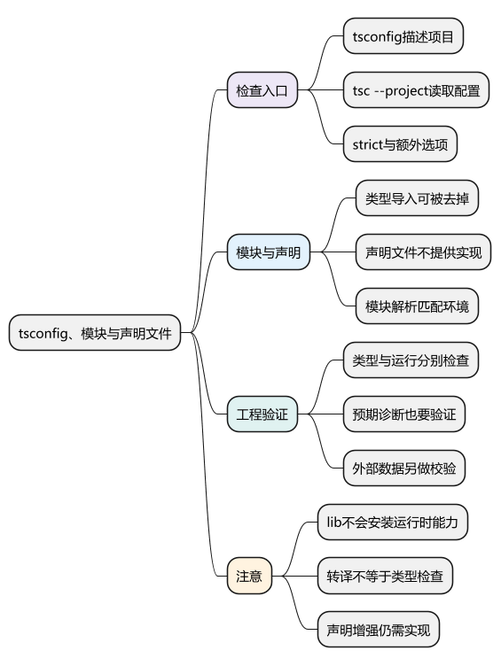
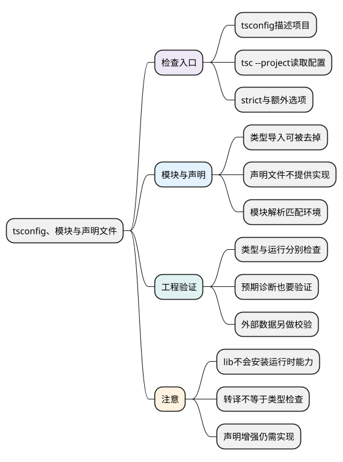

# tsconfig、模块与声明文件

<!-- core-mindmap:start -->
[](examples/ts15-mindmap.svg)

<details>
<summary>PlantUML 源码</summary>



</details>

<!-- core-mindmap:end -->

**口述总览：** tsconfig 用来告诉 TypeScript 检查哪些文件、允许哪些语法和类型，以及怎样处理模块。类型检查、转换 JavaScript 和运行代码是不同步骤；声明文件只描述已有能力，不会替你实现它。先把项目检查跑通，再调整适合运行环境的选项。

本篇接前面的基础与类型工具。示例采用 TypeScript 5.9.3；配置是否合适还取决于浏览器、Node 或构建工具。本篇的 Bundler 配置用于前端构建环境，不直接当作 Node 项目的通用配置。

<a id="k01"></a>

## 建立检查入口：tsconfig.json 与 tsc

在项目中安装 TypeScript，把源文件放进 src，再用配置文件统一检查。这样编辑器、终端和持续集成才能使用一致规则。

```sh
npm install --save-dev typescript@5.9.3
npx tsc --init
npx tsc --project tsconfig.json --noEmit
```

第一条固定教学版本；第二条生成配置，已有配置时不需要重复执行；第三条检查项目，不生成 JavaScript。出现错误时，按文件、位置和诊断信息修正，再重新检查。

下面是一个简化的前端检查配置，适用于后续由构建工具处理模块的项目：

```json
{
  "compilerOptions": {
    "target": "ES2022",
    "module": "ESNext",
    "moduleResolution": "Bundler",
    "lib": ["ES2022", "DOM"],
    "strict": true,
    "noUncheckedIndexedAccess": true,
    "exactOptionalPropertyTypes": true,
    "noEmit": true,
    "isolatedModules": true
  },
  "include": ["src/**/*.ts"]
}
```

- target 指定语法输出目标；它不会自动给运行时补齐缺失 API。
- lib 提供可用 API 的类型声明。加入 DOM 不会让 Node 真正拥有 document。
- module 决定模块输出形式，moduleResolution 决定怎样查找导入目标。前端构建器与 Node 直接运行的解析规则可能不同。
- strict 开启一组严格检查，例如空值和隐式 any 检查；上面两项额外检查不由 strict 自动全部包含。
- noEmit 表示只检查不生成文件；include 决定入口文件范围，导入关系还会把依赖带进项目。

命令使用 --project 读取这份配置。直接把某个文件名交给 tsc 时，不会自动套用同目录 tsconfig 的全部设置；验证项目时应明确入口。

### 配置怎样改变你看到的错误

<!-- example: ts15-strict-options -->
```ts
const scores: Record<string, number> = {};
const missing = scores['missing'];
console.log(missing === undefined); // true

type Settings = { label?: string };
const settings: Settings = {};
if (false) {
  // @ts-expect-error 启用 noUncheckedIndexedAccess 后，结果可能不存在。
  const score: number = scores['missing'];
  // @ts-expect-error 启用 exactOptionalPropertyTypes 后，缺失不等于显式 undefined。
  settings.label = undefined;
}
```

配置不会改变这个对象实际保存的内容，而是让检查器提醒未证明存在的值。不要通过关闭检查来掩盖真实的数据缺失；先确认业务允许什么，再修改类型或处理分支。

<a id="k02"></a>

## 分清三个步骤：类型检查、转译与运行

**口述：** 类型检查分析代码关系；转译把语法转换为目标代码；运行才会执行真正的读写和请求。有的开发工具只做转译，所以页面能打开不代表类型检查已经通过。

Vite 等工具的构建流程不能自动替代完整 tsc 检查；Vue 单文件组件还需要配套的 vue-tsc。具体配置见[Vue 与 TypeScript 应用](17_Vue与TypeScript应用.md)。

普通注解和 interface 在输出中被去掉，class、普通 enum 等则有运行时部分。需要观察实际结果时，可以在独立练习目录关闭 noEmit，设置 outDir，再运行生成的 JavaScript；不要把类型声明当作运行时校验。

noEmitOnError 控制出现类型错误时是否仍输出代码。skipLibCheck 跳过声明文件检查，并不意味着项目整体正确；采用它时仍要管理依赖版本和库之间的兼容性。

<a id="k03"></a>

## 导入类型与声明能力：import type、declare、.d.ts

### import type：只建立类型侧的关系

下面两段放在同一个项目的不同文件中，先用 tsc 检查，再由适配的构建流程执行入口。

<!-- example: ts15-type-module -->
```ts
// 文件：user.ts
export interface User {
  id: string;
  name: string;
}
```

<!-- example: ts15-type-app -->
```ts
// 文件：app.ts
import type { User } from './user.js';
const user: User = { id: 'u1', name: 'Lin' };
console.log(user.name); // Lin
```

这里的 User 只用于描述变量，输出的 JavaScript 不需要读取它。路径中的 .js 表达输出模块的扩展名；TypeScript 能按相应解析规则关联源 .ts。真实项目应让路径、包 exports、构建工具与目标运行方式保持一致。

export type 同样用于只导出类型。verbatimModuleSyntax 会让类型导入和普通导入的区别更明确；采用它时也要匹配模块格式，不能盲目复制配置。

### declare 与 .d.ts：描述已经存在的实现

<!-- example: ts15-ambient-contract -->
```ts
declare function externalFormat(value: number): string;
if (false) {
  const text: string = externalFormat(7);
  // @ts-expect-error 声明要求数字参数。
  externalFormat('7');
  console.log(text);
}
```

这段只验证声明能约束调用，不运行 externalFormat。.d.ts 可以集中保存这样的声明，但函数必须由真实模块或运行环境提供；单独写 declare 不会生成函数体。

模块增强用于补充已有模块的类型。给接口声明一个新方法，只会影响检查器；如果使用这个方法，还必须有对应运行时实现，且不能覆盖原有契约产生冲突。

<a id="k04"></a>

## 项目验收：配置、类型和实际行为一起检查

迁移旧 JavaScript 项目时，优先处理接口输入、公共组件和核心数据。内部局部变量能推断时就利用推断，暂时需要断言的位置注明依据，避免把未知输入直接变成 any。

可以把检查步骤放进 package.json：

```json
{
  "scripts": {
    "typecheck": "tsc --noEmit -p tsconfig.json"
  }
}
```

执行 npm run typecheck 得到检查结果，再执行项目已有的测试与构建。一个完整验收至少确认：合法写法通过、预期错误被发现、运行时数据经过必要校验、关键交互和错误路径正确。预期失败用 @ts-expect-error 并说明原因；当该行不再报错时，检查器会提醒这条注释失效。

配置细节可以按项目查阅，关键是能说明每项检查提供什么保证。模块加载和构建原理引用 [JavaScript 模块化](../01_JavaScript/05_模块化与浏览器实践/01_模块化.md)，不需要在这里重新背一套运行模型。

<a id="summary"></a>

复习时先确认项目运行在哪里，再解释检查、转译、模块解析和声明文件各自负责什么。能构建、类型检查通过和业务运行正确，需要分别验证。

<a id="interview"></a>

## 试题与答案

<a id="ts15-01"></a>

### TS15-01 [P1·工程取舍] 模块增强只写声明就能增加方法吗？

**回答：** 不能。模块增强补充的是类型描述，不会生成函数体或修改运行时对象。需要真实实现与增强后的声明一致，并测试新增能力。

<a id="ts15-02"></a>

### TS15-02 [P0·工程取舍] target、lib、moduleResolution分别负责什么？

**回答：** target 决定输出语法目标，lib 提供环境 API 的类型声明，moduleResolution 决定怎样解析导入。它们都必须匹配真实运行与构建环境；类型里声明有 document，不会让 Node 自动拥有 DOM。

<a id="ts15-03"></a>

### TS15-03 [P1·原理] 声明文件与import type会产生运行时代码吗？

**回答：** import type 和普通类型声明通常在输出时去掉；.d.ts 只描述形状，不提供实现。class、enum 等运行时结构需另看输出，不能概括成所有 TS 语法都不产生代码。

<a id="ts15-04"></a>

### TS15-04 [P0·工程取舍] TypeScript项目应怎样验收？

**回答：** 在选定配置下做类型检查，验证合法与预期非法写法，再检查外部数据校验、模块运行和实际交互。构建成功只证明对应构建步骤完成，不能代替这些证据。

参考：[TypeScript 配置](https://www.typescriptlang.org/tsconfig/)、[声明文件](https://www.typescriptlang.org/docs/handbook/declaration-files/introduction.html)。
