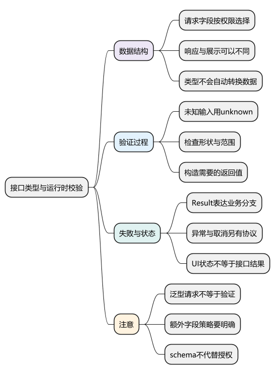
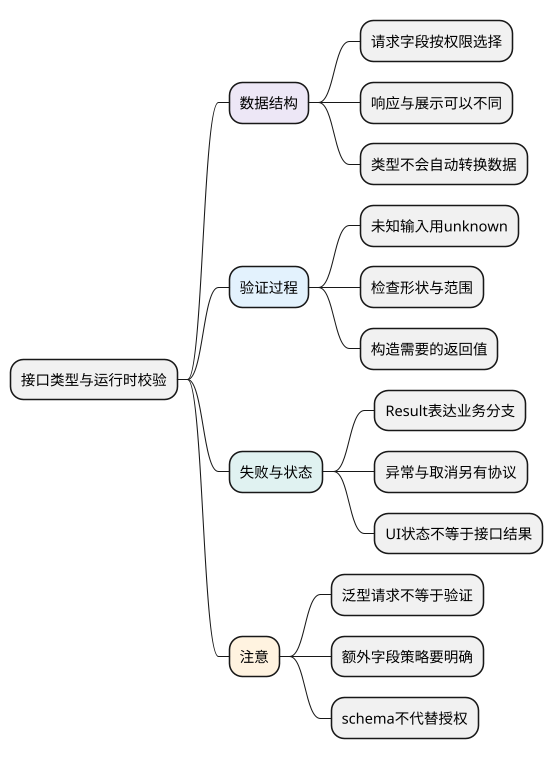

# 接口类型与运行时校验

<!-- core-mindmap:start -->
[](examples/ts16-mindmap.svg)

<details>
<summary>PlantUML 源码</summary>



</details>

<!-- core-mindmap:end -->

**口述总览：** TypeScript 可以描述接口应该返回什么，却不会检查服务器这次真正返回的内容。先把外部数据看作 unknown，再检查字段与业务范围，最后返回应用可以使用的结构。类型定义、实际转换和错误处理需要一起设计。

本篇先处理最常见的用户接口，再区分请求数据、响应数据和界面状态。所有独立 TypeScript 例子使用严格检查；出现 fetch 的例子只调用本地解析函数验证，不会向真实服务发出请求。

<a id="k01"></a>

## 先描述数据：请求、响应与页面需要的结构

接口约定不只是字段名字，还包括哪些字段必填、能否为空、时间和金额怎样编码。JSON 里的日期通常是字符串；写成 Date 类型不会自动把字符串变成 Date 对象。

DTO 可以理解为“接口传输的数据结构”。写入请求只带允许修改的字段，响应只带允许公开的字段；页面还可能需要格式化后的显示值。几个结构可以共享稳定片段，但不必强行使用同一个类型。

<!-- example: ts16-model-shapes -->
```ts
type UpdateName = { name: string };
type UserResponse = { id: string; name: string; createdAt: string };
type UserCard = { id: string; label: string };

function toCard(user: UserResponse): UserCard {
  return { id: user.id, label: user.name.trim() };
}
const request: UpdateName = { name: 'Lin' };
console.log(toCard({ id: 'u1', name: ' Lin ', createdAt: '2026-01-01T00:00:00Z' }).label);
// Lin
if (false) {
  // @ts-expect-error 更新名字的请求没有权限字段。
  const wrong: UpdateName = { name: 'Lin', role: 'admin' };
}
```

toCard 实际构造了新结果，只交付两个字段。TypeScript 可以提醒代码传错字段，但客户端的类型定义不能约束恶意请求；后端仍要做字段白名单、权限和业务校验。

<a id="k02"></a>

## 检查未知输入：先验证，再返回类型

**口述：** unknown 表示现在还没有证明数据是什么。校验函数实际检查对象、字段类型和取值范围；成功时返回明确结构，失败时抛错或返回约定的失败结果。

<!-- example: ts16-parse-user -->
```ts
type User = { id: string; name: string };
function parseUser(value: unknown): User {
  if (value === null || typeof value !== 'object' || Array.isArray(value) ||
      !('id' in value) || typeof value.id !== 'string' || value.id.trim() === '' ||
      !('name' in value) || typeof value.name !== 'string' || value.name.trim() === '') {
    throw new TypeError('invalid user payload');
  }
  return { id: value.id, name: value.name.trim() };
}
console.log(JSON.stringify(parseUser({ id: 'u1', name: ' Lin ', extra: true })));
// {"id":"u1","name":"Lin"}
for (const candidate of [null, { id: 'u1' }, { id: 1, name: 'Lin' }, { id: 'u1', name: ' ' }]) {
  try { parseUser(candidate); }
  catch (error) { console.log(error instanceof TypeError); } // 四次 true
}
```

第一步排除 null、数组和非对象；第二步检查字段；最后只保留应用需要的字段。这里接受未知额外字段并丢弃它们，是本例选择的策略；有些写入接口会选择拒绝额外字段，应按接口约定决定。

### 接到 fetch：每一步失败都有自己的来源

<!-- example: ts16-fetch-boundary -->
```ts
type User = { id: string };
function parseUser(value: unknown): User {
  if (value === null || typeof value !== 'object' ||
      !('id' in value) || typeof value.id !== 'string') {
    throw new TypeError('invalid id');
  }
  return { id: value.id };
}
async function loadUser(id: string): Promise<User> {
  const response = await fetch('/api/users/' + encodeURIComponent(id));
  if (!response.ok) throw new Error('HTTP ' + response.status);
  const incoming: unknown = await response.json();
  return parseUser(incoming);
}
console.log(parseUser({ id: 'u1' }).id); // u1；本例没有调用 loadUser
```

请求失败、HTTP 状态不成功、响应体读取或 JSON 解析失败、字段校验失败是不同阶段。给包装函数写 fetchData<User>()，如果里面只做 as User，就没有真正验证任何字段。

结构复杂时可以采用运行时 schema 库，并尽量从同一份规则推导静态类型；仍需确认它是否检查格式、范围、未知字段和嵌套结构。用真实非法输入测试规则，不能只看编辑器没有报错。

<a id="k03"></a>

## 表达预期失败：Result 与异常怎样分工

<!-- example: ts16-result -->
```ts
type Result<T> =
  | { ok: true; data: T }
  | { ok: false; code: 'NOT_FOUND' | 'FORBIDDEN'; message: string };
function show(result: Result<{ name: string }>): string {
  return result.ok ? result.data.name : result.message;
}
console.log(show({ ok: true, data: { name: 'Lin' } })); // Lin
console.log(show({ ok: false, code: 'NOT_FOUND', message: '用户不存在' }));
// 用户不存在
```

ok 让调用者先区分成功与失败，再访问各自字段。这适合约定好的业务分支；网络中断、代码缺陷等仍可能抛异常，必须约定调用方怎样处理。不要 catch 所有异常后伪造成功结果。

界面还有 loading、旧请求、取消等状态，不一定与服务端 Result 一一对应。判别联合能提醒遗漏分支，但请求版本检查、取消信号和服务端幂等仍要由真正的代码实现。详见[判别联合与状态建模](14_判别联合与状态建模.md)。

<a id="k04"></a>

## 进阶：校验通过后，还要检查操作是否允许

接口参数形状正确，不代表当前用户有权访问相应资源。例如 userId 是字符串，只证明了一个类型事实；是否能修改这个用户，需要服务端授权。

AI 工具调用也是外部输入：工具名称必须来自允许的注册项，参数要经过实际校验，再检查用户、资源和业务条件，才能执行。模型侧的结构化输出或前端类型声明都不能代替服务端检查。

复习本篇时，先用普通接口把“未知数据 → 已检查结果”走通。AI Tool、复杂 schema 生成和幂等协议属于深入应用，可以在 Java 与 AI 项目中继续验证，不要求先掌握它们才能写基础 TypeScript。

<a id="summary"></a>

沿着未知输入 → 检查字段与范围 → 构造业务结果 → 处理成功失败的顺序复述。类型告诉开发者可以怎样使用数据，实际校验和授权确认这次数据与操作是否有效。

<a id="interview"></a>

## 试题与答案

<a id="ts16-01"></a>

### TS16-01 [P0·原理] `fetch<User>`为什么不等于验证了User？

**回答：** 泛型只表达调用方期望；若实现只是断言，运行时没有检查。把响应当作 unknown，经过字段与范围校验后再返回 User，才有真实的验证过程。

<a id="ts16-02"></a>

### TS16-02 [P0·工程取舍] DTO、Entity、展示模型能否总用一个类型？

**回答：** 不能总共用。写入权限、公开字段、传输编码和展示需求不同，可以复用稳定字段，再分别定义和转换结构。类型上删掉字段不等于服务器或 JSON 里真的删掉。

<a id="ts16-03"></a>

### TS16-03 [P1·原理] `Result<T>`能代替所有异常吗？

**回答：** 不能。Result 适合明确的业务分支，网络和代码异常仍需要处理；取消也要按接口协议表达。团队应说明哪些失败返回 Result、哪些失败抛错，调用方再正确收窄。

<a id="ts16-04"></a>

### TS16-04 [P1·工程取舍] 模型工具参数通过schema后可以直接执行吗？

**回答：** 不能。还要验证调用者对资源的权限、业务前提、重复执行和必要确认。schema 主要检查数据形状与已定义约束，不等于授权。

参考：[TypeScript 收窄](https://www.typescriptlang.org/docs/handbook/2/narrowing.html)。
