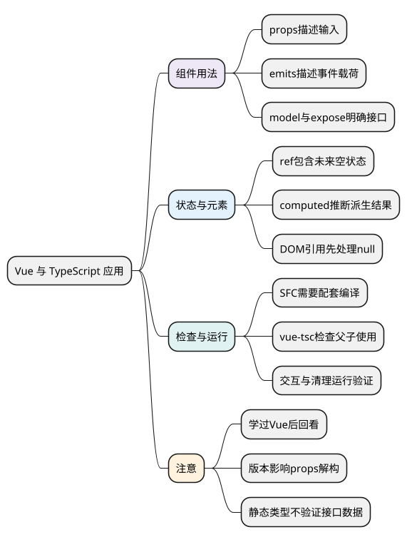

# Vue 与 TypeScript 应用

<!-- core-mindmap:start -->
[](examples/ts17-mindmap.svg)

<details>
<summary>PlantUML 源码</summary>



</details>

<!-- core-mindmap:end -->

**口述总览：** Vue 中使用 TypeScript，先给组件接收的数据和发出的事件写清类型，再处理响应式状态和 DOM 引用。类型检查能发现部分父子组件使用错误，实际交互仍要运行验证。先学会基础 Vue 用法，再用类型把已有使用规则表达出来。

**阅读前提：** 本篇是 TypeScript 与后续 Vue 的衔接篇，可以在完成 Vue 3 基础后回看，不作为先学 Vue 2 或 Vue 3 的门槛。示例固定 Vue 3.5.43、TypeScript 5.9.3，SFC 类型检查使用 vue-tsc 3.1.1；这些是验证版本，不代表只能使用这些版本。

<a id="k01"></a>

## 描述组件输入和输出：props 与 emits

单文件组件用 script setup lang="ts" 编写类型。defineProps 和 defineEmits 是编译宏，不需要从 vue 导入，也不能当作普通 Node 函数直接运行。

先创建 ChildCounter.vue，接收标题和计数，并用事件把加一后的值交回父组件：

<!-- example: ts17-child-counter -->
```vue
<script setup lang="ts">
const props = withDefaults(defineProps<{
  title: string
  count?: number
}>(), { count: 0 })
const emit = defineEmits<{ change: [value: number] }>()
function increment() {
  emit('change', props.count + 1)
}
</script>

<template>
  <button type="button" @click="increment">{{ title }}：{{ count }}</button>
</template>
```

title 必传，count 可省略，默认值为 0；change 事件要求携带一个数字。组件通过事件请求父组件改变状态，类型没有把 props 变成允许随意修改的本地状态。

### 双向输入：用 defineModel 连接值和更新事件

另建 NameField.vue：

<!-- example: ts17-name-field -->
```vue
<script setup lang="ts">
const name = defineModel<string>({ required: true })
function clear() { name.value = '' }
defineExpose({ clear })
</script>

<template>
  <input v-model="name" aria-label="姓名">
</template>
```

defineModel 声明字符串模型，父组件需要提供它；defineExpose 决定父组件通过组件引用能使用哪些成员。模型的默认值要与父侧初始化协调，不能只在子组件生成一个默认值，就认为两边状态一定同步。

父组件 App.vue 同时使用这两个组件：

<!-- example: ts17-parent-app -->
```vue
<script setup lang="ts">
import { ref } from 'vue'
import ChildCounter from './ChildCounter.vue'
import NameField from './NameField.vue'
const count = ref(0)
const name = ref('Lin')
function setCount(value: number) { count.value = value }
</script>

<template>
  <ChildCounter title="次数" :count="count" @change="setCount" />
  <NameField v-model="name" />
  <p>{{ name }}：{{ count }}</p>
</template>
```

点击计数按钮会发出数字事件，父组件更新 count；输入框通过 v-model 更新 name。类型检查可以验证父组件传参和事件载荷；点击、输入、焦点与渲染结果仍需组件或浏览器测试。本轮这里提供的是编译与类型检查示例。

Vue 3.5 支持同一 script setup 内的响应式 props 解构，但把解构后的当前值传给外部函数，仍不是传入持续读取来源。需要监听时可传 getter 等，并区分 Vue 版本。

<a id="k02"></a>

## 描述响应式状态：先考虑当前值和未来值

<!-- example: ts17-reactive-state -->
```ts
import { ref, reactive, computed } from 'vue';
type User = { id: string; name: string };
const selected = ref<User | null>(null);
const form = reactive({ name: '', age: 0 });
const valid = computed(() => form.name.trim().length > 0);
console.log(selected.value === null, valid.value); // true false
selected.value = { id: 'u1', name: 'Lin' };
form.name = selected.value.name;
console.log(valid.value, selected.value.name); // true Lin
if (false) {
  // @ts-expect-error 普通 computed 的结果只读。
  valid.value = false;
}
```

selected 初始没有用户，类型包含 null；之后才能赋用户对象。reactive 从初始属性推断，computed 从 getter 结果推断为布尔值。

不要用 as User 把尚未取得的数据伪装成完整用户。reactive 的返回类型涉及深层 ref 解包，复杂泛型不一定等于原始输入 T；先从明确对象开始，再分析需要的泛型关系。

<a id="k03"></a>

## 处理元素和事件：引用可能为空，事件目标需要检查

<!-- example: ts17-dom-types -->
```ts
import { ref } from 'vue';
const input = ref<HTMLInputElement | null>(null);
function focusInput() { input.value?.focus(); }
function onInput(event: Event) {
  const target = event.target;
  if (target instanceof HTMLInputElement) console.log(target.value);
}
```

这是浏览器组件中的脚本片段，只做类型检查；把 input 关联到模板元素后，在挂载等合适时机调用 focusInput。挂载前、卸载后、v-if 移除时都可能为空，非空断言 ! 不会在运行时等待元素出现。

事件 target 可能不是预想的元素，先检查再读 value。组合式函数同样要说明接收的是值、ref 还是 getter，类型和实际读取方式保持一致；相关 Vue 使用规则在后续框架专题展开。

<a id="k04"></a>

## 检查完整组件：vue-tsc 与运行验证

在包含上述 .vue 文件的项目中安装配套工具，并在现有 tsconfig 的 include 中包含 .vue 文件。例如验证本篇基线：

```sh
npm install vue@3.5.43
npm install --save-dev typescript@5.9.3 vue-tsc@3.1.1
npx vue-tsc --noEmit -p tsconfig.json
```

vue-tsc 检查 SFC 脚本和模板使用；单独转译 script 标签或 Vite 构建成功不能证明父子类型正确。试着把父组件的 count 改成字符串，检查器应在组件使用位置报告类型不匹配，再恢复正确写法。

类型通过后，还要运行组件验证默认值、事件、v-model、条件移除与卸载清理。若接口数据来自服务器，先经过上一章的运行时校验，再交给组件；props 类型不保证外部数据真实有效。

<a id="summary"></a>

先给组件的输入和输出写类型，再处理响应式值与 DOM 引用的空状态，最后验证父子使用和模板。Vue 的类型检查与浏览器交互检查共同覆盖使用过程。

<a id="interview"></a>

## 试题与答案

<a id="ts17-01"></a>

### TS17-01 [P0·基础] defineProps等宏为什么不能直接在普通TS文件调用？

**回答：** 这些宏由 SFC 编译器识别并转换，需要位于支持的组件上下文。普通 TS 文件没有这个编译过程，不能直接作为运行时 API 调用。

<a id="ts17-02"></a>

### TS17-02 [P0·原理] ref(null)后想保存User应怎样写？

**回答：** 按真实状态声明 ref<User | null>(null)。未取得数据时保留 null，读取先处理空值；后续赋有效 User。不要通过断言伪造一个已经存在的用户。

<a id="ts17-03"></a>

### TS17-03 [P1·原理] Vue 3.5的props解构是否永远保持响应式？

**回答：** 不是。3.5 对同一 script setup 的相关读取做编译转换，但传给外部函数的当前值仍可能失去持续响应关系。需要根据接口传 getter/ref，并确认编译版本。

<a id="ts17-04"></a>

### TS17-04 [P0·工程取舍] Vite构建成功为何还要vue-tsc？

**回答：** 构建与完整 SFC 类型检查是不同步骤。vue-tsc 能检查脚本和模板中的使用关系，应纳入检查流程；它也不能替代运行交互验证。

<a id="ts17-05"></a>

### TS17-05 [P0·原理] DOM模板引用为什么应包含null？

**回答：** 元素可能尚未挂载，也可能因条件变化或卸载而消失。null 表达这个生命周期事实，访问前检查或安排合适时机；非空断言不会生成保护逻辑。

参考：[Vue 与 TypeScript](https://vuejs.org/guide/typescript/composition-api.html)、[script setup](https://vuejs.org/api/sfc-script-setup.html)。
