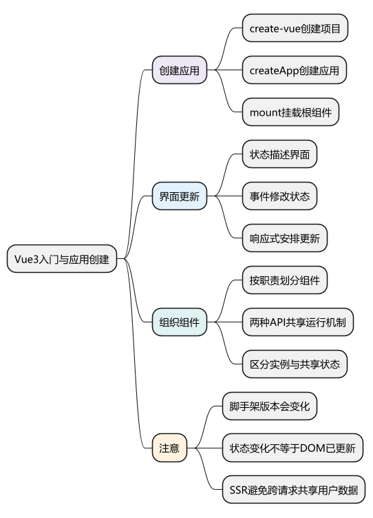
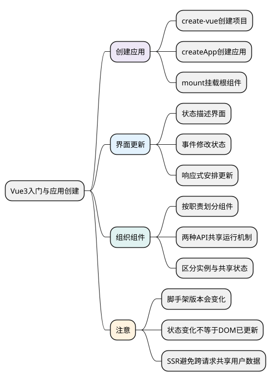

# Vue3入门与应用创建

<!-- core-mindmap:start -->
[](examples/vue01-mindmap.svg)

<details>
<summary>PlantUML 源码</summary>



</details>

<!-- core-mindmap:end -->

**口述总览：** Vue 是用于构建用户界面的框架。我们用模板描述界面，用响应式数据保存状态，用组件划分职责；数据变化后，Vue 会安排相关界面更新。先能创建项目、写组件、处理交互，再学习响应式、调度和渲染原理。

本系列示例以 **Vue 3.5.43、单文件组件和 TypeScript** 为验证基线。带版本要求的 API 会单独标注；这不表示所有 Vue 3 项目都必须升级到这个版本。

## 创建项目：获得可以运行的开发环境

在已经安装兼容 Node.js 版本的终端执行：

```bash
npm create vue@latest
```

按提示输入项目名，例如 `vue-review`，选择 TypeScript。Router、Pinia、测试等选项可以按当前练习选择，基础练习不依赖一次装齐所有功能。

进入生成的项目后执行：

```bash
cd vue-review
npm install
npm run dev
```

`npm create vue@latest` 使用当时最新的 create-vue 脚手架，生成的 Vue 和 Node.js 要求可能变化。应以生成的 `package.json`、锁文件及官方环境要求为准，不能把本文的 3.5.43 基线理解成脚手架永远安装该版本。

先认识几个实际会修改的位置：

- `src/main.ts`：创建应用，安装插件并挂载。
- `src/App.vue`：根组件，通常组织整体布局或路由出口。
- `src/components/`：放置可复用的组件。
- `index.html`：提供应用挂载容器，Vite 开发时从入口加载代码。
- `package.json`：依赖及开发、构建、检查命令。

构建工具负责处理 `.vue`、TypeScript 和资源；浏览器最终执行的是转换后的 JavaScript、CSS 和 HTML。

## createApp() 与 mount()：把根组件显示到页面

`createApp(rootComponent, rootProps?)` 接收根组件及可选的根组件属性，返回应用实例。应用实例提供 `use()`、`component()`、`provide()` 等配置入口。

`app.mount(container)` 接收选择器或 DOM 容器，挂载根组件，并返回根组件公开实例。通常在挂载前完成插件安装。同一个应用实例只能挂载一次；需要卸载时调用 `app.unmount()`。

以下两个文件配合脚手架默认的 `<div id="app"></div>` 即可运行。

<!-- example: vue01-main -->
<!-- project: vue01-start; file: main.ts -->
```ts
import { createApp } from 'vue'
import App from './App.vue'

const app = createApp(App)
app.mount('#app')
```

<a id="k01"></a>

<!-- example: vue01-counter -->
<!-- project: vue01-start; file: App.vue -->
```vue
<script setup lang="ts">
import { computed, ref } from 'vue'

const count = ref(0)
const doubled = computed(() => count.value * 2)

function increment() {
  count.value += 1
}
</script>

<template>
  <main>
    <h1>计数练习</h1>
    <button type="button" @click="increment">增加一次</button>
    <p>次数：{{ count }}</p>
    <p>两倍：{{ doubled }}</p>
  </main>
</template>
```

点击按钮时，函数修改 `count.value`。模板中的 `count` 和 `doubled` 随之更新；模板会解包这里的顶层 ref，因此不写 `.value`。

这里先记住各部分的用途：`ref` 保存可变状态，`computed` 根据状态得到新值，`@click` 处理点击。具体 API 在后续文章展开。

## 声明式界面：描述结果和状态之间的关系

上例没有在每次点击后手动查找 `<p>` 并修改文本，而是描述“文本等于当前次数”。这种写法称为声明式界面。

理解一次更新可以沿着以下顺序：

1. 初次渲染读取 `count` 和 `doubled`。
2. 用户点击按钮，事件处理函数同步修改状态。
3. Vue 根据已有依赖安排相关更新。
4. 更新过程生成新的渲染结果，并修改必要的 DOM。

**状态修改和 DOM 更新不是同一个时刻。** 状态赋值立即生效，组件更新通常会批量安排；需要等本次 DOM 更新完成时使用 `nextTick()`，后续专篇说明。

声明式不代表没有开销。计算逻辑、组件更新、DOM 操作、布局和绘制仍然会发生，性能问题要结合实际测量定位。

## 组件：按职责划分界面与交互

组件可以理解为带有输入、输出和内部状态的界面单元。例如搜索框接收初始值，发出搜索意图；用户列表接收数据，发出选择事件。

常见的组件关系是：

- 父组件通过 props 传入数据。
- 子组件通过事件报告交互结果。
- 父组件通过插槽提供一部分显示内容。
- 组件内部维护只属于自己的临时状态。

不必把每个标签都拆成组件。出现独立职责、重复使用、复杂交互或需要单独验证的边界时，再考虑抽取。

<a id="k03"></a>

## Options API 与 Composition API：组织逻辑的两种方式

Options API 把逻辑放到 `data`、`methods`、`computed`、`watch` 等选项中，适合按选项理解组件。下面是与前面类似的完整计数组件。

<!-- example: vue01-options -->
```vue
<script lang="ts">
import { defineComponent } from 'vue'

export default defineComponent({
  data() {
    return { count: 0 }
  },
  computed: {
    doubled(): number {
      return this.count * 2
    }
  },
  methods: {
    increment() {
      this.count += 1
    }
  }
})
</script>

<template>
  <button type="button" @click="increment">{{ count }} / {{ doubled }}</button>
</template>
```

Composition API 通过 `ref`、`computed`、生命周期钩子等函数组织逻辑，便于把同一个功能的状态和操作放在一起，再提取成组合式函数。

**两者使用同一套组件与响应式系统。** Composition API 不会自动让所有业务代码更快；选择它主要是为了逻辑组织、复用和类型推导。本系列以 `<script setup lang="ts">` 为主，也保留识别 Options API 的能力。

## 实例状态与模块状态：决定数据是否共享

`<script setup>` 的组件逻辑通常为每个实例执行，里面创建的 `ref` 一般属于该实例。两个计数组件默认可以拥有各自的次数。

如果把可变状态放进普通模块顶层再导出，导入者通常会共享同一份状态。共享主题可能合理；用户表单草稿无意共享就可能造成串值。

服务端渲染中还要注意模块可能在多个请求间复用，不能把每个用户的私有状态放进长期共享的模块对象。服务端渲染是把组件输出成 HTML；浏览器随后接管交互的过程称为水合，详细机制放在进阶内容中。

## 工程追问：会创建页面之后，还要能验证什么

先验证“点击后数据与页面一致”“两个实例互不干扰”“重新进入页面的状态符合预期”。再用开发工具查看组件、props 和状态变化，确定变化来自哪个事件或动作。

基础阶段至少完成一个带搜索、列表和详情的页面。后续每学一个知识点，就为这个页面补充明确功能，不要只把 API 例子抄成互不相干的片段。

<a id="interview"></a>

## 试题

<a id="vue01-01"></a>

### VUE01-01 [P0·原理] Vue 的声明式 UI 具体是什么意思？

**回答：** 用状态和模板描述界面应该显示什么。组件渲染时读取响应式数据并建立依赖，状态改变后 Vue 安排更新 DOM。开发者不需要为每一次状态变化手工操作节点，但仍要负责数据归属、交互逻辑和资源清理。

<a id="vue01-03"></a>

### VUE01-03 [P1·工程取舍] Composition API 比 Options API 本质上更快吗？

**回答：** 不能这样概括。两者都使用 Vue 的组件与响应式系统，主要区别是逻辑组织方式。Composition API 更方便把同一功能放在一起并抽取复用，实际性能仍取决于依赖范围、计算量、组件更新和浏览器工作。

<a id="vue01-05"></a>

### VUE01-05 [P0·基础] createApp 和 mount 分别做什么？

**回答：** createApp 根据根组件创建应用实例，提供安装插件和应用级配置的入口；mount 把根组件挂载到指定容器，开始显示和处理交互。通常先完成插件安装，再执行挂载。应用实例和组件实例是不同概念。

<a id="vue01-06"></a>

### VUE01-06 [P1·工程取舍] 为什么两个组件实例可能意外共享状态？

**回答：** 要检查状态是不是在模块顶层创建后被共同导入。组件 setup 内创建的状态通常属于当前实例，模块导出的对象则可能被多个实例共同使用。先确定是否需要共享，再选择实例状态、上层状态或 Store；服务端渲染还要避免跨请求共享用户数据。

参考：[Vue 快速上手](https://cn.vuejs.org/guide/quick-start.html) · [创建应用](https://cn.vuejs.org/guide/essentials/application.html) · [组合式 API 常见问答](https://cn.vuejs.org/guide/extras/composition-api-faq.html)

[返回目录](00_目录.md) · 下一篇：[SFC、setup 与 script setup](<02_SFC、setup与script setup.md>)
