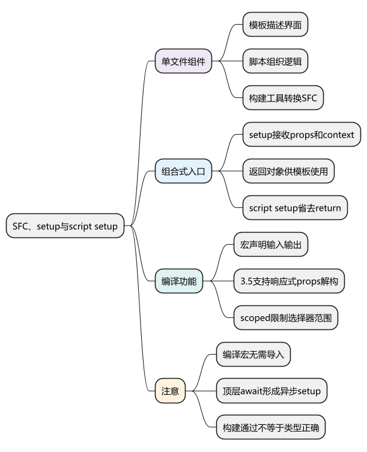
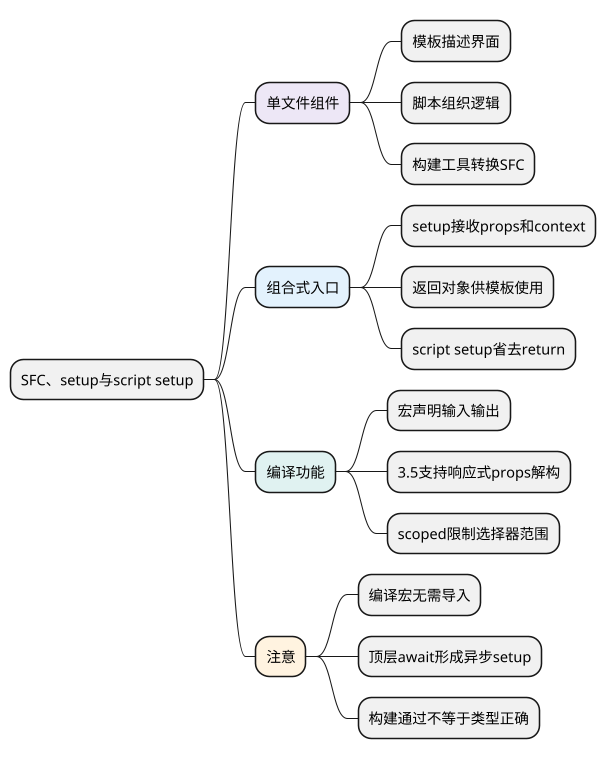

# SFC、setup与script setup

<!-- core-mindmap:start -->
[](examples/vue02-mindmap.svg)

<details>
<summary>PlantUML 源码</summary>



</details>

<!-- core-mindmap:end -->

**口述总览：** SFC 是 `.vue` 单文件组件，把模板、脚本和样式放在一起。`setup()` 是组合式 API 的运行入口，`<script setup>` 是让这套写法更简洁的编译语法。先分清模块执行和组件实例执行，再理解 props、事件和编译宏。

<a id="k01"></a>

## SFC：用 template、script、style 组织组件

下面是可直接替换 `App.vue` 的完整组件。组件导入、响应式状态和函数都能在模板中直接使用。

<!-- example: vue02-sfc -->
```vue
<script setup lang="ts">
import { ref } from 'vue'

const open = ref(false)

function toggle() {
  open.value = !open.value
}
</script>

<template>
  <section class="panel">
    <button type="button" @click="toggle">{{ open ? '收起' : '展开' }}</button>
    <p v-if="open">组件内部的内容</p>
  </section>
</template>

<style scoped>
.panel {
  padding: 12px;
  border: 1px solid #ccc;
}
</style>
```

构建工具里的 Vue 插件会处理这个文件：模板被编译成渲染函数，TypeScript 类型被转换处理，样式按相应规则生成。浏览器不会直接理解 `.vue` 文件。

普通 `<script>` 的顶层属于模块作用域，通常随模块加载执行；`<script setup>` 的主体会成为组件 `setup` 的一部分，通常每个实例都会执行。导入语句仍属于模块机制。

## setup(props, context)：普通组合式入口

`setup(props, context)` 接收响应式的 props 对象和上下文。上下文提供 `attrs`、`slots`、`emit`、`expose`。返回对象时，其中的成员可供模板使用；也可以返回渲染函数。

下面使用普通 `setup`，展示同样的“输入 + 点击事件”组件。

<!-- example: vue02-runtime-setup -->
```vue
<script lang="ts">
import { computed, defineComponent } from 'vue'

export default defineComponent({
  props: {
    name: { type: String, default: '访客' }
  },
  emits: {
    greet: (name: string) => name.length > 0
  },
  setup(props, { emit, expose }) {
    const greeting = computed(() => `你好，${props.name}`)

    function greet() {
      emit('greet', props.name)
    }

    expose({ greet })
    return { greeting, greet }
  }
})
</script>

<template>
  <button type="button" @click="greet">{{ greeting }}</button>
</template>
```

`setup` 内不通过 `this` 读取组件状态。应直接使用参数和局部变量，而不是把它理解为“组件实例还没有创建，所以没有 this”；Vue 内部已经有组件实例，但这里不提供 Options API 风格的实例 `this`。

普通 `setup` 中解构 `props` 的基本类型属性，得到的是当时的值。需要保留后续变化时，使用 `props.name`、getter 或 `toRef`，不要照搬下面仅针对编译宏的转换规则。

<a id="k02"></a>

## script setup：省去注册与 return，使用编译宏

`<script setup>` 中导入的组件可以直接用于模板，顶层变量和函数也不用再写 `return`。编译宏由 Vue 编译器识别，**不需要从 `vue` 导入**，也不能当普通工具函数在任意 `.ts` 文件里调用。

- `defineProps()`：声明组件接收的 props，返回 props 对象。
- `defineEmits()`：声明组件事件，返回 `emit` 函数。
- `defineExpose()`：接收对象，指定父级通过组件引用可访问的成员。
- `defineModel()`：Vue 3.4+，声明组件模型并返回可读写的模型 ref。
- `defineOptions()`：Vue 3.3+，声明 `name`、`inheritAttrs` 等组件选项。
- `defineSlots()`：Vue 3.3+，为插槽提供类型描述，并返回 slots 对象。

这里使用类型式声明，组件可以单独显示；放入父组件后还可以接收 `name` 并监听 `greet`。

<!-- example: vue02-macros -->
```vue
<script setup lang="ts">
defineOptions({ name: 'GreetingButton' })

const props = withDefaults(defineProps<{
  name?: string
  disabled?: boolean
}>(), {
  name: '访客',
  disabled: false
})

const emit = defineEmits<{
  greet: [name: string]
}>()

function greet() {
  if (!props.disabled) emit('greet', props.name)
}

defineExpose({ greet })
</script>

<template>
  <button type="button" :disabled="props.disabled" @click="greet">
    你好，{{ props.name }}
  </button>
</template>
```

`withDefaults()` 配合类型式 `defineProps` 设置默认值；对象或数组默认值通常使用工厂函数，避免实例之间共享同一个可变对象。类型声明和运行时声明二选一，不要在同一次 `defineProps` 调用中同时写两套。

宏的某些配置会提升到模块范围，不能任意依赖实例运行时变量。TypeScript 类型也不能验证服务器返回的 JSON，外部数据仍要在入口检查。

<a id="k03"></a>

## props 解构与顶层 await：分清编译转换和异步运行

Vue 3.5+ 会在同一 `<script setup>` 中转换 `defineProps` 解构后的读取，使其仍指向对应的 prop；默认值也可以直接写在解构位置。

<!-- example: vue02-props-destructure -->
```vue
<script setup lang="ts">
import { computed, watch } from 'vue'

const { name = '访客' } = defineProps<{ name?: string }>()
const greeting = computed(() => `你好，${name}`)

watch(() => name, value => {
  console.log('姓名变化：', value)
})
</script>

<template>
  <p>{{ greeting }}</p>
</template>
```

这不等于所有 JavaScript 解构都变成响应式。Vue 3.4 及以前默认没有此转换，普通 `setup` 也不能直接套用。传给外部函数时，应传 getter 或 ref；传 `name` 的当前字符串仍只是一个值。

顶层 `await` 会让组件形成异步 `setup`，需要父级安排异步显示和错误处理。`<Suspense>` 可用于协调，但目前仍属于实验性特性，后文单独讲解。

使用 `<script setup>` 顶层 `await` 时，编译器会处理组件上下文恢复；不要把这一点推广成“任何普通 async 函数等待后都能随意注册生命周期”。

<a id="k04"></a>

## scoped 与 CSS Modules：控制样式生效范围

`<style scoped>` 通常通过给选择器和节点添加作用域标记，限制样式匹配范围，**不是 Shadow DOM**。

父组件的 scoped 样式可以影响子组件根节点，方便控制布局；子组件深层内部结构通常不直接匹配。需要特殊控制时：

- `:deep(.item)`：匹配子组件内部的目标元素。
- `:slotted(.item)`：匹配传入的插槽内容。
- `:global(.item)`：明确声明全局选择器。

下面展示 CSS Modules 的独立用法，类名由构建工具生成映射，通过 `$style` 使用。

<!-- example: vue02-css-modules -->
```vue
<script setup lang="ts">
const title = '组件样式'
</script>

<template>
  <h2 :class="$style.title">{{ title }}</h2>
</template>

<style module>
.title {
  color: #176b45;
}
</style>
```

## 工程追问：组件能编译，是否就代表类型和交互正确

不代表。构建工具可以转换 TypeScript，但未必完成全部类型检查；项目应配置 `vue-tsc` 检查脚本和模板类型，再验证实际交互。

升级 Vue 时，运行时、SFC 编译器、类型工具需要兼容。出现“某个宏不识别”“解构后不更新”时，先核对实际版本和代码位置，再判断是否写法错误。

样式方面，优先通过 props、CSS 变量和稳定的类名约定提供定制能力。大量 `:deep()` 依赖子组件内部节点，会使组件升级和结构调整更困难。

<a id="interview"></a>

## 试题

<a id="vue02-01"></a>

### VUE02-01 [P0·原理] script setup 与普通 setup 有什么区别？

**回答：** 普通 setup 是组件运行时的组合式入口，需要通过返回值向模板提供成员；script setup 是单文件组件的编译语法，顶层绑定直接供模板使用，并支持编译宏。两者都参与组件实例初始化，script setup 的主体不是只执行一次的模块代码。

<a id="vue02-02"></a>

### VUE02-02 [P0·基础] defineExpose 为什么有用？

**回答：** script setup 组件默认不向父级公开全部内部成员。defineExpose 用来指定父级通过模板引用可以调用什么，例如输入框的 focus。它让公开接口更明确，避免父组件依赖子组件所有内部状态；常规数据通信仍优先使用 props 和事件。

<a id="vue02-03"></a>

### VUE02-03 [P1·原理] scoped 是不是完全隔离 CSS？

**回答：** 不是。它主要通过编译后的作用域标记约束选择器，父级样式仍可能作用于子组件根节点，也有 deep、slotted、global 等特殊规则。它不同于 Shadow DOM，使用时要结合实际生成的选择器和节点判断。

<a id="vue02-04"></a>

### VUE02-04 [P1·工程取舍] 顶层 await 与 props 解构有什么版本注意？

**回答：** 顶层 await 会形成异步 setup，需要异步内容展示和错误处理方案。Vue 3.5 的响应式 props 解构是 script setup 编译转换，旧版和普通 setup 不能直接套用；传值给外部函数也不会自动保留响应式，应按约定传 getter 或 ref，并核对编译器和类型工具版本。

参考：[script setup](https://cn.vuejs.org/api/sfc-script-setup.html) · [setup()](https://cn.vuejs.org/api/composition-api-setup.html) · [SFC 样式](https://cn.vuejs.org/api/sfc-css-features.html)

上一篇：[Vue3 入门与应用创建](01_Vue3入门与应用创建.md) · 下一篇：[模板语法与指令](03_模板语法与指令.md) · [返回目录](00_目录.md)
