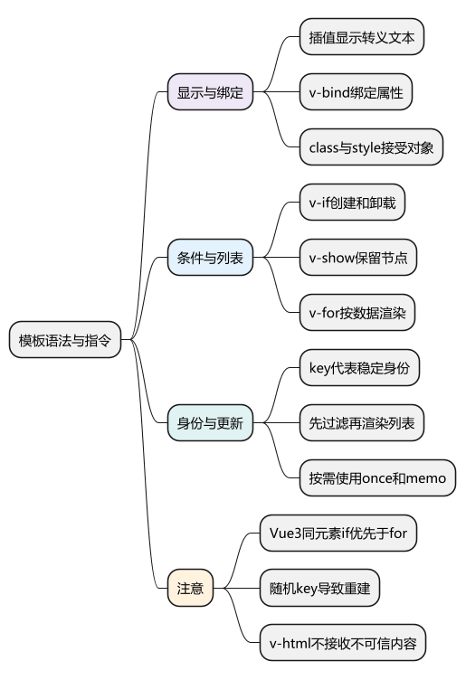
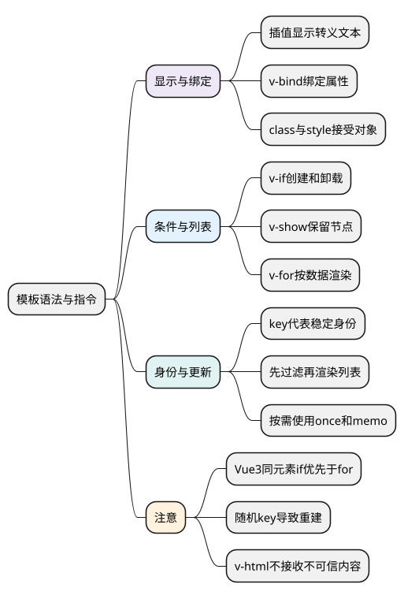

# 模板语法与指令

<!-- core-mindmap:start -->
[](examples/vue03-mindmap.svg)

<details>
<summary>PlantUML 源码</summary>



</details>

<!-- core-mindmap:end -->

**口述总览：** Vue 模板用 HTML 加表达式描述界面。插值负责显示文本，`v-bind` 绑定属性，`v-on` 监听事件，`v-if` 和 `v-show` 控制显示，`v-for` 渲染列表。指令的重点是让数据与界面保持联系，并理解它们是否创建、保留或复用节点。

## 插值与 v-bind：显示文本、绑定属性

`{{ expression }}` 把表达式结果作为文本显示，会进行 HTML 转义。`v-text` 设置元素的文本内容，会覆盖元素原有内容。

`v-bind:属性="表达式"` 把表达式结果绑定到属性，简写为 `:属性="表达式"`。需要动态属性名时可以写 `:[attributeName]="value"`。

<!-- example: vue03-binding -->
```vue
<script setup lang="ts">
import { ref } from 'vue'

const username = ref('小林')
const disabled = ref(false)
const profileUrl = '/users/lin'
const description = '<strong>这里仍显示文本</strong>'
</script>

<template>
  <section>
    <h2>{{ username }}的资料</h2>
    <p>{{ description }}</p>
    <a :href="profileUrl">查看资料</a>
    <button type="button" :disabled="disabled" @click="username = '小周'">
      修改姓名
    </button>
  </section>
</template>
```

这里 `:disabled="false"` 会解除禁用，而 HTML 中直接写 `disabled="false"` 仍表示存在禁用属性。布尔属性应根据它的实际规则绑定。

模板表达式可以写运算、条件表达式或函数调用，不能直接放 `if`、`for` 这样的语句，也不应该执行修改状态、发请求等副作用。复杂展示逻辑优先交给 `computed` 或明确的函数。

`v-html` 会把字符串作为 HTML 插入，插入内容不会继续编译成 Vue 模板。不要把不可信的用户输入直接交给它；确需展示富文本，应先经过可信的清理流程。

## class 与 style：根据状态切换样式

`class` 可以接收字符串、对象或数组；对象的键是类名，值控制是否启用。`style` 可以接收样式对象或数组，包含短横线的属性名可以加引号，也可写成驼峰形式。

<!-- example: vue03-style -->
```vue
<script setup lang="ts">
import { ref } from 'vue'

const active = ref(false)
const fontSize = ref(18)
</script>

<template>
  <button
    type="button"
    class="tag"
    :class="{ active, muted: !active }"
    :style="{ fontSize: `${fontSize}px` }"
    @click="active = !active"
  >
    {{ active ? '已选择' : '未选择' }}
  </button>
</template>

<style scoped>
.tag { padding: 8px 12px; }
.active { color: #fff; background: #176b45; }
.muted { color: #555; background: #eee; }
</style>
```

静态 `class` 和动态 `:class` 可以共存。多个条件类适合对象或数组，不必把所有情况拼成难以维护的长字符串。

<a id="k02"></a>

## v-if 与 v-show：决定节点是否存在或是否显示

`v-if` 条件为真时创建对应内容，为假时不渲染或卸载已有内容。可使用 `v-else-if`、`v-else` 表达互斥分支，分支元素需要紧邻。

`v-show` 始终渲染元素，通过修改 `display` 控制显示。它不支持 `<template>` 分组，也不能配合 `v-else`。

<!-- example: vue03-conditions -->
```vue
<script setup lang="ts">
import { ref } from 'vue'

const visible = ref(true)
</script>

<template>
  <button type="button" @click="visible = !visible">切换</button>

  <section v-if="visible">
    <h2>条件创建</h2>
    <input aria-label="v-if 临时输入" placeholder="关闭再打开会重新创建">
  </section>
  <p v-else>条件创建区域已关闭</p>

  <section v-show="visible">
    <h2>保留节点</h2>
    <input aria-label="v-show 临时输入" placeholder="隐藏再显示保留节点">
  </section>
</template>
```

上例故意没有给输入框绑定状态，用来观察 DOM 自身的临时值。如果使用 `v-model`，值能否恢复还取决于模型状态是否仍然存在，不能把节点卸载直接理解成所有相关数据都会丢失。

频繁切换且需要保留实例时可以考虑 `v-show`；初始不需要显示、内容较重或需要真正卸载时可考虑 `v-if`。不能简单背“v-if 总是更慢”：前者有切换成本，后者有初始渲染和持续保留成本。

## v-for 与 key：按数据渲染并保留正确身份

`v-for="item in items"` 遍历数组，`v-for="(item, index) in items"` 额外取得下标。遍历对象时可以写 `(value, key, index)`；遍历正整数时从 1 开始。

`key` 用来标识同层节点身份。列表可能插入、删除、排序，或包含输入框、子组件状态时，优先使用稳定唯一的业务标识。

<!-- example: vue03-list-key -->
```vue
<script setup lang="ts">
import { ref } from 'vue'

const users = ref([
  { id: 'u1', name: '小林' },
  { id: 'u2', name: '小周' }
])

function reverse() {
  users.value = [...users.value].reverse()
}
</script>

<template>
  <button type="button" @click="reverse">反转顺序</button>
  <ul>
    <li v-for="user in users" :key="user.id">
      <span>{{ user.name }}</span>
      <input :aria-label="`${user.name}的临时备注`" placeholder="输入后反转列表">
    </li>
  </ul>
</template>
```

先给某个人填写备注，再反转列表，可以观察对应节点随身份移动。改成下标 `key` 后，下标代表位置，可能让临时输入或子组件状态对应到另一个人。

`key` 不是“加了就一定更快”。它主要保证身份和复用规则正确；随机生成 key 会让 Vue 把每次渲染当成新节点，造成不必要的重建。

## v-if 与 v-for 同时出现：先过滤或分层

**Vue 3 同一个元素上，`v-if` 的优先级高于 `v-for`。** 因此 `v-if` 不能直接使用这个 `v-for` 尚未建立的循环变量。旧 Vue 2 的优先级描述不能直接套用。

要筛选列表，可以先计算过滤结果；要控制整组是否显示，可以把条件放到外层。

<!-- example: vue03-filter-list -->
```vue
<script setup lang="ts">
import { computed, ref } from 'vue'

const showList = ref(true)
const users = ref([
  { id: 'u1', name: '小林', active: true },
  { id: 'u2', name: '小周', active: false }
])
const activeUsers = computed(() => users.value.filter(user => user.active))
</script>

<template>
  <ul v-if="showList">
    <li v-for="user in activeUsers" :key="user.id">{{ user.name }}</li>
  </ul>
</template>
```

一次循环需要输出多个兄弟节点时，可以用 `<template v-for="item in items" :key="item.id">` 分组，把 key 放在这个 template 上。

## v-once、v-memo 与 v-pre：按目的使用特殊指令

`v-once` 只渲染一次对应内容，之后跳过更新，适合确定不再变化的显示。`v-memo` 根据依赖数组是否变化决定是否复用上次结果，是按需使用的优化工具，漏写依赖会显示旧内容。

`v-pre` 跳过所在元素及子元素的模板编译，可用来原样显示 `{{ message }}` 这样的模板语法。它与“只渲染一次”不是同一个功能。

## 工程追问：列表错位时先检查什么

先检查 key 是否唯一、稳定，并代表实际数据身份；再检查数据是否原地被错误修改、子组件是否把 props 复制成不再同步的本地状态。不要看到更新异常就先强制刷新或给每个节点换随机 key。

<a id="interview"></a>

## 试题

<a id="vue01-02"></a>

### VUE01-02 [P0·基础] v-if 和 v-show 如何选择？

**回答：** v-if 控制节点和组件是否创建，切换涉及挂载、卸载；v-show 保留节点，通过 display 切换显示。频繁切换且要保留实例可考虑 v-show，条件性存在或需要卸载内容时可考虑 v-if。要综合初始渲染、切换成本和状态保留需求。

<a id="vue16-01"></a>

### VUE16-01 [P0·基础] 插值、v-text 和 v-html 有什么区别？

**回答：** 插值和 v-text 都显示文本并进行 HTML 转义；插值可以与其他文本混合，v-text 会设置元素整个文本内容。v-html 把字符串当 HTML 插入，内容不会作为 Vue 模板继续编译，也不能直接接受不可信输入，否则可能产生脚本注入风险。

<a id="vue16-02"></a>

### VUE16-02 [P0·原理] 为什么列表不能随便用下标或随机数作为 key？

**回答：** key 表示节点身份。下标表示位置，列表排序或插入后可能把旧节点状态复用给另一条数据；随机数每次变化，又会让原本可复用的节点被重建。存在变化和内部状态的列表应优先使用稳定唯一的业务 ID。

<a id="vue16-03"></a>

### VUE16-03 [P0·基础] Vue 3 中 v-if 和 v-for 能写在同一元素吗？

**回答：** 语法上可能写在一起，但不推荐依赖这种组合。Vue 3 中 v-if 优先执行，不能直接读取同元素 v-for 的循环变量。筛选数据时先用 computed 过滤，控制整组显示时把 v-if 放外层，这样作用域和意图都更清楚。

<a id="vue16-04"></a>

### VUE16-04 [P1·工程取舍] 使用 v-once 或 v-memo 为什么可能显示旧数据？

**回答：** 这两个指令会主动跳过部分更新。v-once 在首次渲染后不再更新对应内容，v-memo 只有依赖变化才重新计算对应结果。如果内容本来会变化，或依赖数组漏掉影响显示的值，就会保留旧结果。应先确认需求和性能瓶颈，再引入跳过更新的优化。

参考：[模板语法](https://cn.vuejs.org/guide/essentials/template-syntax.html) · [条件渲染](https://cn.vuejs.org/guide/essentials/conditional.html) · [列表渲染](https://cn.vuejs.org/guide/essentials/list.html) · [内置指令](https://cn.vuejs.org/api/built-in-directives.html)

上一篇：[SFC、setup 与 script setup](<02_SFC、setup与script setup.md>) · 下一篇：[事件处理与表单绑定](04_事件处理与表单绑定.md) · [返回目录](00_目录.md)
