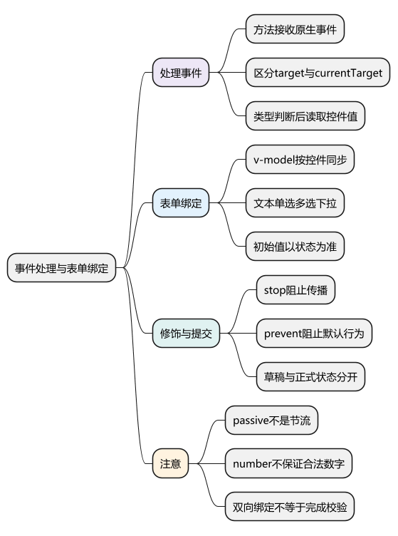
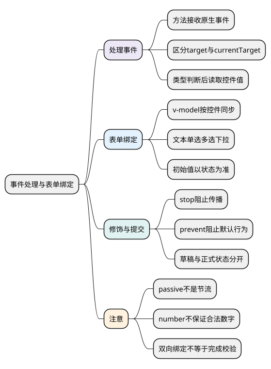

# 事件处理与表单绑定

<!-- core-mindmap:start -->
[](examples/vue04-mindmap.svg)

<details>
<summary>PlantUML 源码</summary>



</details>

<!-- core-mindmap:end -->

**口述总览：** 事件处理把用户操作变成状态变化，表单绑定把输入值和状态连接起来。`v-on` 负责监听事件，`v-model` 封装常见表单的取值与更新。绑定完成后还需要校验、提交和错误处理，它不会自动完成整个表单业务。

## v-on 与 @：监听原生事件

`v-on:click="handler"` 简写为 `@click="handler"`。直接传方法名时，Vue 会把原生事件作为参数传入；内联调用需要事件时使用 `$event`。

<!-- example: vue04-events -->
```vue
<script setup lang="ts">
import { ref } from 'vue'

const message = ref('等待点击')

function record(event: MouseEvent) {
  const button = event.currentTarget
  if (button instanceof HTMLButtonElement) {
    message.value = `点击了：${button.textContent?.trim()}`
  }
}

function choose(id: string, event: MouseEvent) {
  message.value = `选择 ${id}，鼠标横坐标 ${event.clientX}`
}
</script>

<template>
  <button type="button" @click="record">记录事件</button>
  <button type="button" @click="choose('u1', $event)">选择小林</button>
  <p>{{ message }}</p>
</template>
```

`event.target` 表示实际触发事件的目标，可能是按钮里面的图标；`event.currentTarget` 表示当前监听器绑定的元素。需要操作绑定元素时，优先读取 currentTarget，并在当前同步处理阶段保存需要的数据。

TypeScript 中原生事件目标不是自动确定的输入框。接收 `Event` 后进行类型缩小，再读取 `.value`，比不加说明地使用任意类型更可靠。

<!-- example: vue04-input-event -->
```vue
<script setup lang="ts">
import { ref } from 'vue'

const text = ref('')

function updateText(event: Event) {
  const input = event.currentTarget
  if (input instanceof HTMLInputElement) {
    text.value = input.value
  }
}
</script>

<template>
  <input :value="text" aria-label="手动绑定文本" @input="updateText">
  <p>{{ text }}</p>
</template>
```

## 事件修饰符：声明传播、默认行为和监听方式

修饰符写在事件名后，例如 `@submit.prevent="submit"`。常见用途：

- `.stop`：停止事件继续传播，不会自动阻止默认行为。
- `.prevent`：阻止可取消事件的默认行为，例如表单页面提交。
- `.self`：只有 target 就是当前元素时才执行处理函数。
- `.capture`：使用捕获阶段监听。
- `.once`：监听器触发一次后移除。
- `.passive`：声明监听器不会调用 preventDefault，便于浏览器安排某些默认滚动行为。

`.passive` 不是节流，也不会减少回调次数；不要与 `.prevent` 一起使用。

修饰符按书写顺序生成处理逻辑，`@click.self.prevent` 与 `@click.prevent.self` 的行为可能不同：是否先过滤目标，会影响子元素点击是否也被阻止默认行为。

键盘事件可使用 `@keyup.enter`、`@keydown.esc`；系统键有 `.ctrl`、`.alt`、`.shift`、`.meta`，`.exact` 可以限制只匹配指定组合。不要把 `.prevent` 当成处理所有键盘交互的通用答案，还要保留必要的可访问操作。

## 原生 v-model：根据控件同步状态

`v-model="state"` 把控件当前值和可写状态绑定。不同控件使用不同的属性与事件：文本框通常是 value 和 input，复选框与单选框使用 checked 和 change，select 使用 value 和 change。

对于文本输入，Vue 还会处理输入法组合输入等细节，因此不能把所有场景都理解成一行普通 input 监听器。

下面是可运行的表单，覆盖文本、数字、单选、多选和下拉框。

<!-- example: vue04-form -->
```vue
<script setup lang="ts">
import { ref } from 'vue'

const name = ref('')
const age = ref<number | string>('')
const contact = ref('email')
const skills = ref<string[]>([])
const city = ref('')
const agreed = ref(false)
const result = ref('')

function submit() {
  if (!name.value || typeof age.value !== 'number' || age.value < 18) {
    result.value = '请填写姓名，年龄需要是至少 18 的数字'
    return
  }
  if (!city.value || !agreed.value) {
    result.value = '请选择城市并确认报名信息'
    return
  }
  result.value = JSON.stringify({
    name: name.value,
    age: age.value,
    contact: contact.value,
    skills: skills.value,
    city: city.value
  })
}
</script>

<template>
  <form @submit.prevent="submit">
    <label>姓名 <input v-model.trim="name" autocomplete="name"></label>
    <label>年龄 <input v-model.number="age" type="number" min="18"></label>

    <fieldset>
      <legend>联系方式</legend>
      <label><input v-model="contact" type="radio" value="email">邮箱</label>
      <label><input v-model="contact" type="radio" value="phone">电话</label>
    </fieldset>

    <fieldset>
      <legend>已学知识</legend>
      <label><input v-model="skills" type="checkbox" value="JavaScript">JavaScript</label>
      <label><input v-model="skills" type="checkbox" value="TypeScript">TypeScript</label>
    </fieldset>

    <label>
      城市
      <select v-model="city">
        <option disabled value="">请选择</option>
        <option value="shanghai">上海</option>
        <option value="hangzhou">杭州</option>
      </select>
    </label>

    <label><input v-model="agreed" type="checkbox">确认报名信息</label>
    <button type="submit">提交</button>
  </form>
  <p role="status">{{ result }}</p>
</template>
```

初始显示以 JavaScript 状态为准，不依赖 HTML 上的初始 `value`、`checked` 或 `selected` 属性。单个复选框常绑定布尔值，多个复选框可绑定数组或 Set；多选 select 可用 `multiple` 配合数组。

需要绑定数字、对象等非字符串值时使用 `:value`，例如 `:value="1"`。普通 `value="1"` 表示字符串。

## lazy、trim、number：调整取值时机和内容

`.lazy` 把文本同步时机从 input 改为 change，常在用户确认修改后更新。它不等于固定的“失焦事件”，应按具体控件的 change 语义理解。

`.trim` 去掉用户输入两端空白，不会清除字符串中间的空格。

`.number` 尝试转换为数字；无法解析时保留原值，输入清空时可能得到空字符串。`type="number"` 会自动应用对应的数字转换行为，但仍不能保证业务状态永远是合法数字。

所以示例中的年龄类型使用 `number | string`，提交时再做类型和范围检查。前端校验用于反馈，服务端仍需验证真正提交的数据。

## 组件 v-model：与原生控件分开理解

组件上的默认 `v-model` 对应 `modelValue` prop 和 `update:modelValue` 事件，Vue 3.4+ 可以用 `defineModel` 简化。它与原生 input 的内部处理不同，详细的父子交互放在组件通信篇。

无论使用哪一种 v-model，都只是同步约定。它不会自动处理远程保存、防止重复提交、异步校验或编辑取消。

## 工程追问：表单编辑和提交状态怎样分开

需要“保存”和“取消”的表单，通常维护独立草稿。不能让用户每输入一个字就直接改动其他页面共享的正式数据，再指望点击取消后自动恢复。

提交请求时还要有提交中状态、失败反馈和结果归属判断。异步校验需要防止旧输入的慢结果覆盖新输入；这些问题在侦听与组合式函数篇继续展开。

<a id="interview"></a>

## 试题

<a id="vue17-01"></a>

### VUE17-01 [P0·基础] target 和 currentTarget 有什么区别？

**回答：** target 是事件实际发生的目标，可能是按钮内部图标；currentTarget 是正在执行的监听器所绑定的元素。需要读取输入框或按钮本身时，可以使用 currentTarget 并做类型判断。异步处理前应先保存需要的值，避免等待后再依赖事件当前监听阶段。

<a id="vue17-02"></a>

### VUE17-02 [P0·基础] stop、prevent 和 passive 分别解决什么问题？

**回答：** stop 阻止事件继续传播，prevent 阻止可取消的默认行为，passive 声明监听器不会阻止默认行为，便于浏览器处理某些滚动交互。passive 不是节流，不能减少执行次数，也不应和 prevent 同时使用。

<a id="vue17-03"></a>

### VUE17-03 [P0·原理] 原生表单的 v-model 都是 value 加 input 吗？

**回答：** 不是。文本输入通常使用 value 和 input，复选框、单选框使用 checked 和 change，select 使用 value 和 change。Vue 还处理输入法组合输入和修饰符。v-model 是按控件适配的同步语法，不能只背一种展开形式。

<a id="vue17-04"></a>

### VUE17-04 [P0·基础] number 修饰符能保证拿到数字吗？

**回答：** 不能。它尝试进行数字转换，无法解析时仍可能保留字符串，清空输入也可能得到空字符串。业务代码应在使用前验证类型和范围，不能把绑定变量声明成 number 后就假设运行时一定合法。

<a id="vue17-05"></a>

### VUE17-05 [P1·工程取舍] 表单已经双向绑定，为什么还要维护编辑草稿？

**回答：** 双向绑定只保证输入与所绑定状态同步。如果直接绑定共享的正式数据，每次输入就已经影响其他位置，取消操作也没有天然的回滚。需要提交确认的场景应使用草稿，校验成功并保存后再更新正式状态，同时处理提交中、失败和重复提交。

参考：[事件处理](https://cn.vuejs.org/guide/essentials/event-handling.html) · [表单输入绑定](https://cn.vuejs.org/guide/essentials/forms.html) · [原生事件的类型](https://cn.vuejs.org/guide/typescript/composition-api.html#typing-event-handlers)

上一篇：[模板语法与指令](03_模板语法与指令.md) · 下一篇：[ref 与响应式工具](05_ref与响应式工具.md) · [返回目录](00_目录.md)
