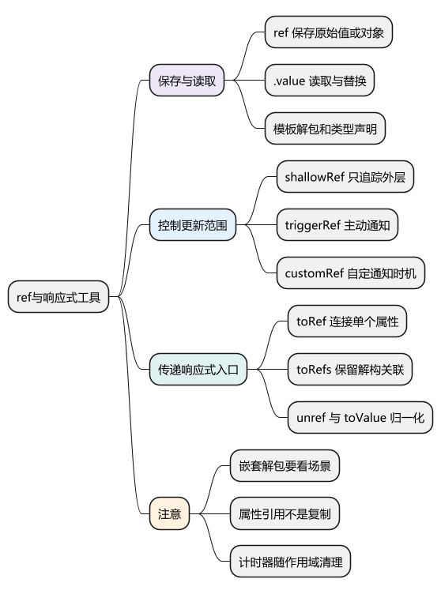
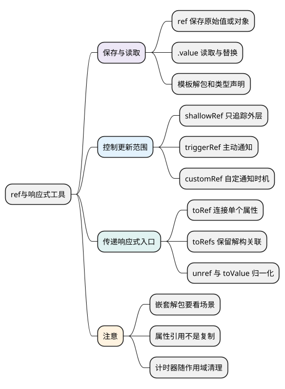

# ref与响应式工具

<!-- core-mindmap:start -->
[](examples/vue05-mindmap.svg)

<details>
<summary>PlantUML 源码</summary>



</details>

<!-- core-mindmap:end -->

**总览：** `ref` 把一个值放进可以追踪读写的容器。脚本通过 `.value` 读取或赋值，依赖这个值的模板、计算属性和侦听器便能收到变化。先会用 `ref` 保存和替换状态，再根据需要选择浅层容器、属性引用和自定义更新时机。

本文以 Vue **3.5.43** 为基线；`toValue` 和 `toRef` 的归一化重载从 **3.3** 开始提供。

<a id="k01"></a>

## ref(value)：保存原始值或对象，返回可读写的响应式引用

`ref(value)` 接收初始值，返回 ref 对象。`.value` 就是内部值：字符串、数字、布尔值、对象、数组都可以使用。传入普通对象时，内部对象会转换成深层响应式代理；原始值本身不会变成 Proxy。

<!-- example: vue05-basic -->
```ts
import { computed, ref } from 'vue'

const count = ref(0)
const doubled = computed(() => count.value * 2)
count.value++
console.log(count.value, doubled.value) // 1 2

const user = ref({ name: '小明' })
user.value.name = '小红' // 修改内部对象
user.value = { name: '小李' } // 替换整个对象，外层 ref 仍是同一个
console.log(user.value.name) // 小李
```

**为什么需要 `.value`？** Vue 无法拦截普通局部变量 `count = 1` 的赋值，但可以在 ref 的 `value` getter/setter 中追踪和通知。Vue 3.5 使用类访问器实现这一入口，不必把它背成“所有 ref 都调用 `Object.defineProperty`”。

`const count = ref(0)` 禁止替换 `count` 变量指向的容器，并不禁止修改 `count.value`。

## 模板解包：顶层 ref 通常直接使用，嵌套场景分别判断

下面是完整的单文件组件，放入 `App.vue` 即可运行。

<!-- project: vue05-counter; file: App.vue -->
```vue
<script setup lang="ts">
import { ref } from 'vue'

const count = ref(0)
const box = { count: ref(10) }
</script>

<template>
  <button @click="count++">计数：{{ count }}</button>
  <p>嵌套 ref 做加法：{{ box.count.value + 1 }}</p>
</template>
```

模板渲染上下文中的顶层 ref 会解包，所以 `count++` 可用。普通对象里的 `box.count` 不是顶层绑定，进行表达式运算时应显式读取 `.value`。文本插值的最终结果如果恰好是 ref，还有单独的显示解包规则，不能据此推断所有表达式都能省略 `.value`。

响应式数组和 Map 中保存的 ref 也不自动解包，具体例子见[reactive 与只读代理](06_reactive与只读代理.md)。

## ref 的类型声明：让空值与未来的数据形状都合法

TypeScript 根据初始值推断类型。`ref(null)` 无法表达“稍后放入用户对象”的意图，应补上联合类型。

<!-- example: vue05-types -->
```ts
import { ref, type Ref } from 'vue'

type User = { id: number; name: string }
const user = ref<User | null>(null)
const name: Ref<string> = ref('小明')

user.value = { id: 1, name: name.value }
console.log(user.value.name) // 小明
```

不要写 `const name: string = ref('小明')`：右侧是 ref 容器，不是字符串。也不要仅为绕过检查就使用非空断言，页面加载中、请求失败和组件卸载后都可能存在空值。

<a id="k02"></a>

## shallowRef(value) 与 triggerRef(ref)：由调用者控制深层变化的通知

`shallowRef(value)` 返回浅层 ref，只追踪 `.value`，不会主动把内部普通对象转为响应式。替换 `.value` 会通知；直接改普通对象内部属性不会单独通知。

`triggerRef(shallow)` 接收浅层 ref，返回 `void`，主动通知依赖它的订阅者。它不负责改变值，也不是无条件“强制更新整个页面”。

<!-- example: vue05-shallow -->
```ts
import { shallowRef, triggerRef, watchEffect } from 'vue'

const data = shallowRef({ count: 0 })
const seen: number[] = []
const stop = watchEffect(() => {
  seen.push(data.value.count)
}, { flush: 'sync' })

data.value.count = 1
console.log(seen) // [0]
triggerRef(data)
console.log(seen) // [0, 1]
data.value = { count: 2 }
console.log(seen) // [0, 1, 2]
stop()
```

这里用同步侦听展示每一步，并非建议所有业务侦听器都采用 `sync`。大块不可变数据常用“浅层保存、整体替换”；第三方实例常用浅层 ref 避免深代理。若内部原本就已经是响应式对象，浅层 ref 不会把它还原成普通对象。

<a id="k03"></a>

## isRef、unref 与 toValue：识别容器，统一读取不同形式的输入

`isRef(value)` 返回布尔值，并能帮助 TypeScript 缩小类型。`unref(value)` 在输入是 ref 时取 `.value`，其他情况原样返回。

`toValue(input)` 从 **Vue 3.3** 开始支持“普通值、ref、getter”三种输入：getter 是一个用于读取当前值的函数，调用它后才获得结果。

<!-- example: vue05-normalize -->
```ts
import { isRef, ref, toValue, unref } from 'vue'

const count = ref(2)
const getter = () => count.value * 2
console.log(isRef(count), isRef(2)) // true false
console.log(unref(count), unref(2)) // 2 2
console.log(unref(getter) === getter) // true，不执行普通函数
console.log(toValue(count), toValue(getter)) // 2 4
```

需要让 getter 内的响应式读取被追踪，就在 `watch` 的 source getter 或 `watchEffect` 同步执行期间调用 `toValue`。在外面只调用一次得到的普通值，依旧只是当时的结果。

## toRef 与 toRefs：保留属性关联，便于传递和解构

`toRef(object, key, defaultValue?)` 返回连接某属性的 ref，读写 `.value` 等同于访问该属性。即使属性当前不存在，也能先建立入口。它不会复制整个对象，更不是深拷贝。

`toRefs(object)` 返回普通对象，其中每个成员都是连接原对象属性的 ref，只覆盖调用时已有的可枚举属性。

<!-- example: vue05-property-refs -->
```ts
import { reactive, toRef, toRefs } from 'vue'

const state = reactive<{ count: number; note?: string }>({ count: 0 })
const { count } = toRefs(state)
const note = toRef(state, 'note', '未填写')
count.value++
console.log(state.count, note.value) // 1 未填写
note.value = '已完成'
console.log(state.note) // 已完成

const existing = toRef(count)
const readonlyCount = toRef(() => state.count) // Vue 3.3+，只读 getter ref
console.log(existing === count, readonlyCount.value) // true 1
```

**3.3 起的单参数重载**：已有 ref 原样返回，普通值转为 ref，getter 转为只读 ref。getter ref 不等于 computed 缓存；它在读取时调用 getter。连接只读 props 的 ref 仍应遵守 props 不可写的约束。

<a id="k04"></a>

## customRef(factory)：自定义读取追踪与更新通知

`customRef(factory)` 将 `track`、`trigger` 交给工厂函数，工厂必须返回 `get`、`set`，最终得到一个 ref。`track()` 记录读取依赖，`trigger()` 通知变化；是否延迟、何时调用由开发者决定。

下面实现一个防抖 ref：连续输入时重新计时，停下 300 毫秒才提交新值。定时器随作用域释放；完整组件可直接运行。

<!-- project: vue05-custom-ref; file: App.vue -->
```vue
<script setup lang="ts">
import { customRef, onScopeDispose } from 'vue'

function useDebouncedRef(initial: string, delay = 300) {
  let value = initial
  let timer: ReturnType<typeof setTimeout> | undefined
  onScopeDispose(() => clearTimeout(timer))

  return customRef<string>((track, trigger) => ({
    get() {
      track()
      return value
    },
    set(next) {
      clearTimeout(timer)
      timer = setTimeout(() => {
        value = next
        trigger()
      }, delay)
    }
  }))
}

const keyword = useDebouncedRef('')
</script>

<template>
  <input v-model="keyword" aria-label="搜索关键词">
  <p>提交的关键词：{{ keyword }}</p>
</template>
```

这类函数应在组件 `setup` 或有效的 effect scope 中同步调用，作用域用法见[组合式函数与副作用清理](13_组合式函数与副作用清理.md)。getter 不宜每次制造全新对象，否则读取本身就改变引用身份，可能使父子组件更新难以理解。

<a id="summary"></a>

## 工程追问：选择 ref 后，仍要明确谁能修改、何时通知

`ref` 适合原始值、需要整体替换的对象以及组合式函数返回值；`reactive` 适合需要稳定对象入口的状态。选择依据是数据访问方式，不是把两者排成性能高低。

遇到“不更新”，先确认写到了同一个容器、读取发生在响应式上下文中，再检查浅层边界、解构和调度。遇到“更新太多”，先确认依赖范围及数据规模，不要直接用 `triggerRef` 或 `customRef` 补救。

继续深入：[源码系列：ref 与依赖追踪](../02_Vue3原理与源码/07_ref与依赖追踪.md#ref与依赖追踪)。

参考：[ref 与核心 API](https://cn.vuejs.org/api/reactivity-core.html#ref)、[响应式工具](https://cn.vuejs.org/api/reactivity-utilities.html)、[浅层与自定义 ref](https://cn.vuejs.org/api/reactivity-advanced.html)。

<a id="interview"></a>

## 试题

<a id="vue03-01"></a>

### VUE03-01 [P0·原理] ref 为什么能让原始值响应式？

**回答：** ref 给原始值增加了一个可追踪的容器。读取 `.value` 时记录当前依赖它的计算，写入新值时通知相关计算。它监听的是容器的读写入口，没有把数字本身变成 Proxy；对象值则通常会再转换为响应式代理。

<a id="vue03-02"></a>

### VUE03-02 [P0·原理] shallowRef 内部属性变化为什么没更新？

**回答：** shallowRef 只追踪 `.value`，不主动代理内部普通对象。直接修改内部属性绕过了它的通知入口。可以整体替换 `.value`，或者在确实需要手动通知时调用 `triggerRef`；后者只是通知，不会替我改变数据。

<a id="vue03-03"></a>

### VUE03-03 [P1·基础] toRefs 与直接解构 reactive 有什么区别？

**回答：** 直接解构原始值属性得到当时的值，后续不会继续读取原代理属性。toRefs 返回与原属性连接的 ref，读写 `.value` 仍关联原对象。它只处理当时已有的可枚举属性，未来才出现的属性可以用 toRef 单独建立入口。

<a id="vue03-04"></a>

### VUE03-04 [P1·基础] unref 和 toValue 一样吗？

**回答：** 不一样。unref 只解包 ref，普通函数会原样返回；toValue 还会调用 getter。组合式函数接收 ref 或 getter 时，要在侦听源或 watchEffect 同步执行中调用 toValue，才能追踪输入变化。

<a id="vue03-05"></a>

### VUE03-05 [P1·工程取舍] customRef 为何还需要管理生命周期？

**回答：** customRef 只提供追踪与通知的控制权，不会自动清理我创建的定时器、请求或订阅。防抖 ref 的计时器应随作用域停止，否则组件卸载后仍可能执行。还应避免 getter 每次返回新对象，造成不必要的引用变化。

<a id="vue03-06"></a>

### VUE03-06 [P0·基础] 模板里所有 ref 都不需要写 .value 吗？

**回答：** 不是。模板中的顶层 ref 通常自动解包，但普通对象内嵌套的 ref 做表达式计算时需要明确 `.value`。响应式数组或 Map 里的 ref 也不会按普通对象属性规则解包，必须结合访问位置判断。
