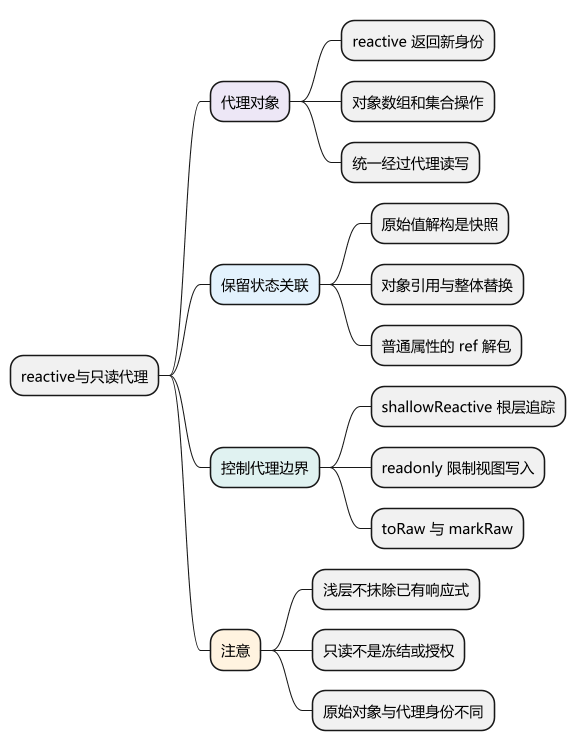
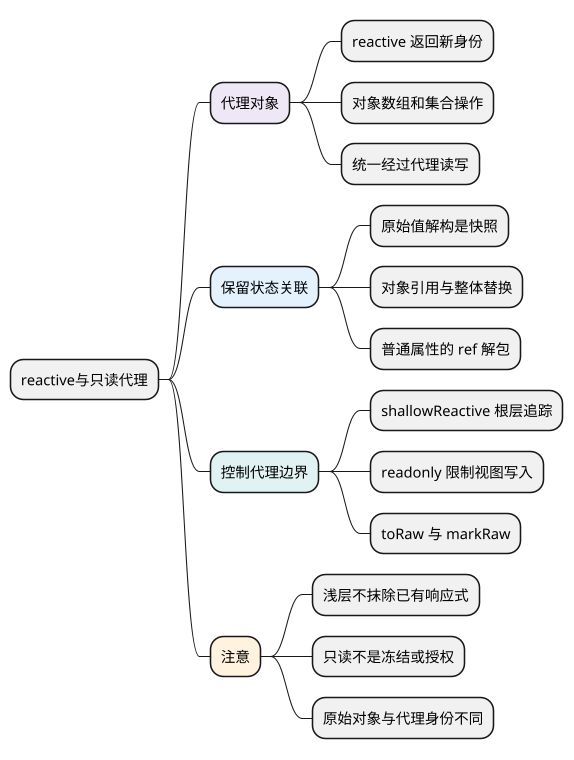

# reactive与只读代理

<!-- core-mindmap:start -->
[](examples/vue06-mindmap.svg)

<details>
<summary>PlantUML 源码</summary>



</details>

<!-- core-mindmap:end -->

**总览：** `reactive` 返回一个对象代理，Vue 通过代理记录属性读取、通知属性变化。代理与原对象不是同一个引用，解构、整体替换、浅层转换和只读限制都有各自边界。排查响应式问题，首先看数据的读写是否经过正确入口。

本文以 Vue **3.5.43** 为基线。先掌握普通对象，再扩展到数组、Map、Set 和第三方对象。

<a id="k01"></a>

## reactive(object)：返回深层响应式代理，保留对象式访问

`reactive` 接收可支持的对象，返回代理。普通对象、数组和 Map、Set 等集合可以使用；数字、字符串等原始值应使用 `ref`。Date、自定义内部槽对象不能按普通对象假定所有操作都能被追踪。

<!-- example: vue06-proxy -->
```ts
import { isReactive, reactive, toRaw } from 'vue'

const raw = { name: '小明', profile: { age: 18 } }
const user = reactive(raw)
user.name = '小红'
user.profile.age++

console.log(user.name, user.profile.age) // 小红 19
console.log(user === raw) // false
console.log(toRaw(user) === raw) // true
console.log(reactive(raw) === user) // true，相同目标使用缓存代理
console.log(isReactive(user.profile)) // true
```

深层响应式不意味着创建时就一次遍历整个对象树。Vue 在访问嵌套对象时提供响应式转换，并缓存对应代理。通过代理写入通常会落到原对象上，但**直接修改原对象不会经过代理的触发逻辑**。

## 修改对象、数组和集合：保持同一个响应式入口

不需要像 Vue 2 那样用 `Vue.set` 补充普通对象的新属性，也无需用额外 API 通知数组索引修改。Proxy 能拦截这些操作，Vue 再处理相关依赖。

<!-- example: vue06-collections -->
```ts
import { reactive } from 'vue'

const form = reactive<{ name: string; note?: string }>({ name: '小明' })
form.note = '新增字段'
delete form.note

const list = reactive(['A', 'B'])
list[0] = 'C'
list.push('D')
list.splice(0, list.length, 'X', 'Y') // 保留数组代理，替换内容

const scores = reactive(new Map<string, number>())
scores.set('小明', 90)
const selected = reactive(new Set<number>())
selected.add(1)
console.log(list.join(','), scores.get('小明'), selected.has(1)) // X,Y 90 true
```

如果业务总是接收并替换整个列表，用 `ref<Item[]>([])` 后赋值 `.value` 通常更直观。把 `let list = reactive([])` 重新赋为普通数组，并不是对原代理的修改；持有旧代理的侦听器与子函数也不会自动改为新入口。

<a id="k02"></a>

## 解构与整体替换：原始值是快照，对象引用要分情况

<!-- example: vue06-destructure -->
```ts
import { reactive, toRef, toRefs } from 'vue'

const state = reactive({ count: 0, nested: { name: 'A' } })
const { count, nested } = state
const linkedCount = toRef(state, 'count')
const { nested: linkedNested } = toRefs(state)

state.count = 2
console.log(count, linkedCount.value) // 0 2
nested.name = 'B'
console.log(state.nested.name) // B，nested 仍是嵌套代理

state.nested = { name: 'C' }
console.log(nested.name, linkedNested.value.name) // B C
```

直接解构 `count` 得到数字快照。解构 `nested` 得到当前嵌套代理，所以修改它的属性仍可响应；但父属性换成新对象后，旧 `nested` 不会自动改指向。`toRef` 或 getter 能保留“以后继续读取这个属性”的关系。

Vue 3.5 的 `defineProps` 响应式解构是 `<script setup>` 编译器提供的专门能力，不代表普通 `reactive` 解构规则也变了。

## ref 解包：普通对象属性自动解包，数组与集合保留容器

<!-- example: vue06-unwrap -->
```ts
import { reactive, ref } from 'vue'

const count = ref(1)
const state = reactive({ count })
const list = reactive([count])
const map = reactive(new Map([['count', count]]))

console.log(state.count) // 1
state.count = 2
console.log(count.value) // 2，赋普通值会更新原 ref 的 value
console.log(list[0]!.value, map.get('count')!.value) // 2 2
```

不要把“reactive 不用 `.value`”理解为它里面保存的所有值都自动解包。解包是具体访问路径上的规则；浅层代理也不做相同的根属性 ref 解包。

## shallowReactive(object)：只代理根层，明确嵌套数据的更新方式

`shallowReactive` 返回浅层代理，根属性的增删改会通知，内部普通对象保持原样。适合边界明确的根状态，不宜随意嵌入深层响应式树。

<!-- example: vue06-shallow -->
```ts
import { isReactive, reactive, shallowReactive } from 'vue'

const state = shallowReactive({ count: 0, nested: { value: 1 } })
state.count++ // 根属性变化可追踪
state.nested.value++ // 普通嵌套对象变化不单独通知
console.log(isReactive(state), isReactive(state.nested)) // true false

state.nested = { value: 3 } // 替换根属性可通知
const alreadyReactive = reactive({ value: 4 })
state.nested = alreadyReactive
console.log(isReactive(state.nested)) // true，浅层容器不抹除已有响应式
```

浅层方案是主动减少代理与追踪范围，代价是调用者必须明确如何替换、通知和传递状态。不是“浅层数据只能改值，永远不能更新页面”。

<a id="k03"></a>

## readonly 与 shallowReadonly：限制当前视图的写入

`readonly(value)` 返回深层只读视图；`shallowReadonly(object)` 只限制根属性赋值，嵌套普通对象仍可修改。两者都不是数据副本，也不是安全授权机制。

<!-- example: vue06-readonly -->
```ts
import { isProxy, isReactive, isReadonly, reactive, readonly, shallowReadonly } from 'vue'

const owner = reactive({ count: 0, nested: { value: 1 } })
const view = readonly(owner)
owner.count = 2
console.log(view.count) // 2，可写所有者的变化能反映到只读视图
console.log(isReadonly(view), isReactive(view), isProxy(view)) // true true true

const shallowView = shallowReadonly({ nested: { value: 1 } })
shallowView.nested.value = 2
console.log(shallowView.nested.value) // 2，仅根层只读
```

通过只读视图写入会被阻止，开发环境通常提示警告；TypeScript 也会检查只读赋值。只读视图不阻止数据所有者更新，也不等于 `Object.freeze`。只读代理包装普通原对象时，直接改原对象同样不会凭空产生响应式通知。

`isReactive` 检查响应式身份，`isReadonly` 检查只读身份，`isProxy` 检查是否为响应式或只读代理。只读 computed 也可能被 `isReadonly` 识别，因此不要把“只读”只理解为一种 Proxy。

## toRaw 与 markRaw：对接外部对象时控制代理边界

`toRaw(proxy)` 返回代理对应的原对象，没有复制数据。适合短暂读取原始身份，不应长期持有它并绕过代理维护业务状态。

`markRaw(object)` 返回同一个对象并标记它不要被响应式转换。适合不需要深追踪的第三方类实例等，但不会递归标记所有嵌套对象。

<!-- example: vue06-raw -->
```ts
import { isReactive, markRaw, reactive, toRaw } from 'vue'

const external = markRaw({ nested: { id: 1 } })
const state = reactive({ external, nested: external.nested })
console.log(state.external === external) // true
console.log(isReactive(state.external)) // false
console.log(state.nested === external.nested) // false，嵌套值另行进入代理
console.log(toRaw(state.nested) === external.nested) // true
```

原对象与代理混用可能导致 Set、Map 键或严格相等比较产生身份差异。应用代码应统一使用业务 ID 或稳定引用，不要依赖所有库都替你消除身份差异。

<a id="k04"></a>

<a id="summary"></a>

## 工程追问：表单、外部实例和大列表应该如何选择

编辑表单有明确字段、经常局部更新，可以用 `reactive`。接口列表经常整体替换，可以用 `ref`；确认数据按不可变方式使用且规模较大，再考虑 `shallowRef`。图表、编辑器等外部实例可用浅层容器或 `markRaw`，实例资源仍需要卸载清理。

排查不更新的顺序是：数据是否进入支持的容器，读写是否经过同一入口，是否解构快照，是否存在 shallow/raw 边界，观察者是否仍有效，最后才看 DOM 更新时机。

这些 API 只管理前端访问行为。接口响应仍要做运行时校验，接口权限仍由服务端控制，不应把 readonly 当作防篡改措施。

继续深入：[源码系列：reactive 与 Proxy](../02_Vue3原理与源码/06_reactive与Proxy.md#reactive与proxy)。

参考：[响应式基础](https://cn.vuejs.org/guide/essentials/reactivity-fundamentals.html)、[响应式高级 API](https://cn.vuejs.org/api/reactivity-advanced.html)、[只读与代理检测](https://cn.vuejs.org/api/reactivity-utilities.html)。

<a id="interview"></a>

## 试题

<a id="vue04-01"></a>

### VUE04-01 [P0·原理] reactive 是否把原对象原地变成代理？

**回答：** 不是，reactive 返回一个代理，通常与原对象不是同一个引用。通过代理操作会转发到原对象，但直接读写原对象会绕过相应追踪和通知。业务代码应统一使用代理，重复转换同一原对象时 Vue 会复用缓存代理。

<a id="vue04-02"></a>

### VUE04-02 [P0·原理] 解构 reactive 后为什么有时不更新？

**回答：** 原始值属性解构得到快照，不再通过原属性读取；嵌套对象解构可能仍持有响应式代理，所以修改内部属性可以有效，但父属性整体替换后它仍指向旧对象。需要持续连接父属性时用 toRef、toRefs 或 getter，不能笼统说所有解构都失去响应式。

<a id="vue04-03"></a>

### VUE04-03 [P1·基础] readonly 是否意味着底层对象永远不变？

**回答：** 不是，它只限制通过只读视图写入。原状态所有者仍可修改数据，基于响应式状态建立的只读视图能反映这些变化。它不是深拷贝、冻结或权限系统，适合表达“对外可读、由所有者负责修改”的接口。

<a id="vue04-04"></a>

### VUE04-04 [P1·工程取舍] 什么时候用 markRaw 或 shallowReactive？

**回答：** 第三方实例不适合被代理时可以考虑 markRaw；只有根层需要追踪、嵌套数据有明确替换策略时可以考虑 shallowReactive。代价是内部普通数据的修改不再自动通知，markRaw 的嵌套对象还可能在别处被代理，必须明确更新与身份边界。

<a id="vue04-05"></a>

### VUE04-05 [P0·基础] 接口返回新数组时，怎样避免替换 reactive 变量导致关联丢失？

**回答：** 如果列表设计上需要整体替换，我优先使用 ref 数组并给 `.value` 赋新数组；如果要保留同一个 reactive 数组，则用 splice 替换内容。关键是稳定对外的响应式入口，让模板、侦听器和其他函数读取同一份状态。
