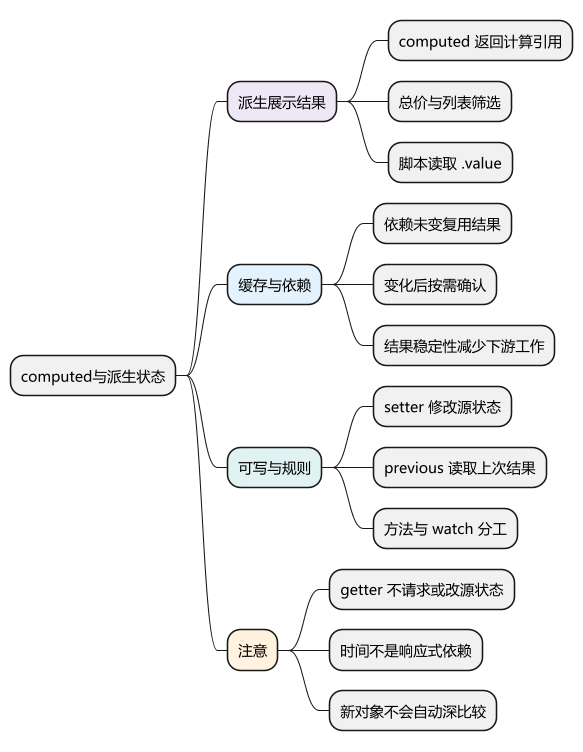
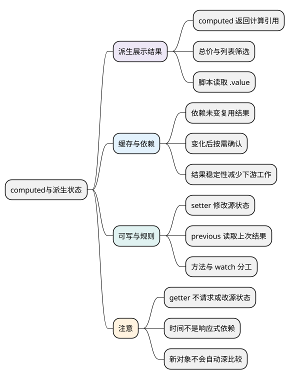

# computed与派生状态

<!-- core-mindmap:start -->
[](examples/vue07-mindmap.svg)

<details>
<summary>PlantUML 源码</summary>



</details>

<!-- core-mindmap:end -->

**总览：** `computed` 用来表达“这个结果可以由已有状态计算出来”，例如总价、筛选后的列表和是否允许提交。它追踪计算依赖并缓存结果；普通函数执行动作，watch 处理副作用。先确定数据能否推导，再决定是否另存一份状态。

本文以 Vue **3.5.43** 为基线。计算结果稳定性优化与读取上一次结果的 getter 参数从 **3.4** 开始提供。

<a id="k01"></a>

## computed(getter)：根据已有状态返回只读计算引用

`computed(getter)` 接收一个同步读取函数，返回计算属性 ref。脚本用 `.value` 读取，模板中的顶层绑定会自动解包。只有 getter 的形式不能直接给 `.value` 赋新值。

下面是完整单文件组件，修改单价或数量会更新总价。

<!-- project: vue07-total; file: App.vue -->
```vue
<script setup lang="ts">
import { computed, ref } from 'vue'

const price = ref(10)
const count = ref(2)
const total = computed(() => price.value * count.value)
</script>

<template>
  <label>单价 <input v-model.number="price" type="number" min="0"></label>
  <label>数量 <input v-model.number="count" type="number" min="0"></label>
  <p>总价：{{ total }}</p>
</template>
```

这个例子用于观察派生关系。清空输入仍可能得到空字符串，`.number` 不保证始终得到合法数字；实际金额表单还应按[表单绑定篇](04_事件处理与表单绑定.md)检查空值、数值范围和精度。

这里的“只读”限制给 `total.value` 赋值，不代表 getter 返回的任意对象都被递归冻结。应把计算结果视为派生视图，通过修改源状态改变结果。

## 缓存与重新计算：相关依赖变化后，再按需确认结果

<!-- example: vue07-cache -->
```ts
import { computed, ref } from 'vue'

const price = ref(10)
const count = ref(2)
let runs = 0
const total = computed(() => {
  runs++ // 仅用于观察计算次数，业务 getter 不做这类副作用
  return price.value * count.value
})

console.log(runs) // 0，尚未读取
console.log(total.value, total.value, runs) // 20 20 1
count.value = 3
console.log(total.value, runs) // 30 2
```

getter 执行时，读取 `price.value` 和 `count.value` 建立依赖。依赖没有相关变化时可复用结果；变化后结果需要重新确认，通常在再次读取时求值。Vue 3.5 还结合依赖版本等信息跳过不必要的重新计算，不宜只背某个历史版本的 `_dirty` 字段。

`computed(() => Date.now())` 不会自行更新时间，因为时钟不是响应式数据。需要实时显示时间时，应使用计时器更新 ref，并在作用域结束时清理计时器。

## 列表筛选与排序：从源数据计算展示结果

<!-- example: vue07-filter -->
```ts
import { computed, ref } from 'vue'

const keyword = ref('')
const users = ref([
  { id: 1, name: '小明', score: 80 },
  { id: 2, name: '小红', score: 95 }
])
const visibleUsers = computed(() => {
  const query = keyword.value.trim()
  return users.value
    .filter(user => user.name.includes(query))
    .sort((a, b) => b.score - a.score)
})

console.log(visibleUsers.value.map(user => user.name)) // ['小红', '小明']
console.log(users.value.map(user => user.name)) // ['小明', '小红']
keyword.value = '小明'
console.log(visibleUsers.value.length) // 1
```

`filter` 先产生新数组，所以这里的 `sort` 不修改原数组顺序。如果直接写 `users.value.sort(...)`，就会在 getter 内修改源状态，应先复制再排序。数组中的对象仍是原对象引用，不能把新数组误认为深拷贝。

<a id="k02"></a>

## computed、方法与 watch：分别处理派生结果、动作和副作用

**计算属性**适合纯派生结果：总价、有效条数、筛选列表。纯计算指只依据输入返回结果，不修改外部状态、不请求接口、不写 DOM。

**普通方法**适合明确触发的动作，例如提交表单、重置字段，也适合不需要缓存的简单计算。模板调用方法时，组件重新渲染会再次调用；computed 可在依赖未变时复用结果。

**watch** 适合状态变化后发请求、写存储或控制外部实例，需要处理副作用清理。不要为了总价额外声明一个 ref，再用 watch 把计算结果同步过去，这会增加状态来源和同步负担。

`computed(async () => ...)` 得到的是包含 Promise 的计算引用，Vue 不会自动把它等待成业务数据。异步状态应显式管理结果、加载中、错误和取消，见[组合式函数与副作用清理](13_组合式函数与副作用清理.md)。

<a id="k03"></a>

## computed({ get, set })：把写入转换为对源状态的修改

传入包含 `get`、`set` 的对象，可返回可写计算引用。`get` 负责从源状态计算，`set(newValue)` 负责把赋值意图转换回源状态，不应再次给自身 `.value` 赋值。

<!-- project: vue07-writable; file: App.vue -->
```vue
<script setup lang="ts">
import { computed, ref } from 'vue'

const enabled = ref(true)
const status = computed({
  get: () => enabled.value ? '启用' : '停用',
  set: (value: string) => {
    enabled.value = value === '启用'
  }
})
</script>

<template>
  <select v-model="status" aria-label="状态">
    <option>启用</option>
    <option>停用</option>
  </select>
  <p>实际布尔值：{{ enabled }}</p>
</template>
```

可写 computed 适合明确的双向映射，不适合隐藏一整套异步提交流程。需要取消编辑、校验或服务端保存时，应单独设计草稿、验证和提交状态。

## getter(previous)：在计算规则中读取上一次结果

Vue **3.4+** 的组合式 computed getter 可以接收上一次计算结果，第一次为 `undefined`。下面约定超过上限时保留之前有效值。

<!-- example: vue07-previous -->
```ts
import { computed, ref } from 'vue'

const input = ref(1)
const limited = computed<number>((previous) => {
  const current = input.value
  return current <= 3 ? current : previous ?? 0
})

console.log(limited.value) // 1
input.value = 2
console.log(limited.value) // 2
input.value = 5
console.log(limited.value) // 2
```

上一次结果是计算属性最近一次求值的结果，不是每次输入修改的完整历史。若输入连续变化但没有触发重新求值，不会自动保存所有中间值。需要审计记录时应单独记录事件。

<a id="k04"></a>

## 结果稳定性：值没变时减少下游工作，不自动深比较对象

Vue **3.4+** 会利用计算结果稳定性：getter 重新确认后，结果不变可避免相关下游副作用的无效执行。源数据变化不等于计算结果一定变化。

<!-- example: vue07-stability -->
```ts
import { computed, nextTick, ref, watchEffect } from 'vue'

const count = ref(0)
const isEven = computed(() => count.value % 2 === 0)
const seen: boolean[] = []
const stop = watchEffect(() => { seen.push(isEven.value) })

count.value = 2
await nextTick()
console.log(seen) // [true]，重新计算仍为 true
count.value = 3
await nextTick()
console.log(seen) // [true, false]
stop()
```

如果每次返回 `{ even: true }` 这样的新对象，即使内容相同，引用也不同。Vue 不会为所有计算结果执行昂贵的深比较。有实际性能问题时，可以设计稳定的派生字段，或完整读取依赖并比较后返回旧结果；不要为了复用旧对象而跳过必要依赖读取。

<a id="summary"></a>

## 工程追问：缓存能否解决大列表卡顿

缓存避免依赖不变时重复计算，但当搜索词每次输入都变化时，大列表过滤仍会执行。应先测量数据量和耗时，再选择减少数据、服务端搜索、适当防抖、分页或虚拟列表。把任意慢逻辑包装成 computed 不会自动降低一次计算的成本。

检查计算属性时，分别验证相关依赖变化、无关状态变化、重复读取、对象身份和可写映射。业务 getter 应保持可预测，随机数、请求和隐式写入都会破坏这种可预测性。

继续深入：[源码系列：computed 与 watch](../02_Vue3原理与源码/09_computed与watch.md#computed与watch)。

参考：[计算属性](https://cn.vuejs.org/guide/essentials/computed.html)、[计算属性稳定性](https://cn.vuejs.org/guide/best-practices/performance.html#computed-stability)、[Vue 3.5.43 computed 源码](https://github.com/vuejs/core/blob/v3.5.43/packages/reactivity/src/computed.ts)。

<a id="interview"></a>

## 试题

<a id="vue06-01"></a>

### VUE06-01 [P0·原理] computed 为什么能缓存？

**回答：** getter 执行时会记录自己读取的响应式依赖。依赖未发生相关变化时，后续读取可复用之前结果；依赖变化后，Vue 在需要时重新确认计算结果。缓存依赖响应式追踪，所以普通外部变量或时间流逝不会自动让它失效。

<a id="vue06-02"></a>

### VUE06-02 [P0·基础] computed、methods 和 watch 怎么选？

**回答：** 可以由已有状态纯计算得到的结果用 computed；点击提交等明确动作使用方法；数据变化后需要请求、存储或订阅等副作用时用 watch。我会尽量避免用 watch 维护一份本可直接推导的状态，也不会在 computed getter 里发请求。

<a id="vue06-03"></a>

### VUE06-03 [P1·原理] computed(() => Date.now()) 会自动更新时间吗？

**回答：** 不会，Date.now 没有响应式依赖，时间流逝不会通知 computed。需要定时显示时间时，应让计时器更新一个 ref，再从这个 ref 派生展示结果，同时随组件或作用域结束清理计时器。

<a id="vue06-04"></a>

### VUE06-04 [P1·工程取舍] 返回新对象的 computed 有什么代价？

**回答：** 每次重新计算得到新引用，可能让依赖结果的组件或副作用认为结果发生变化。Vue 不会自动深比较所有对象，因此应先观察实际更新成本，再考虑稳定结果引用或拆成更小的派生字段，不能只因为用了 computed 就认为下游不会重复执行。

<a id="vue06-05"></a>

### VUE06-05 [P0·原理] 可写 computed 的 setter 应该修改什么？

**回答：** 修改真正的源状态，把调用方赋入的值转换成源数据。例如界面选“启用”，setter 修改底层布尔值。不能再次给这个 computed 自身赋值，否则会递归调用 setter；复杂校验、草稿和保存流程也应单独表达。

<a id="vue06-06"></a>

### VUE06-06 [P1·工程取舍] computed 缓存为什么不一定解决输入搜索卡顿？

**回答：** 搜索词每次变化都会改变依赖，过滤仍需要重新计算，缓存只减少没有相关变化时的重复工作。应测量一次计算成本和数据量，再选择防抖、服务端搜索、分页等方案；虚拟列表主要减少渲染量，也不自动消除过滤全量数据的成本。
