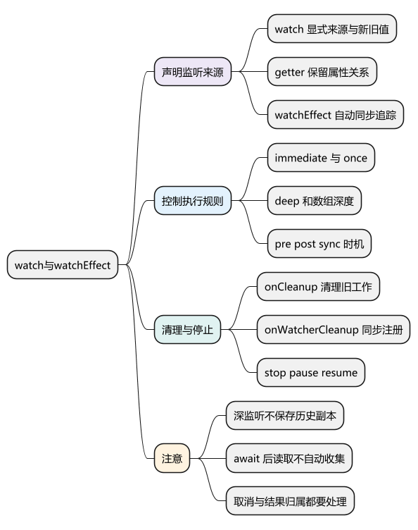
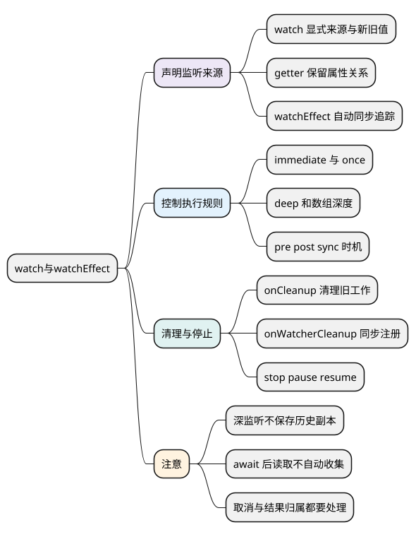

# watch与watchEffect

<!-- core-mindmap:start -->
[](examples/vue08-mindmap.svg)

<details>
<summary>PlantUML 源码</summary>



</details>

<!-- core-mindmap:end -->

**总览：** `watch` 和 `watchEffect` 用于响应状态变化后的副作用，例如请求、计时、写存储和调用外部组件。使用时要回答三个问题：监听什么，什么时候执行，旧任务什么时候清理。能够直接算出来的展示数据，优先使用 computed。

本文以 Vue **3.5.43** 为基线。`once` 从 **3.4** 提供；数字 `deep`、`onWatcherCleanup` 以及句柄的 `pause/resume` 从 **3.5** 提供。

<a id="k01"></a>

## watch(source, callback, options)：明确监听来源，获得新旧值

`source` 可传 ref、返回值的 getter、响应式对象或由这些来源组成的数组。回调接收 `(newValue, oldValue, onCleanup)`，配置对象控制初次执行、深度和时机。返回值是可停止的侦听句柄。

默认不会立即执行回调，来源发生变化后才执行；初次求值仍会读取来源，以便收集依赖。

<!-- example: vue08-watch-basic -->
```ts
import { nextTick, ref, watch } from 'vue'

const count = ref(0)
const changes: Array<[number, number]> = []
const stop = watch(count, (next, previous) => {
  changes.push([next, previous])
})

count.value = 1
count.value = 2
await nextTick()
console.log(changes) // [[2, 0]]，本轮同步变化被合并
stop()
```

这里的旧值是上次回调对应的值，不是所有中间赋值的历史。若最终又回到旧值，普通值来源的回调可能不执行。

## 属性与多个来源：传 getter 保留读取关系

监听对象属性时，传入 `() => state.count`，不要传 `state.count` 得到的普通数字。监听多个来源时，新旧值按来源顺序组成数组。

<!-- example: vue08-watch-sources -->
```ts
import { nextTick, reactive, ref, watch } from 'vue'

const state = reactive({ page: 1 })
const keyword = ref('Vue')
const seen: string[] = []
const stop = watch([() => state.page, keyword], ([page, text], [oldPage]) => {
  seen.push(`${oldPage}->${page}:${text}`)
})

state.page = 2
keyword.value = 'Vue3'
await nextTick()
console.log(seen) // ['1->2:Vue3']
stop()
```

`watch` 只追踪 source 的读取，不会把 callback 内碰到的所有状态也当成触发来源。这让“查询条件变化才请求，其他状态仅供请求时参考”的契约更明确。

## watchEffect(effect)：立即执行，自动追踪同步读取

`watchEffect` 接收副作用函数和可选配置，返回同样的侦听句柄。函数第一次立即执行，自动追踪本次同步执行中实际读取的响应式值。

<!-- example: vue08-effect -->
```ts
import { nextTick, ref, watchEffect } from 'vue'

const keyword = ref('Vue')
const page = ref(1)
const seen: string[] = []
const stop = watchEffect(() => {
  seen.push(`${keyword.value}:${page.value}`)
})

page.value = 2
await nextTick()
console.log(seen) // ['Vue:1', 'Vue:2']
stop()
```

异步 effect 只自动追踪第一次 `await` 之前的同步读取。需要作为触发条件的状态，应先读取，或者直接改用 `watch` 明确声明来源。watchEffect 不提供旧值参数，也不支持靠 `immediate` 关闭首次执行。

<a id="k02"></a>

## immediate 与 once：控制初次执行和自动停止

`immediate: true` 使 watch 创建时先调用一次，第一次的 `oldValue` 是 `undefined`。适合初次加载和以后随参数刷新。

`once: true` 从 **3.4** 起可在回调执行一次后自动停止。与 `immediate: true` 组合时，立即执行的这次也消耗唯一一次执行，因此不会继续监听后续变化。

<!-- example: vue08-watch-once -->
```ts
import { nextTick, ref, watch } from 'vue'

const count = ref(0)
const seen: number[] = []
watch(count, value => { seen.push(value) }, { once: true })
count.value = 1
await nextTick()
count.value = 2
await nextTick()
console.log(seen) // [1]
```

## deep：遍历嵌套依赖，不负责保存历史快照

直接 `watch(reactiveObject, callback)` 会隐式深度侦听。`watch(() => state.user, callback)` 默认只关注返回引用变化；要覆盖其嵌套属性，可以设置 `deep: true`，或只监听实际需要的字段。

深层修改没有替换根对象时，`newValue` 和 `oldValue` 可能就是同一个对象。deep 的任务是发现嵌套变化，不是自动深拷贝旧数据。

<!-- example: vue08-deep -->
```ts
import { nextTick, reactive, watch } from 'vue'

const state = reactive({ user: { name: 'A' } })
const sameReferences: boolean[] = []
const stop = watch(() => state.user, (next, previous) => {
  sameReferences.push(next === previous)
}, { deep: true })

state.user.name = 'B'
await nextTick()
state.user = { name: 'C' }
await nextTick()
console.log(sameReferences) // [true, false]
stop()
```

Vue **3.5** 支持 `deep: number`，表示最大遍历深度。对 ref 数组而言，`deep: 1` 可覆盖数组替换和 push、splice 等数组层变化，但不会继续深入每项对象的属性；需要更深时按数据形状选择深度。

<!-- example: vue08-array-depth -->
```ts
import { nextTick, ref, watch } from 'vue'

const items = ref([{ id: 1, name: 'A' }])
let runs = 0
const stop = watch(items, () => { runs++ }, { deep: 1 })
items.value[0]!.name = 'B'
await nextTick()
console.log(runs) // 0
items.value.push({ id: 2, name: 'C' })
await nextTick()
console.log(runs) // 1
stop()
```

大表单或大列表不宜无条件全量 deep。优先监听具体字段；需要历史对比时明确保存哪些字段的快照，而不是每次都盲目深拷贝整个状态树。

## flush：选择副作用相对组件更新的执行位置

- 默认 `pre`：变化回调会批处理，在父组件更新之后、侦听器所属组件的 DOM 更新之前执行。此时读自身 DOM 可能还是旧内容。
- `post`：在所属组件 DOM 更新之后执行，适合读取更新后的元素。`watchPostEffect` 是 `watchEffect` 配置 `flush: 'post'` 的便捷形式，首次执行也会安排在后置阶段。
- `sync`：来源触发时同步执行，不享受普通侦听回调的批处理。`watchSyncEffect` 是对应的便捷形式，适合少量且确实需要同步失效的状态。

这里说的是侦听器与其所属组件的相对时机，不是“全站所有 pre 完了才能有任何组件更新”。`immediate`、首次 effect 和异步组件还要分别分析。`post` 也不代表浏览器已经把像素绘制到屏幕。

完整 DOM 示例见[调度与组件更新](21_调度与组件更新.md)。不要为监听大量数组修改而使用 sync，它可能在一次循环中反复执行昂贵工作。

<a id="k03"></a>

## onCleanup：下一次回调执行前或停止时清理旧副作用

watch 回调的第三个参数、watchEffect 的第一个参数都是清理注册函数。调用 `onCleanup(fn)` 登记清理，不是立即执行 `fn`。下面只保留最后一次输入对应的计时任务。

<!-- project: vue08-cleanup; file: App.vue -->
```vue
<script setup lang="ts">
import { ref, watch } from 'vue'

const keyword = ref('')
const committed = ref('')
watch(keyword, (value, _previous, onCleanup) => {
  const timer = setTimeout(() => {
    committed.value = value
  }, 300)
  onCleanup(() => clearTimeout(timer))
})
</script>

<template>
  <input v-model="keyword" aria-label="关键词">
  <p>等待 300 毫秒后提交：{{ committed }}</p>
</template>
```

清理发生在副作用重新执行前或侦听器停止时，不是“响应式变量赋值前”。默认 pre 回调会排队，因此需要在源变化瞬间就取消的场景要单独设计同步失效策略。

## onWatcherCleanup：Vue 3.5 的清理注册 API 必须同步调用

`onWatcherCleanup(cleanupFn)` 为当前运行的 watcher 注册清理，方便把资源申请与清理封装在辅助函数中。必须在 watch 回调或 watchEffect 的同步执行阶段调用，**不能放在 await 之后**。

<!-- example: vue08-watcher-cleanup -->
```ts
import { onWatcherCleanup, ref, watch } from 'vue'

const enabled = ref(true)
const stop = watch(enabled, (value) => {
  if (!value) return
  const timer = setInterval(() => { console.log('执行轮询任务') }, 1000)
  onWatcherCleanup(() => clearInterval(timer))
}, { immediate: true })

stop() // 清理计时器，示例不会留下后台轮询
```

回调参数形式的 `onCleanup` 绑定于对应 watcher，没有同样的同步注册限制；但仍应在第一次异步等待之前尽早注册，否则旧任务失效时清理逻辑可能还没登记。不要把“API 允许晚注册”当成“不会出现时序问题”。

请求场景通常同时使用 `AbortController` 和结果归属检查：abort 减少无用工作，归属检查防止不响应取消、已经进入解析等阶段的旧任务覆盖新状态。完整可运行实现见[组合式函数与副作用清理](13_组合式函数与副作用清理.md)。

<a id="k04"></a>

## stop、pause 与 resume：管理侦听器的生命周期

句柄可直接作为 `stop()` 调用，也有 `.stop()`。Vue **3.5** 起提供 `.pause()`、`.resume()`，暂停期间不会按常规执行变化回调，恢复后处理暂停期间积累的失效；不是逐项重放所有中间变化。

<!-- example: vue08-pause -->
```ts
import { nextTick, ref, watch } from 'vue'

const count = ref(0)
const seen: number[] = []
const handle = watch(count, value => { seen.push(value) })
handle.pause()
count.value = 1
count.value = 2
await nextTick()
console.log(seen) // []
handle.resume()
await nextTick()
console.log(seen) // [2]
handle.stop()
```

暂停不是取消已运行的请求，也不等于立即清空已经排队的所有工作；要结束资源应执行清理或停止。同步在 `setup` 中创建的 watcher 绑定组件作用域，通常随卸载自动停止；在 `setTimeout` 等异步回调里后来创建的 watcher 要自行保留 stop 并释放。

<a id="summary"></a>

## 工程追问：侦听逻辑越来越多时，先整理数据来源

出现多个 watch 互相改值时，先确认是否把派生状态误当成独立状态。如果 A 能由 B 计算，就用 computed；如果是请求，则明确触发来源、清理、结果归属与错误状态。不要靠 deep、sync 或更多 nextTick 掩盖数据流问题。

开发环境的 `onTrack/onTrigger` 可以观察依赖收集和触发事件。验证至少覆盖合并更新、嵌套修改、新旧引用相同、连续切换、卸载与旧请求迟到。

继续深入：[源码系列：computed 与 watch](../02_Vue3原理与源码/09_computed与watch.md#computed与watch)。

参考：[侦听器](https://cn.vuejs.org/guide/essentials/watchers.html)、[watch 与清理 API](https://cn.vuejs.org/api/reactivity-core.html#watch)、[3.5 数组侦听深度](https://v3-migration.vuejs.org/breaking-changes/watch.html)。

<a id="interview"></a>

## 试题

<a id="vue07-01"></a>

### VUE07-01 [P0·原理] watch 与 watchEffect 的区别是什么？

**回答：** watch 显式声明来源，能获得新旧值，默认来源变化后才执行回调；watchEffect 首次立即执行，自动追踪同步读取的依赖。watch 回调内额外读到的状态不会自动成为来源，watchEffect 中 await 之后新读取的状态也不会加入最初那次自动收集。

<a id="vue07-02"></a>

### VUE07-02 [P1·原理] deep watch 里新旧值为什么可能相同？

**回答：** 修改嵌套属性时，根对象并没有被替换，回调收到的是同一个对象引用。deep 用遍历让嵌套变化能触发侦听，不会帮我保留修改前的深拷贝。需要比较历史值时，应另行记录必要字段的快照。

<a id="vue07-03"></a>

### VUE07-03 [P0·工程取舍] 为什么取消 fetch 后还要 active 或版本号？

**回答：** 取消网络可以节约资源，但旧任务可能已完成网络、正在解析，或者某个依赖根本不支持取消。提交结果前再检查任务是否仍属于当前请求，才能阻止过期结果覆盖新状态；数据、错误和 loading 都应受同一归属规则约束。

<a id="vue07-04"></a>

### VUE07-04 [P1·原理] post 与 nextTick 是否表示浏览器已经绘制？

**回答：** 不是。post 表达所属组件 DOM 更新后的执行位置，nextTick 等待相应 Vue 更新刷新完成，它们都不保证像素已经呈现。图片加载、CSS 动画和浏览器绘制需要分别使用对应机制等待，requestAnimationFrame 也只是绘制前的帧回调。

<a id="vue07-05"></a>

### VUE07-05 [P1·工程取舍] watcher 一定随组件自动停止吗？

**回答：** 同步在 setup 所属作用域创建的 watcher 通常随组件卸载停止；异步回调里后来创建的 watcher 可能没有绑定组件，必须自行保存 stop。侦听器停止之外，内部创建的请求、计时器和事件监听也要通过清理函数释放。

<a id="vue07-06"></a>

### VUE07-06 [P0·基础] 如何监听 ref 数组的增删，而不深度监听每一项对象？

**回答：** 在 Vue 3.5 可以使用 `watch(items, callback, { deep: 1 })`，覆盖数组替换和数组层的增删改动，不继续深入每项对象。若只关心数量，还可直接监听 length；应以实际业务触发条件决定范围，避免无条件全量 deep。

<a id="vue07-07"></a>

### VUE07-07 [P1·原理] onWatcherCleanup 可以在 await 后注册吗？

**回答：** 不可以，它依赖当前同步运行的 watcher 上下文，应在首次 await 之前注册。回调参数 onCleanup 的绑定方式不同，但为了避免异步任务失效时尚未登记清理，我同样会尽早注册资源释放逻辑。
