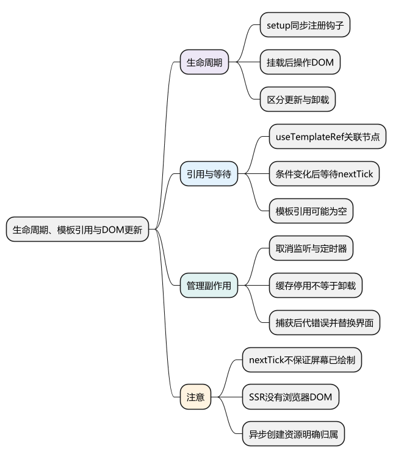
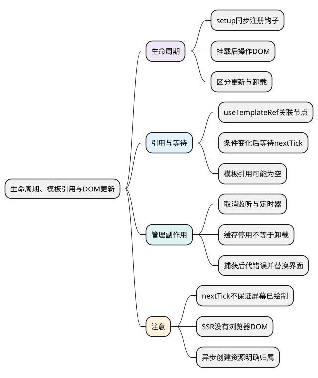
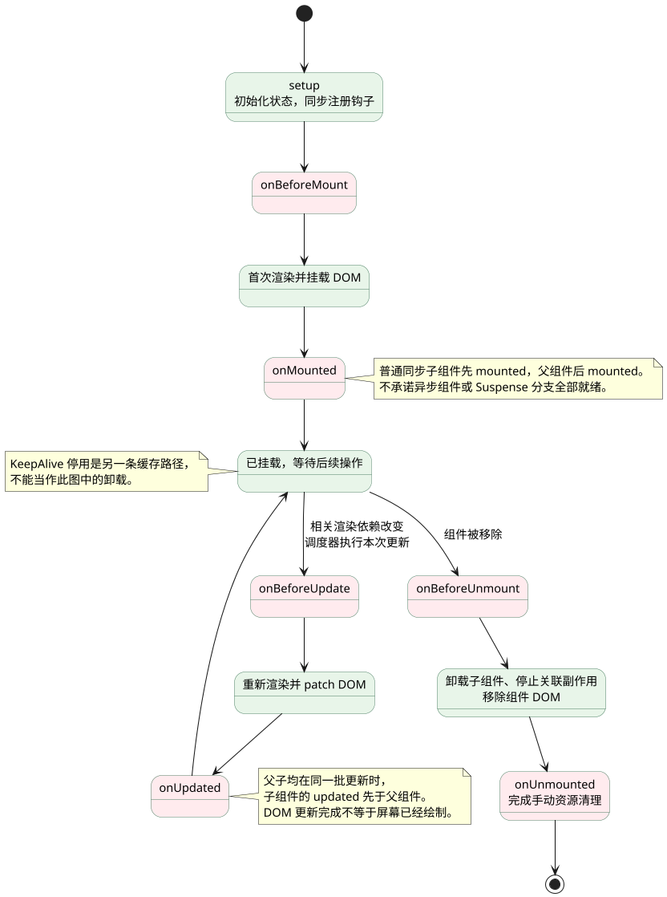
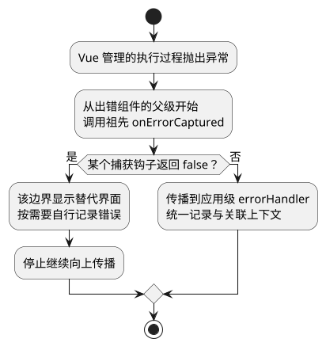

# 生命周期、模板引用与DOM更新

<!-- core-mindmap:start -->
[](examples/vue09-mindmap.svg)

<details>
<summary>PlantUML 源码</summary>



</details>

<!-- core-mindmap:end -->

**口述总览：** 生命周期说明组件从创建、挂载、更新到卸载会经历什么。需要真实 DOM 时等挂载完成，需要读取修改状态后的 DOM 时等 `nextTick`，创建事件监听、定时器等资源后要在适当时机清理。钩子提供时机，资源是否被正确管理仍由业务代码负责。

<a id="k04"></a>

## 生命周期钩子：在对应阶段注册工作

组合式钩子通常在 `setup` 或 `<script setup>` 中同步注册，接收需要执行的回调。常用钩子的职责是：

- `onBeforeMount()`：首次挂载之前，此时还没有当前组件的已挂载 DOM。
- `onMounted()`：组件 DOM 已创建并挂载，同步子组件也已经挂载。
- `onBeforeUpdate()`：状态已变化，本次 DOM 更新之前。
- `onUpdated()`：当前组件因响应式变化而完成 DOM 更新之后。
- `onBeforeUnmount()`：卸载前，组件仍然可以正常工作。
- `onUnmounted()`：组件卸载后，适合完成手动资源清理。

`setup` 在 Options API 的 beforeCreate 之前调用。组合式写法不提供 onCreated，应把初始化逻辑直接放在 setup 中；不要把 setup 定义成某个旧钩子的简单别名。

下面把一个普通客户端组件的挂载、更新和卸载串起来。更新支路可以重复进入；没有影响本组件渲染的变化，就不会仅因某个变量被修改而进入该支路。

<!-- understanding-flow: vue09-lifecycle:start -->
<a id="lifecycle-flow"></a>

<details>
<summary>PlantUML 源码</summary>



</details>

<!-- understanding-flow: vue09-lifecycle:end -->

下面可替换 `App.vue`，观察数据更新和挂载、更新日志。

<!-- example: vue09-hooks -->
```vue
<script setup lang="ts">
import {
  onBeforeMount,
  onBeforeUpdate,
  onMounted,
  onUpdated,
  ref
} from 'vue'

const count = ref(0)

onBeforeMount(() => console.log('挂载前'))
onMounted(() => console.log('挂载后'))
onBeforeUpdate(() => console.log('DOM 更新前，状态已是', count.value))
onUpdated(() => console.log('DOM 更新后'))
</script>

<template>
  <button type="button" @click="count++">{{ count }}</button>
</template>
```

`onUpdated` 不是“任意变量改变都会执行”，只有相关组件发生 DOM 更新时才执行。也不要在里面无条件修改触发本组件更新的状态，否则可能造成反复更新。

## useTemplateRef()：取得真实元素或组件公开实例

Vue 3.5+ 的 `useTemplateRef(key)` 根据模板中的 ref 名称创建引用，返回一个用于读取目标的浅层只读 ref。目标还没有挂载、因 `v-if` 消失或组件卸载时，值可能是 `null`。

下面展示点击后创建输入框，再等待 DOM 更新并聚焦。

<!-- example: vue09-template-ref -->
```vue
<script setup lang="ts">
import { nextTick, ref, useTemplateRef } from 'vue'

const editing = ref(false)
const name = ref('小林')
const input = useTemplateRef<HTMLInputElement>('nameInput')

async function edit() {
  editing.value = true
  await nextTick()
  input.value?.focus()
}
</script>

<template>
  <button type="button" @click="edit">编辑姓名</button>
  <input
    v-if="editing"
    ref="nameInput"
    v-model="name"
    aria-label="姓名"
  >
  <p>{{ name }}</p>
</template>
```

旧版 Vue 3 可以使用 `const input = ref<HTMLInputElement | null>(null)`，并在模板中写 `ref="input"`。这与模板引用的用途相同，但不是 `useTemplateRef` 按名称关联的写法。

模板 ref 绑定到组件时得到公开实例，能访问哪些成员取决于子组件公开了什么。`<script setup>` 子组件需要用 `defineExpose` 明确暴露接口，后续文章给出父子示例。

## nextTick()：等待当前批次 DOM 更新完成

`nextTick()` 返回 Promise，可使用 `await nextTick()`；也可以传入回调，在 DOM 更新完成后执行。一般先修改响应式状态，再等待 nextTick。

它适合在条件渲染后聚焦、读取本次更新后的元素尺寸或滚动位置。它等待 Vue 更新批次，**不保证图片加载完成、CSS 动画结束或浏览器已完成屏幕绘制**。

普通同步赋值会立即改变状态，而多次组件更新通常被合并。同一个函数中连续增加三次数值，并不意味着必须立刻修改 DOM 三次。

`onUpdated` 适合观察某次组件更新结束；只需要等待自己刚触发的那次更新时，nextTick 往往更直接。调度原理在后面的专篇展开。

## 清理监听与定时器：让资源跟随组件生命周期

下面的组件在挂载时读取窗口宽度并添加监听，卸载时解除监听和定时器。回调引用必须是添加时使用的同一个函数。

<!-- example: vue09-cleanup -->
```vue
<script setup lang="ts">
import { onMounted, onUnmounted, ref } from 'vue'

const width = ref(0)
const seconds = ref(0)
let timer: ReturnType<typeof setInterval> | undefined

function updateWidth() {
  width.value = window.innerWidth
}

onMounted(() => {
  updateWidth()
  window.addEventListener('resize', updateWidth)
  timer = setInterval(() => {
    seconds.value += 1
  }, 1000)
})

onUnmounted(() => {
  window.removeEventListener('resize', updateWidth)
  if (timer !== undefined) clearInterval(timer)
})
</script>

<template>
  <p>窗口宽度：{{ width }}，已运行 {{ seconds }} 秒</p>
</template>
```

Vue 会停止与组件关联的响应式 effect，但不会替你清理任意手动创建的窗口监听、定时器或外部订阅。异步之后才创建的 watcher 也可能需要显式停止。

被 KeepAlive 缓存的组件停用时并未卸载。需要页面隐藏就暂停的轮询，应结合 `onActivated`、`onDeactivated` 管理，而不是只等待 onUnmounted。

## 父子组件与错误捕获：明确触发范围

对普通同步子组件，父级的挂载后钩子晚于子级；父级的更新后钩子通常也晚于子级。异步组件和 Suspense 分支不属于“所有子组件都已完成”的简单保证。

`onErrorCaptured((error, instance, info) => ...)` 用来捕获来自后代组件的错误，回调可返回 `false` 阻止继续向上级捕获钩子和全局错误处理器传播。它不是捕获当前组件自身全部错误的通用 try/catch。

下面两个文件演示后代事件处理出错后的替代界面。

<!-- example: vue09-error-boundary -->
<!-- project: vue09-error; file: App.vue -->
```vue
<script setup lang="ts">
import { onErrorCaptured, ref } from 'vue'
import ErrorChild from './ErrorChild.vue'

const message = ref('')

onErrorCaptured(error => {
  message.value = error instanceof Error ? error.message : '未知错误'
  return false
})
</script>

<template>
  <p v-if="message" role="alert">操作失败：{{ message }}</p>
  <ErrorChild v-else />
</template>
```

<!-- example: vue09-error-child -->
<!-- project: vue09-error; file: ErrorChild.vue -->
```vue
<script setup lang="ts">
function fail() {
  throw new Error('演示错误')
}
</script>

<template>
  <button type="button" @click="fail">触发子组件错误</button>
</template>
```

错误替代界面应避免继续渲染刚刚失败的同一分支，否则可能反复触发错误。真实项目还要记录必要上下文，并为用户提供可操作的重试方式。

## app.config.errorHandler：为未被局部边界截断的 Vue 错误提供统一入口

业务校验失败、HTTP 非成功响应和用户取消，通常由对应表单或请求流程处理。后代组件在渲染、生命周期等 Vue 管理的执行过程中抛出异常时，先经过祖先的 `onErrorCaptured`；没有被截断的错误再到应用级 `app.config.errorHandler`。

下面是完整的安装函数。在应用 `mount()` 前传入项目的记录函数即可；这里把“收集异常”与具体监控平台分开。`info` 描述错误来源，生产构建可能使用压缩的错误代码，不能依赖它永远是一句完整英文。

<!-- example: v3review09-error-handler -->
```ts
import type { App } from 'vue';

export function installVueErrorHandler(
  app: App,
  report: (error: unknown, context: { info: string; component: string }) => void,
) {
  app.config.errorHandler = (error, instance, info) => {
    report(error, {
      info,
      component: instance?.$options.name ?? 'AnonymousComponent',
    });
  };
}
```

它会设置本应用的统一处理器；如果项目已有处理器，应在项目入口合并职责。记录函数自身应可靠，避免再次抛错，也不要把表单内容、凭据等敏感信息原样上报。

<!-- understanding-flow: vue09-error-propagation:start -->
<a id="error-propagation"></a>

<details>
<summary>PlantUML 源码</summary>



</details>

<!-- understanding-flow: vue09-error-propagation:end -->

`onErrorCaptured` 只捕获后代，不能用来捕获组件自身的错误。返回 `false` 会阻止这次错误继续传给上层捕获钩子和全局处理器；如果边界需要统一记录，应在这条分支显式记录，避免遗漏或重复报告。

全局处理器不等于给所有异步代码套上 `try/catch`。Vue 能关联的事件处理器或钩子所返回的 Promise 拒绝可以进入框架错误处理；自行启动却没有返回或等待的 Promise、定时器回调仍需要在各自边界捕获。处理器也不会自动恢复失败业务或重试请求。进一步的日志与监控安排放到[工程化与项目面试](../../09_工程化_性能_安全_系统设计_项目面试/00_目录.md)。

## 服务端渲染：浏览器资源不能提前访问

服务端渲染时没有浏览器 DOM，`onMounted`、`onUpdated`、`onUnmounted` 等客户端生命周期不会按浏览器挂载流程执行。浏览器专用操作应放到客户端阶段，不能在模块顶层直接读取 window。

`onServerPrefetch` 可以注册服务端渲染前需要等待的数据任务。服务端状态按请求创建，客户端和服务端第一次输出还需保持可匹配，不能用随意的时间、随机数或浏览器独有状态制造不同结果。

## 工程追问：进入页面多次后回调越来越多

检查监听、订阅和定时器是否重复注册却没有清理；确认页面是卸载还是被 KeepAlive 停用；再检查异步注册的资源是否失去组件作用域归属。复现时记录注册与清理次数，比只在日志多了以后加防抖更能定位问题。

<a id="interview"></a>

## 试题

<a id="vue01-04"></a>

### VUE01-04 [P0·原理] 为什么不能在所有 setup 代码中直接操作 DOM？

**回答：** setup 执行时，当前组件的 DOM 还没有完成挂载，服务端渲染时甚至没有浏览器 DOM。应在 onMounted 等适当阶段操作元素，条件渲染后先等待 nextTick，并处理模板引用为空的情况。创建的监听和外部资源还要安排清理。

<a id="vue18-01"></a>

### VUE18-01 [P0·基础] 模板 ref 为什么可能是 null？

**回答：** 元素尚未挂载时还不存在，v-if 为假或组件卸载后也会消失。模板 ref 表达当前实际渲染目标，不保证始终可用。应在合适生命周期读取，并做空值处理；需要在状态变化后操作新节点时先等 nextTick。

<a id="vue18-02"></a>

### VUE18-02 [P0·原理] nextTick 之后一定已经绘制到屏幕了吗？

**回答：** 不一定。nextTick 等待的是 Vue 当前 DOM 更新批次完成，浏览器绘制、图片加载和动画结束是不同过程。读取本次更新后的 DOM 可以用 nextTick，等待图片或动画则应使用相应事件和机制。

<a id="vue18-03"></a>

### VUE18-03 [P1·工程取舍] 组件卸载后，定时器和窗口监听会自动清理吗？

**回答：** 手动创建的这类资源通常不会被 Vue 自动清理，要保存必要的引用并在卸载或作用域结束时取消。还要区分 KeepAlive 停用与卸载；需要停用即暂停的工作，应在停用阶段处理，不能只等待卸载钩子。

<a id="vue18-04"></a>

### VUE18-04 [P1·原理] onErrorCaptured 能处理哪些错误？

**回答：** 它用于捕获后代组件在 Vue 管理的渲染、事件、生命周期等流程中产生的错误，不是当前组件自身或任意外部异步任务的万能捕获器。返回 false 会停止继续向上和全局处理器传播。处理后应切换到可靠的替代界面，避免重复执行失败分支。

参考：[组合式生命周期](https://cn.vuejs.org/api/composition-api-lifecycle.html) · [模板引用](https://cn.vuejs.org/guide/essentials/template-refs.html) · [nextTick](https://cn.vuejs.org/api/general.html#nexttick) · [服务端渲染](https://cn.vuejs.org/guide/scaling-up/ssr.html)

上一篇：[watch 与 watchEffect](08_watch与watchEffect.md) · 下一篇：[props、emits 与组件 v-model](10_props、emits与组件v-model.md) · [返回目录](00_目录.md)

<a id="vue18-05"></a>

### VUE18-05 [P1·工程取舍] onErrorCaptured 与全局 errorHandler 怎样分工？

本地业务错误在对应流程处理；后代组件的框架异常沿祖先捕获钩子传播，没有被返回 false 截断时才到全局 errorHandler。局部边界负责替代界面，全局入口负责统一记录；定时器和脱离 Vue 调用链的 Promise 仍需自行捕获，处理器不会自动恢复业务。
