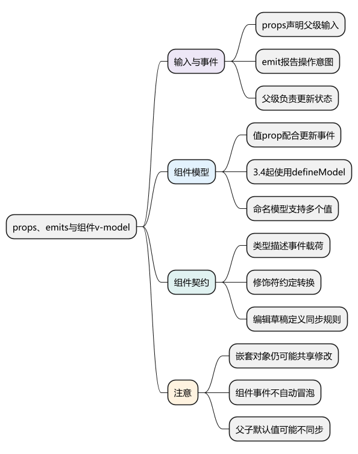
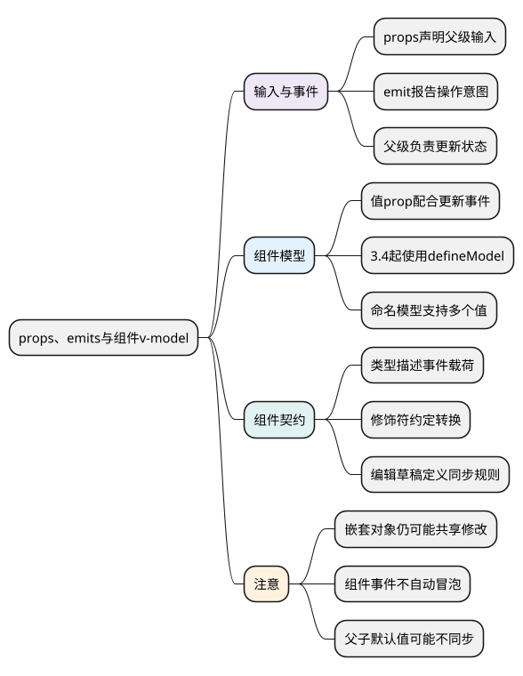
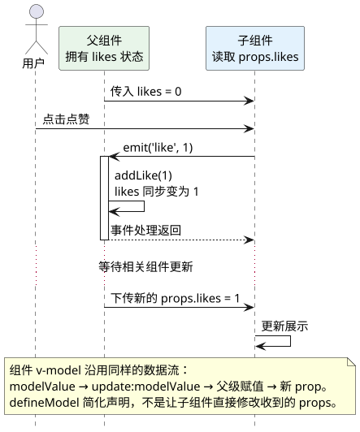

# props、emits与组件v-model

<!-- core-mindmap:start -->
[](examples/vue10-mindmap.svg)

<details>
<summary>PlantUML 源码</summary>



</details>

<!-- core-mindmap:end -->

**口述总览：** 父组件通过 props 把数据传给子组件，子组件通过 emit 报告操作意图，由父组件决定如何修改状态。组件 v-model 是“值 prop 加更新事件”的约定。先把数据归属讲清楚，再选择通信方式，避免父子都在暗中修改同一份数据。

<a id="k01"></a>

## defineProps()：声明组件需要什么输入

`defineProps()` 声明 props，返回可读取的 props 对象。可以使用运行时对象声明，也可以使用 TypeScript 类型声明；它是编译宏，无须导入。

props 中可以声明必填项、可选项和默认值。根级 props 不应由子组件直接重新赋值，新的值通过父级传入。

## defineEmits()：声明并发出组件事件

`defineEmits()` 返回 `emit` 函数。`emit(eventName, ...args)` 根据事件名携带参数通知父级，返回值不是业务结果；父组件通过 `@事件名` 监听。

下面两个文件展示完整数据流：父级保存点赞数，子级展示并发出点赞事件。

<!-- example: vue10-parent -->
<!-- project: vue10-props-events; file: App.vue -->
```vue
<script setup lang="ts">
import { ref } from 'vue'
import UserCard from './UserCard.vue'

const likes = ref(0)

function addLike(step: number) {
  likes.value += step
}
</script>

<template>
  <UserCard name="小林" :likes="likes" @like="addLike" />
  <p>父组件保存的次数：{{ likes }}</p>
</template>
```

<!-- example: vue10-child -->
<!-- project: vue10-props-events; file: UserCard.vue -->
```vue
<script setup lang="ts">
const props = withDefaults(defineProps<{
  name: string
  likes: number
  disabled?: boolean
}>(), {
  disabled: false
})

const emit = defineEmits<{
  like: [step: number]
}>()
</script>

<template>
  <article>
    <h2>{{ props.name }}</h2>
    <button
      type="button"
      :disabled="props.disabled"
      @click="emit('like', 1)"
    >
      点赞 {{ props.likes }}
    </button>
  </article>
</template>
```

这个过程是“父传值 → 子报告操作 → 父更新值 → 子接收新值”，并不是子组件直接改动 props。

沿着图中的箭头看，数据所有者始终是父组件。事件处理函数通常在 emit 时同步调用，而新 props 的下传和 DOM 展示仍经过组件更新流程。

<!-- understanding-flow: vue10-props-events:start -->
<a id="props-event-flow"></a>

<details>
<summary>PlantUML 源码</summary>



</details>

<!-- understanding-flow: vue10-props-events:end -->

组件事件不会像 DOM 事件一样自动沿任意组件祖先冒泡。祖父级要接收，应由中间组件显式转发，或根据关系选择依赖注入、共享状态。

## 对象 props：能修改嵌套属性，不等于应该修改

对象和数组通过引用传递，props 的根级只读不等于整个对象被深度冻结。子组件可能改到 `props.user.name` 或调用数组的 push，并影响父级数据。

这种修改绕开了明确的事件路径。可复用组件通常应发出更新意图，或接收父级提供的操作函数；确有紧密耦合的内部组件共享可写对象时，也应明确约定。

编辑表单可以从 prop 创建本地草稿，但要决定后续父级更新是否覆盖草稿。只在初始化时复制一次，之后就不会自动与父级保持一致。

<a id="k02"></a>

## defineModel()：简化组件 v-model

Vue 3.4+ 的 `defineModel()` 声明一个模型 prop 和对应的更新事件，返回模型 ref。默认名称是 `modelValue`，更新事件是 `update:modelValue`；指定名称后则使用这个名称及 `update:名称`。

下面是一个可编辑姓名的父子组件。

<!-- example: vue10-model-parent -->
<!-- project: vue10-model; file: App.vue -->
```vue
<script setup lang="ts">
import { ref } from 'vue'
import NameEditor from './NameEditor.vue'

const name = ref('小林')
</script>

<template>
  <NameEditor v-model="name" />
  <p>父组件收到：{{ name }}</p>
</template>
```

<!-- example: vue10-model-child -->
<!-- project: vue10-model; file: NameEditor.vue -->
```vue
<script setup lang="ts">
const model = defineModel<string>({ required: true })
</script>

<template>
  <label>姓名 <input v-model="model"></label>
</template>
```

编辑输入框时，模型更新会通过对应事件通知父级。它不是把父级变量直接作为任意可写内存交给子级。

不使用 defineModel 时，同一个 NameEditor 可以写成下面的完整组件，它与上面的父级保持相同默认契约。

<!-- example: vue10-manual-model -->
```vue
<script setup lang="ts">
const props = defineProps<{ modelValue: string }>()
const emit = defineEmits<{
  'update:modelValue': [value: string]
}>()

function update(event: Event) {
  const input = event.currentTarget
  if (input instanceof HTMLInputElement) {
    emit('update:modelValue', input.value)
  }
}
</script>

<template>
  <label>
    姓名
    <input :value="props.modelValue" @input="update">
  </label>
</template>
```

## 命名模型与修饰符：明确每一个输入的约定

一个组件可有多个模型。以下是供父级以 `v-model:first-name` 和 `v-model:last-name` 使用的完整子组件；父级应分别提供两个字符串 ref。

<!-- example: vue10-named-model -->
```vue
<script setup lang="ts">
const firstName = defineModel<string>('firstName', { required: true })
const lastName = defineModel<string>('lastName', { required: true })
</script>

<template>
  <label>名 <input v-model="firstName"></label>
  <label>姓 <input v-model="lastName"></label>
</template>
```

组件还可以读取模型修饰符并通过 get/set 转换。下面这个子组件支持父级的 `v-model.trim`；不传 trim 时按原值提交。

<!-- example: vue10-model-modifier -->
```vue
<script setup lang="ts">
const [model, modifiers] = defineModel<string, 'trim'>({
  required: true,
  set(value) {
    return modifiers.trim ? value.trim() : value
  }
})
</script>

<template>
  <input v-model="model" aria-label="可去除两端空白的输入">
</template>
```

修饰符处理属于组件契约，应明确在输入时、失焦时还是提交时格式化，避免边输入边转换导致光标或输入法体验异常。

## 默认值与校验：避免看起来同步、实际上不一致

如果子级给 defineModel 设置了默认值，而父级绑定的是 undefined，可能出现子级已显示默认值、父级仍未初始化的情况。需要同步初始值时，优先在状态拥有者处初始化，或明确初始化事件流程。

props 类型检查、运行时 validator、emits 参数检查主要帮助开发阶段发现错误，不是外部数据验证或安全边界。输入组件还要处理空值、非法值和禁用状态，提交数据仍由业务层校验。

## 工程追问：组件接口怎样支持维护

先明确组件负责“收集输入”还是“提交业务”。通用输入框通常不应自己猜请求地址、权限和保存规则，而应提供明确的值、事件和必要状态。

同时声明 emits 可以使 Vue 区分组件事件与未声明的原生透传监听，减少包装组件出现重复触发或监听落点不清楚的问题。attrs 的规则下一篇继续说明。

<a id="interview"></a>

## 试题

<a id="vue11-01"></a>

### VUE11-01 [P0·原理] 子组件为何不应直接修改父传来的对象？

**回答：** 对象共享引用使嵌套修改可能实际生效，但这会绕过清晰的数据所有权，父级不容易判断谁在什么时候修改了状态。可复用组件通常通过事件报告修改意图，由父级更新；需要取消编辑的场景可以维护独立草稿，再明确保存和同步规则。

<a id="vue11-02"></a>

### VUE11-02 [P0·基础] 组件 v-model 的本质是什么？

**回答：** 是值 prop 和更新事件的约定。默认对应 modelValue 与 update:modelValue，命名模型使用相应名称。defineModel 提供编译简写并返回模型 ref，但它不会自动处理校验、提交、服务器同步和父子默认值不一致的问题。

<a id="vue11-05"></a>

### VUE11-05 [P0·基础] 子组件 emit 后，祖父组件会自动收到吗？

**回答：** 不会。组件自定义事件不像 DOM 事件那样自动沿祖先冒泡，通常只有直接监听这个组件事件的父级收到。需要跨层时可以显式转发，或根据数据关系采用 provide/inject、共享状态，不能只在祖父级随便写同名监听。

<a id="vue11-06"></a>

### VUE11-06 [P1·工程取舍] 子组件给 v-model 设置默认值有什么注意点？

**回答：** 如果父级模型还是 undefined，而子级使用了默认值，两边可能在初始化时不一致。应优先在拥有状态的父级设置初值，或者约定明确的初始化流程。不能把子级显示出默认值当作父级状态已经被更新。

<a id="vue11-07"></a>

### VUE11-07 [P1·工程取舍] 把 props 复制成本地状态就能安全编辑了吗？

**回答：** 还需要定义同步规则。复制一次会形成独立初始值，父级后续变化不会自动同步；浅复制也可能保留嵌套对象引用。应按数据结构创建合适草稿，决定父级更新、取消和保存分别如何处理，避免表面是本地编辑，实际上仍修改共享对象。

参考：[Props](https://cn.vuejs.org/guide/components/props.html) · [组件事件](https://cn.vuejs.org/guide/components/events.html) · [组件 v-model](https://cn.vuejs.org/guide/components/v-model.html)

上一篇：[生命周期、模板引用与 DOM 更新](09_生命周期、模板引用与DOM更新.md) · 下一篇：[插槽、attrs 与组件公开接口](11_插槽、attrs与组件公开接口.md) · [返回目录](00_目录.md)
