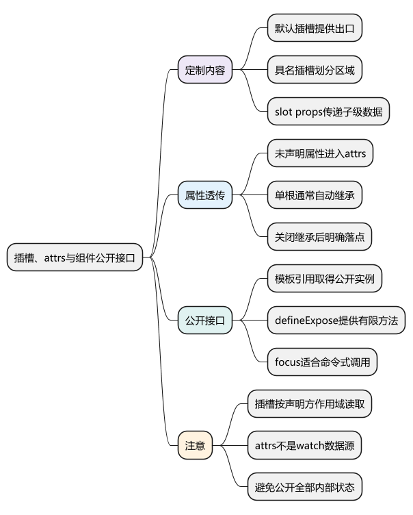
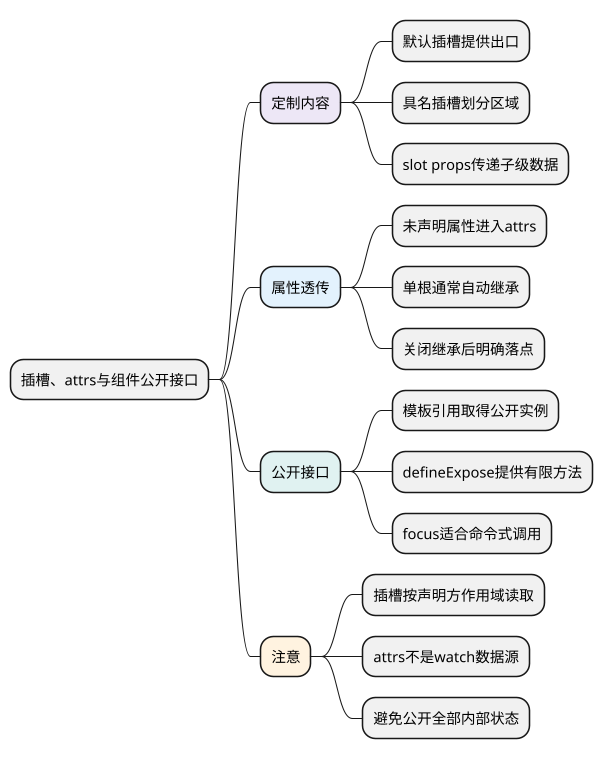

# 插槽、attrs与组件公开接口

<!-- core-mindmap:start -->
[](examples/vue11-mindmap.svg)

<details>
<summary>PlantUML 源码</summary>



</details>

<!-- core-mindmap:end -->

**口述总览：** props 适合传数据，插槽适合让父级提供显示内容；attrs 处理未声明为 props 或组件事件的透传属性；defineExpose 提供少量需要父级直接调用的方法。它们解决的是不同需求，不能把组件内部状态全部公开来代替正常通信。

<a id="k03"></a>

## slot：让父级填入内容

子组件使用 `<slot>` 声明内容出口，父组件把内容写在组件标签内部。slot 中的默认内容在父级没有提供相应内容时显示。

`<slot name="header">` 是具名插槽，父级使用 `<template #header>` 提供对应内容。`#` 是 `v-slot:` 的简写，没有指定名称的插槽叫 default。

下面两个文件组成一个带标题、正文和底部区域的卡片。

<!-- example: vue11-slot-parent -->
<!-- project: vue11-card; file: App.vue -->
```vue
<script setup lang="ts">
import InfoCard from './InfoCard.vue'

const title = '学习进度'
</script>

<template>
  <InfoCard>
    <template #header>
      <h2>{{ title }}</h2>
    </template>

    <p>已经完成 JavaScript 和 TypeScript 复习。</p>

    <template #footer>
      <a href="#next">继续学习 Vue 3</a>
    </template>
  </InfoCard>
</template>
```

<!-- example: vue11-slot-child -->
<!-- project: vue11-card; file: InfoCard.vue -->
```vue
<script setup lang="ts">
defineSlots<{
  header?: () => unknown
  default?: () => unknown
  footer?: () => unknown
}>()
</script>

<template>
  <article class="card">
    <header><slot name="header">默认标题</slot></header>
    <section><slot>暂无内容</slot></section>
    <footer v-if="$slots.footer"><slot name="footer" /></footer>
  </article>
</template>

<style scoped>
.card { padding: 16px; border: 1px solid #ccc; }
</style>
```

父级插槽内容里的 `title` 属于父级作用域，不会因为显示在子组件里就自动访问子组件全部变量。

`defineSlots()` 是 Vue 3.3+ 编译宏，用于描述插槽类型，不需要导入。这里只给各区域提供类型提示，实际渲染位置仍由模板中的 slot 决定。

## 作用域插槽：子级给数据，父级决定显示方式

子组件在 slot 出口绑定属性，父级通过 `v-slot` 或 `#default` 接收，称为作用域插槽。可以把它理解为“子级调用父级提供的显示函数，并传入参数”。

以下列表组件负责遍历，父级决定每行怎样显示。

<!-- example: vue11-scoped-parent -->
<!-- project: vue11-scoped; file: App.vue -->
```vue
<script setup lang="ts">
import UserList from './UserList.vue'

const users = [
  { id: 'u1', name: '小林' },
  { id: 'u2', name: '小周' }
]
</script>

<template>
  <UserList :users="users">
    <template #default="{ user, index }">
      <strong>{{ index + 1 }}. {{ user.name }}</strong>
    </template>
  </UserList>
</template>
```

<!-- example: vue11-scoped-child -->
<!-- project: vue11-scoped; file: UserList.vue -->
```vue
<script setup lang="ts">
interface User {
  id: string
  name: string
}

const props = defineProps<{ users: User[] }>()
defineSlots<{
  default?: (props: { user: User; index: number }) => unknown
}>()
</script>

<template>
  <ul>
    <li v-for="(user, index) in props.users" :key="user.id">
      <slot :user="user" :index="index">{{ user.name }}</slot>
    </li>
  </ul>
</template>
```

父级能读取这里的 user 和 index，是因为子级显式提供了 slot props。父级仍不能随意访问子组件未暴露的内部变量。

`useSlots()` 是运行时函数，返回当前组件的插槽对象，可在 setup 中读取插槽函数。模板中可直接使用 `$slots` 判断某个区域是否有内容。

## 泛型组件：让输入、插槽和事件共享同一种数据类型

公共列表不一定只展示 User。Vue 3.3+ 支持 `<script setup generic="...">`，可以让组件接收的每一项、插槽提供的数据和选中事件的参数保持同一种类型；不要把它们都写成 `any`，否则父级无法验证字段是否存在。

下面两个文件放在同一目录。`T` 至少有 id 和 label，父级传入含 email 的用户后，插槽与 select 事件也能使用 email。

<!-- example: vue11-generic-list -->
<!-- project: vue11-generic; file: ChoiceList.vue -->
```vue
<script setup lang="ts" generic="T extends { id: string; label: string }">
const props = defineProps<{ items: readonly T[] }>()
const emit = defineEmits<{ select: [item: T] }>()
defineSlots<{ default?: (props: { item: T }) => unknown }>()
</script>

<template>
  <ul>
    <li v-for="item in props.items" :key="item.id">
      <button type="button" @click="emit('select', item)">
        <slot :item="item">{{ item.label }}</slot>
      </button>
    </li>
  </ul>
</template>
```

<!-- example: vue11-generic-app -->
<!-- project: vue11-generic; file: App.vue -->
```vue
<script setup lang="ts">
import { ref } from 'vue'
import ChoiceList from './ChoiceList.vue'

interface User { id: string; label: string; email: string }
const users: User[] = [{ id: 'u1', label: '小林', email: 'lin@example.com' }]
const selectedEmail = ref('')
function selectUser(user: User) { selectedEmail.value = user.email }
</script>

<template>
  <ChoiceList :items="users" @select="selectUser">
    <template #default="{ item }">{{ item.label }}：{{ item.email }}</template>
  </ChoiceList>
  <p>已选邮箱：{{ selectedEmail }}</p>
</template>
```

运行 `vue-tsc --noEmit` 检查父子调用；把父级插槽的 `item.email` 写成不存在的字段，应产生类型错误。泛型只表达类型关系，不负责验证接口 JSON，也不自动处理加载、空数据和选择状态；这些行为仍要在组件契约中明确。

如果还要取得泛型组件的公开实例，不能直接照搬普通组件的 `InstanceType`；可以使用 `vue-component-type-helpers` 的 `ComponentExposed`。本例通过事件通信，不需要引入额外的组件引用。

## attrs 与 inheritAttrs：决定属性落在哪个节点

未声明为 props 或 emits 的属性会进入透传属性，例如 `class`、`style`、`id` 和未声明的事件监听器。单根组件通常自动把它们传到根节点，class/style 会与根节点已有值合并。

多根组件没有唯一落点，需要明确把 `$attrs` 绑定到哪个节点。单根包装组件也可能希望属性落在内部 input，而不是最外层 label，此时可以关闭自动继承。

`defineOptions({ inheritAttrs: false })` 需要 Vue 3.3+。`useAttrs()` 返回当前透传属性对象，无须通过组件实例读取。

下面的输入组件把 id、class、原生 focus 监听等 attrs 统一放到实际 input，同时公开一个 focus 方法。

<!-- example: vue11-public-parent -->
<!-- project: vue11-public; file: App.vue -->
```vue
<script setup lang="ts">
import { ref, useTemplateRef } from 'vue'
import SmartInput from './SmartInput.vue'

const name = ref('')
const message = ref('')
const field = useTemplateRef<InstanceType<typeof SmartInput>>('field')
</script>

<template>
  <SmartInput
    id="username"
    ref="field"
    v-model="name"
    label="姓名"
    autocomplete="name"
    @focus="message = '开始输入'"
  />
  <button type="button" @click="field?.focus()">聚焦姓名框</button>
  <p>{{ message }} {{ name }}</p>
</template>
```

<!-- example: vue11-public-child -->
<!-- project: vue11-public; file: SmartInput.vue -->
```vue
<script setup lang="ts">
import { useAttrs, useTemplateRef } from 'vue'

defineOptions({ inheritAttrs: false })
const props = defineProps<{ label: string }>()
const model = defineModel<string>({ required: true })
const attrs = useAttrs()
const input = useTemplateRef<HTMLInputElement>('nativeInput')

function focus() {
  input.value?.focus()
}

defineExpose({ focus })
</script>

<template>
  <label>
    <span>{{ props.label }}</span>
    <input ref="nativeInput" v-model="model" v-bind="attrs">
  </label>
</template>
```

这里 label 是已声明 prop，模型的更新事件也属于已声明事件，因此不会当普通 attrs 传给 input。未声明的 focus 监听则明确落到 input。

`useAttrs()` 返回值会反映最新透传属性，但不是供 watch 追踪的响应式数据源。如果业务逻辑需要响应某个输入的变化，应把它明确声明为 prop，而不是把所有输入都藏在 attrs 里。

## defineExpose()：公开有限的命令式接口

`defineExpose({ focus })` 指定父级通过组件引用可访问的成员。它是编译宏，默认返回值没有业务用途；应在任何顶层 await 之前调用。

父级得到的是公开实例，而不是子组件全部 setup 变量。公开的 ref 在父级实例访问时会自动解包，但这不表示应该把所有内部状态都公开。

focus、reset、滚动到指定项适合命令式接口；名称、选中值、开关状态等持续数据关系，通常仍适合 props、事件或 v-model。

## 工程追问：包装组件怎样避免破坏调用方

先决定属性落点、事件语义和公开方法，再调整内部结构。否则从单个 input 改成 label 包裹 input 后，class、disabled 或原生监听可能突然落错位置。

测试应覆盖父级传入的 class、aria 属性、原生事件是否到达正确节点，以及组件引用在条件渲染前后是否安全。组件内部结构可以变化，公开行为应保持明确。

<a id="interview"></a>

## 试题

<a id="vue11-03"></a>

### VUE11-03 [P1·原理] slot 内容能直接访问子组件全部状态吗？

**回答：** 不能。插槽内容通常在父级声明，按父级作用域读取变量；需要子级数据时，由子级通过 slot props 显式传出，父级再接收。作用域插槽是一个明确的数据和显示契约，不是直接访问子组件全部内部状态。

<a id="vue19-01"></a>

### VUE19-01 [P0·基础] 默认插槽、具名插槽和作用域插槽有什么区别？

**回答：** 默认插槽提供默认内容出口；具名插槽把标题、正文、底部等多个区域分开；作用域插槽强调子组件向插槽传数据，让父组件决定显示方式。具名与作用域并不互斥，一个具名插槽也可以提供 slot props。

<a id="vue19-02"></a>

### VUE19-02 [P1·工程取舍] 为什么包装输入框时常使用 inheritAttrs: false？

**回答：** 包装组件的根节点可能是 label 或 div，但 id、disabled、class 和原生事件往往需要落到内部 input。关闭自动继承后，显式把 attrs 绑定到正确节点，可以避免属性落错位置或重复监听。多根组件同样需要明确落点。

<a id="vue19-03"></a>

### VUE19-03 [P1·工程取舍] 为什么不把子组件全部状态都 defineExpose 出去？

**回答：** 全部公开会让父级依赖子级实现细节，内部重构容易影响调用方，也容易出现绕过事件直接改状态的情况。应该只公开必要的命令式能力，例如 focus 或 reset，持续的数据同步优先通过 props、事件和 v-model 表达。

<a id="vue19-05"></a>

### VUE19-05 [P1·工程取舍] 公共列表组件为什么需要把 props、插槽和事件的泛型关联起来？

**回答：** 它们传递的是同一类业务条目。用同一个 T 能让父级从 items 推断插槽字段和事件参数，错误字段可以被类型检查发现；分别写成宽泛对象或 any 会丢失这种关系。类型检查之后仍需验证选择事件、空数据和更新行为。

参考：[插槽](https://cn.vuejs.org/guide/components/slots.html) · [透传属性](https://cn.vuejs.org/guide/components/attrs.html) · [defineExpose](https://cn.vuejs.org/api/sfc-script-setup.html#defineexpose)

上一篇：[props、emits 与组件 v-model](10_props、emits与组件v-model.md) · 下一篇：[provide、inject 与依赖注入](12_provide、inject与依赖注入.md) · [返回目录](00_目录.md)
