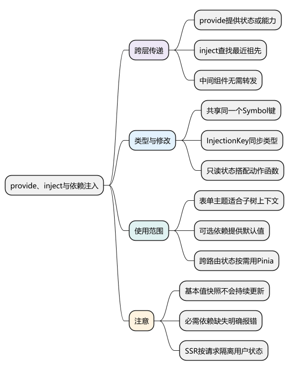
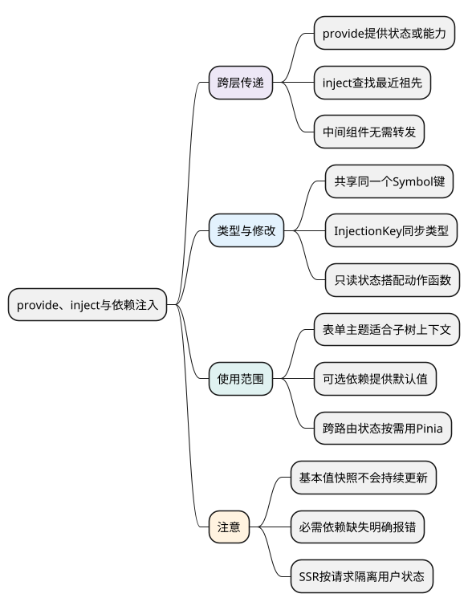

# provide、inject与依赖注入

<!-- core-mindmap:start -->
[](examples/vue12-mindmap.svg)

<details>
<summary>PlantUML 源码</summary>



</details>

<!-- core-mindmap:end -->

**口述总览：** provide 和 inject 用于把上层提供的数据或能力交给深层后代，减少中间组件逐层转发。提供者决定数据来源和修改方式，使用者根据键取得依赖。它适合组件子树的上下文，例如主题、表单和业务服务，不等于所有状态都应该全局共享。

<a id="k04"></a>

## provide() 与 inject()：跨层传递数据或能力

`provide(key, value)` 在当前组件提供一个值给后代，key 可以是字符串或 Symbol，函数没有需要使用的业务返回值。

`inject(key)` 在祖先提供者中查找对应值并返回；找不到时默认返回 undefined。存在多个同名提供者时，使用距离当前组件最近的一层。

通常在 setup 中同步调用这两个函数。组件自身的 inject 查找祖先提供者，不是查找自己刚刚 provide 的值。

应用级也可以使用 `app.provide(key, value)` 提供整个应用可用的依赖，但每个应用的配置范围和每个组件子树的范围要分清。

## InjectionKey：让提供者和使用者共享类型约定

项目较大时，使用单独导出的 Symbol 键，并用 `InjectionKey<T>` 描述值的类型。提供者和使用者必须导入同一个键，不能各自创建两个描述相同的新 Symbol。

下面四个文件演示“上层提供计数状态，中间只做布局，深层读取并通过动作修改”。

<!-- example: vue12-key -->
<!-- project: vue12-injection; file: counter.ts -->
```ts
import type { InjectionKey, Ref } from 'vue'

export interface CounterContext {
  count: Readonly<Ref<number>>
  increment: () => void
}

export const counterKey: InjectionKey<CounterContext> = Symbol('counter')
```

<!-- example: vue12-provider -->
<!-- project: vue12-injection; file: App.vue -->
```vue
<script setup lang="ts">
import { provide, readonly, ref } from 'vue'
import CounterPanel from './CounterPanel.vue'
import { counterKey } from './counter'

const count = ref(0)

function increment() {
  count.value += 1
}

provide(counterKey, {
  count: readonly(count),
  increment
})
</script>

<template>
  <h1>父级计数：{{ count }}</h1>
  <CounterPanel />
</template>
```

<!-- example: vue12-middle -->
<!-- project: vue12-injection; file: CounterPanel.vue -->
```vue
<script setup lang="ts">
import CounterButton from './CounterButton.vue'
</script>

<template>
  <section>
    <h2>中间组件只负责布局</h2>
    <CounterButton />
  </section>
</template>
```

<!-- example: vue12-consumer -->
<!-- project: vue12-injection; file: CounterButton.vue -->
```vue
<script setup lang="ts">
import { inject } from 'vue'
import { counterKey } from './counter'

const context = inject(counterKey)
if (!context) {
  throw new Error('CounterButton 必须放在计数提供者内部')
}

const { count, increment } = context
</script>

<template>
  <button type="button" @click="increment">深层组件增加：{{ count }}</button>
</template>
```

中间组件不需要声明计数 prop，也不需要转发点击事件。深层组件拿到的是 count ref 和 increment 函数，状态仍由提供者管理。

`InjectionKey` 让两侧获得一致的 TypeScript 提示，但不会在运行时自动验证任意数据。示例仍检查了提供者是否存在，避免用非空断言掩盖实际缺失。

## 响应式传递：注入机制不会自动把快照变成状态

提供 `ref` 或响应式对象时，使用者拿到同一份响应式值，可以跟随更新。注入的 ref 不会在脚本里自动解包，仍通过 `.value` 读取；放在模板顶层时适用模板的解包规则。

如果提供的是 `count.value` 的当时数字，注入者拿到的是这个值，而不是对原 ref 的持续订阅。需要持续变化时传 ref、响应式对象或明确的读取接口。

上例把 count 放进普通上下文对象后再解构，拿到的仍是 ref，因此可以保持更新。这与直接解构 reactive 对象的基本类型属性不是同一情况。

## 修改权：提供只读状态和明确动作

仅仅调用 provide 不会自动限制使用者写入。直接提供一个可变响应式对象，后代就可能在多个位置修改它。

需要集中修改逻辑时，可以像上例一样用 readonly 提供只读视图，并暴露 increment、select、reset 等动作函数。动作可以同时处理校验和相关状态，使变化更容易追踪。

只读代理是前端代码的使用约定，不是权限或安全机制。真正的接口权限仍由服务端验证。

## 默认值与工厂：处理可选依赖

`inject(key, defaultValue)` 在没有找到提供者时返回默认值；只有业务允许缺省时才这样做。缺失本应必需的表单上下文时，清晰报错通常比默默创建另一份状态更合适。

如果默认对象构建有成本，可以使用 `inject(key, factory, true)`。第三个参数表示把第二个参数当默认值工厂，只在需要默认值时调用。

下面是一个可独立使用的组件：外层可通过对应字符串键提供设置，没有提供者时使用本地默认值。

<!-- example: vue12-defaults -->
```vue
<script setup lang="ts">
import { inject } from 'vue'

const title = inject<string>('pageTitle', '默认页面')
const settings = inject<{ compact: boolean }>(
  'pageSettings',
  () => ({ compact: false }),
  true
)
</script>

<template>
  <section :class="{ compact: settings.compact }">
    <h2>{{ title }}</h2>
  </section>
</template>

<style scoped>
.compact { padding: 4px; }
</style>
```

这里用字符串展示默认值 API，实际多人协作时可继续使用有类型的 Symbol 键。若提供者确实提供了 undefined，查找已成功，不能把默认值当成对所有 undefined 的自动替换。

## 与 props、Pinia 的选择：按使用范围决定

直接父子关系且输入输出清晰时，props 和事件最直观。许多层都需要同一表单、主题或服务时，provide/inject 可以减少无意义转发。

跨路由共享、需要集中动作和开发工具支持的客户端状态，可以考虑 Pinia。可分享的筛选条件可能属于 URL，接口数据还需要缓存和失效策略；不要只因为“多个组件要用”就把所有内容放进全局 Store。

## 工程追问：依赖注入怎样保持可维护

把注入键、值类型和必需条件集中定义，避免各组件到处写同名字符串。组件文档应说明它能否独立使用，以及需要哪个提供者。

同一页面可以创建多个提供者，例如多个独立表单；后代会选择最近的一层，使状态隔离更自然。服务端渲染时，用户相关状态仍需按请求或应用创建，不能通过模块单例把不同用户连到同一份可变对象。

<a id="interview"></a>

## 试题

<a id="vue11-04"></a>

### VUE11-04 [P1·工程取舍] provide/inject 与 Pinia 怎么选？

**回答：** 组件子树内的主题、表单上下文或依赖服务适合 provide/inject；跨路由共享并需要集中动作、调试支持的客户端状态可以用 Pinia。还要区分 URL 状态和服务器数据，不应把所有状态都全局化。先判断归属、共享范围和修改责任，再选工具。

<a id="vue20-01"></a>

### VUE20-01 [P0·基础] 注入一定具有响应式吗？

**回答：** 不一定，取决于提供的值。提供 ref 或响应式对象时可以观察后续变化，提供某个基本值的当前快照则不会自动订阅原状态。注入机制负责查找和传递依赖，不负责把任意值自动变成响应式。

<a id="vue20-02"></a>

### VUE20-02 [P0·基础] 没有提供者时怎么办，同名提供者又怎样选择？

**回答：** 没有提供者且未设置默认值时，inject 返回 undefined。可选依赖可以提供默认值或默认值工厂，必需依赖应明确检查并报错。多个祖先提供同一个键时，使用距离当前组件最近的提供者，适合嵌套上下文和局部覆盖。

<a id="vue20-03"></a>

### VUE20-03 [P1·工程取舍] 为什么要使用 Symbol、InjectionKey 和动作函数？

**回答：** Symbol 降低不同模块的键名冲突，InjectionKey 让提供者和使用者共享值的类型约定，动作函数则把修改责任集中在提供者。它们分别解决命名、类型和修改路径问题；仍需导入同一个键，并处理提供者缺失和实际运行时数据。

参考：[依赖注入](https://cn.vuejs.org/guide/components/provide-inject.html) · [组合式依赖注入 API](https://cn.vuejs.org/api/composition-api-dependency-injection.html) · [为 provide/inject 标注类型](https://cn.vuejs.org/guide/typescript/composition-api.html#typing-provide-inject)

上一篇：[插槽、attrs 与组件公开接口](11_插槽、attrs与组件公开接口.md) · 下一篇：[组合式函数与副作用清理](13_组合式函数与副作用清理.md) · [返回目录](00_目录.md)
