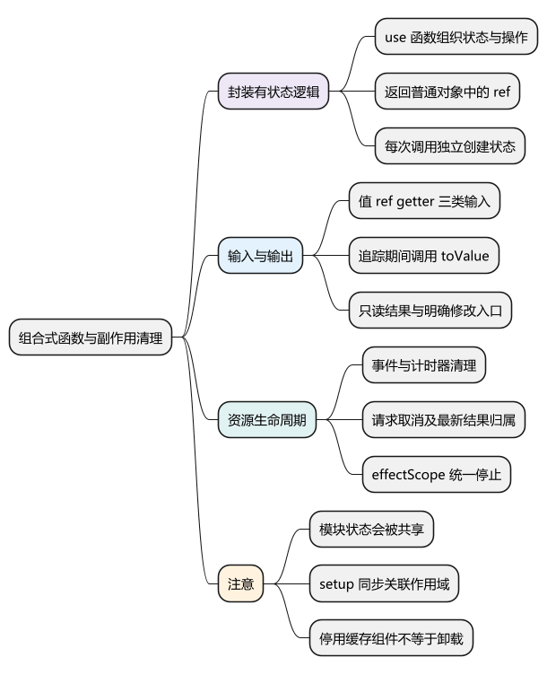
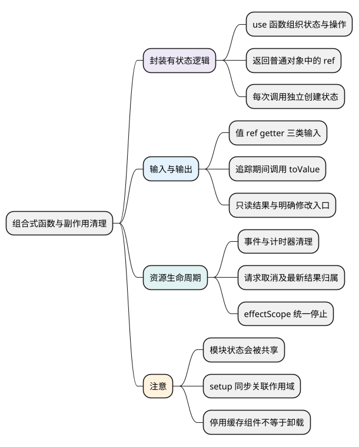
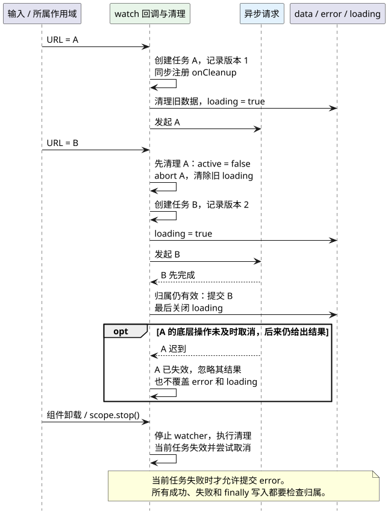

# 组合式函数与副作用清理

<!-- core-mindmap:start -->
[](examples/vue13-mindmap.svg)

<details>
<summary>PlantUML 源码</summary>



</details>

<!-- core-mindmap:end -->

**总览：** 组合式函数是利用 Vue 组合式 API 封装、复用有状态逻辑的函数，通常以 `use` 开头。它不只是把代码移进另一个文件，还应说清输入是否响应变化、状态是否独立、谁能修改，以及请求、监听和计时器何时结束。

本文以 Vue **3.5.43** 为基线；`MaybeRefOrGetter` 和 `toValue` 从 **3.3** 开始提供。

## useCounter：先从独立状态和明确操作开始

下面是一个可直接使用的两文件示例。每次调用创建自己的 ref，返回普通对象，调用者可以解构这些 ref。

<!-- project: vue13-counter; file: useCounter.ts -->
```ts
import { computed, readonly, ref } from 'vue'

export function useCounter(initial = 0) {
  const count = ref(initial)
  const doubled = computed(() => count.value * 2)
  function increment() { count.value++ }
  function reset() { count.value = initial }
  return { count: readonly(count), doubled, increment, reset }
}
```

<!-- project: vue13-counter; file: App.vue -->
```vue
<script setup lang="ts">
import { useCounter } from './useCounter'

const { count, doubled, increment, reset } = useCounter(1)
const { count: secondCount, increment: incrementSecond } = useCounter(10)
</script>

<template>
  <button @click="increment">第一份：{{ count }}，两倍：{{ doubled }}</button>
  <button @click="reset">重置第一份</button>
  <button @click="incrementSecond">第二份：{{ secondCount }}</button>
</template>
```

返回普通对象中的 ref，解构后仍保留响应式入口；若返回 reactive 对象再直接解构原始值字段，就会遇到快照问题。只读结果加操作函数可以约束修改入口，但并非所有组合式函数都必须只读，表单字段也可以明确允许调用者修改。

把 ref 移到模块顶层，会变成调用者共享同一份状态。共享必须是有意设计，服务端渲染还应避免跨请求共用用户状态；应用级业务共享通常更适合 Pinia 或按应用创建的状态容器。

## 输入普通值、ref 或 getter：在追踪期间调用 toValue

`MaybeRefOrGetter<T>` 表示可接受普通值、ref 或 `() => T`；`toValue(input)` 统一取值。接受 getter 能让调用者传入 props 属性而不丢失关联，例如 `() => props.userId`。

<!-- example: vue13-input -->
```ts
import { computed, ref, toValue, type MaybeRefOrGetter } from 'vue'

function useGreeting(name: MaybeRefOrGetter<string>) {
  return computed(() => `你好，${toValue(name)}`)
}

const name = ref('小明')
const greeting = useGreeting(() => name.value)
console.log(greeting.value) // 你好，小明
name.value = '小红'
console.log(greeting.value) // 你好，小红
```

如果先在函数外层执行一次 `const value = toValue(input)`，再只使用这个普通值，后续变化就无法被侦听。应在 computed getter、watch source getter 或 watchEffect 同步执行中读取输入。

getter 应尽量只读取并返回数据，避免顺便发请求或修改其他状态。函数作为业务值传入时也要明确契约：`toValue` 会把普通函数当 getter 调用。

## 生命周期与 onScopeDispose：资源和使用它的作用域一起结束

组合式函数应在 `setup` 或 `<script setup>` 中同步调用，便于关联组件生命周期。涉及浏览器 DOM 的逻辑放在 `onMounted` 中，避免服务端渲染时访问不存在的 window。

`onScopeDispose(cleanup)` 接收清理函数，当前响应式作用域停止时调用，返回 `void`。它适用于组件作用域，也适用于手动创建的 effect scope。

<!-- project: vue13-pointer; file: usePointer.ts -->
```ts
import { onMounted, onScopeDispose, readonly, ref } from 'vue'

export function usePointer() {
  const x = ref(0)
  const y = ref(0)
  let detach = () => {}

  onMounted(() => {
    const update = (event: PointerEvent) => {
      x.value = event.clientX
      y.value = event.clientY
    }
    window.addEventListener('pointermove', update)
    detach = () => window.removeEventListener('pointermove', update)
  })
  onScopeDispose(() => detach())
  return { x: readonly(x), y: readonly(y) }
}
```

<!-- project: vue13-pointer; file: App.vue -->
```vue
<script setup lang="ts">
import { usePointer } from './usePointer'
const { x, y } = usePointer()
</script>

<template>
  <p>指针位置：{{ x }}，{{ y }}</p>
</template>
```

清理时要使用同一个监听函数引用，且 capture 配置一致。不要以为 watcher 自动停止，就连手工建立的 DOM 监听、WebSocket 和定时器都自动消失。

KeepAlive 停用不等于卸载。需要隐藏时暂停的轮询或监听，还应使用激活/停用钩子管理，详见[动态组件与 KeepAlive](15_动态组件与KeepAlive.md)。

## useTextResource：请求取消、错误处理与最新结果归属

请求型组合式函数至少需要结果、加载中和错误状态，还需要处理连续切换以及卸载。下面的两文件例子使用 `data:` URL 演示，不依赖未提供的后端；替换为实际接口时，同样执行 HTTP 状态检查与文本读取。

函数要求在有效作用域中同步创建。监听的只是 URL 字符串，使用 `flush: 'sync'` 在它变化时立即使旧任务失效；不要照搬为深层大对象的同步侦听。

<!-- project: vue13-resource; file: useTextResource.ts -->
```ts
import {
  getCurrentScope, onScopeDispose, readonly, ref, toValue, watch,
  type MaybeRefOrGetter
} from 'vue'

export function useTextResource(url: MaybeRefOrGetter<string>) {
  if (!getCurrentScope()) {
    throw new Error('useTextResource 需要在有效作用域中调用')
  }
  const data = ref<string | null>(null)
  const loading = ref(false)
  const error = ref<string | null>(null)
  let version = 0

  const handle = watch(() => toValue(url), async (address, _old, onCleanup) => {
    const ownVersion = ++version
    const controller = new AbortController()
    let active = true
    const isCurrent = () => active && ownVersion === version
    onCleanup(() => {
      active = false
      controller.abort()
      loading.value = false
    })

    data.value = null
    error.value = null
    loading.value = false
    if (!address) return
    loading.value = true

    try {
      const response = await fetch(address, { signal: controller.signal })
      if (!response.ok) throw new Error(`HTTP ${response.status}`)
      const text = await response.text()
      if (isCurrent()) data.value = text
    } catch (cause) {
      if (isCurrent() && !controller.signal.aborted) {
        error.value = cause instanceof Error ? cause.message : String(cause)
      }
    } finally {
      if (isCurrent()) loading.value = false
    }
  }, { immediate: true, flush: 'sync' })

  function stop() { handle.stop() }
  onScopeDispose(stop)
  return {
    data: readonly(data), loading: readonly(loading),
    error: readonly(error), stop
  }
}
```

<!-- project: vue13-resource; file: App.vue -->
```vue
<script setup lang="ts">
import { computed, ref } from 'vue'
import { useTextResource } from './useTextResource'

const keyword = ref('Vue3')
const url = computed(() => {
  const text = `当前查询：${keyword.value}`
  return `data:text/plain;charset=utf-8,${encodeURIComponent(text)}`
})
const { data, loading, error } = useTextResource(url)
</script>

<template>
  <input v-model="keyword" aria-label="查询词">
  <p v-if="loading">加载中</p>
  <p v-else-if="error" role="alert">{{ error }}</p>
  <p v-else>{{ data }}</p>
</template>
```

`AbortController` 尽量终止无用请求；`active` 和版本号确保提交的仍是最新任务。即使旧依赖不响应取消，也不能覆盖新结果、错误或 loading。清理发生在新回调启动之前，所以清理旧 loading 后，新请求再设为 true。

下面用“先发 A、后发 B，但 B 先完成”观察清理的作用。取消用于减少无用工作，提交前检查归属用于阻止迟到结果，两者职责不同。

<!-- understanding-flow: vue13-request-ownership:start -->
<a id="request-ownership-flow"></a>

<details>
<summary>PlantUML 源码</summary>



</details>

<!-- understanding-flow: vue13-request-ownership:end -->

这个例子选择切换时清空结果；保留旧结果直到新请求完成也是合理产品策略，应显式表达“正在刷新旧数据”。实际 JSON 接口应验证响应形状，泛型类型不会自动校验服务端数据。

## effectScope：在组件外组织一组响应式任务

`effectScope(detached?)` 返回作用域；`.run(fn)` 在作用域内执行并收集其中的响应式副作用；`.stop()` 停止它们并运行清理。默认会关联当前父作用域，`true` 表示独立作用域，需要调用方负责停止。

<!-- example: vue13-effect-scope -->
```ts
import { effectScope, onScopeDispose, ref, watchEffect } from 'vue'

const scope = effectScope()
const count = ref(0)
const seen: number[] = []
scope.run(() => {
  watchEffect(() => { seen.push(count.value) }, { flush: 'sync' })
  onScopeDispose(() => { console.log('已释放作用域') })
})
count.value = 1
scope.stop() // 输出：已释放作用域
count.value = 2
console.log(seen) // [0, 1]
```

`.run` 内的同步创建会被收集；后续任意异步回调里新创建的 watcher 不能假定仍属于原作用域。一般应同步创建 watcher，通过条件控制执行，而不是等待请求结束后才创建无法归属的监听。

## 工程追问：复用逻辑，不掩盖状态归属和失败处理

抽取前先确认重复的是有状态行为还是纯计算。格式化字符串属于普通工具函数，不必为了统一命名而依赖 Vue；鼠标位置、请求状态与订阅管理才适合组合式函数。

边界清楚的组合式函数需要说明输入变化、可写性、独立或共享、停止行为、异常如何呈现。验证应覆盖两次调用互不影响、快速切换、旧请求迟到、失败、停止和卸载，而不只观察一次成功响应。

参考：[组合式函数](https://cn.vuejs.org/guide/reusability/composables.html)、[effectScope 与清理](https://cn.vuejs.org/api/reactivity-advanced.html#effectscope)、[侦听器副作用清理](https://cn.vuejs.org/guide/essentials/watchers.html#side-effect-cleanup)。

<a id="interview"></a>

## 试题

<a id="vue21-01"></a>

### VUE21-01 [P0·基础] 什么是组合式函数，与普通工具函数有什么区别？

**回答：** 组合式函数利用 Vue 响应式和生命周期 API 封装有状态逻辑，例如请求状态或事件订阅；普通工具函数一般接收输入并返回计算结果，不依赖组件作用域。是否抽成 use 函数取决于行为是否需要响应式和生命周期，不能只按代码重复行数判断。

<a id="vue21-02"></a>

### VUE21-02 [P0·原理] 两个组件调用同一个组合式函数，会共享状态吗？

**回答：** 要看状态创建位置。ref 在函数内部创建时，每次调用都有独立状态；放在模块顶层则会共享同一份状态。共享应是明确设计，服务端渲染还要避免跨请求共享用户数据；应用级状态可以交给按应用创建的 Pinia 管理。

<a id="vue21-03"></a>

### VUE21-03 [P1·基础] 为什么组合式函数接收 props 属性时常使用 getter？

**回答：** 直接传一个原始值通常只传入当前快照，函数不知道以后属性如何变化。传 getter 可以在 watch 或 computed 执行时重新读取 props 属性，建立依赖。函数内部用 toValue 统一处理值、ref 和 getter，但必须在会追踪依赖的位置读取。

<a id="vue21-04"></a>

### VUE21-04 [P0·工程取舍] 请求组合式函数怎样防止旧结果覆盖新结果？

**回答：** 输入切换时清理旧任务，用 AbortController 减少无用请求，并在提交结果、错误和加载状态前确认任务仍有效。归属标记或版本号负责阻止迟到提交，取消网络本身不能覆盖所有异步阶段。卸载时同样需要失效并清理。

<a id="vue21-05"></a>

### VUE21-05 [P1·工程取舍] watcher 会自动停止，为什么还要清理事件和定时器？

**回答：** watcher 自动停止只处理它管理的订阅和已注册清理，不会识别我手动创建的所有外部资源。DOM 监听、定时器、WebSocket 和请求要通过 onScopeDispose 或 watcher cleanup 显式释放；KeepAlive 停用时是否暂停也需按业务设计。

<a id="vue21-06"></a>

### VUE21-06 [P1·原理] effectScope 解决什么问题？

**回答：** 它把一组同步创建的响应式副作用归到同一个作用域，让调用方可以统一停止并释放资源。组件外运行的响应式服务或可复用逻辑尤其需要明确所有者；独立 scope 不会自动随某个组件消失，必须保存并调用 stop。
