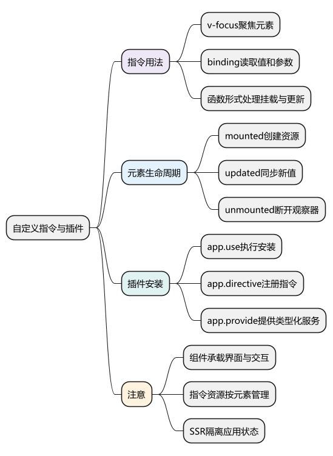
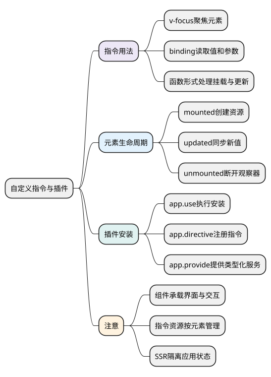

# 自定义指令与插件：复用 DOM 行为和应用能力

<!-- core-mindmap:start -->
[](examples/vue14-mindmap.svg)

<details>
<summary>PlantUML 源码</summary>



</details>

<!-- core-mindmap:end -->

**口述总览：** 自定义指令用于复用直接操作 DOM 的行为，例如聚焦、测量和第三方库接入；插件用于把一组能力安装到 Vue 应用，例如注册组件、指令和提供服务。普通业务逻辑先考虑函数或组合式函数，有自己的界面和状态则优先用组件。

本文以 Vue 3.5.43、`<script setup lang="ts">` 为例。

## 自定义指令：把 DOM 行为绑定到元素

### v-focus：元素挂载后自动聚焦

指令定义通常是包含生命周期钩子的对象。`mounted(el, binding)` 接收真实元素和绑定信息，在元素插入父容器后运行。钩子的返回值不负责更新界面，也不会自动成为清理函数。

在 `script setup` 中，把变量命名为 `vFocus`，模板即可使用 `v-focus`。

<!-- example: vue14-focus -->
<!-- project: vue14-focus; file: App.vue -->
```vue
<script setup lang="ts">
import { ref, type ObjectDirective } from 'vue'

const editing = ref(false)
const name = ref('')
const vFocus: ObjectDirective<HTMLInputElement> = {
  mounted(el) {
    el.focus()
  }
}
</script>

<template>
  <button type="button" @click="editing = !editing">切换编辑</button>
  <input v-if="editing" v-focus v-model="name" aria-label="姓名">
</template>
```

点击按钮后，输入框创建并获得焦点。这里使用 `v-if`，每次重新创建元素都会触发 `mounted`；如果改成 `v-show`，只是显示状态改变，不会每次重新挂载。

### binding：读取值、旧值、参数和修饰符

调用形式为 `v-name:arg.modifier="value"`。指令通过 `binding.value` 读取当前值，`binding.oldValue` 在更新钩子中提供上一次值，`binding.arg` 读取参数，`binding.modifiers` 读取修饰符布尔标记。

下面的 `v-tone:color.bold="color"` 表示：使用 `color` 参数选择文字颜色，使用 `bold` 修饰符控制加粗。

<!-- example: vue14-binding -->
<!-- project: vue14-binding; file: App.vue -->
```vue
<script setup lang="ts">
import { ref, type FunctionDirective } from 'vue'

const color = ref('teal')
const applyTone: FunctionDirective<HTMLElement, string> = (el, binding) => {
  if (binding.arg === 'color') el.style.color = binding.value
  el.style.fontWeight = binding.modifiers.bold ? 'bold' : 'normal'
}
const vTone = applyTone
</script>

<template>
  <button type="button" @click="color = color === 'teal' ? 'purple' : 'teal'">
    切换颜色
  </button>
  <p v-tone:color.bold="color">观察指令值变化</p>
</template>
```

函数形式是 `mounted` 和 `updated` 使用同一处理函数的简写；需要分别处理创建和清理时，应使用对象形式。修改 `binding.value` 不会建立“向父组件更新状态”的通信机制，需要更新数据时使用明确的回调或事件。

## 指令生命周期：在合适时机创建、更新和清理

常用钩子按顺序包括 `created`、`beforeMount`、`mounted`、`beforeUpdate`、`updated`、`beforeUnmount`、`unmounted`。这里的主体是指令绑定的元素，不是另一个独立组件实例。

- `mounted`：可以访问已挂载元素，建立第三方实例或监听。
- `updated`：根据新绑定值同步外部状态；避免每次更新重复注册监听。
- `beforeUnmount` / `unmounted`：断开监听、观察器和第三方实例。

下面用 `ResizeObserver` 观察元素宽度。指令对象会被多个元素复用，不能只用一个模块变量保存“当前观察器”。

<!-- example: vue14-resize -->
<!-- project: vue14-resize; file: App.vue -->
```vue
<script setup lang="ts">
import { ref, type ObjectDirective } from 'vue'

const visible = ref(true)
const width = ref(0)
type ReportWidth = (value: number) => void
const records = new WeakMap<HTMLElement, {
  observer: ResizeObserver
  report: ReportWidth
}>()
const vMeasure: ObjectDirective<HTMLElement, ReportWidth> = {
  mounted(el, binding) {
    const record = {
      report: binding.value,
      observer: new ResizeObserver(entries => {
        const entry = entries[0]
        if (entry) record.report(Math.round(entry.contentRect.width))
      })
    }
    records.set(el, record)
    record.observer.observe(el)
  },
  updated(el, binding) {
    const record = records.get(el)
    if (record) record.report = binding.value
  },
  unmounted(el) {
    records.get(el)?.observer.disconnect()
    records.delete(el)
  }
}
function reportWidth(value: number) {
  width.value = value
}
</script>

<template>
  <button type="button" @click="visible = !visible">切换测量区域</button>
  <div v-if="visible" v-measure="reportWidth" class="box">拖动右下角调整宽度</div>
  <p>宽度：{{ width }} px</p>
</template>

<style scoped>
.box { width: 240px; min-width: 120px; resize: horizontal; overflow: auto; }
</style>
```

示例在支持 `ResizeObserver` 的浏览器运行。真实业务不要在测量回调里反复改变被测元素宽度，否则可能形成“测量 → 修改 → 再测量”的循环。Vue 不会因为指令卸载就自动断开你创建的观察器。

## 插件：用 app.use 安装一组公共能力

### install(app, options)：接收应用和安装选项

插件可以是函数，也可以是提供 `install` 方法的对象。调用 `app.use(plugin, options)` 后，Vue 执行安装逻辑；返回应用实例，便于链式调用。同一个应用重复安装同一个插件对象，Vue 会避免重复执行安装。

下面的插件注册 `v-focus`，并通过 `app.provide` 提供带 TypeScript 类型的提示服务。示例采用浏览器原生提示框，实际项目可以替换为自己的消息组件。

<!-- example: vue14-plugin-service -->
<!-- project: vue14-plugin; file: uiPlugin.ts -->
```ts
import type { InjectionKey, Plugin } from 'vue'

export interface NoticeService {
  info(message: string): void
}
export const noticeKey: InjectionKey<NoticeService> = Symbol('notice')

export const uiPlugin: Plugin<{ prefix: string }> = {
  install(app, options) {
    const service: NoticeService = {
      info(message) {
        window.alert(options.prefix + message)
      }
    }
    app.provide(noticeKey, service)
    app.directive('focus', {
      mounted(el: HTMLElement) { el.focus() }
    })
  }
}
```

<!-- example: vue14-plugin-main -->
<!-- project: vue14-plugin; file: main.ts -->
```ts
import { createApp } from 'vue'
import App from './App.vue'
import { uiPlugin } from './uiPlugin'

createApp(App).use(uiPlugin, { prefix: '提示：' }).mount('#app')
```

<!-- example: vue14-plugin-app -->
<!-- project: vue14-plugin; file: App.vue -->
```vue
<script setup lang="ts">
import { inject } from 'vue'
import { noticeKey } from './uiPlugin'

const notice = inject(noticeKey)
if (!notice) throw new Error('请先安装 uiPlugin')
function save() {
  notice!.info('保存成功')
}
</script>

<template>
  <input v-focus aria-label="名称">
  <button type="button" @click="save">保存</button>
</template>
```

这组文件可放入已经创建好的 Vue + TypeScript 项目；`index.html` 需要有 `id="app"` 的挂载节点。`app.provide(key, value)` 返回应用实例，后代组件用 `inject(key)` 获取同一个服务。它提供依赖，不会自动把任意普通值转换成响应式状态。

### app.component 与 globalProperties：选择合适的暴露方式

插件可用 `app.component('AppButton', Button)` 注册全局组件，也可用 `app.config.globalProperties.$xxx` 给组件实例添加公共属性。后者常见于旧选项式代码，但在组合式代码中，显式导入或类型化注入通常更容易追踪依赖。

不要把每个工具函数都装成全局属性。纯计算函数可以直接导入，组件树内可替换的服务适合注入，需要统一安装的一组能力再做成插件。

## 工程追问：职责和生命周期如何划分

**指令还是组件？** 聚焦、测量等围绕现有元素的低层行为适合指令；弹窗、表格、带交互的输入框适合组件。不要用指令悄悄重建由 Vue 管理的整片 DOM。

**指令能否直接写在组件上？** 不建议依赖组件根元素落点。组件变成多根结构后会出现限制，公共组件应通过属性或公开方法表达能力。

**插件会不会跨用户共享状态？** 同一个应用内共享是正常的；SSR 服务端若把可变用户状态放模块单例，可能跨请求复用。应为每次请求创建应用，并在安装时创建该应用自己的服务或状态。

**第三方库怎样清理？** 在创建时保存实例，在指令卸载时调用它的销毁方法。插件若自己注册全局资源，Vue 3.5 可结合 `app.onUnmount(cleanup)` 在应用卸载时清理；应用级资源与单个元素资源不要混在一起。

<a id="interview"></a>

## 试题

<a id="vue22-01"></a>
### VUE22-01 [P0·基础] 自定义指令、组件和组合式函数怎样选择？

**回答：** 指令复用对真实元素的低层操作；组件复用界面、状态与交互；组合式函数复用有响应式状态或生命周期的逻辑。先判断复用对象是什么，而不是把所有逻辑都塞进一个指令。

<a id="vue22-02"></a>
### VUE22-02 [P0·基础] v-focus 为什么放在 mounted，v-show 切换时还会执行吗？

**回答：** mounted 时元素已经挂载，适合访问和聚焦。v-show 只改变显示状态，没有重新挂载，因此不会因为每次显示而再次运行 mounted；需要随显示状态处理时，要监听绑定值或在组件中等待更新后聚焦。

<a id="vue22-03"></a>
### VUE22-03 [P1·工程取舍] 指令创建的监听和 ResizeObserver 会自动释放吗？

**回答：** 不会自动替你调用外部资源的清理方法。应按元素保存资源，并在卸载钩子里移除监听或 disconnect；同一个指令会服务多个元素，不能只保存一份共享实例。

<a id="vue22-04"></a>
### VUE22-04 [P0·基础] app.use 和 app.provide 分别做什么？

**回答：** app.use 安装插件，执行注册或配置逻辑；app.provide 向该应用的组件后代提供依赖值。插件可以在安装时调用 provide，但二者不是同一件事；使用方仍要处理缺少提供者与类型约束。

官方文档：[自定义指令](https://cn.vuejs.org/guide/reusability/custom-directives.html) · [插件](https://cn.vuejs.org/guide/reusability/plugins.html) · [应用 API](https://cn.vuejs.org/api/application.html)。

前篇：[组合式函数与副作用清理](13_组合式函数与副作用清理.md) · 后篇：[动态组件与 KeepAlive](15_动态组件与KeepAlive.md) · [返回目录](00_目录.md)
