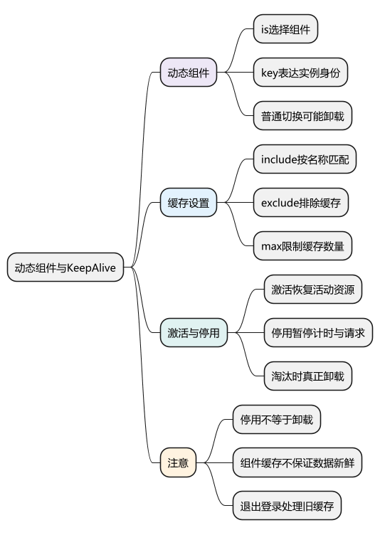
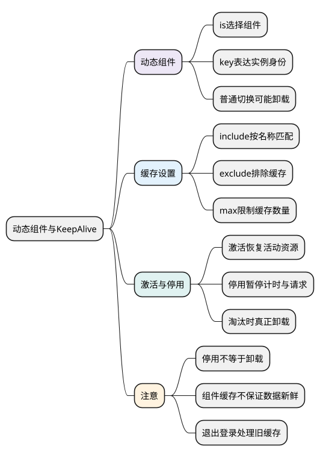
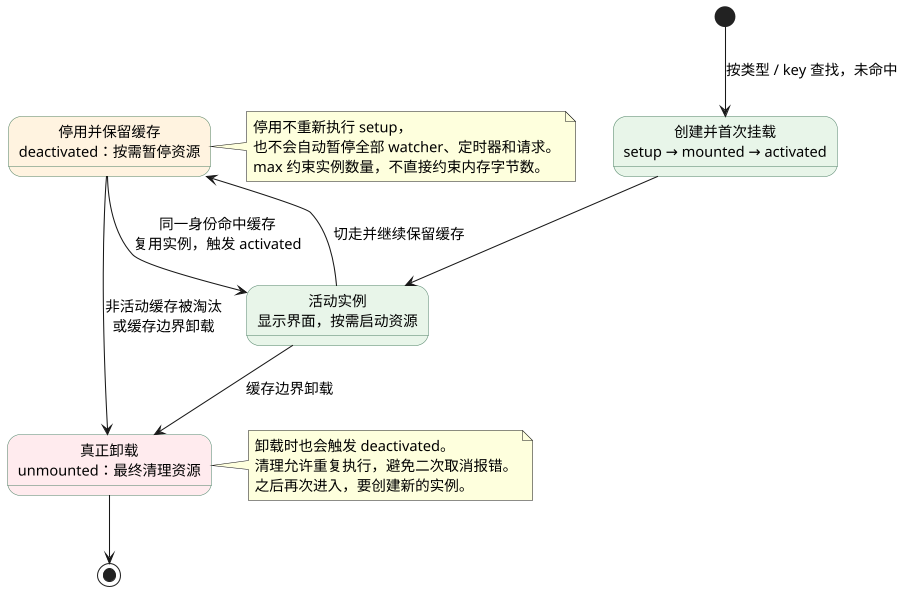

# 动态组件与 KeepAlive：切换界面并保留组件状态

<!-- core-mindmap:start -->
[](examples/vue15-mindmap.svg)

<details>
<summary>PlantUML 源码</summary>



</details>

<!-- core-mindmap:end -->

**口述总览：** 动态组件用同一个位置展示不同组件，`KeepAlive` 则在切换时缓存符合条件的组件实例。缓存能保留输入和局部状态，但实例停用不等于卸载，定时器、连接和请求仍需要按业务暂停或清理。

## component：用 is 决定当前位置渲染谁

### :is 接收组件定义，切换时更新组件身份

调用形式是 `<component :is="currentComponent" />`，`is` 可以是导入的组件定义，也可以是已注册的组件名或原生标签名。它是模板内建元素，没有需要接收的函数返回值。

下面三个文件构成一个完整的页签例子。先不使用缓存：在“基本信息”中输入文字，切到“偏好设置”再切回，局部输入会重置，因为旧组件已经卸载。

<!-- example: vue15-profile -->
<!-- project: vue15-tabs; file: ProfilePanel.vue -->
```vue
<script setup lang="ts">
import { ref } from 'vue'
defineOptions({ name: 'ProfilePanel' })
const nickname = ref('')
</script>

<template>
  <label>昵称 <input v-model="nickname"></label>
</template>
```

<!-- example: vue15-settings -->
<!-- project: vue15-tabs; file: SettingsPanel.vue -->
```vue
<script setup lang="ts">
import { ref } from 'vue'
defineOptions({ name: 'SettingsPanel' })
const emailNotice = ref(false)
</script>

<template>
  <label><input v-model="emailNotice" type="checkbox">接收邮件通知</label>
</template>
```

<!-- example: vue15-tabs -->
<!-- project: vue15-tabs; file: App.vue -->
```vue
<script setup lang="ts">
import { computed, ref } from 'vue'
import ProfilePanel from './ProfilePanel.vue'
import SettingsPanel from './SettingsPanel.vue'

const panels = { profile: ProfilePanel, settings: SettingsPanel }
const selected = ref<keyof typeof panels>('profile')
const current = computed(() => panels[selected.value])
</script>

<template>
  <nav aria-label="设置分类">
    <button type="button" @click="selected = 'profile'">基本信息</button>
    <button type="button" @click="selected = 'settings'">偏好设置</button>
  </nav>
  <component :is="current" />
</template>
```

这里把组件定义保存在普通映射中，响应式状态只保存页签键。如果需要把组件定义直接放进响应式容器，可使用 `shallowRef`，避免把组件对象当业务深层数据代理。

<a id="k01"></a>

## KeepAlive：保留切走的组件实例

### 包裹动态组件：切回时恢复原有局部状态

在上例 App.vue 中，将动态组件那一行替换成下面的模板片段即可观察差异：

<!-- example: vue15-cache-template -->
```html
<KeepAlive>
  <component :is="current" />
</KeepAlive>
```

这是上例的模板替换片段，`current` 沿用上例定义。现在切走“基本信息”后，实例保留；切回时输入仍在。一个 KeepAlive 同一时刻应有一个活动组件子节点。

KeepAlive 的内建能力不需要额外导入。它缓存组件实例及相关状态，而不是单纯给所有页面添加 `display: none`；实例关联的 DOM 会在缓存容器与活动位置之间移动。

### include、exclude：按组件名称选择缓存范围

`include` 表示允许缓存的名称，`exclude` 表示排除的名称。可传逗号分隔字符串、正则或名称数组；同一个名称同时被包含和排除时，排除条件仍然生效。

<!-- example: vue15-cache-filter-template -->
```html
<KeepAlive :include="['ProfilePanel']" :max="2">
  <component :is="current" />
</KeepAlive>
```

该片段仍替换前面 App.vue 的组件位置，只缓存 `ProfilePanel`。匹配依据是组件 `name`，不是页签文本、文件所在目录或路由路径。Vue 3.2.34 起 `script setup` 可根据文件名推断名称；示例使用 `defineOptions` 显式命名，便于观察规则。

### max 与 key：限制数量，明确缓存身份

`max` 接收数字或数字字符串，限制缓存实例数量。超过限制时，KeepAlive 淘汰最近最少使用的实例，并对被淘汰实例执行卸载。

相同组件如果需要为不同业务对象保留独立状态，可以提供稳定的 `key`。没有显式 key 时，缓存通常按组件类型区分；显式 key 则参与缓存身份。

例如两个用户共用一个编辑组件，使用用户 ID 作为 key 可以分别保留草稿。但每个 ID 都可能形成一份缓存，必须考虑上限。随机 key 会不断创建新身份，也会破坏正常复用。

## onActivated 与 onDeactivated：管理缓存中的资源

### 激活时启动，停用时暂停，卸载时最终清理

`onActivated(callback)` 注册激活钩子，首次挂载和从缓存重新插入时都会调用；`onDeactivated(callback)` 注册停用钩子，在进入缓存以及卸载时调用。这些注册函数返回 `void`，应在 setup 同步阶段调用。

以下跟踪一份符合缓存条件的组件实例。首次创建和缓存命中走不同路径；停用后再切回会复用实例，真正卸载后再进入才需要重新创建。

<!-- understanding-flow: vue15-cache-lifecycle:start -->
<a id="cache-lifecycle-flow"></a>

<details>
<summary>PlantUML 源码</summary>



</details>

<!-- understanding-flow: vue15-cache-lifecycle:end -->

下面的组件用于替换上例的 `ProfilePanel.vue`。可切换页签，观察重新激活时计数继续增加；停用期间不会继续增加。

<!-- example: vue15-activation-timer -->
<!-- project: vue15-resource; file: ProfilePanel.vue -->
```vue
<script setup lang="ts">
import { onActivated, onDeactivated, onUnmounted, ref } from 'vue'

defineOptions({ name: 'ProfilePanel' })
const ticks = ref(0)
let timer: ReturnType<typeof setInterval> | undefined

function pause() {
  if (timer !== undefined) clearInterval(timer)
  timer = undefined
}

onActivated(() => {
  pause()
  timer = setInterval(() => { ticks.value++ }, 1000)
})
onDeactivated(pause)
onUnmounted(pause)
</script>

<template>
  <p>当前页签活动期间累计计时：{{ ticks }} 秒</p>
</template>
```

`pause` 被设计为可重复调用：停用和卸载都可能触发清理，重复执行不会创建新资源或报错。真实轮询如果含异步请求，还应取消请求、阻止过期结果写入，而不仅是清除下一次定时触发。

### 缓存状态不等于数据永远有效

KeepAlive 保留组件实例，不代表服务器数据永远新鲜，也不代表所有 watcher 自动暂停。停用期间状态仍可能变化，响应式副作用也可能继续执行。

可以保留表单草稿，同时在重新激活时检查数据是否过期；也可以仅在用户主动刷新时请求。选择取决于数据时效要求，不能把“缓存组件”当作完整的数据缓存策略。

## 原理理解：复用实例与重新创建的区别

普通动态组件切换时，Vue 根据类型和 key 判断是否还能复用；不能复用则卸载旧实例、创建新实例。KeepAlive 为符合条件的组件保留缓存记录，在切回时恢复已有实例，并运行对应激活流程。

因此，同一个组件的 `onMounted` 不会因为每次切回而重新执行，但 `onActivated` 会。超过 max 或从缓存筛选中移除时，实例可能真正卸载；这时才能按普通卸载逻辑最终释放组件拥有的资源。

只需要两块简单 DOM 频繁显隐时，`v-show` 也可能足够；需要在多个组件实例之间切换并保留局部状态时，KeepAlive 更贴合需求。

## 工程追问：路由缓存、用户切换和内存如何处理

路由页面通过 RouterView 插槽拿到当前组件后，可再交给 KeepAlive。缓存匹配仍依赖组件名，`route.meta` 只是你自定义的数据，不会自动变成缓存行为。

缓存键要反映你想保留的身份。例如页面 ID 可以区分两份编辑草稿，直接使用包含所有查询参数的完整 URL 则可能制造很多无意义缓存。

用户退出登录时，不应继续展示上一位用户的缓存状态。可以改变外层缓存边界的 key 使整个缓存边界重新创建，并清理相关 Store 和请求；这种操作会同时重置该边界中的所有缓存，需符合产品预期。

验证缓存时要检查输入、滚动恢复、请求次数、定时器数量和退出登录后的状态；仅看页面切换是否顺滑，无法证明生命周期处理正确。

<a id="interview"></a>

## 试题

<a id="vue12-01"></a>
### VUE12-01 [P0·原理] KeepAlive 停用是否等于卸载？

**回答：** 不等于。停用会保留组件实例及状态，后续可以重新激活；淘汰缓存或销毁缓存边界才会真正卸载。业务轮询、监听和请求不能假定自动暂停，应在停用时暂停、激活时恢复，并在卸载时最终清理。

<a id="vue23-01"></a>
### VUE23-01 [P0·基础] component 的 is 和 key 分别决定什么？

**回答：** is 选择当前位置渲染的组件或标签，key 参与节点身份判断。同一组件类型使用不同 key，可以表达不同实例身份；随机改变 key 会使正常复用失效。

<a id="vue23-02"></a>
### VUE23-02 [P0·基础] include 为什么没有缓存指定页面？

**回答：** 先确认它匹配的是组件名称，而不是路由名称或路径，再检查当前组件是否被 exclude 排除、是否位于有效 KeepAlive 边界中，以及是否因 max 淘汰。必要时显式设置组件 name 并观察激活与卸载日志。

<a id="vue23-03"></a>
### VUE23-03 [P1·工程取舍] 为什么缓存了页面还会继续请求？

**回答：** 缓存实例不等于暂停所有副作用。定时器、监听或 watcher 可能仍在工作，应明确页面停用后是否允许继续请求；需要暂停时，在停用钩子中取消相关资源，并阻止旧响应迟到后覆盖当前状态。

<a id="vue23-04"></a>
### VUE23-04 [P1·工程取舍] KeepAlive 的 max 能否直接限制内存大小？

**回答：** 不能。max 限制的是缓存实例数量，一个实例保留的数据和外部资源可能很大。应结合缓存数量、数据规模和清理策略检查真实内存，并确保被淘汰实例不再被外部监听或闭包引用。

官方文档：[动态组件](https://cn.vuejs.org/guide/essentials/component-basics.html#dynamic-components) · [KeepAlive](https://cn.vuejs.org/guide/built-ins/keep-alive.html)。

前篇：[自定义指令与插件](14_自定义指令与插件.md) · 后篇：[Teleport 与 Transition](16_Teleport与Transition.md) · [返回目录](00_目录.md)
