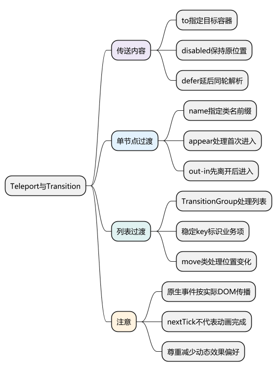
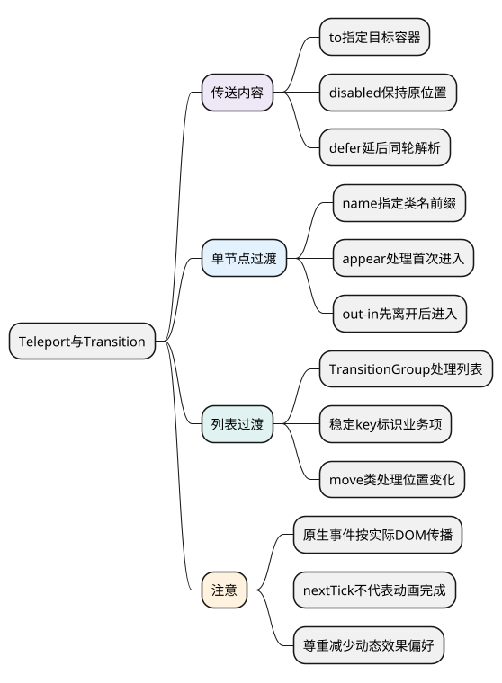

# Teleport 与 Transition：控制 DOM 位置和进入离开动画

<!-- core-mindmap:start -->
[](examples/vue16-mindmap.svg)

<details>
<summary>PlantUML 源码</summary>



</details>

<!-- core-mindmap:end -->

**口述总览：** Teleport 改变内容实际挂载的位置，但保留 Vue 的组件关系；Transition 为单个元素或组件的进入离开添加过渡，TransitionGroup 则处理列表的进入、离开和移动。位置、组件状态和动画是三个不同问题，需要分别判断。

<a id="k02"></a>

## Teleport：把内容渲染到指定容器

### to：指定选择器或真实元素作为目标

调用形式为 `<Teleport to="#overlays">...</Teleport>`。`to` 接收 CSS 选择器或 DOM 元素，内容会挂到目标中；这是模板组件，没有函数返回值。常见用途包括通知、浮层和弹窗，避免被某些祖先的裁剪或布局限制影响。

下面三个文件放入 Vue + TypeScript 项目即可运行。目标容器放在应用根节点旁边，在 Vue 挂载前已经存在。

<!-- example: vue16-teleport-html -->
<!-- project: vue16-teleport; file: index.html -->
```html
<!doctype html>
<html lang="zh-CN">
  <head><meta charset="UTF-8"><title>Teleport 示例</title></head>
  <body>
    <div id="app"></div>
    <div id="overlays"></div>
    <script type="module" src="/src/main.ts"></script>
  </body>
</html>
```

<!-- example: vue16-teleport-main -->
<!-- project: vue16-teleport; file: src/main.ts -->
```ts
import { createApp } from 'vue'
import App from './App.vue'
createApp(App).mount('#app')
```

<!-- example: vue16-teleport-app -->
<!-- project: vue16-teleport; file: src/App.vue -->
```vue
<script setup lang="ts">
import { ref } from 'vue'
const open = ref(false)
</script>

<template>
  <section class="clipped">
    <button type="button" @click="open = true">显示通知</button>
    <Teleport to="#overlays">
      <aside v-if="open" class="notice" aria-label="操作结果">
        <p role="status">资料已保存。</p>
        <button type="button" @click="open = false">关闭</button>
      </aside>
    </Teleport>
  </section>
</template>

<style scoped>
.clipped { height: 60px; overflow: hidden; border: 1px solid #ccc; }
.notice {
  position: fixed;
  right: 20px;
  bottom: 20px;
  padding: 16px;
  background: white;
  border: 1px solid #777;
  box-shadow: 0 4px 20px #0002;
}
</style>
```

通知实际位于 `#overlays`，点击关闭仍能修改本组件的 `open`。Teleport 只负责挂载位置，`position`、层级和动画仍由 CSS 等机制决定。若改成模态弹窗，还需要焦点限制、Escape 关闭、背景不可交互和关闭后恢复焦点，不能仅加 `aria-modal` 就算完整弹窗。

### disabled 与 defer：控制是否传送和目标解析时机

`disabled` 为 true 时，内容在原位置渲染；改回 false 后重新传送。可用于窄屏内嵌、宽屏浮层等布局切换，组件逻辑关系仍然保留。

Vue 3.5 的 `defer` 延后 Teleport 目标解析，使目标可以由同一次挂载或更新中的稍后内容提供。例如下面是可独立放入 SFC 的模板：

<!-- example: vue16-defer -->
<!-- project: vue16-defer; file: App.vue -->
```vue
<template>
  <Teleport defer to="#late-target">
    <p>这个目标出现在模板后面。</p>
  </Teleport>
  <div id="late-target"></div>
</template>
```

`defer` 不会一直等待未来某个请求创建目标。若目标要到一秒后才出现，应调整渲染条件，让目标与 Teleport 在合适的同一更新中就绪。

## Teleport 的关系：组件树保留，原生事件按真实 DOM 传播

Teleport 中的后代仍能接收 props、触发组件事件、读取祖先 provide 的内容。`scoped` 样式所需的作用域标记也仍会添加到相关元素上。

原生点击的冒泡路径则依赖实际 DOM。上例通知中的点击不会因为模板写在 `.clipped` 内，就自动经过 `.clipped` 的原生监听器；它位于 `#overlays` 下。判断点击外部关闭、事件委托和 CSS 祖先选择器时，要按移动后的 DOM 分析。

<a id="k04"></a>

## Transition：为一个节点添加进入和离开过渡

### name：决定过渡类前缀

调用形式为 `<Transition name="fade">条件节点</Transition>`。通常配合 `v-if`、`v-show`、动态组件或 key 变化使用，同一时刻应对应一个可过渡的元素或组件根节点。

<!-- example: vue16-transition -->
<!-- project: vue16-transition; file: App.vue -->
```vue
<script setup lang="ts">
import { ref } from 'vue'
const visible = ref(true)
</script>

<template>
  <button type="button" @click="visible = !visible">切换说明</button>
  <Transition name="fade" appear>
    <p v-if="visible">内容进入或离开时平滑改变透明度。</p>
  </Transition>
</template>

<style scoped>
.fade-enter-active, .fade-leave-active { transition: opacity .2s ease; }
.fade-enter-from, .fade-leave-to { opacity: 0; }
@media (prefers-reduced-motion: reduce) {
  .fade-enter-active, .fade-leave-active { transition-duration: .01s; }
}
</style>
```

`appear` 让首次显示也执行进入过渡；不写时，初次渲染通常不会运行进入动画。`enter-from` 表示进入起点，`enter-active` 表示进入期间，`enter-to` 表示进入终点；离开阶段对应 `leave-from`、`leave-active`、`leave-to`。

示例没有显式设置 `enter-to` 和 `leave-from`，它们使用正常状态下的透明度。Vue 在合适时机切换这些类，并等待对应过渡完成后移除离开节点。

### mode 与 JavaScript 钩子：控制切换次序和结束信号

`mode="out-in"` 表示旧节点离开后，新节点再进入；适合两个互斥内容或动态组件切换。不同内容需要能明确区分身份，必要时提供不同 key。

当 CSS 不方便描述动画时，可使用 `@enter="onEnter"`、`@leave="onLeave"`。处理函数形式为 `(el, done) => void`，使用 JavaScript 独立控制过渡时配合 `:css="false"`，并在动画完成后调用 `done()`。取消动画时也应停止相关工作，避免留下旧回调。

不要把 `nextTick()` 当成动画结束信号；它等待 Vue 更新，不代表过渡时长已走完。

## TransitionGroup：为列表增删和排序添加动画

### 稳定 key：把动画关联到同一个业务项

TransitionGroup 默认不额外生成包装标签，可用 `tag="ul"` 指定容器。每个直接子节点必须有唯一、稳定的 key；它不支持 Transition 那样的 mode 切换模式。

<!-- example: vue16-transition-group -->
<!-- project: vue16-transition-group; file: App.vue -->
```vue
<script setup lang="ts">
import { ref } from 'vue'
const items = ref([
  { id: 1, label: '资料' },
  { id: 2, label: '项目' },
  { id: 3, label: '设置' }
])
let nextId = 4
function add() {
  const id = nextId++
  items.value.push({ id, label: `新项目 ${id}` })
}
function remove(id: number) {
  items.value = items.value.filter(item => item.id !== id)
}
</script>

<template>
  <button type="button" @click="add">新增</button>
  <button type="button" @click="items.reverse()">倒序</button>
  <TransitionGroup name="list" tag="ul" class="items">
    <li v-for="item in items" :key="item.id" class="item">
      {{ item.label }}
      <button type="button" @click="remove(item.id)">删除</button>
    </li>
  </TransitionGroup>
</template>

<style scoped>
.items { position: relative; width: 260px; padding: 0; list-style: none; }
.item { box-sizing: border-box; width: 260px; padding: 8px; border: 1px solid #ddd; }
.list-move, .list-enter-active, .list-leave-active {
  transition: transform .25s ease, opacity .25s ease;
}
.list-enter-from, .list-leave-to { opacity: 0; transform: translateX(20px); }
.list-leave-active { position: absolute; }
@media (prefers-reduced-motion: reduce) {
  .list-move, .list-enter-active, .list-leave-active { transition-duration: .01s; }
}
</style>
```

进入离开使用相应过渡类，排序后的位移使用 `list-move`。离开节点暂时脱离正常文档流，便于其余节点移动到新位置。动态行高、复杂布局和虚拟列表还需结合实际测量，不能直接套一个固定高度假设。

## 工程追问：可访问性、性能与组合关系

动画优先考虑 `transform`、`opacity` 等属性，但仍要测量实际渲染成本；大量节点同时动画也可能卡顿。使用减少动态效果的系统偏好，为不适合动画的用户提供较弱效果。

Teleport 与 Transition 可以组合：前者负责目标容器，后者处理其中条件节点的进入离开。KeepAlive、RouterView 与 Transition 组合时，需要遵循各自的子节点结构要求，并实际检查激活、停用和离开时机。

事件和焦点常是浮层问题的关键。验证内容移出原祖先后，原生事件委托、样式选择器和焦点恢复是否仍正确，比只检查“弹层能显示”更有价值。

<a id="interview"></a>

## 试题

<a id="vue12-02"></a>
### VUE12-02 [P0·原理] Teleport 是否改变组件事件和原生事件的路径？

**回答：** Vue 的逻辑父子关系保留，props、组件事件和依赖注入仍按组件关系工作；原生事件沿实际 DOM 路径传播。内容被移到其他容器后，不能继续按原模板祖先推断原生事件冒泡。

<a id="vue12-04"></a>
### VUE12-04 [P1·基础] TransitionGroup 为什么需要稳定 key？

**回答：** 进入、离开和移动需要识别哪个节点对应同一业务项。索引随重排变化或随机 key 会破坏身份判断，导致状态错位或反复创建销毁，也会影响动画。应使用同级唯一、跨更新稳定的业务 ID。

<a id="vue12-05"></a>
### VUE12-05 [P0·基础] Transition 的 name 和 appear 有什么作用？

**回答：** name 决定进入、离开等 CSS 类的前缀，例如 fade-enter-active；appear 让首次渲染也参与进入过渡。Transition 根据更新条件协调类名和节点移除，并不是只要套一层就自动知道想要的动画效果。

<a id="vue12-06"></a>
### VUE12-06 [P1·工程取舍] Teleport defer 能等待任意异步请求创建目标吗？

**回答：** 不能。Vue 3.5 的 defer 支持同一次挂载或更新中稍后出现的目标，不是长期观察选择器。目标要在未来异步创建时，应同步设计渲染条件，让目标与传送内容在合适时机一起就绪。

官方文档：[Teleport](https://cn.vuejs.org/guide/built-ins/teleport.html) · [Transition](https://cn.vuejs.org/guide/built-ins/transition.html) · [TransitionGroup](https://cn.vuejs.org/guide/built-ins/transition-group.html)。

前篇：[动态组件与 KeepAlive](15_动态组件与KeepAlive.md) · 后篇：[异步组件与 Suspense](17_异步组件与Suspense.md) · [返回目录](00_目录.md)
