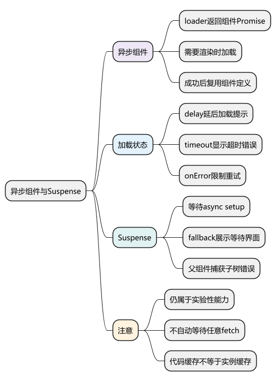
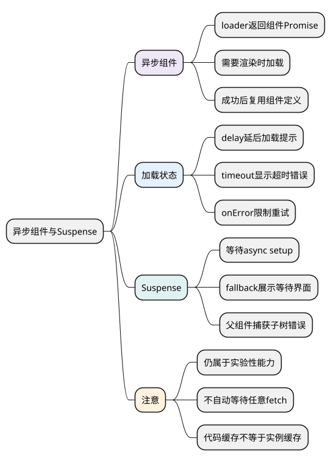

# 异步组件与 Suspense：按需加载代码并协调等待界面

<!-- core-mindmap:start -->
[](examples/vue17-mindmap.svg)

<details>
<summary>PlantUML 源码</summary>



</details>

<!-- core-mindmap:end -->

**口述总览：** 异步组件解决“组件代码什么时候加载”，Suspense 协调组件子树中被它识别的异步依赖。它们都不等于任意网络请求管理器；接口加载、错误、取消和重试，仍需要按业务设计。

本文以 Vue 3.5.43 为基线。**Suspense 在 Vue 3 官方文档中仍属于实验性功能**，需要结合项目版本验证行为；基础按需加载可以先掌握 defineAsyncComponent。

<a id="k03"></a>

## defineAsyncComponent：需要显示时再加载组件

### loader：返回解析为组件定义的 Promise

调用形式是 `defineAsyncComponent(loader)`，或 `defineAsyncComponent(options)`；返回一个可正常放入模板使用的包装组件。loader 常用动态 `import()` 返回组件模块，包装组件会处理默认导出。

下面展示一个按需打开的报表面板。项目需要支持 Vue 单文件组件和动态 import，例如 create-vue 创建的 Vite 项目。

<!-- example: vue17-report-panel -->
<!-- project: vue17-async; file: ReportPanel.vue -->
```vue
<script setup lang="ts">
defineProps<{ title: string }>()
</script>

<template>
  <section>
    <h2>{{ title }}</h2>
    <p>这里只演示组件代码分包，接口数据可按业务另行加载。</p>
  </section>
</template>
```

<!-- example: vue17-basic-loader -->
<!-- project: vue17-async; file: App.vue -->
```vue
<script setup lang="ts">
import { defineAsyncComponent, ref } from 'vue'

const open = ref(false)
const AsyncReport = defineAsyncComponent(() => import('./ReportPanel.vue'))
</script>

<template>
  <button type="button" @click="open = !open">切换报表</button>
  <AsyncReport v-if="open" title="月度报表" />
</template>
```

只有包装组件实际需要渲染时才启动 loader。加载成功后，包装器会复用已解析的组件定义，不需要每次重新获取同一模块；但 `v-if` 切走再切回仍可能创建新的组件实例。**代码加载缓存与 KeepAlive 的实例缓存是两回事。**

## 加载选项：分别处理等待、失败和超时

### loadingComponent、errorComponent、delay、timeout

- `loadingComponent`：加载尚未结束时显示的组件。
- `delay`：等待多少毫秒再显示 loading，默认 200，减少很快完成时的闪烁。
- `errorComponent`：失败时显示的组件，会收到 `error` 属性。
- `timeout`：超过指定毫秒仍未完成时显示超时错误；默认不设置超时限制。

以下是独立示例，复用前面 ReportPanel.vue 的内容，并增加两个提示组件。真实网络很快时可能看不到加载提示，可通过浏览器 Network 限速观察。

<!-- example: vue17-loading -->
<!-- project: vue17-load-states; file: LoadingPanel.vue -->
```vue
<template><p role="status">正在加载报表组件……</p></template>
```

<!-- example: vue17-error -->
<!-- project: vue17-load-states; file: ErrorPanel.vue -->
```vue
<script setup lang="ts">
defineProps<{ error?: Error }>()
</script>

<template>
  <p role="alert">组件加载失败，请检查网络或刷新页面。</p>
</template>
```

<!-- example: vue17-state-report -->
<!-- project: vue17-load-states; file: ReportPanel.vue -->
```vue
<script setup lang="ts">
defineProps<{ title: string }>()
</script>
<template><h2>{{ title }}</h2></template>
```

<!-- example: vue17-load-states -->
<!-- project: vue17-load-states; file: App.vue -->
```vue
<script setup lang="ts">
import { defineAsyncComponent, ref } from 'vue'
import LoadingPanel from './LoadingPanel.vue'
import ErrorPanel from './ErrorPanel.vue'

const open = ref(false)
const AsyncReport = defineAsyncComponent({
  loader: () => import('./ReportPanel.vue'),
  loadingComponent: LoadingPanel,
  errorComponent: ErrorPanel,
  delay: 200,
  timeout: 10_000
})
</script>

<template>
  <button type="button" @click="open = !open">切换报表</button>
  <AsyncReport v-if="open" title="按需加载报表" />
</template>
```

timeout 控制包装组件的等待展示，不会自动取消浏览器已发出的模块请求。组件卸载也不意味着所有底层网络都被取消；业务请求需要自己的 AbortController 或失效标记。

### onError：决定重试还是结束加载

`onError(error, retry, fail, attempts)` 接收错误、重试函数、失败函数和尝试次数，返回 `void`。调用 retry 会再执行加载器，调用 fail 则结束本次恢复流程并传递错误。

应根据错误类型、网络状态和次数决定是否重试，不能无限 retry。发布后旧页面请求已经删除的 chunk，重复请求同一个旧 URL 往往不能解决问题；需要合理保留旧资源，或提示用户保存数据后刷新。

动态 import 适合清楚的模块路径。不要直接把用户输入拼成任意组件模块路径；构建工具还需要在构建时确定可打包的候选模块。

## Suspense：统一等待 async setup 等异步依赖

### default 与 fallback：展示结果或等待界面

调用形式为 `<Suspense><AsyncChild /><template #fallback>...</template></Suspense>`。默认插槽提供内容，fallback 提供等待状态；每个插槽都应有一个直接根节点。

Suspense 主要识别异步 setup（包括 script setup 顶层 await）和参与其协调的异步组件。下面通过本地延时模拟数据获取，不依赖不存在的服务器地址。

<!-- example: vue17-async-profile -->
<!-- project: vue17-suspense; file: AsyncProfile.vue -->
```vue
<script setup lang="ts">
const user = await new Promise<{ name: string }>(resolve => {
  setTimeout(() => resolve({ name: '小林' }), 500)
})
</script>

<template><p>当前用户：{{ user.name }}</p></template>
```

<!-- example: vue17-suspense-boundary -->
<!-- project: vue17-suspense; file: App.vue -->
```vue
<script setup lang="ts">
import { onErrorCaptured, ref } from 'vue'
import AsyncProfile from './AsyncProfile.vue'

const errorMessage = ref('')
onErrorCaptured(error => {
  errorMessage.value = error instanceof Error ? error.message : '加载失败'
  return false
})
</script>

<template>
  <p v-if="errorMessage" role="alert">{{ errorMessage }}</p>
  <Suspense v-else>
    <AsyncProfile />
    <template #fallback><p role="status">正在读取用户资料……</p></template>
  </Suspense>
</template>
```

500 毫秒内显示 fallback，子组件异步 setup 完成后显示用户。若把模拟 Promise 改为拒绝，错误由外层 onErrorCaptured 处理。返回 false 表示这次错误已在此处理，不再继续向上传播；实际项目可同时上报错误，并提供明确的重试操作。

### pending、fallback、resolve：观察边界状态

Suspense 提供 `pending`、`fallback`、`resolve` 事件，分别通知进入等待、显示后备内容和完成解析。`timeout` 可以影响已经展示内容后，再进入等待时何时切到 fallback；首次等待与后续更新不是完全相同的过程。

已解析的默认内容内部后来启动一个普通请求，不会因为那里有 fetch 就自动使边界回到 fallback。后续重新挂起与默认插槽根节点等更新条件有关，不能把 Suspense 当作任意子树的全局 loading 开关。

### suspensible：决定异步组件由谁管理加载状态

异步组件位于 Suspense 内且参与其协调时，等待界面由 Suspense 协调，组件自己的 `loadingComponent`、`delay` 和 `timeout` 不再按独立加载分支工作。加载失败仍会进入错误处理流程；在本文的 Vue 3.5.43 基线中，已配置的 `errorComponent` 仍可成为失败时的渲染结果。Suspense 本身没有通用的 error 插槽。

需要该异步组件独立管理加载状态时，可在 `defineAsyncComponent` 选项中设置 `suspensible: false`。这不等于自动取消底层网络请求，也不替代业务错误处理。

这里说的是 defineAsyncComponent 的选项。不要把它与嵌套 Suspense 的其他协调规则混在一起，复杂嵌套应按目标版本验证。

## 原理与工程追问：分清代码、数据和错误

**异步组件加载什么？** loader 解析出组件定义，之后 Vue 才按该定义创建或复用实例。组件里发出的业务请求是另一层，不会因为模块已经加载就自动完成。

**Suspense 会捕获错误吗？** 它负责等待协调，没有自动替你处理所有错误的 error 插槽。子树错误可交给父组件 onErrorCaptured 或应用错误处理；业务请求则按具体请求流程处理错误与重试。

**路由懒加载要不要包 defineAsyncComponent？** Vue Router 的路由 component 直接使用 `() => import('./Page.vue')` 即可，Router 有自己的路由组件解析机制；页面内部的延迟组件才按需使用 defineAsyncComponent。

**是否把整个页面都包起来？** 页面只有一个小区域需要等待时，局部 loading 通常更清楚。统一挂起可能隐藏已经可用的内容；应按真实交互决定等待边界，而不是为使用新 API 而扩大边界。

<a id="interview"></a>

## 试题

<a id="vue12-03"></a>
### VUE12-03 [P1·工程取舍] Suspense 能自动管理组件中的任意异步请求吗？

**回答：** 不能。它只协调被支持机制识别的异步依赖，例如 async setup 和参与其协调的异步组件。普通事件回调或 mounted 中启动的请求，不会自动成为 Suspense 等待对象；错误、取消和重试仍需业务处理。

<a id="vue24-01"></a>
### VUE24-01 [P0·基础] defineAsyncComponent 返回什么，何时启动加载？

**回答：** 返回可作为普通组件使用的包装组件，实际需要渲染时调用 loader。loader 返回解析为组件定义的 Promise；成功解析后可复用组件定义，但这不等于缓存了每次创建的组件实例。

<a id="vue24-02"></a>
### VUE24-02 [P0·基础] delay 和 timeout 有什么区别？

**回答：** delay 控制多久以后显示加载提示，减少快速完成时的闪烁；timeout 控制等待过久时显示超时错误。它们不负责取消底层请求，也不能替代接口请求自己的超时与取消策略。

<a id="vue24-03"></a>
### VUE24-03 [P1·工程取舍] Suspense 会自动显示错误界面吗？

**回答：** 不会自动替应用设计错误界面。它主要提供 default 和 fallback 的等待协调；错误需要父组件 onErrorCaptured、应用错误处理或业务请求状态处理。处理错误时还要明确日志、恢复动作和是否继续向上传播。

<a id="vue24-04"></a>
### VUE24-04 [P1·工程取舍] 组件加载失败为什么不应该无限重试？

**回答：** 断网、永久删除的 chunk、代码执行错误不是同一种问题。无限重试会浪费请求并让用户一直等待，应区分可恢复情况、限制次数，并在发布版本不一致时提供可理解的刷新恢复方案。

官方文档：[异步组件](https://cn.vuejs.org/guide/components/async.html) · [Suspense](https://cn.vuejs.org/guide/built-ins/suspense.html)。

前篇：[Teleport 与 Transition](16_Teleport与Transition.md) · 后篇：[Vue Router 路由与导航](<18_Vue Router路由与导航.md>) · [返回目录](00_目录.md)
