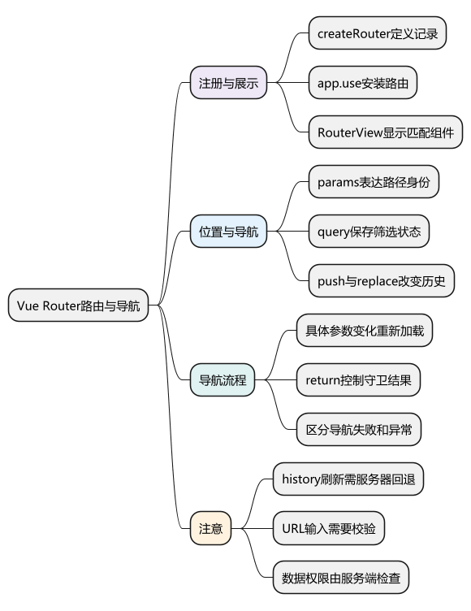
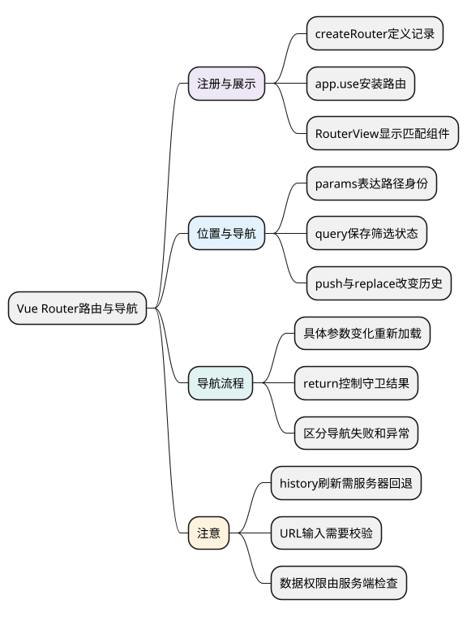
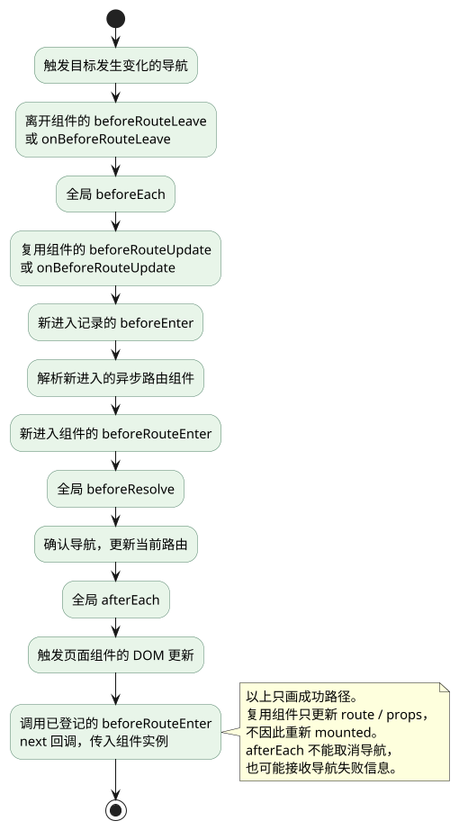

# Vue Router：用 URL 组织页面、参数和导航流程

<!-- core-mindmap:start -->
[](examples/vue18-mindmap.svg)

<details>
<summary>PlantUML 源码</summary>



</details>

<!-- core-mindmap:end -->

**口述总览：** Vue Router 把 URL 映射到组件。先配置路由记录、注册插件并放置 RouterView，再用 RouterLink 或 router.push 导航。参数变化可能复用原组件；导航守卫控制前端页面流程，真正的数据权限必须由服务端检查。

本文使用 Vue Router 4、Vue 3.5.43 和 TypeScript。

<a id="k01"></a>

## 安装与注册：让路由真正进入应用

### createRouter：配置历史模式和路由记录

在已有 Vue 项目中运行 `npm install vue-router@4`。`createRouter({ history, routes })` 返回 Router 实例；`createWebHistory(base?)` 创建使用正常路径的浏览器历史模式，`base` 为应用部署基础路径。

下面是一组可运行的项目文件。根目录为普通 Vue + TypeScript 项目，文件放在 `src` 中，`index.html` 已有 `#app`。

<!-- example: vue18-router-config -->
<!-- project: vue18-navigation; file: router.ts -->
```ts
import { createRouter, createWebHistory } from 'vue-router'
import UsersLayout from './UsersLayout.vue'
import UserList from './UserList.vue'
import UserDetail from './UserDetail.vue'
import NotFound from './NotFound.vue'

export const router = createRouter({
  history: createWebHistory('/'),
  routes: [
    { path: '/', redirect: '/users' },
    {
      path: '/users',
      component: UsersLayout,
      children: [
        { path: '', name: 'users', component: UserList },
        {
          path: ':id',
          name: 'user',
          component: UserDetail,
          props: route => ({ id: String(route.params.id) })
        }
      ]
    },
    { path: '/:pathMatch(.*)*', name: 'not-found', component: NotFound }
  ]
})
```

<!-- example: vue18-main -->
<!-- project: vue18-navigation; file: main.ts -->
```ts
import { createApp } from 'vue'
import App from './App.vue'
import { router } from './router'

createApp(App).use(router).mount('#app')
```

<!-- example: vue18-app -->
<!-- project: vue18-navigation; file: App.vue -->
```vue
<template>
  <header>
    <RouterLink :to="{ name: 'users' }">用户列表</RouterLink>
    <RouterLink :to="{ name: 'user', params: { id: '1' } }">用户 1</RouterLink>
  </header>
  <RouterView />
</template>
```

`app.use(router)` 安装路由插件，同时提供 RouterLink、RouterView 和路由上下文。RouterView 是当前匹配组件的显示位置，不放它就不会自动出现页面。

### 嵌套路由：父布局再提供一个 RouterView

<!-- example: vue18-layout -->
<!-- project: vue18-navigation; file: UsersLayout.vue -->
```vue
<template>
  <main>
    <h1>用户管理</h1>
    <RouterView />
  </main>
</template>
```

<!-- example: vue18-list -->
<!-- project: vue18-navigation; file: UserList.vue -->
```vue
<script setup lang="ts">
const users = [{ id: '1', name: '小林' }, { id: '2', name: '小周' }]
</script>
<template>
  <ul>
    <li v-for="user in users" :key="user.id">
      <RouterLink :to="{ name: 'user', params: { id: user.id }, query: { tab: 'profile' } }">
        {{ user.name }}
      </RouterLink>
    </li>
  </ul>
</template>
```

<!-- example: vue18-detail -->
<!-- project: vue18-navigation; file: UserDetail.vue -->
```vue
<script setup lang="ts">
import { computed } from 'vue'
import { useRoute, useRouter } from 'vue-router'

const props = defineProps<{ id: string }>()
const route = useRoute()
const router = useRouter()
const activeTab = computed(() => route.query.tab === 'activity' ? 'activity' : 'profile')
function showActivity() {
  return router.push({ name: 'user', params: { id: props.id }, query: { tab: 'activity' } })
}
</script>
<template>
  <h2>用户 {{ id }}</h2>
  <p>当前页签：{{ activeTab }}</p>
  <button type="button" @click="showActivity">查看活动</button>
  <button type="button" @click="router.back()">返回</button>
</template>
```

<!-- example: vue18-not-found -->
<!-- project: vue18-navigation; file: NotFound.vue -->
```vue
<template>
  <h1>页面不存在</h1>
  <RouterLink :to="{ name: 'users' }">返回用户列表</RouterLink>
</template>
```

父路由匹配布局，子路由匹配布局内部内容。子路径 `:id` 不以 `/` 开头，最终是 `/users/:id`；空子路径用于 `/users` 的默认页面。404 通配记录解决客户端未匹配路径，不替代服务器的 SPA 回退配置。

<a id="k02"></a>

## useRoute 与 useRouter：读取位置和执行导航

`useRoute()` 返回当前路由的响应式对象，用于读取 params、query、hash、meta 等；`useRouter()` 返回 Router 实例，用于 push、replace、back 等操作。二者在组件 setup 或对应组合式上下文中使用。

### params、query、hash：区分路径身份和附加状态

- `/users/2` 中的 `2` 对应路由模式 `:id`，从 `route.params.id` 获取。
- `?tab=activity&page=2` 属于 query，适合筛选、页码和可分享的界面状态。
- `#details` 属于 hash，常用于锚点定位等。

这些值来自 URL，不能因为给它们写了 TypeScript 类型就认为输入合法。query 还可能是数组或 null，数值转换后要检查范围；上例通过白名单把 tab 归一化为两种允许值。

使用具名路由配合 params 时，Router 可以按照路径模式编码参数。直接提供 `path` 时，不要再指望额外的 params 帮你拼接路径；可改用 name + params。

### push、replace、back：决定历史记录怎样变化

`router.push(location)` 新增一条导航历史；`router.replace(location)` 替换当前记录，常用于登录重定向完成或清理无效参数；二者返回 Promise。`router.back()` 相当于后退一步，没有可等待的导航结果 Promise。

返回上一页需要有实际历史记录，用户直接打开详情页时不能保证 back 会回到站内列表；需要确定的返回位置时，提供明确的具名链接。

## 组件复用：参数变了，不一定再次 mounted

从 `/users/1` 到 `/users/2` 通常复用同一个 UserDetail 实例。props 和 route 会更新，但 mounted 不会因此重跑。加载详情数据应监听具体 ID，而不是只在 mounted 请求一次。

下面是独立 SFC，演示按路由参数更新数据；它用本地 Promise 模拟查询，运行时应放在已安装 Router 的应用中。

<!-- example: vue18-param-watch -->
<!-- project: vue18-param-watch; file: UserLoader.vue -->
```vue
<script setup lang="ts">
import { ref, watch } from 'vue'
import { useRoute } from 'vue-router'
const route = useRoute()
const name = ref('')
const loadUser = async (id: string) => ({ name: `用户 ${id}` })

watch(() => route.params.id, async (id, _old, onCleanup) => {
  let active = true
  onCleanup(() => { active = false })
  name.value = ''
  if (typeof id !== 'string') return
  const user = await loadUser(id)
  if (active) name.value = user.name
}, { immediate: true })
</script>
<template><p>{{ name || '正在读取用户' }}</p></template>
```

真实 fetch 还应处理错误、取消和加载状态。不要为了捕捉参数变化深监听整个 route，否则无关 query 或 hash 改动也可能重复请求。

<a id="k03"></a>

## 导航守卫：用返回值允许、取消或重定向

### beforeEach：进入页面前检查条件

`router.beforeEach(guard)` 注册全局前置守卫，返回移除守卫的函数。guard 接收 to、from；返回 false 取消导航，返回路由位置重定向，返回 undefined 或 true 放行，也可以返回 Promise 等待异步判断。

下面是完整的可复用注册函数，放入应用后传入 Router 和项目已有的登录检查函数。被保护的路由设置 `meta: { requiresAuth: true }`，登录路由需要命名为 `login`。

<!-- example: vue18-guard -->
```ts
import type { Router } from 'vue-router'

export function installLoginGuard(router: Router, checkSession: () => Promise<boolean>) {
  return router.beforeEach(async to => {
    if (to.name === 'login' || to.meta.requiresAuth !== true) return true
    if (await checkSession()) return true
    return { name: 'login', query: { redirect: to.fullPath } }
  })
}
```

此函数不伪造后端会话检查；checkSession 由实际应用传入。登录页必须放行，避免重定向循环；登录成功后处理 redirect 时，只允许认可的站内目标。异步检查出错需要明确呈现错误或转到恢复页面，不应把所有异常都当“未登录”。

其他常用阶段包括 beforeResolve（导航确认前）、afterEach（导航完成后的统计等，不能取消导航）和 onBeforeRouteLeave（组件离开前处理未保存内容）。组件路由更新时还可以使用 onBeforeRouteUpdate；它与普通 mounted 的触发条件不同。

按完整顺序理解时，还要区分离开的、复用的和新进入的路由记录。`beforeEnter` 配置在路由记录上，仅改变同一记录的 params、query 或 hash 不会重新触发它；复用组件可用更新守卫处理。新组件的 `beforeRouteEnter` 在实例创建前执行，不能直接读取 `this`，其 `next(vm => ...)` 回调在实例可用后接收实例。

图中画的是一次目标发生变化、守卫均放行的成功导航。没有对应记录或守卫时跳过该步；任意守卫取消、重定向或抛错都会改变流程，不能把这张成功路径当作所有导航必经的步骤。

<!-- understanding-flow: vue18-navigation-guards:start -->
<a id="navigation-guard-flow"></a>

<details>
<summary>PlantUML 源码</summary>



</details>

<!-- understanding-flow: vue18-navigation-guards:end -->

## 会话初始化：区分尚未确认、匿名、已登录和检查失败

刷新页面后，Store 暂时没有用户资料不等于已经确认未登录。受保护页面应等待会话初始化；同一时间多次检查可以复用一个进行中的任务。接口不可用也不应被当成“密码错误”或匿名用户。

下面的模块把会话来源作为参数注入。`loadSession` 由项目请求层实现：确认没有会话时返回 `null`，确认登录时返回已校验的用户结构，网络或服务故障则抛错。它本身不替代服务端身份和权限校验。

`session.ts`：

<!-- project: v3review18-session; file: session.ts -->
```ts
export interface Session {
  userId: string;
  permissions: string[];
}
type Result =
  | { status: 'anonymous' }
  | { status: 'authenticated'; user: Session }
  | { status: 'error'; error: unknown }
  | { status: 'superseded' };
type State = Exclude<Result, { status: 'superseded' }>
  | { status: 'unknown' | 'loading' };

export function createSessionGate(loadSession: () => Promise<Session | null>) {
  let state: State = { status: 'unknown' };
  let generation = 0;
  let pending: Promise<Result> | undefined;

  function ensure(): Promise<Result> {
    if (state.status === 'authenticated' || state.status === 'anonymous') {
      return Promise.resolve(state);
    }
    if (pending) return pending;
    const own = generation;
    state = { status: 'loading' };
    pending = Promise.resolve().then(loadSession).then<Result, Result>(
      user => {
        if (own !== generation) return { status: 'superseded' };
        const result: Result = user
          ? { status: 'authenticated', user }
          : { status: 'anonymous' };
        state = result;
        return result;
      },
      error => {
        if (own !== generation) return { status: 'superseded' };
        const result = { status: 'error' as const, error };
        state = result;
        return result;
      },
    ).finally(() => {
      if (own === generation) pending = undefined;
    });
    return pending;
  }

  return {
    ensure,
    isCurrent: (result: Result) => result === state,
    invalidate(next: 'unknown' | 'anonymous' = 'unknown') {
      generation++;
      pending = undefined;
      state = { status: next };
    },
  };
}
```

`sessionGuard.ts`：应用需预先声明 `login`、`forbidden`、`session-error` 三个公开路由。保护页面配置 `meta.requiresAuth`，可选 `meta.permission` 表示页面所需权限。

<!-- project: v3review18-session; file: sessionGuard.ts -->
```ts
import type { Router } from 'vue-router';
import type { createSessionGate } from './session';

export function installSessionGuard(
  router: Router,
  gate: ReturnType<typeof createSessionGate>,
) {
  return router.beforeEach(async to => {
    if (['login', 'forbidden', 'session-error'].includes(String(to.name))
      || to.meta.requiresAuth !== true) return true;

    const result = await gate.ensure();
    if (!gate.isCurrent(result)) return false;
    if (result.status === 'error') return { name: 'session-error' };
    if (result.status === 'anonymous') {
      return { name: 'login', query: { redirect: to.fullPath } };
    }
    if (result.status !== 'authenticated') return false;
    const permission = to.meta.permission;
    if (typeof permission === 'string' && !result.user.permissions.includes(permission)) {
      return { name: 'forbidden' };
    }
    return true;
  });
}
```

这是前面简版 `checkSession` 守卫的扩展写法，项目中选择一个入口，避免重复安装两套登录守卫。登录成功后调用 `gate.invalidate()`，让下一次受保护导航重新确认会话；退出时调用 `gate.invalidate('anonymous')`，防止旧检查结果把状态恢复成已登录。

`isCurrent` 在 `await` 之后再次检查结果归属，覆盖“结果已返回，但导航继续前用户已退出”的情况。示例门禁只管理会话检查，不会自动停止列表请求、清空 Pinia 或移除权限路由；它们应在同一个退出流程中分别处理。SSR 场景每个请求创建独立门禁，不能跨用户共享这个闭包状态。

## 动态权限路由：安装、重新匹配与退出清理配套进行

`router.addRoute(record)` 返回移除该记录的函数。添加记录本身不会立即重新渲染当前页面；在守卫里完成注册后，通常返回目标位置重新匹配，并通过“已安装”状态防止重复注册循环。若在守卫外添加，则按需要 `router.replace(router.currentRoute.value.fullPath)`。

<!-- example: v3review18-permission-routes -->
```ts
import type { RouteRecordRaw, Router } from 'vue-router';

export function addPermissionRoutes(router: Router, records: RouteRecordRaw[]) {
  const names = new Set<string | symbol>();
  function check(record: RouteRecordRaw, topLevel = false) {
    const name = record.name;
    if (topLevel && name === undefined) throw new Error('顶层权限路由需要名称');
    if (name !== undefined) {
      if (router.hasRoute(name) || names.has(name)) {
        throw new Error('权限路由名称不能与现有或本批记录重复');
      }
      names.add(name);
    }
    record.children?.forEach(child => check(child));
  }
  records.forEach(record => check(record, true));
  const removers: Array<() => void> = [];
  try {
    for (const record of records) removers.push(router.addRoute(record));
  } catch (error) {
    removers.reverse().forEach(remove => remove());
    throw error;
  }
  return () => removers.splice(0).reverse().forEach(remove => remove());
}
```

本例接收应用内可信的路由配置，注册前检查顶层名称，以及所有命名子路由是否与现有或同批记录冲突；无名子路由随父记录管理。不要把服务端返回的字符串当作任意组件代码执行。静态路由加权限守卫通常更简单，只有确实需要按权限组装导航时才使用动态注册。

退出登录或切换用户时，先使旧会话检查和请求结果失效，再移除权限路由、清空用户相关 Store 和缓存，最后导航到公开页面。移除路由不会自动取消已经发出的请求，也不会替服务端撤销凭据。登录页处理 `redirect` 时，只允许认可的站内目标；菜单隐藏与路由过滤始终不是接口授权。

### 导航失败：区分被取消、被替代和重复导航

push 返回的 Promise 在导航被阻止时，通常解析为导航失败对象；成功导航以及成功重定向通常解析为 undefined。导航过程抛出的异常则可能导致 Promise 拒绝。

<!-- example: vue18-navigation-result -->
```ts
import { isNavigationFailure, type Router } from 'vue-router'

export async function openUsers(router: Router) {
  try {
    const failure = await router.push({ name: 'users' })
    if (isNavigationFailure(failure)) {
      console.info('导航未完成', failure.type)
      return false
    }
    return true
  } catch (error) {
    console.error('导航过程发生异常', error)
    return false
  }
}
```

按需要进一步区分 aborted、cancelled、duplicated。重定向到其他页面不应一律当成错误提示，afterEach 也能收到失败信息。

<a id="k04"></a>

## 懒加载与部署：让直接打开和刷新也可用

路由 component 可改成 `() => import('./UserDetail.vue')`，由 Router 在导航时加载；不需要再包装 defineAsyncComponent。部署时要考虑旧 chunk 保留、加载失败恢复和基础路径。

createWebHistory 模式下，直接请求 `/users/2` 会到服务器；静态托管要为合法前端页面路径返回应用入口，同时保留 API、静态资源的正确错误响应。createWebHashHistory 将路由放在 `#` 后，服务器不接收这部分；createMemoryHistory 适合 SSR 或测试，不会自动对应浏览器地址栏。

页面滚动可用 scrollBehavior(to, from, savedPosition) 返回目标位置；回退时可优先恢复 savedPosition。异步内容高度变化、KeepAlive 与用户主动滚动仍需实际测试。

## 工程追问：路由权限与数据权限不能混用

前端守卫、隐藏菜单、按钮禁用改善交互，不是安全边界。用户可以直接调用 API，服务端必须检查身份、资源归属和操作权限。

验收导航要覆盖菜单点击、直接打开、刷新、前进后退、参数变化、404、重复导航、守卫取消与失效会话。路由示例在开发服务器能用，不代表生产服务器的回退和权限配置已经正确。

<a id="interview"></a>

## 试题

<a id="vue14-01"></a>
### VUE14-01 [P0·原理] 路由参数变了为什么 mounted 不再执行？

**回答：** 匹配相同组件时，Router 可以复用已有实例，只更新 route 或 props。需要随 ID 加载数据时，应监听具体参数或使用路由更新守卫，并清理旧任务；不能把 mounted 当作每次导航都会触发的钩子。

<a id="vue14-02"></a>
### VUE14-02 [P0·工程取舍] history 模式刷新 404 怎样处理？

**回答：** 服务器要为前端页面路径提供应用入口回退，同时保留 API 和真实资源的正确响应。客户端 404 路由只负责应用启动后的未匹配地址，不能替代服务器配置；还需检查部署 base 是否一致。

<a id="vue14-03"></a>
### VUE14-03 [P0·原理] 为什么前端路由权限不能当真正权限？

**回答：** 前端逻辑可以被修改，用户也能绕过页面直接请求 API。路由守卫只控制导航体验，服务端必须针对每次请求验证身份和具体资源操作权限。

<a id="vue14-04"></a>
### VUE14-04 [P1·工程取舍] 异步导航失败要怎样区分？

**回答：** 被守卫取消、被新导航替代、重复导航可通过返回的导航失败对象判断；成功重定向通常属于成功结果；守卫或加载器抛出异常则要捕获拒绝。不要统一吞错，也不要把所有未到目标页面的情况都报成服务器故障。

<a id="vue14-05"></a>
### VUE14-05 [P0·基础] useRoute、useRouter、RouterView 分别负责什么？

**回答：** useRoute 读取当前路由状态，useRouter 获取导航操作实例，RouterView 显示当前层级匹配的组件。嵌套页面需要父布局内再提供 RouterView，路由配置不会自动替你创建显示位置。

<a id="vue14-06"></a>
### VUE14-06 [P0·基础] params 和 query 怎么选？

**回答：** 路径中的资源身份通常用 params，例如用户 ID；筛选、分页等附加且可分享的状态常用 query。两者都是外部 URL 输入，必须按业务转换和校验，不能直接依赖 TypeScript 声明保证运行时合法。

官方文档：[Vue Router 入门](https://router.vuejs.org/zh/guide/) · [导航守卫](https://router.vuejs.org/zh/guide/advanced/navigation-guards.html) · [导航故障](https://router.vuejs.org/zh/guide/advanced/navigation-failures.html)。

前篇：[异步组件与 Suspense](17_异步组件与Suspense.md) · 后篇：[Pinia 与共享状态](19_Pinia与共享状态.md) · [返回目录](00_目录.md)

<a id="vue14-07"></a>

### VUE14-07 [P1·工程取舍] 刷新、退出登录与权限路由怎样保持一致？

刷新时先区分会话未确认、匿名、已登录和检查失败，受保护导航等待初始化；退出时使旧检查与请求结果失效，移除权限路由、清理用户相关状态和缓存，再导航到公开页。动态路由注册后需要重新匹配，前端路由控制不能替代服务端授权。
