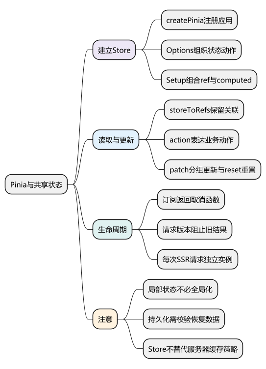
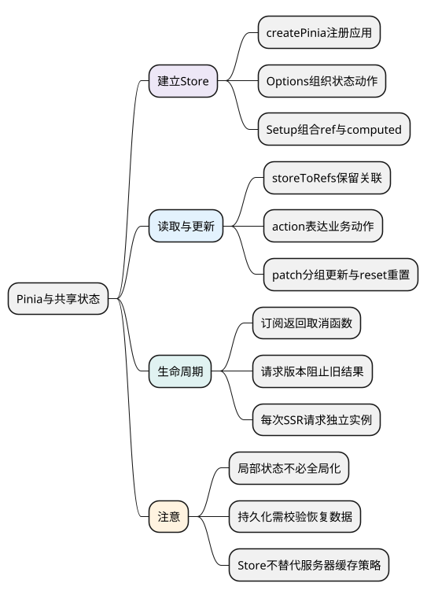
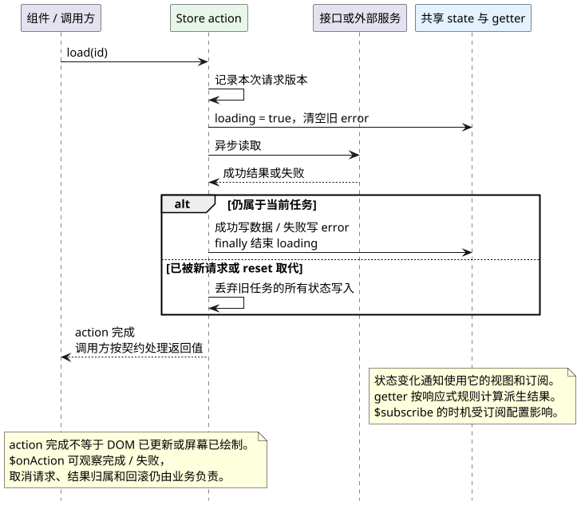

# Pinia：组织共享状态、派生数据和业务动作

<!-- core-mindmap:start -->
[](examples/vue19-mindmap.svg)

<details>
<summary>PlantUML 源码</summary>



</details>

<!-- core-mindmap:end -->

**口述总览：** Pinia 把需要跨组件共享的客户端状态组织成 Store。state 保存状态，getter 表达派生结果，action 执行业务动作。组件局部输入、URL 筛选条件和服务器缓存不必全部搬进 Store；先确定谁拥有数据，再决定是否共享。

本文使用 Pinia 3、Vue 3.5.43 和 TypeScript。Pinia 3 面向 Vue 3，维护 Vue 2 项目时要单独核对兼容版本。

## 安装与注册：给应用提供 Pinia 实例

在已有 Vue 项目中运行 `npm install pinia@3`。`createPinia()` 返回 Pinia 实例，`app.use(pinia)` 把它安装到应用。`defineStore(id, options)` 或 `defineStore(id, setup)` 返回 useStore 函数，调用后才获得对应 Store 实例。

下面文件放在 Vue + TypeScript 项目的 `src` 目录。

<!-- example: vue19-main -->
<!-- project: vue19-counter; file: main.ts -->
```ts
import { createApp } from 'vue'
import { createPinia } from 'pinia'
import App from './App.vue'

const pinia = createPinia()
createApp(App).use(pinia).mount('#app')
```

同一个 Pinia 实例内，同一个 Store ID 对应共享的 Store；不同组件调用 useCounterStore，不会各自获得互不相关的计数器。需要独立状态的组件实例，可以先使用组件本地 ref 或组合式函数。

<a id="k01"></a>

## Options Store：按 state、getters、actions 组织

### state 返回初始对象，getter 计算结果，action 修改状态

<!-- example: vue19-options-store -->
<!-- project: vue19-counter; file: stores/counter.ts -->
```ts
import { defineStore } from 'pinia'

export const useCounterStore = defineStore('counter', {
  state: () => ({ count: 0, step: 1 }),
  getters: {
    double: state => state.count * 2
  },
  actions: {
    increment() {
      this.count += this.step
    },
    setStep(value: number) {
      if (!Number.isInteger(value) || value <= 0) throw new Error('步长必须为正整数')
      this.step = value
    }
  }
})
```

state 使用函数返回初始对象；所有需要的状态应提前声明。Options Store 的 action 中，普通方法的 this 指向 Store，可以访问状态、getter 和其他 action；不要改成捕获外层 this 的箭头函数。

getter 返回派生值并参与响应式计算，例如 double 随 count 更新。若 getter 用 this 访问其他 getter，TypeScript 可能需要显式声明返回类型，帮助消除推断限制。

<a id="k02"></a>

### storeToRefs：解构状态时保留响应式关系

`storeToRefs(store)` 返回包含状态和 getter 引用的对象，忽略方法和非响应式属性。模板自动解包这些 ref，脚本中通过 `.value` 读写可写状态；只读 getter 不能当作可写状态修改。

<!-- example: vue19-counter-app -->
<!-- project: vue19-counter; file: App.vue -->
```vue
<script setup lang="ts">
import { storeToRefs } from 'pinia'
import { useCounterStore } from './stores/counter'

const store = useCounterStore()
const { count, double } = storeToRefs(store)
const { increment } = store

function addTen() {
  store.$patch(state => { state.count += 10 })
}
</script>

<template>
  <p>计数：{{ count }}，两倍：{{ double }}</p>
  <button type="button" @click="increment">按步长增加</button>
  <button type="button" @click="addTen">增加 10</button>
  <button type="button" @click="store.$reset()">重置</button>
</template>
```

直接 `const { count } = store` 取到的数字是当时的值，失去后续关联；`store.count` 的访问仍然响应式。action 已按 Pinia 的规则绑定，可以解构调用，不需要用 storeToRefs 包装。

## Setup Store：用 ref、computed 和函数定义 Store

### 返回值决定公开状态与动作

下面是独立于前面计数器的完整 Store。它使用本地异步函数模拟接口；实际项目可以替换实现，但要保留错误、加载与过期结果处理。

<!-- example: vue19-setup-store -->
<!-- project: vue19-profile; file: stores/profile.ts -->
```ts
import { computed, ref } from 'vue'
import { defineStore } from 'pinia'

interface User { id: string; name: string }
const readUser = async (id: string): Promise<User> => ({ id, name: `用户 ${id}` })

export const useProfileStore = defineStore('profile', () => {
  const user = ref<User | null>(null)
  const loading = ref(false)
  const error = ref('')
  const displayName = computed(() => user.value?.name ?? '未选择用户')
  let requestVersion = 0

  async function load(id: string) {
    const version = ++requestVersion
    loading.value = true
    error.value = ''
    try {
      const result = await readUser(id)
      if (version === requestVersion) user.value = result
    } catch (cause) {
      if (version === requestVersion) {
        error.value = cause instanceof Error ? cause.message : '读取失败'
      }
    } finally {
      if (version === requestVersion) loading.value = false
    }
  }

  function $reset() {
    requestVersion++
    user.value = null
    loading.value = false
    error.value = ''
  }

  return { user, loading, error, displayName, load, $reset }
})
```

这里 ref 对应 state，computed 对应 getter，函数对应 action。应返回需要被 Pinia 管理的状态；把真实业务状态藏在闭包里不返回，会影响 SSR、开发工具和插件。示例 requestVersion 只是当前进程内的异步失效标记，不作为要序列化的业务状态。

<!-- example: vue19-setup-app -->
<!-- project: vue19-profile; file: App.vue -->
```vue
<script setup lang="ts">
import { storeToRefs } from 'pinia'
import { useProfileStore } from './stores/profile'
const store = useProfileStore()
const { displayName, loading, error } = storeToRefs(store)
</script>

<template>
  <button type="button" @click="store.load('1')">读取用户 1</button>
  <button type="button" @click="store.load('2')">读取用户 2</button>
  <button type="button" @click="store.$reset()">清空</button>
  <p>{{ loading ? '读取中' : displayName }}</p>
  <p v-if="error" role="alert">{{ error }}</p>
</template>
```

<!-- example: vue19-setup-main -->
<!-- project: vue19-profile; file: main.ts -->
```ts
import { createApp } from 'vue'
import { createPinia } from 'pinia'
import App from './App.vue'
createApp(App).use(createPinia()).mount('#app')
```

Setup Store 没有 Options Store 那样自动恢复初始 state 的通用 `$reset`，因此示例自行实现。重置也使旧请求结果失效，避免用户清空后旧响应再次把数据填回来。

## 更新 API：直接赋值、$patch 与 $reset

Pinia 允许直接修改 state，例如 `store.count++`；不要求必须经过 mutations。复杂业务可以集中到 action，便于复用和追踪。

`store.$patch({ count: 10 })` 按对象修改部分状态；`store.$patch(state => { ... })` 适合数组等多项修改，把相关变更作为一组记录。$patch 返回 `void`，它不是数据库事务，不提供跨请求回滚或并发隔离。

Options Store 的 `$reset()` 重新生成初始 state；Setup Store 则按实际状态提供自己的重置方法。`$state` 赋值也不会让组件引用自动变成一个完全无关联的新 Store，而是通过 Pinia 的更新机制处理状态。

## 订阅 API：观察状态变化和 action 结果

`$subscribe(callback, options?)` 观察状态变化，callback 接收 mutation 和新 state；`$onAction(callback, detached?)` 观察 action，可通过 after 和 onError 处理完成或失败。两者都返回取消函数。

下面的工具文件加入前面计数器项目，调用 installCounterLogs(store) 即可安装，返回函数用于一次性移除本例的两种订阅。

<!-- example: vue19-subscriptions -->
<!-- project: vue19-counter; file: counterLogs.ts -->
```ts
import type { useCounterStore } from './stores/counter'

export function installCounterLogs(store: ReturnType<typeof useCounterStore>) {
  const stopState = store.$subscribe((mutation, state) => {
    console.info('状态变化', mutation.type, state.count)
  })
  const stopAction = store.$onAction(({ name, after, onError }) => {
    after(result => { console.info('动作完成', name, result) })
    onError(error => { console.error('动作失败', name, error) })
  })
  return () => { stopState(); stopAction() }
}
```

在组件 setup 中建立的订阅通常随所属组件卸载清理；detached 订阅或组件之外建立的订阅需要明确自己的所有者。不要把所有页面各自注册的全局订阅都留到浏览器关闭。

持久化只是订阅的一个用途。写 localStorage 前应选择字段，恢复时做结构和版本校验，并处理存储失败；不应直接持久化请求对象、第三方实例或敏感凭据。Pinia 核心不会默认替你做持久化。

## 偏好持久化：先校验恢复，再订阅白名单字段

以主题偏好为例，Store 的默认值先保证界面可用；浏览器存储里的内容属于外部输入，应先解析、检查版本和字段，再恢复到 Store。下面两个文件构成可复用模块，组件中仍按前面的 `storeToRefs` 方式读取主题。

`preferences.ts`：

<!-- project: v3review19-preferences; file: preferences.ts -->
```ts
import { defineStore } from 'pinia';

export type Theme = 'light' | 'dark';
export const usePreferences = defineStore('preferences', {
  state: () => ({ theme: 'light' as Theme }),
});

type StoragePort = Pick<Storage, 'getItem' | 'setItem'>;
const key = 'app-preferences';

export function persistPreferences(
  store: ReturnType<typeof usePreferences>,
  storage: StoragePort,
  onStorageError: (error: unknown) => void,
) {
  try {
    const saved = storage.getItem(key);
    const value: unknown = saved === null ? null : JSON.parse(saved);
    if (value !== null && typeof value === 'object'
      && 'version' in value && value.version === 1
      && 'theme' in value && (value.theme === 'light' || value.theme === 'dark')) {
      store.theme = value.theme;
    }
  } catch (error) {
    onStorageError(error);
  }

  return store.$subscribe((_mutation, state) => {
    try {
      storage.setItem(key, JSON.stringify({ version: 1, theme: state.theme }));
    } catch (error) {
      onStorageError(error);
    }
  }, { detached: true, flush: 'sync' });
}
```

`installPreferences.ts`：普通客户端渲染应用在创建 Pinia 后安装；SSR 应用需保证首屏数据一致，纯客户端偏好可在水合完成后再恢复。返回的函数用于应用销毁或重新安装配置时解除订阅。

<!-- project: v3review19-preferences; file: installPreferences.ts -->
```ts
import type { Pinia } from 'pinia';
import { persistPreferences, usePreferences } from './preferences';

export function installBrowserPreferences(pinia: Pinia) {
  if (typeof window === 'undefined') return () => {};
  try {
    return persistPreferences(usePreferences(pinia), window.localStorage, error => {
      console.warn('主题偏好未能保存或恢复', error);
    });
  } catch (error) {
    // 某些浏览器策略下，获取 localStorage 本身也可能失败。
    console.warn('当前环境无法使用主题偏好存储', error);
    return () => {};
  }
}
```

示例先恢复再订阅，避免安装时用默认值覆盖缓存。版本未知或字段不合法时保留当前默认状态；如果需要兼容旧版本，应写明确的迁移函数。只保存 `theme`，不会把 Store 的全部字段、请求状态或凭据一起落盘。

这里使用同步订阅便于观察单个偏好的即时保存。频繁编辑的大对象不应每次输入都同步序列化，可以合并写入或节流，并在退出时处理尚未保存的变化。取消订阅不等于删除存储；清空偏好与退出登录后清除用户缓存也应显式执行。

这个例子只覆盖单页面环境下的偏好保存，没有实现多标签页同步。SSR 时客户端偏好不能偷偷改变首屏结构：需要使用服务端一致的初始数据，或在水合完成后再应用纯客户端偏好。

<a id="k03"></a>

## 状态归属：什么值得放进 Store

**组件局部状态**，例如只影响一个弹窗的展开状态，可以保留在组件。**可分享的筛选或分页状态**，通常应放进 URL。**跨页面共享的客户端状态**，例如购物车选择或当前工作区，可以由 Store 管理。

**服务器数据**还涉及缓存、失效、重试、权限和并发，不能因为放进 Pinia 就自动获得这些能力。请求层或查询缓存可以负责数据读取，Store 只承接确实需要共享的部分，避免在多个地方各复制一份再手动同步。

一次 action 可以包含异步逻辑，但仍要考虑请求竞态。前面的版本标记负责旧结果失效；若真实请求支持 AbortController，还可减少不必要的网络和解析工作。

把一次读取操作展开后，action 负责业务判断和状态写入，响应式系统再把变化传递给使用这些状态的视图。状态订阅观察变化，action 订阅观察动作完成或失败；它们不替业务完成取消、回滚或权限判断。

action 内部捕获异常并正常返回时，对调用方仍是成功完成；`$onAction` 的 `onError` 只观察向外抛出或拒绝的错误，不能靠它自动发现所有已被业务捕获的请求失败。

<!-- understanding-flow: vue19-store-data-flow:start -->
<a id="store-data-flow"></a>

<details>
<summary>PlantUML 源码</summary>



</details>

<!-- understanding-flow: vue19-store-data-flow:end -->

<a id="k04"></a>

## SSR 隔离：每次请求创建自己的 Pinia

服务端模块可能跨请求复用，不能把带用户状态的 Store 实例放在模块单例中。下面的 Node ESM 例子展示每次调用独立创建应用和 Pinia；defineStore 的定义本身可以在模块级复用。

<!-- example: vue19-ssr-isolation -->
```ts
import { createSSRApp, h } from 'vue'
import { renderToString } from 'vue/server-renderer'
import { createPinia, defineStore } from 'pinia'

const useSessionStore = defineStore('session', {
  state: () => ({ displayName: '' })
})

export async function renderForUser(displayName: string) {
  const pinia = createPinia()
  const store = useSessionStore(pinia)
  store.displayName = displayName
  const app = createSSRApp({ render: () => h('p', store.displayName) })
  app.use(pinia)
  return { html: await renderToString(app), state: pinia.state.value }
}
```

组件之外调用 useStore 时，显式传 pinia 能避免依赖不明确的活动实例。返回的 state 若要注入 HTML，必须使用安全序列化方案并只公开允许发送给客户端的字段；不能直接把任意 JSON 字符串拼进 script 标签。

客户端恢复的状态可能陈旧或被修改，服务端仍负责真正授权。退出登录时也应重置相关 Store、清理持久化内容，并使未完成请求失效。

<a id="interview"></a>

## 试题

<a id="vue13-01"></a>
### VUE13-01 [P0·基础] Pinia 与传统 Vuex 有哪些主要 API 差异？

**回答：** Pinia 以 state、getters、actions 组织，不要求独立 mutations 层，可以直接修改状态，并支持 Setup Store 与较自然的类型推断。各 Store 通过独立 ID 组织；更换状态库仍需要设计数据归属、插件和迁移，不能自动消除业务耦合。

<a id="vue13-02"></a>
### VUE13-02 [P0·原理] 为什么解构 Store 状态要用 storeToRefs？

**回答：** Store 上的 ref 状态通常已解包，直接解构数字等值会得到当时快照，失去后续关联。storeToRefs 生成与 Store 状态和 getter 对应的 ref；action 是已按 Pinia 规则绑定的方法，可以直接解构。

<a id="vue13-03"></a>
### VUE13-03 [P1·工程取舍] 是否所有接口数据都该放 Pinia？

**回答：** 不必。先区分本地 UI、URL、共享客户端和服务器数据。服务器数据需要缓存与失效策略，Pinia 本身不自动处理这些；应避免组件和多个 Store 各自复制同一数据，产生难以维护的人工同步。

<a id="vue13-04"></a>
### VUE13-04 [P1·原理] SSR 为什么要按请求创建 Pinia 环境？

**回答：** 服务端模块会被多个请求复用，共享可变用户状态会造成串用户。每次请求应创建应用和 Pinia，在组件之外使用 Store 时传入正确实例，再安全地序列化允许公开的数据。

<a id="vue13-05"></a>
### VUE13-05 [P0·基础] Options Store 和 Setup Store 怎样重置？

**回答：** Options Store 提供内建 $reset，按 state 工厂恢复初始状态；Setup Store 通常需要自己定义重置函数。业务上还要同时处理请求失效、持久化和临时错误状态，不能只把界面上的一个字段清空。

<a id="vue13-06"></a>
### VUE13-06 [P1·工程取舍] 异步 action 写进 Store 后还需要防请求竞态吗？

**回答：** 需要。位置改变不会改变异步完成顺序，旧请求仍可能覆盖新请求或退出登录后的状态。可用版本标记确认结果归属，并在支持时取消请求；loading 和 error 的写入也需要同样判断。

官方文档：[Pinia 核心概念](https://pinia.vuejs.org/zh/core-concepts/) · [状态](https://pinia.vuejs.org/zh/core-concepts/state.html) · [Action](https://pinia.vuejs.org/zh/core-concepts/actions.html) · [SSR](https://pinia.vuejs.org/zh/ssr/)。

前篇：[Vue Router 路由与导航](<18_Vue Router路由与导航.md>) · 后篇：[响应式原理与依赖追踪](20_响应式原理与依赖追踪.md) · [返回目录](00_目录.md)

<a id="vue13-07"></a>

### VUE13-07 [P1·工程取舍] Pinia 持久化为什么不能直接保存整个 Store？

Store 中可能含请求状态、敏感字段或不能可靠序列化的数据。应选择必要字段，先校验存储版本与结构，再恢复并订阅写入；处理读写异常，按生命周期解除订阅。SSR 还要保证服务端与客户端首次渲染一致，不能把浏览器缓存当成可信初始状态。
