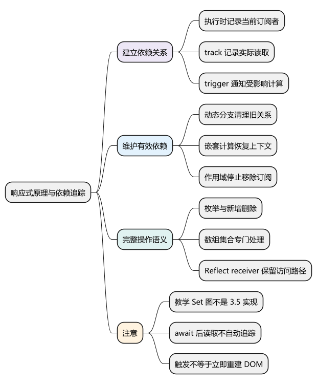
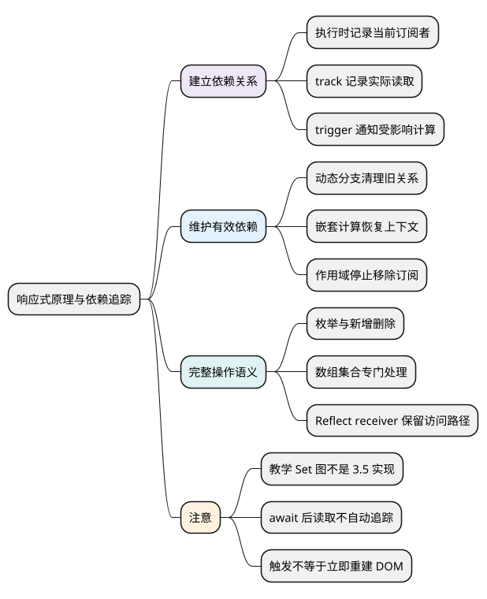

# 响应式原理与依赖追踪

<!-- core-mindmap:start -->
[](examples/vue20-mindmap.svg)

<details>
<summary>PlantUML 源码</summary>



</details>

<!-- core-mindmap:end -->

**总览：** 响应式系统记录“哪段计算读取了哪个数据”，数据变化时通知相关计算。读取时建立依赖，执行路径变化时调整依赖，写入时找到受影响者，再交给计算属性、侦听器或组件调度各自处理。不是任何赋值都会立即重画整个页面。

本文以 Vue **3.5.43** 为源码基线。先观察真实 API 的行为，再看内部概念；旧笔记中用 Set、effectStack 和 `_dirty` 展示的结构只能代表对应历史版本或教学模型。

<a id="k01"></a>

## 先观察依赖：只有执行时真正读到的字段才相关

`watchEffect` 可以展示自动追踪。下面读取 name，没有读取 age，所以修改 age 不会使这个 effect 重新执行。

<!-- example: vue20-dependency -->
```ts
import { reactive, watchEffect } from 'vue'

const user = reactive({ name: 'A', age: 18 })
const seen: string[] = []
const stop = watchEffect(() => {
  seen.push(user.name)
}, { flush: 'sync' })

user.age = 19
user.name = 'B'
console.log(seen) // ['A', 'B']
stop()
```

这里使用同步执行方便逐步观察，并不代表组件更新也同步。组件渲染函数读取模板需要的响应式值，同样会建立依赖；computed 的 getter 和侦听器的来源求值也各有订阅关系。

## effect、track、trigger：执行、记录与通知分别负责什么

**effect** 可以理解为由响应式系统管理的计算。执行期间，系统知道当前是哪一个订阅者，使属性读取能与它关联。组件渲染和 watcher 都会使用相关机制，但不能把 effect 仅解释为“刷新 DOM 的函数”。

**track** 是内部依赖收集过程。代理拦截到读取时，结合目标对象、属性和当前订阅者记录关系；没有处于追踪中的订阅者时，普通读取不会无条件创建一项组件依赖。

**trigger** 是内部触发过程。属性变化后，根据目标、属性和操作类别找到受影响的依赖，通知计算失效或安排执行。它并不等同于“立刻执行所有函数”。

```text
执行计算，设置当前订阅者
  → 读取响应式属性
  → track 记录这段计算依赖该属性
  → 执行结束，恢复外层追踪上下文

修改响应式属性
  → 判断实际变化与操作类别
  → trigger 通知受影响订阅者
  → 计算属性确认结果，watcher/组件按各自规则执行
```

ref 的 `.value` 通过自身依赖入口参与这个过程；reactive 普通对象通过 Proxy handler 接入。两者能共同参与依赖图，但并不是所有数据都经过同一种 Proxy get。

## Vue 3.5 的依赖结构：属性依赖、订阅链接和版本信息

教学上可以用“对象 → 属性 → 一组计算”理解关系，常见模型写成 `WeakMap<target, Map<key, Set<effect>>>`。这种模型表达关联关系，**不是 Vue 3.5.43 的完整实现**。

在该版本源码中，目标对象的属性依赖仍按 target、key 组织；属性依赖由 `Dep` 表示，订阅者与依赖之间通过 `Link` 等结构连接，并使用版本和标记辅助失效检查、清理和批处理。computed 也参与订阅体系，不能照搬旧代码认为它必定持有某版 `ReactiveEffect` 和 `_dirty` 实现。

读源码时沿着功能追踪：普通对象访问看 `baseHandlers.ts`，依赖关系看 `dep.ts`，响应式计算和清理看 `effect.ts`，ref 看 `ref.ts`。先确认版本，再对应函数，避免混用不同教程的私有字段。

<a id="k02"></a>

## 动态分支：每次运行让依赖匹配当前执行路径

<!-- example: vue20-branch -->
```ts
import { reactive, watchEffect } from 'vue'

const state = reactive({ enabled: true, count: 0, fallback: '关闭' })
const seen: Array<number | string> = []
const stop = watchEffect(() => {
  seen.push(state.enabled ? state.count : state.fallback)
}, { flush: 'sync' })

state.count = 1
state.enabled = false
state.count = 2
state.fallback = '已停用'
console.log(seen) // [0, 1, '关闭', '已停用']
stop()
```

第一次读取 enabled 和 count。切换为 false 后，新执行路径读取 enabled 和 fallback，不再需要 count；响应式系统调整订阅关系，防止以后 count 变化引发无关计算。

不能把依赖收集理解为第一次运行后永远不变，也不能说“对象有十个属性就全部收集”。自动追踪依据实际执行路径，深层 watch 则通过遍历主动触达更大范围。

嵌套计算需要在内层结束后恢复外层订阅者，异常退出也要正确恢复状态。直接遍历并修改同一个订阅集合还可能造成重复执行，这也是完整实现不能停留在几行 Proxy 的原因。

## await 与追踪边界：异步后的读取不会自动回到之前上下文

<!-- example: vue20-async-boundary -->
```ts
import { nextTick, ref, watchEffect } from 'vue'

const before = ref(0)
const after = ref(0)
const seen: string[] = []
const stop = watchEffect(async () => {
  const first = before.value
  await Promise.resolve()
  seen.push(`${first}:${after.value}`)
})

await nextTick()
after.value = 1
await nextTick()
console.log(seen) // ['0:0']，after 未被最初的同步阶段追踪
stop()
```

异步函数在 await 后恢复时，最初的自动追踪上下文已经结束。需要这些字段成为触发条件时，先同步读取，或者用 watch 明确给出来源。停止 watcher 也不会自动取消已经启动的任意 Promise，需要另外注册清理与结果归属检查。

<a id="k03"></a>

## 新增、删除与枚举：依赖不只来自普通 get

`Object.keys` 依赖对象有哪些键，`'name' in state` 依赖属性是否存在，数组 length 依赖长度，Map 的键迭代和数值迭代也不完全相同。Vue 需要区分这些操作，才能通知恰当的订阅者。

<!-- example: vue20-iteration -->
```ts
import { reactive, watchEffect } from 'vue'

const state = reactive<Record<string, number>>({ a: 1 })
const keys: string[] = []
const stop = watchEffect(() => {
  keys.push(Object.keys(state).join(','))
}, { flush: 'sync' })

state.a = 2 // 已有键的值变了，键集合不变
state.b = 3 // 新增键，枚举结果变化
delete state.a
console.log(keys) // ['a', 'a,b', 'b']
stop()
```

数组新增索引可能影响 length，缩短 length 又会影响被移除的索引。Map、Set 方法涉及内建对象的内部槽，不能把普通对象的 handler 原样套上去，因此 Vue 为集合和数组行为提供专门处理。

## Reflect 的 receiver：让 getter 内部访问继续经过正确对象

Proxy 的 get handler 中常见 `Reflect.get(target, key, receiver)`。第三个参数决定 getter 内部的 `this`，使 getter 继续读取属性时有机会经过代理。

<!-- example: vue20-receiver -->
```ts
const raw = {
  first: '小',
  last: '明',
  get fullName() { return this.first + this.last }
}
const reads: string[] = []
const proxy = new Proxy(raw, {
  get(target, key, receiver) {
    reads.push(String(key))
    return Reflect.get(target, key, receiver)
  }
})

console.log(proxy.fullName) // 小明
console.log(reads) // ['fullName', 'first', 'last']
```

这只是 JavaScript 的访问转发演示，没有实现 Vue 的依赖收集、readonly、数组集合、代理缓存和调度。直接 `target[key]` 会让此处 getter 的 this 指向原对象，从而绕开后续代理读取。

<a id="k04"></a>

## 调试依赖：用 onTrack 和 onTrigger 验证读写链路

开发环境可给 computed、watch、watchEffect 配置调试回调，或在组件中使用渲染调试钩子。它们用于定位依赖问题，不是生产业务通知接口。

<!-- example: vue20-debug -->
```ts
import { reactive, watchEffect } from 'vue'

const state = reactive({ count: 0 })
const events: string[] = []
const stop = watchEffect(() => {
  console.log(state.count)
}, {
  flush: 'sync',
  onTrack(event) { events.push(`读取:${String(event.key)}`) },
  onTrigger(event) { events.push(`触发:${String(event.key)}`) }
})
state.count++
stop()
console.log(events) // 开发构建中包含 count 的追踪和触发信息
```

不更新时先看读取是否发生在追踪阶段、写入是否经过同一 ref/代理、是否存在解构快照或 shallow/raw 边界，再看分支是否仍订阅、作用域是否停止，最后判断更新是否尚未刷新。

更新过多时检查深监听范围、getter 返回新对象、父子 props 稳定性与循环写入。`trigger` 后可能只使 computed 失效，也可能把组件更新交给调度器，不应把触发次数直接当作 DOM 重建次数。

<a id="summary"></a>

## 工程追问：依赖停止与资源释放是两件相连的事

watcher 或 effect scope 停止后，系统移除相应订阅，后续变化不再正常调度它。外部请求、事件监听、定时器则要通过 cleanup/onScopeDispose 清理；不可取消的异步任务还需提交前检查是否仍有效。

使用 `WeakMap` 不等于“整个响应式系统不可能泄漏”。长期订阅、闭包和外部资源可能继续持有对象，需要明确作用域和状态所有者。

继续深入：[源码系列：effect、track、trigger 与依赖清理](../02_Vue3原理与源码/08_effect_track_trigger与依赖清理.md#effect-track-trigger与依赖清理)。

参考：[深入响应式系统](https://cn.vuejs.org/guide/extras/reactivity-in-depth.html)、[3.5.43 dep.ts](https://github.com/vuejs/core/blob/v3.5.43/packages/reactivity/src/dep.ts)、[effect.ts](https://github.com/vuejs/core/blob/v3.5.43/packages/reactivity/src/effect.ts)、[baseHandlers.ts](https://github.com/vuejs/core/blob/v3.5.43/packages/reactivity/src/baseHandlers.ts)。

<a id="interview"></a>

## 试题

<a id="vue05-01"></a>

### VUE05-01 [P0·原理] Vue 如何知道数据变化后更新谁？

**回答：** 执行组件渲染、计算属性或侦听来源时，响应式系统记录当前订阅者。读取响应式值把订阅者与对应数据关联，修改时找到受影响的依赖，再按计算属性、watcher 和组件各自的规则通知或调度。它依据实际读取建立关系，不是每次修改都重跑整棵页面。

<a id="vue05-02"></a>

### VUE05-02 [P0·原理] 为什么需要清理旧依赖？

**回答：** 条件分支变化后，计算可能不再读取之前的字段。如果继续保留旧订阅，那些无关字段变化仍会引发计算，并延长引用关系的生命周期。依赖应随每次实际执行路径更新，而不是第一次收集后一直不变。

<a id="vue05-03"></a>

### VUE05-03 [P1·原理] 只有 Proxy 的 get/set 就能完整实现 Vue 响应式吗？

**回答：** 不能。删除、属性存在性检查、键枚举、数组长度和 Map、Set 操作都有不同的依赖语义，还要处理 receiver、代理缓存、动态分支清理、计算属性和调度。简单 get/set 示例只能解释限定场景，不能当作完整框架实现。

<a id="vue05-04"></a>

### VUE05-04 [P1·工程取舍] 数据变了却没有副作用执行，如何排查？

**回答：** 我先确认读取是否处于追踪阶段，写入是否经过同一响应式入口，再检查解构快照、原对象绕写、浅层边界、分支和停止状态。依赖有效后才看调度时机，用 onTrack、onTrigger 和最小复现验证，避免直接归因于 Proxy 失效。

<a id="vue05-05"></a>

### VUE05-05 [P1·原理] 为什么不能把 WeakMap、Map、Set 教学图当成 Vue 3.5 完整源码？

**回答：** 那个模型有助于理解对象、属性和订阅者的关联，但 Vue 3.5 还使用 Dep、Link、版本和标记处理订阅、清理与失效检查。讲机制可以用简化图，讲具体源码要固定版本并核对实际结构，避免把不同年代的教程拼成同一实现。
