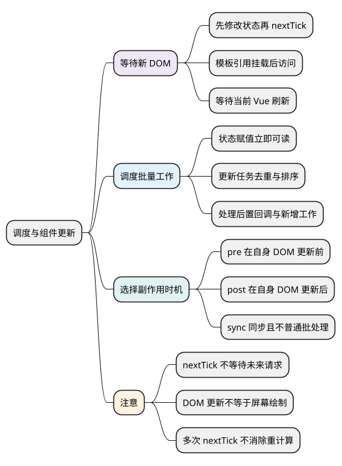
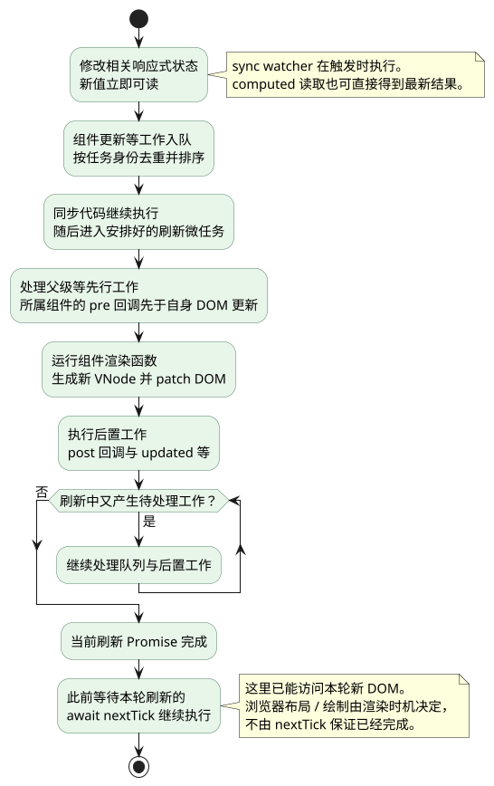

# 调度与组件更新

<!-- core-mindmap:start -->
[](examples/vue21-mindmap.svg)

<details>
<summary>PlantUML 源码</summary>



</details>

<!-- core-mindmap:end -->

**总览：** 修改响应式状态时，新值通常立即可读；组件 DOM 则通常在 Vue 的更新队列中批量刷新。`nextTick` 用来等待相关 Vue 更新完成，调度器负责合并、排序和执行任务。先会在正确位置等待 DOM，再理解队列为什么这样安排。

本文以 Vue **3.5.43** 为基线，浏览器渲染行为另按浏览器事件循环理解。Vue 更新、网络完成、布局测量与屏幕绘制不是同一个时间点。

<a id="k03"></a>

## nextTick()：等待当前 Vue 更新完成，再访问新 DOM

`nextTick()` 返回 Promise，可以 `await`；也可传回调，在相关刷新完成后执行。它关联当前待处理的 Vue 更新，不是等待所有未来异步任务。

下面是完整单文件组件：先改变条件渲染状态，再等待输入框出现，最后聚焦。

<!-- project: vue21-focus; file: App.vue -->
```vue
<script setup lang="ts">
import { nextTick, ref } from 'vue'

const visible = ref(false)
const input = ref<HTMLInputElement | null>(null)

async function openEditor() {
  visible.value = true
  await nextTick()
  input.value?.focus()
}
</script>

<template>
  <button @click="openEditor">打开编辑框</button>
  <input v-if="visible" ref="input" aria-label="名称">
</template>
```

正确顺序是**先改影响渲染的状态，再等待，再读 DOM**。如果条件根本没满足、引用指错、组件没挂载，多写几个 nextTick 也不会自动修复。

模板 ref 的类型包含 null，是因为首次渲染前、条件不成立或卸载后，目标元素可能不存在。不要靠无条件非空断言掩盖这些状态。

<a id="k01"></a>

## 状态同步改变：批处理合并的是后续工作，不是先缓存赋值

<!-- example: vue21-batch -->
```ts
import { nextTick, ref, watch } from 'vue'

const count = ref(0)
const seen: number[] = []
const stop = watch(count, value => { seen.push(value) })

count.value++
count.value++
count.value++
console.log(count.value, seen.length) // 3 0
await nextTick()
console.log(seen) // [3]
stop()
```

三次赋值都已经发生，所以同步读取是 3。普通 watcher 与组件更新可在同一轮刷新中合并，通常不会为了每个中间值各更新一次 DOM。业务如果需要保留每一步事件，应主动记录，不依赖渲染队列充当日志。

computed 读取可以当场获得最新派生结果，sync watcher 也会同步运行。不能把所有响应式计算都归为同一条异步 DOM 队列。

## pre、post、sync：侦听器与自身组件 DOM 的相对位置

默认 pre watcher 的变化回调通常在父组件更新后、所属组件自身 DOM 更新前执行。post watcher 在所属组件 DOM 更新之后执行。sync watcher 在触发时同步执行，不进行普通回调批处理。

下面的组件在每次点击后输出状态值和 DOM 文本。日志只描述这一个组件的更新，不代表全应用所有组件的统一先后顺序。

<!-- project: vue21-flush; file: App.vue -->
```vue
<script setup lang="ts">
import { nextTick, ref, watch } from 'vue'

const count = ref(0)
const text = ref<HTMLElement | null>(null)
const domText = () => text.value?.textContent ?? '未挂载'

watch(count, value => console.log('sync', value, domText()), { flush: 'sync' })
watch(count, value => console.log('pre', value, domText()))
watch(count, value => console.log('post', value, domText()), { flush: 'post' })

async function increment() {
  count.value++
  console.log('赋值后', count.value, domText())
  await nextTick()
  console.log('nextTick', count.value, domText())
}
</script>

<template>
  <button @click="increment">加一</button>
  <span ref="text">{{ count }}</span>
</template>
```

首次点击可观察到 `sync 1 0`、`赋值后 1 0`、`pre 1 0`、`post 1 1`、`nextTick 1 1`。模板里的旧文本不是状态尚未赋值，而是 DOM 尚未刷新。

需要某个响应式值变化后读取自身新 DOM，可用 post watcher；在明确动作里改状态后继续下一步，可用 await nextTick。watchPostEffect 的首次执行会安排在后置阶段，immediate watch 的首次回调还应与后续变化回调分开理解。

<a id="k02"></a>

## Scheduler：去重、排序并批量执行组件更新任务

Scheduler 是调度器，不是独立线程。组件响应式依赖变化后，通常将组件更新工作加入队列，通过 Promise 微任务安排刷新。

可以沿四个职责理解源码：

- **排队与去重**：相同更新任务已经等待执行时，不必因同步多次赋值反复入队。
- **顺序**：根据任务 ID、标记与组件关系安排，通常让父组件先于子组件更新，并把 pre watcher 放在所属组件更新之前。
- **刷新**：执行待处理任务及后置回调，处理刷新中继续产生的工作。
- **保护与清理**：跳过失效工作，重置队列状态，开发环境检查递归更新问题。

Vue 3.5.43 的 `queueJob`、`queueFlush`、`flushJobs`、`queuePostFlushCb` 位于 `scheduler.ts`。内部使用任务标记和有序队列，不能用旧教程的一句 `queue.includes(job)` 代表当前实现。

下面跟踪一次已经挂载的组件更新，只突出“状态、队列、DOM、等待点”四者的关系。pre / post 的位置针对所属组件，不能推导成全应用所有 pre 都必须先于所有组件更新。

<!-- understanding-flow: vue21-update-scheduling:start -->
<a id="update-scheduling-flow"></a>

<details>
<summary>PlantUML 源码</summary>



</details>

<!-- understanding-flow: vue21-update-scheduling:end -->

组件内部并不是状态一变就卸载所有 DOM 再重建。渲染函数计算新 VNode，渲染器比较并修改必要节点，见[VNode、key 与 Diff](22_VNode、key与Diff.md)。调度解决“何时执行”，Diff 解决“怎样更新节点”。

## nextTick 与微任务：等待 Vue 的刷新 Promise

源码中的 nextTick 选择当前刷新 Promise；没有待刷新任务时，则基于已兑现的 Promise。它没有能力预知未来请求何时结束，因此应该在相关状态修改之后调用。

<!-- example: vue21-microtask -->
```ts
import { nextTick, ref, watch } from 'vue'

const count = ref(0)
const order: string[] = []
const stop = watch(count, () => { order.push('watch') })
count.value++
order.push('同步')
await nextTick()
order.push('nextTick 之后')
console.log(order) // ['同步', 'watch', 'nextTick 之后']
stop()
```

如果网络请求还没结束，应该先等待请求，再修改状态，必要时再等待 DOM 更新。nextTick 不是请求完成信号，也不是“等待下一秒”或“等待下一帧”的别名。

`setTimeout(fn, 0)` 创建计时器任务，与 Vue 当前刷新 Promise 的契约不同。它可能碰巧在 DOM 更新后执行，但还会受到浏览器调度、最小延迟和页面状态影响，不能作为 nextTick 的等价实现。

## DOM 更新、布局和绘制：等待点必须对应目标

await nextTick 后可读取 Vue 本轮已经提交的 DOM，但不保证屏幕已经显示新像素。浏览器可能随后才进行样式计算、布局和绘制；读取 `getBoundingClientRect` 等还可能触发布局计算。

`requestAnimationFrame` 提供下一次可用渲染机会前的回调，适合按帧协调动画工作，也不表示回调开始时上一批像素已确认显示。图片解码、字体加载、CSS 过渡结束需要各自的加载或结束信号。

不要用“每轮微任务清完必然绘制一次”解释所有情况。浏览器会根据渲染时机和页面可见性决定是否绘制，连续微任务可能延后渲染机会。

<a id="k04"></a>

<a id="summary"></a>

## 工程追问：循环 await nextTick 为什么仍然会卡顿

nextTick 不会把重计算搬到其他线程，也不减少工作量。循环里不断加入微任务仍可能让主线程长期无法让出渲染机会，页面只在最后显示结果。

应先用性能工具定位瓶颈：是计算、组件更新范围、DOM 数量，还是强制布局。随后分别减少计算量、保持 props 稳定、使用虚拟列表、合理分片或将适合的纯计算交给 Worker。

同样不要在 updated 钩子里无条件改动该组件依赖的状态。调度去重不保证这种循环安全，开发环境的递归告警只是排错帮助，不是业务流程控制。

## 验证顺序：分别观察状态、回调、DOM 与浏览器表现

定位“读取旧 DOM”时，先确认状态响应式入口正确，再确认渲染条件和模板引用，最后比较 pre/post/nextTick 时机。测试 Vue DOM 更新可以等待 nextTick；真实布局、焦点与绘制问题还应在浏览器里验证。

如果一处逻辑需要连续堆叠多个 nextTick 才“偶尔正常”，应进一步检查异步请求、子组件延迟挂载、过渡或第三方组件的完成事件，等待实际负责完成该工作的信号。

继续深入：[源码系列：Scheduler 与 nextTick](../02_Vue3原理与源码/10_Scheduler与nextTick.md#scheduler与nexttick)。

参考：[nextTick](https://cn.vuejs.org/api/general.html#nexttick)、[侦听器刷新时机](https://cn.vuejs.org/guide/essentials/watchers.html#callback-flush-timing)、[3.5.43 scheduler.ts](https://github.com/vuejs/core/blob/v3.5.43/packages/runtime-core/src/scheduler.ts)、[renderer.ts](https://github.com/vuejs/core/blob/v3.5.43/packages/runtime-core/src/renderer.ts)。

<a id="interview"></a>

## 试题

<a id="vue08-01"></a>

### VUE08-01 [P0·原理] 连续修改三次状态为什么通常只更新一次组件？

**回答：** 状态值每次都同步改变，但组件更新任务会进入队列，相同任务在同一轮等待时可以去重。刷新时渲染读取最新状态，减少中间重复工作。这个结论针对常见组件调度，sync watcher 等其他副作用不一定只执行一次。

<a id="vue08-02"></a>

### VUE08-02 [P0·基础] nextTick 应该何时调用？

**回答：** 当后续操作需要某次状态修改产生的新 DOM 时，先改状态，再 await nextTick，最后读取或操作元素，例如打开条件渲染的输入框后聚焦。它不会替我等待未来请求，也不能修复未被追踪的状态或错误的渲染条件。

<a id="vue08-03"></a>

### VUE08-03 [P1·原理] nextTick 等于 setTimeout(0) 吗？

**回答：** 不等于。nextTick 关联 Vue 当前更新刷新的 Promise，setTimeout 注册浏览器计时器任务，两者等待的目标和调度位置不同。碰巧都在 DOM 更新后执行不代表语义相同，需要新 DOM 时应该选择对应 Vue 更新的等待点。

<a id="vue08-04"></a>

### VUE08-04 [P1·工程取舍] 多加 nextTick 能解决页面卡顿吗？

**回答：** 不能，它不减少计算，也不让计算并行。连续微任务还可能推迟浏览器绘制。应先定位长任务和更新范围，再按瓶颈减少工作量、控制 DOM 数量、分片或使用 Worker，而不是把 nextTick 当作性能优化开关。

<a id="vue08-05"></a>

### VUE08-05 [P1·原理] 更新队列去重是否意味着所有副作用只执行一次？

**回答：** 不是，去重针对队列中的特定任务。sync watcher 会同步响应变化，不同任务和刷新中产生的新工作也有各自规则。无条件互相修改状态仍可能产生递归更新，不能指望调度器替业务消除循环。

<a id="vue08-06"></a>

### VUE08-06 [P1·原理] await nextTick 后，用户一定已经看到新界面了吗？

**回答：** 不一定。它表示相关 Vue 更新完成，DOM 可以已经改变，但浏览器未必完成绘制。读取 DOM、读取布局、等待动画结束和确认视觉表现是不同任务，应按目标使用 DOM 更新、加载事件、动画结束或帧调度机制。
