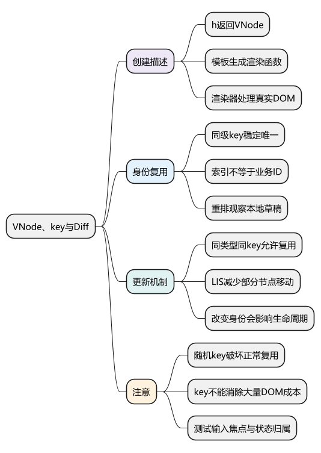
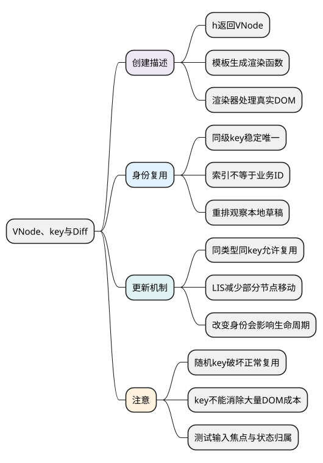

# VNode、key与Diff

<!-- core-mindmap:start -->
[](examples/vue22-mindmap.svg)

<details>
<summary>PlantUML 源码</summary>



</details>

<!-- core-mindmap:end -->

**口述总览：** VNode 是用 JavaScript 对象描述的界面结构。组件重新渲染后，Vue 比较前后的描述，决定保留哪些节点、修改哪些内容、移动或卸载哪些节点。`key` 用来表达同级节点的身份；先理解身份与状态复用，再看 Diff 怎样减少操作。

本篇先用 Vue 3.5 的公开 API 观察行为。内部列表算法以 Vue 3.5.43 为基线，完整位置映射与最长递增子序列推导放在[源码篇](../02_Vue3原理与源码/12_Patch与Diff.md#patch与diff)。

<a id="k01"></a>

## h()：创建节点描述，交给渲染器处理

`h(type, props, children)` 返回 VNode。`type` 可以是标签名或组件；`props` 传属性、事件等；`children` 可以是文本、节点数组，组件还可以接收插槽函数。调用 `h` 本身不会把节点插进页面。

<!-- example: vue22-vnode -->
```ts
import { h, isVNode } from 'vue';

const node = h('button', { type: 'button', disabled: true }, '保存');
console.log(isVNode(node)); // true
console.log(node.type, node.props?.disabled, node.children); // button true 保存
```

模板会被编译成生成 VNode 的渲染函数。通常写模板即可；需要用程序灵活组合结构时，可以手写渲染函数。下面是一个完整的 `.ts` 组件，可从父组件导入并当普通组件使用。

<!-- example: vue22-render-component -->
```ts
import { defineComponent, h, ref } from 'vue';

export default defineComponent({
  name: 'RenderCounter',
  setup() {
    const count = ref(0);
    return () => h('button', {
      type: 'button',
      onClick: () => count.value++,
    }, `点击次数：${count.value}`);
  },
});
```

`setup` 返回的函数在渲染时执行；渲染读取 `count.value`，从而建立更新依赖。VNode 包含类型、属性、子节点等信息，实际 DOM 则由渲染器创建和更新。组件 VNode 表示组件边界，不等于组件里面已经生成的真实 DOM。

<a id="k02"></a>

## key：让同一条业务数据对应同一个实例

`key` 在同级节点中应当稳定且唯一，通常使用业务 ID。它不是全局编号，也不会作为普通 prop 自动传入子组件。

下面用两个组件观察身份。先修改某一行的输入框，再点“倒序”，输入内容应当跟随对应姓名移动。把父组件的 `:key="item.id"` 改成 `:key="index"` 后再次尝试，就能观察位置复用带来的错位。

`EditRow.vue`：本例特意把初始名称复制为独立草稿，用来观察实例状态；它不是自动跟随父级变化的双向绑定。

<!-- project: vue22-key-identity; file: EditRow.vue -->
```vue
<script setup lang="ts">
import { ref } from 'vue';
const props = defineProps<{ name: string }>();
const draft = ref(props.name);
</script>

<template>
  <label>{{ props.name }} 的草稿：<input v-model="draft"></label>
</template>
```

`App.vue`：

<!-- project: vue22-key-identity; file: App.vue -->
```vue
<script setup lang="ts">
import { ref } from 'vue';
import EditRow from './EditRow.vue';
const items = ref([
  { id: 'u1', name: '小林' },
  { id: 'u2', name: '小周' },
]);
</script>

<template>
  <button type="button" @click="items.reverse()">倒序</button>
  <ul>
    <li v-for="(item, index) in items" :key="item.id">
      <EditRow :name="item.name" />
    </li>
  </ul>
</template>
```

用 ID 时，Vue 可以把已有行移到新位置，草稿仍属于原来的实例。用索引时，同一位置的 key 没变，实例可能被用于另一条数据，而本地草稿还保留旧值。静态且不会重排的简单列表使用索引风险较小，但应先确认这个前提。

随机生成 key 会让同一条数据每次更新都像一个新节点，破坏正常复用；重复 key 则无法可靠表达身份。

<a id="k03"></a>

## Patch 与 Diff：先判断身份，再决定更新动作

Patch 可以理解为“把新描述应用到已有界面”。相同类型、相同 key 通常允许复用，但属性、子节点或组件输入仍可能需要更新。类型或身份不同，则可能卸载旧节点、挂载新节点。

带 key 的列表更新通常先比较相同的开头、结尾，再处理新增和删除。剩余的未知区间会建立键与位置的对应关系，找出可复用节点，并决定哪些节点需要移动。

旧顺序为 `A B C D`，新顺序为 `B C A D` 时，可以保留 `B C` 的相对顺序，把 `A` 移到它们后面。最长递增子序列（LIS）帮助找出一组不必移动的复用节点；它并不负责全部的组件渲染、属性更新和浏览器布局。

算法不是逐层暴力比较整棵旧树与整棵新树的任意组合。模板编译得到的动态标记也会帮助缩小需要处理的范围，详见[模板编译与渲染优化](23_模板编译与渲染优化.md)。

<a id="k04"></a>

## 改变 key：主动重置实例，也要承担清理成本

业务上切换不同记录时，可以通过 key 明确重置编辑器的本地状态。例如父级用记录 ID 作为编辑器 key，换记录后创建新的编辑器实例。但保存草稿、未完成请求、订阅和焦点是否需要保留，应由业务要求决定。

`KeepAlive` 会影响实例的缓存与停用行为，因此不能把所有“离开页面”都解释为卸载。验证重排时也不能只看文本，还应检查输入值、焦点、选中项和订阅是否仍归属于正确记录。

<a id="summary"></a>

## 工程追问：列表卡顿与状态错位分别怎样排查

状态错位先检查 key、数据 ID 和子组件本地状态的关系；卡顿先测量计算、组件更新与真实 DOM 的数量。稳定 key 可以帮助正确复用，却不能消除十万行 DOM 的布局与绘制成本。分页或虚拟列表解决的是另一类工作量问题。

参考：[渲染函数与 JSX](https://cn.vuejs.org/guide/extras/render-function.html)、[维护列表状态](https://cn.vuejs.org/guide/essentials/list.html#maintaining-state-with-key)。

<a id="interview"></a>

## 试题与答案

<a id="vue09-01"></a>

### VUE09-01 [P0·原理] 为什么key不能随意使用index？

**回答：** 重排时index代表位置而不是业务身份，框架可能把旧组件状态和DOM复用给另一条数据，造成输入、焦点和状态错位。稳定唯一ID更符合身份契约。

对应讲解：[key 表达身份而非位置](#k02)。

<a id="vue09-02"></a>

### VUE09-02 [P1·原理] Vue Diff中的LIS解决什么？

**回答：** 在带key未知区域重排时，寻找可以保持相对顺序的一组复用节点，减少移动操作。它只是列表更新的一环，不代表整个渲染或布局成本都由LIS决定。

对应讲解：[同层比较与最长递增子序列](#k03)。

<a id="vue09-03"></a>

### VUE09-03 [P1·工程取舍] 给组件换key有什么效果？

**回答：** 通常会改变身份并触发旧实例卸载、新实例创建，可用于有意重置状态，但会重新执行生命周期和资源建立。随机key会破坏正常复用。

对应讲解：[复用、卸载与实战判断](#k04)。

<a id="vue09-04"></a>

### VUE09-04 [P0·基础] 虚拟DOM一定比直接DOM操作快吗？

**回答：** 不一定，它提供声明式结构和跨更新的协调机制，也有计算成本。针对单一动作的直接DOM可能更少工作；实际性能取决于更新规模、编译优化与浏览器成本。

对应讲解：[VNode 与渲染结果](#k01)。
