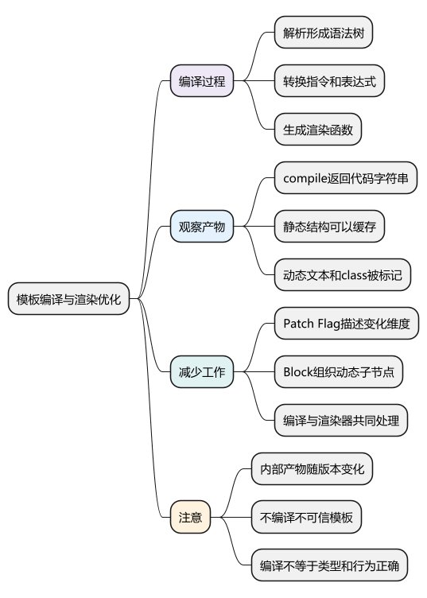
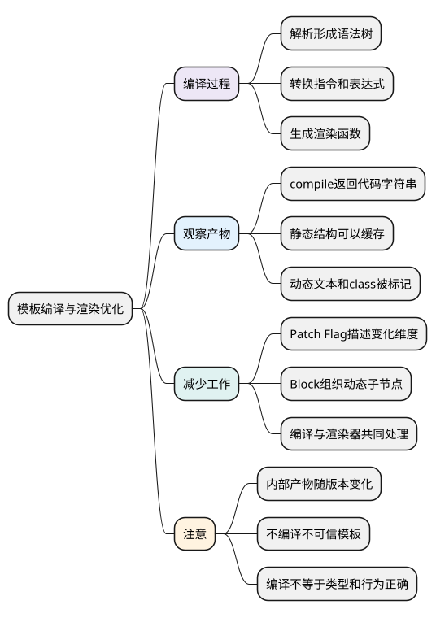

# 模板编译与渲染优化

<!-- core-mindmap:start -->
[](examples/vue23-mindmap.svg)

<details>
<summary>PlantUML 源码</summary>



</details>

<!-- core-mindmap:end -->

**口述总览：** Vue 模板先经过编译，变成生成 VNode 的渲染函数；运行时执行渲染函数，再更新界面。编译器能提前知道哪些内容静态、哪些绑定会变化，把这些信息告诉运行时，减少重复判断。

先会写模板，再通过一个小例子观察产物即可。源码中的 AST 节点、变换插件和具体标志常量属于深入阅读，不要求先背完才能使用 Vue。

<a id="k01"></a>

## 从 .vue 文件到界面：编译与运行分开理解

单文件组件（SFC）的脚本、模板和样式需要分别处理。`script setup` 中的编译宏由 SFC 编译器处理；模板编译器处理插值、指令、事件和插槽；构建工具负责串联这些处理并输出浏览器可加载的模块。

模板编译一般分为三步：

1. **解析**：把标签、属性、表达式等文本识别为语法树（AST），用结构化节点表示模板。
2. **转换**：处理 `v-if`、`v-for` 等结构，分析静态内容和动态绑定，确定需要调用哪些辅助函数。
3. **生成**：输出渲染函数代码；函数运行时生成 VNode，渲染器再挂载或更新 DOM。

普通 Vite 项目通常在构建时编译 `.vue` 文件。Vue 也提供包含模板编译器的构建，但不能据此认为页面每次更新都重新解析模板字符串。不要把用户输入直接当模板执行，模板表达式具有执行能力。

<!-- example: vue23-template-demo -->
```vue
<script setup lang="ts">
import { ref } from 'vue';
const title = ref('第一条消息');
const active = ref(false);
</script>

<template>
  <section>
    <h2>说明</h2>
    <p :class="{ active }">{{ title }}</p>
    <button type="button" @click="active = !active">切换样式</button>
    <input v-model="title" aria-label="消息">
  </section>
</template>

<style scoped>
.active { color: #2563eb; font-weight: bold; }
</style>
```

这段代码中标题是静态内容，段落文本和 class 是动态内容。它们不需要使用同一种比较策略。

<a id="k02"></a>

## compile()：观察编译器怎样标记动态部分

在一个 Node ESM 项目中安装 `@vue/compiler-dom@3.5.43`，把下面代码保存为 `.mjs` 后运行。`compile(template, options)` 返回编译结果，其中 `code` 是生成的 JavaScript 字符串；它不会替你挂载页面。

<!-- example: vue23-compiler-output -->
```js
import { compile } from '@vue/compiler-dom';

const { code } = compile(
  '<section><h2>说明</h2><p :class="{ active }">{{ title }}</p></section>',
  { mode: 'module', hoistStatic: true },
);
console.log(code.includes('TEXT, CLASS')); // true，Vue 3.5.43 的该组编译选项
console.log(code.includes('_cache[0]')); // true，静态标题使用缓存
```

在这组输出中，动态段落会带有 `TEXT, CLASS` 的提示，表示文本和 class 需要关注；静态标题使用缓存。不同 Vue 版本、开发或生产模式、SFC 绑定信息与编译选项，会改变具体产物形式。

通常把静态结构的提取和复用统称为静态提升或静态缓存优化，但不能把某个版本的一种输出当成永久写法。Vue 3.5 中可以看到渲染缓存形式；重点是减少重复创建和检查，而不是背 `_cache` 的下标。

<a id="k03"></a>

## Patch Flag 与 Block：分别缩小变化维度和查找范围

**Patch Flag 是节点的动态提示。** 例如某节点只有文本变化，运行时可以优先更新文本，不必把所有静态属性都当作可能变化的内容。对象整体绑定、动态键等情况会需要更宽的检查范围。

**Block 用来组织一组需要关注的动态子节点。** 一个动态文本位于多层静态容器里面时，记录动态子节点有助于减少反复遍历静态层次。条件分支、列表等结构会形成相应的组织边界，不能认为所有动态节点都放在一个全局数组里。

两者共同依赖编译器和渲染器的配合：前者说明“这个节点哪些地方可能变”，后者帮助定位“这个结构里哪些节点需要处理”。遇到不能使用优化信息的情况，运行时仍有正常比较路径。

手写 `h()` 可以表达相同界面，但通常没有模板编译器同样丰富的静态分析信息。不能仅凭使用模板或渲染函数就断言哪种页面一定更快。

<a id="k04"></a>

## 编译成功、类型正确和交互正确是三个检查

模板语法编译通过，说明工具可以处理该模板；`vue-tsc` 用于检查组件输入、事件参数和模板类型关系；实际交互测试才会发现点击、请求顺序和生命周期等行为是否符合预期。

例如模板能够编译，并不证明传入组件的数据来自可信接口，也不证明大列表滚动流畅。不要把“Vite 能打包”当成所有校验都完成。

<a id="summary"></a>

## 工程追问：遇到模板更新问题怎样使用编译知识

先用最小组件复现，确认响应式读取、key 和组件输入，再检查编译结果是否符合预期。怀疑编译优化时，记录 Vue 版本和编译选项，把问题缩到最小模板；真实项目仍应以测量结果决定是否修改组件边界或数据结构。

继续深入：[Compiler 编译流程](../02_Vue3原理与源码/14_Compiler编译流程.md#compiler编译流程)、[Patch Flag 与 Block Tree](../02_Vue3原理与源码/15_PatchFlag与BlockTree.md#patchflag与blocktree)。

参考：[渲染机制](https://cn.vuejs.org/guide/extras/rendering-mechanism.html)、[单文件组件](https://cn.vuejs.org/guide/scaling-up/sfc.html)。

<a id="interview"></a>

## 试题与答案

<a id="vue10-01"></a>

### VUE10-01 [P0·原理] Vue为什么在模板上做编译优化？

**回答：** 模板在构建时可暴露静态结构和动态绑定，编译器把这些信息编码进render函数，运行时不必重复猜测所有部分是否变化。

对应讲解：[解析、转换与代码生成](#k01)。

<a id="vue10-02"></a>

### VUE10-02 [P1·原理] Patch Flag与Block Tree分别负责什么？

**回答：** 前者标记节点哪些维度动态，后者组织相应动态子节点以减少遍历。两者都依赖编译与运行时协作，不能当作完全相同的优化。

对应讲解：[Block Tree 与动态子节点](#k03)。

<a id="vue10-03"></a>

### VUE10-03 [P1·基础] 静态提升是不是把所有节点永久缓存？

**回答：** 不是，只对符合条件的静态结构采取相应复用，动态状态和分支仍需处理。具体策略随版本和编译上下文变化，不能无条件套到所有节点。

对应讲解：[静态提升与动态标记](#k02)。

<a id="vue10-04"></a>

### VUE10-04 [P1·工程取舍] 是否需要背所有Patch Flag数值？

**回答：** 通常不需要，应该能解释静态/动态信息如何降低工作量，并能在锁定版本时查源码验证。实际优化还需性能数据，而非依赖内部常量名。

对应讲解：[开发与面试中的使用方式](#k04)。
