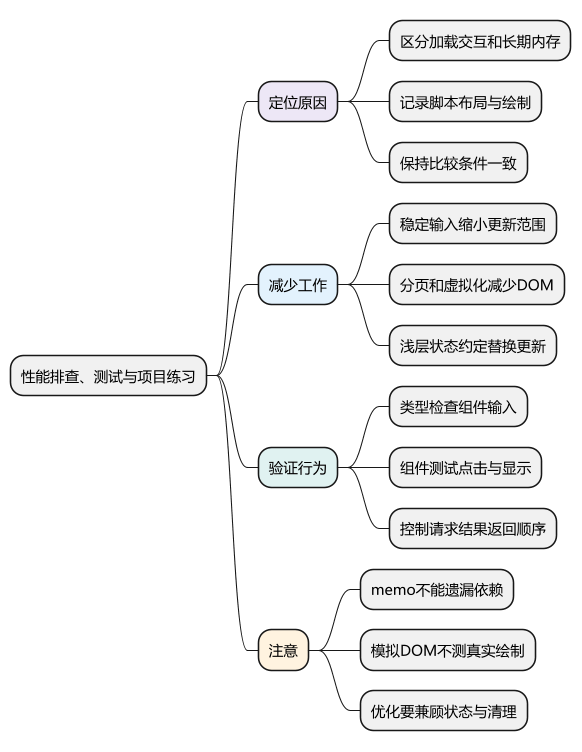
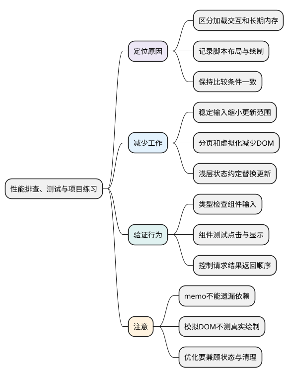

# 性能排查、测试与项目练习

<!-- core-mindmap:start -->
[](examples/vue24-mindmap.svg)

<details>
<summary>PlantUML 源码</summary>



</details>

<!-- core-mindmap:end -->

**口述总览：** Vue 项目优化先复现问题、测出主要耗时，再减少对应工作。组件是否正确、交互是否及时、资源是否释放，需要不同证据。测试帮助确认行为，性能记录帮助确认成本，二者不能互相替代。

本篇把前面的组件、状态、路由和异步知识串成练习。完整的浏览器性能、工程化和架构方案在后续专题展开，不要求现在就读完全部工具源码。

<a id="k01"></a>

## 先区分加载慢、交互慢和越用越慢

加载慢，先看 Network 中关键资源、请求依赖和首屏代码；交互慢，录制 Performance，分清脚本计算、组件更新、布局和绘制；越用越慢，检查多次进入离开后的监听、定时器、缓存和内存保留。

Vue DevTools 可以辅助观察组件、状态和更新关系。开发环境的 `app.config.performance` 可增加框架相关性能标记，但不要把开发模式的记录直接当成生产性能。比较时保持数据规模、设备、操作步骤和构建模式一致。

例如“搜索输入卡顿”可能来自每次输入都扫描大数组，也可能来自结果列表太大，还可能是布局读取与写入交错。先找主要耗时，再决定采用计算缓存、缩小更新范围、分页或 Worker。

<a id="k02"></a>

## 稳定组件输入：让无关行不必跟随选中项变化

如果每行都接收整个 `activeId`，切换选中项时所有行的这个输入都会变化。父级先算好每行的 `active` 布尔值，通常只有旧选中行和新选中行的输入改变。列表父级仍会执行自己的计算和比较，这不是让所有工作消失。

`ListRow.vue`：

<!-- project: vue24-stable-props; file: ListRow.vue -->
```vue
<script setup lang="ts">
defineProps<{ name: string; active: boolean }>();
</script>

<template><span :class="{ active }">{{ name }}</span></template>

<style scoped>
.active { font-weight: bold; color: #2563eb; }
</style>
```

`App.vue`：

<!-- project: vue24-stable-props; file: App.vue -->
```vue
<script setup lang="ts">
import { ref } from 'vue';
import ListRow from './ListRow.vue';
const activeId = ref('u1');
const items = [{ id: 'u1', name: '小林' }, { id: 'u2', name: '小周' }];
</script>

<template>
  <ul>
    <li v-for="item in items" :key="item.id">
      <button type="button" @click="activeId = item.id">
        <ListRow :name="item.name" :active="item.id === activeId" />
      </button>
    </li>
  </ul>
</template>
```

大块不可变数据可以用 `shallowRef` 保存，更新时整体替换；第三方实例可以按需要使用 `markRaw`。代价是内部任意属性变化不会获得普通深响应式的通知，不能只换 API 而不改更新方式。

`computed` 适合纯派生数据，但依赖不断变化时仍需要重新计算。`deep` 侦听也有遍历成本；观察明确字段通常比对整个大对象无限向下遍历更容易控制。

<a id="k03"></a>

## 大列表与分包：减少真正需要处理的内容

十万条数据不代表必须同时创建十万行 DOM。先考虑分页，再按需求选择虚拟列表。虚拟列表只渲染可视区域及缓冲区，还需要处理行高、滚动定位、键盘焦点、选中状态与可访问性。

路由懒加载、异步组件可以推迟非首屏代码加载，同时要处理加载中、失败与重试。过度切分也会增加请求和调度成本，不能只比较单个文件体积。

<a id="k04"></a>

## v-once 与 v-memo：明确允许跳过哪些更新

`v-once` 用于内容确定后不需要继续随状态更新的子树。`v-memo` 接收依赖数组，依赖都未变化时可以复用相应渲染结果；遗漏依赖会造成显示旧值。它们适合已经确认存在更新成本的局部，不建议为了“优化”默认到处添加。

下面组件中，切换选中项和修改名称都应更新，因此都包含在 memo 依赖中。Vue 的 `v-memo` 自 3.2 起提供；与 `v-for` 配合时应放在同一元素上。

<!-- example: vue24-memo -->
```vue
<script setup lang="ts">
import { ref } from 'vue';
const selectedId = ref('u1');
const items = ref([{ id: 'u1', name: '小林' }, { id: 'u2', name: '小周' }]);
</script>

<template>
  <ul>
    <li v-for="item in items" :key="item.id"
        v-memo="[item.name, item.id === selectedId]">
      <button type="button" :aria-pressed="item.id === selectedId"
              @click="selectedId = item.id">{{ item.name }}</button>
    </li>
  </ul>
</template>
```

`KeepAlive` 减少重复创建，也会保留实例和数据。容量、失效条件、激活与停用期间是否继续请求，应有明确约定。

## 组件测试：模拟用户操作，再检查可见结果

可以用 `create-vue` 创建项目时启用 Vitest，沿用它生成的 Vue 插件与测试配置。下面两个文件放在同一目录，测试使用 `@vue/test-utils` 与 jsdom；执行项目的 `test:unit` 脚本。

`Counter.vue`：

<!-- project: vue24-component-test; file: Counter.vue -->
```vue
<script setup lang="ts">
import { ref } from 'vue';
const count = ref(0);
</script>

<template><button type="button" @click="count++">次数 {{ count }}</button></template>
```

`Counter.test.ts`：

<!-- project: vue24-component-test; file: Counter.test.ts -->
```ts
// @vitest-environment jsdom
import { expect, test } from 'vitest';
import { mount } from '@vue/test-utils';
import Counter from './Counter.vue';

test('点击后显示新的次数', async () => {
  const wrapper = mount(Counter);
  try {
    expect(wrapper.get('button').text()).toBe('次数 0');
    await wrapper.get('button').trigger('click');
    expect(wrapper.get('button').text()).toBe('次数 1');
  } finally {
    wrapper.unmount();
  }
});
```

`await trigger()` 等待相关 Vue 更新后再断言；它不会自动等完任意网络请求。请求测试应控制返回顺序，并分别验证加载、成功、失败、取消和旧结果晚返回。不要依靠真实网络延时碰运气。

类型检查验证输入与返回类型，组件测试验证渲染和交互，端到端测试检查真实页面导航与关键流程。jsdom 不会替代浏览器布局、绘制和真实性能测量。

<a id="form-contract-test"></a>

## 表单契约测试：控制异步结果，验证重复提交和失效处理

把 [业务表单篇](25_业务表单、请求状态与页面协作.md) 的 `user.ts`、`UserForm.vue` 放在同一目录，再加入下面的 `UserForm.test.ts`。沿用启用了 Vue 插件的 Vitest 配置；无需复制业务表单的实现到测试中。

测试注入可手动完成的 Promise，准确决定何时成功或失败。取消场景故意让假服务继续返回结果，用来证明“旧结果不能提交”这项公开契约，而不只是证明 AbortController 被调用。

<!-- example: vue24-form-contract-test -->
<!-- project: vue25-form; file: UserForm.test.ts -->
```ts
// @vitest-environment jsdom
import { expect, test, vi } from 'vitest'
import { flushPromises, mount } from '@vue/test-utils'
import UserForm from './UserForm.vue'
import type { SaveUser, User } from './user'

function deferred<T>() {
  let resolve!: (value: T) => void
  let reject!: (reason: unknown) => void
  const promise = new Promise<T>((yes, no) => { resolve = yes; reject = no })
  return { promise, resolve, reject }
}
const initialUser: User = { id: 'u1', name: '小林', email: 'lin@example.com' }

test('字段错误先反馈，不调用保存服务', async () => {
  const save = vi.fn<SaveUser>(async user => user)
  const wrapper = mount(UserForm, { props: { initialUser, save, confirmDiscard: () => true } })
  try {
    await wrapper.get('input[name="name"]').setValue('')
    await wrapper.get('form').trigger('submit')
    expect(wrapper.get('[role="alert"]').text()).toBe('请输入姓名')
    expect(save).not.toHaveBeenCalled()
  } finally { wrapper.unmount() }
})

test('重复提交只保存一次，失败保留草稿和正式数据', async () => {
  const task = deferred<User>()
  const save = vi.fn<SaveUser>(() => task.promise)
  const wrapper = mount(UserForm, { props: { initialUser, save, confirmDiscard: () => true } })
  try {
    await wrapper.get('input[name="name"]').setValue('新的草稿')
    await wrapper.get('form').trigger('submit')
    await wrapper.get('form').trigger('submit')
    expect(save).toHaveBeenCalledTimes(1)
    expect(wrapper.get('fieldset').attributes('disabled')).toBeDefined()
    task.reject(new Error('保存失败'))
    await flushPromises()
    expect(wrapper.get('[role="status"]').text()).toBe('保存失败')
    expect(wrapper.get<HTMLInputElement>('input[name="name"]').element.value).toBe('新的草稿')
    expect(wrapper.get('fieldset').attributes('disabled')).toBeUndefined()
    expect(initialUser.name).toBe('小林')
    expect(wrapper.emitted('saved')).toBeUndefined()
  } finally { wrapper.unmount() }
})

test('成功采用服务端返回的数据，通过事件交给父级', async () => {
  const task = deferred<User>()
  const save = vi.fn<SaveUser>(() => task.promise)
  const onSaved = vi.fn()
  const wrapper = mount(UserForm, {
    props: { initialUser, save, onSaved, confirmDiscard: () => true }
  })
  try {
    await wrapper.get('input[name="name"]').setValue('  小周  ')
    await wrapper.get('form').trigger('submit')
    const confirmed = { ...initialUser, name: '小周' }
    task.resolve(confirmed)
    await flushPromises()
    expect(onSaved).toHaveBeenCalledExactlyOnceWith(confirmed)
    expect(wrapper.get<HTMLInputElement>('input[name="name"]').element.value).toBe('小周')
    expect(wrapper.text()).toContain('与已保存数据一致')
  } finally { wrapper.unmount() }
})

test.each(['取消', '卸载'])('%s 后的迟到结果不能再通知父级', async action => {
  const task = deferred<User>()
  const save = vi.fn<SaveUser>(() => task.promise) // 故意忽略 AbortSignal
  const onSaved = vi.fn()
  const wrapper = mount(UserForm, {
    props: { initialUser, save, onSaved, confirmDiscard: () => true }
  })
  let mounted = true
  try {
    await wrapper.get('input[name="name"]').setValue('迟到结果')
    await wrapper.get('form').trigger('submit')
    if (action === '取消') await wrapper.get('button[type="button"]').trigger('click')
    else { wrapper.unmount(); mounted = false }
    expect(save.mock.calls[0]![1].aborted).toBe(true)
    task.resolve({ ...initialUser, name: '迟到结果' })
    await flushPromises()
    expect(onSaved).not.toHaveBeenCalled()
    if (mounted) {
      expect(wrapper.get<HTMLInputElement>('input[name="name"]').element.value).toBe('小林')
    }
  } finally { if (mounted) wrapper.unmount() }
})
```

`flushPromises()` 等待已经可以推进的 Promise 回调，不会替你让未完成的网络请求成功，也不等于等待浏览器绘制。真实路由跳转、刷新恢复、焦点和实际接口契约仍需对应的集成或浏览器测试。

<a id="summary"></a>

## 项目练习：把知识串成一个可验证的搜索页面

做一个用户搜索页：输入关键字、显示列表、打开详情，再返回列表。用 URL 表达需要分享的查询条件；局部输入与加载状态留在合适的组件或组合式函数；确实跨页面共享的数据再考虑 Pinia。

验收时至少检查以下行为：

- 初次进入、成功、空结果与请求失败都有明确显示。
- 快速输入两次，旧请求晚返回也不能覆盖新结果。
- 切换路由或卸载后，旧副作用不再提交状态，监听和定时器能够清理。
- 列表排序后，选中项、输入草稿和业务 ID 仍对应正确。
- 刷新深层 URL 可以进入页面；登录守卫提供导航体验，接口权限由服务端校验。
- 为一次确定的慢操作保留优化前后同条件记录，同时回归正确性。

这组练习完成后，可以复盘 Vue 2 项目差异，再进入 HTTP、浏览器、性能和工程化专题。架构追问从状态归属和组件边界开始，逐步延伸到团队协作、发布与长期演进。

参考：[Vue 性能指南](https://cn.vuejs.org/guide/best-practices/performance.html)、[Vue 测试指南](https://cn.vuejs.org/guide/scaling-up/testing.html)。

<a id="interview"></a>

## 试题与答案

<a id="vue15-01"></a>

### VUE15-01 [P0·工程取舍] 十万条Vue列表卡顿怎样排查和处理？

**回答：** 先看计算、响应式和DOM各占多少，通常应减少同时渲染节点，采用分页或虚拟化，再优化数据结构和依赖。key、computed或nextTick都不能单独解决海量DOM。

对应讲解：[大列表、虚拟化与异步组件](#k03)。

<a id="vue15-02"></a>

### VUE15-02 [P1·原理] shallowRef为什么可能更省成本，有什么代价？

**回答：** 它减少深层代理和依赖跟踪，但内部变更不会按普通深响应式自动通知。使用方要通过替换或明确触发管理更新，不能只换API不改数据契约。

对应讲解：[数据与响应式粒度](#k02)。

<a id="vue15-03"></a>

### VUE15-03 [P1·工程取舍] v-memo能到处加吗？

**回答：** 不能，依赖列表必须覆盖子树真正变化条件，漏项会出现陈旧UI。先量出值得优化的更新，再验证数据与交互正确性。

对应讲解：[v-once、v-memo、KeepAlive 与验证](#k04)。

<a id="vue15-04"></a>

### VUE15-04 [P0·工程取舍] 如何证明优化有效？

**回答：** 在相同数据和设备条件下对比生产模式指标、长任务、输入延迟和内存，再结合现场分群数据；同时回归列表状态、取消和错误路径，避免用错误结果换速度。

对应讲解：[测量与更新范围](#k01)。

<a id="vue15-05"></a>

### VUE15-05 [P0·工程取舍] 怎样验证表单取消后不会被旧请求结果覆盖？

**回答：** 注入可控 Promise，先提交，再取消或卸载，最后让旧请求返回成功，检查父级没有收到 saved，当前草稿也没有被覆盖。假服务应刻意忽略取消信号，才能验证结果归属保护；还要覆盖失败恢复和重复提交，不能只断言调用了 abort。
