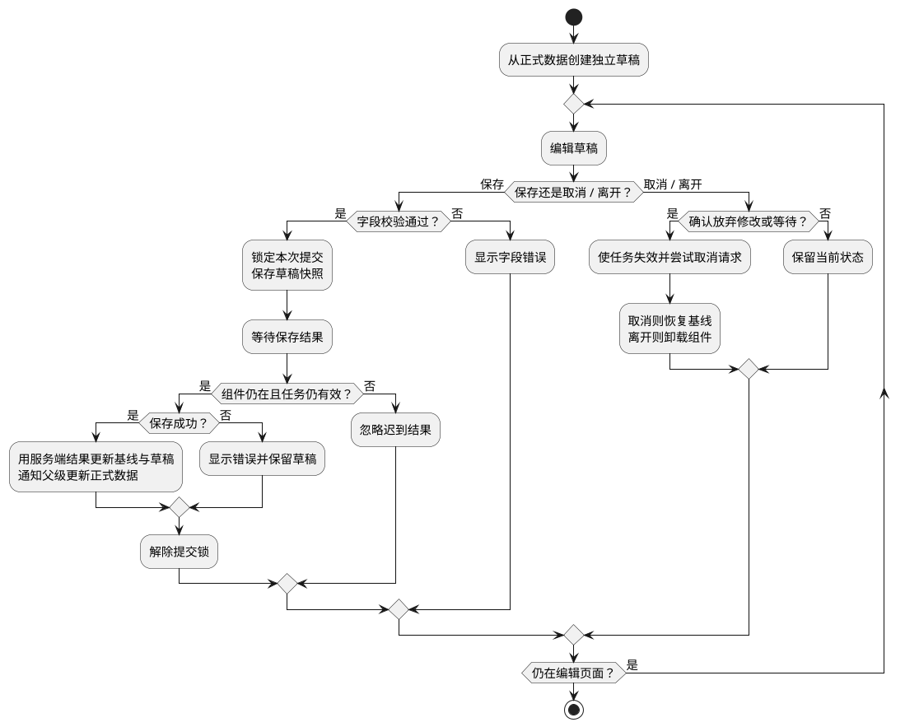

# 业务表单、请求状态与页面协作

<!-- understanding-flow: vue25-form:start -->
<details>
<summary>PlantUML 源码</summary>



</details>

<!-- understanding-flow: vue25-form:end -->

**口述总览：** 业务表单要分清正式数据、编辑草稿和本次提交的数据快照。校验失败显示字段问题；提交期间阻止重复操作；保存失败保留输入；成功后用服务端结果回填，并通知数据所有者。取消或卸载会让旧任务失效，但不能保证后端已经执行的保存会回滚。

本文基于 Vue **3.5.43** 和 TypeScript。已学过 [表单绑定](04_事件处理与表单绑定.md)、[组件通信](10_props、emits与组件v-model.md) 和 [请求清理](13_组合式函数与副作用清理.md) 后，用本篇串起完整流程。

## 状态归属：父级保存正式数据，子级编辑草稿

父级拥有已经确认的用户数据；表单只复制本例的几个字符串字段作为草稿。直接把 props 对象交给输入框，会在保存前就修改父级数据，取消也无法自然恢复。

下面三个文件放在已有 Vue + TypeScript 项目的 `src` 中，以 `App.vue` 为入口。保存能力通过 prop 注入；演示服务由页面按钮控制成功或失败，不依赖未提供的后端。

### user.ts：明确保存输入和返回结果

<!-- example: vue25-types -->
<!-- project: vue25-form; file: user.ts -->
```ts
export interface User {
  id: string
  name: string
  email: string
}

export type SaveUser = (draft: User, signal: AbortSignal) => Promise<User>
```

`SaveUser` 返回最终确认的数据，实际请求层需要检查 HTTP 状态并校验响应结构。服务端可能归一化字段，因此成功后不应只把旧草稿标成“已保存”。类型声明本身不会验证接口数据。

## UserForm.vue：校验、提交、取消与失效判断

`initialUser` 只负责本次打开时的初始化。保存后，表单用返回值更新自己的基线，同时发出 `saved` 事件让父级更新正式数据。切换业务记录时应先确认离开，再用不同的 `key` 创建新表单；后台刷新同一记录时，不能未经确认覆盖正在编辑的草稿。

<!-- example: vue25-user-form -->
<!-- project: vue25-form; file: UserForm.vue -->
```vue
<script setup lang="ts">
import { computed, onBeforeUnmount, reactive, ref } from 'vue'
import type { SaveUser, User } from './user'

const props = defineProps<{
  initialUser: User
  save: SaveUser
  confirmDiscard: () => boolean
}>()
const emit = defineEmits<{ saved: [user: User] }>()
const baseline = ref<User>({ ...props.initialUser })
const draft = reactive<User>({ ...props.initialUser })
const errors = ref<Partial<Record<'name' | 'email', string>>>({})
const message = ref('')
const saving = ref(false)
const dirty = computed(() => draft.name !== baseline.value.name
  || draft.email !== baseline.value.email)
let version = 0
let controller: AbortController | undefined

function invalidate() {
  version++
  controller?.abort()
  controller = undefined
  saving.value = false
}

function canLeave() {
  return (!dirty.value && !saving.value) || props.confirmDiscard()
}

function cancel() {
  if (!canLeave()) return
  invalidate()
  Object.assign(draft, baseline.value)
  errors.value = {}
  message.value = ''
}

async function submit() {
  if (saving.value) return
  errors.value = {}
  message.value = ''
  if (!draft.name.trim()) errors.value.name = '请输入姓名'
  if (!/^[^\s@]+@[^\s@]+\.[^\s@]+$/.test(draft.email.trim())) {
    errors.value.email = '请输入有效邮箱'
  }
  if (Object.keys(errors.value).length) return

  const ownVersion = ++version
  const task = new AbortController()
  controller = task
  const payload = { ...draft }
  saving.value = true
  try {
    const saved = await props.save(payload, task.signal)
    if (ownVersion !== version) return
    baseline.value = { ...saved }
    Object.assign(draft, saved)
    emit('saved', { ...saved })
    message.value = '已保存'
  } catch (cause) {
    if (ownVersion === version && !task.signal.aborted) {
      message.value = cause instanceof Error ? cause.message : '保存失败，请重试'
    }
  } finally {
    if (ownVersion === version) {
      saving.value = false
      controller = undefined
    }
  }
}

onBeforeUnmount(invalidate)
defineExpose({ canLeave })
</script>

<template>
  <form novalidate @submit.prevent="submit">
    <fieldset :disabled="saving">
      <legend>编辑用户</legend>
      <label>
        姓名
        <input v-model="draft.name" name="name" :aria-invalid="!!errors.name">
      </label>
      <p v-if="errors.name" role="alert">{{ errors.name }}</p>
      <label>
        邮箱
        <input v-model="draft.email" name="email" type="email"
               :aria-invalid="!!errors.email">
      </label>
      <p v-if="errors.email" role="alert">{{ errors.email }}</p>
      <button type="submit">{{ saving ? '保存中' : '保存' }}</button>
    </fieldset>
    <button type="button" @click="cancel">取消编辑</button>
    <p v-if="message" role="status">{{ message }}</p>
    <p>{{ dirty ? '有未保存的修改' : '与已保存数据一致' }}</p>
  </form>
</template>
```

禁用字段让本次提交快照和用户看到的内容一致；函数开头的 `saving` 判断负责阻止重复提交，不能只靠按钮外观。`novalidate` 让演示统一展示自定义字段错误，邮箱规则只用于基础反馈，服务端还需执行正式业务校验。

失败时保留草稿和基线，方便修改或重试；成功时采用返回值。若服务端返回字段级校验错误，可由请求层转换为明确结构后填写 `errors`，不要把任意服务器文本直接拼成 HTML。

## App.vue：注入可控保存服务，接收成功结果

先编辑并点击“保存”，再点击演示服务的成功或失败按钮。保存期间可以取消编辑或关闭表单，观察旧请求不会再更新页面。

<!-- example: vue25-app -->
<!-- project: vue25-form; file: App.vue -->
```vue
<script setup lang="ts">
import { ref, shallowRef, useTemplateRef } from 'vue'
import UserForm from './UserForm.vue'
import type { SaveUser, User } from './user'

const user = ref<User>({ id: 'u1', name: '小林', email: 'lin@example.com' })
const opened = ref(true)
const editor = useTemplateRef<InstanceType<typeof UserForm>>('editor')
const pending = shallowRef<{ succeed: () => void; fail: () => void } | null>(null)
const confirmDiscard = () => window.confirm('放弃本次编辑或等待，继续操作？')

const save: SaveUser = (draft, signal) => new Promise((resolve, reject) => {
  if (signal.aborted) {
    reject(new DOMException('已取消', 'AbortError'))
    return
  }
  function cleanup() {
    signal.removeEventListener('abort', abort)
    pending.value = null
  }
  function abort() {
    cleanup()
    reject(new DOMException('已取消', 'AbortError'))
  }
  signal.addEventListener('abort', abort, { once: true })
  pending.value = {
    succeed() {
      cleanup()
      resolve({ ...draft, name: draft.name.trim(), email: draft.email.trim() })
    },
    fail() {
      cleanup()
      reject(new Error('演示保存失败，输入已保留'))
    }
  }
})

function close() {
  if (editor.value?.canLeave()) opened.value = false
}
</script>

<template>
  <p>已保存：{{ user.name }} / {{ user.email }}</p>
  <UserForm v-if="opened" :key="user.id" ref="editor"
            :initial-user="user" :save="save" :confirm-discard="confirmDiscard"
            @saved="user = $event" />
  <button v-if="opened" type="button" @click="close">关闭表单</button>
  <button v-else type="button" @click="opened = true">重新编辑</button>
  <fieldset>
    <legend>演示服务响应</legend>
    <button type="button" :disabled="!pending" @click="pending?.succeed()">完成本次保存</button>
    <button type="button" :disabled="!pending" @click="pending?.fail()">模拟保存失败</button>
  </fieldset>
</template>
```

这里每次只保留一个演示任务，与表单提交锁对应。真实保存函数可以接入 fetch 或已有请求库，只要遵守相同的输入、结果和取消契约，表单就不需要知道 HTTP 地址。

## 取消、卸载与离开：分别处理交互和任务归属

“取消编辑”先确认，再使任务失效并恢复基线；“关闭表单”确认后卸载，`onBeforeUnmount` 负责失效和取消。即使底层服务不支持取消，版本判断也会阻止迟到的成功、错误和 finally 修改当前状态。

路由页面可在 `onBeforeRouteLeave` 中调用同样的 `canLeave()`，返回 false 阻止导航；路由参数切换可能复用当前实例，还需用 `onBeforeRouteUpdate` 确认后再切换记录。浏览器刷新或关闭不经过 Vue Router，可按需用 `beforeunload` 提醒，但浏览器限制其提示能力，不能依赖它完成异步保存。

**取消请求不等于撤销服务端操作。** 请求发出后，后端可能已经成功保存；再次打开应重新获取正式数据。重要写操作还需要服务端幂等、版本校验或冲突处理，不能把客户端提交锁当作完整并发控制。

## 页面协作：保存成功后怎样更新列表

本例父级直接接受 `saved` 更新正式用户。列表页可按稳定 ID 替换对应条目；若修改会影响排序、筛选、分页数量或服务端计算字段，则让数据读取层重新获取相关列表或使其缓存失效，不要把组件、Store 和列表各维护成互不一致的副本。

详情读取与表单保存也要分开：详情请求晚返回时，不应静默覆盖草稿；需要明确“重新加载会放弃修改”的交互。表单库能减少字段注册和校验代码，但不能替代这些数据归属和异步规则。

验证本例时，至少覆盖字段不合法、连续提交、保存失败、服务端归一化、取消后重试、取消后旧结果返回、卸载后旧结果返回。具体自动化用例见 [组件契约测试](24_性能排查、测试与项目练习.md#form-contract-test)。

<a id="interview"></a>

## 试题

<a id="vue25-01"></a>

### VUE25-01 [P0·工程取舍] 为什么表单双向绑定后还要维护草稿？

**回答：** 双向绑定只同步输入和绑定目标。如果目标就是共享正式数据，用户输入时已经改动其他页面。独立草稿让保存、取消和失败恢复有明确边界，保存成功后再用服务端结果更新正式状态。

<a id="vue25-02"></a>

### VUE25-02 [P0·工程取舍] 防止重复保存只禁用按钮够吗？

**回答：** 不够。提交函数也要检查进行中状态，并同步设置提交锁，因为提交还可能来自键盘、其他调用或尚未更新的 DOM。客户端锁只管理当前界面，真正的重复写入和并发冲突还需要服务端幂等与版本控制。

<a id="vue25-03"></a>

### VUE25-03 [P0·原理] abort 请求后为什么仍然要判断任务是否有效？

**回答：** 取消并不保证底层服务或后续异步处理立刻停止。版本标记确保成功、失败与 finally 都只影响仍然有效的编辑任务；取消或卸载后，旧结果不能继续回填或发送 saved 事件。

<a id="vue25-04"></a>

### VUE25-04 [P1·工程取舍] 用户取消保存，是否代表服务端数据没变？

**回答：** 不代表。服务端可能已完成写入，只是响应尚未被当前页面接收。重新进入时需要确认最新数据；涉及重要业务时使用服务端幂等、版本校验及明确的撤销接口，不能把网络取消当事务回滚。

<a id="vue25-05"></a>

### VUE25-05 [P1·工程取舍] 保存后直接改列表一行还是重新请求？

**回答：** 如果返回结果足以更新当前条目，可以按稳定 ID 替换；若修改影响筛选、排序、分页或服务端派生值，就需要重新获取相关数据或使查询缓存失效。决定依据是数据一致性规则，而不是固定选择本地更新或整页刷新。

前篇：[性能排查、测试与项目练习](24_性能排查、测试与项目练习.md) · [返回目录](00_目录.md)
