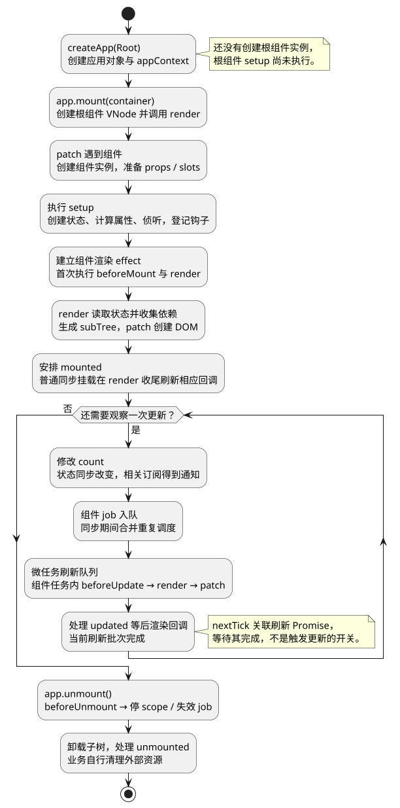

# 源码地图与运行主线

**口述总览：** 读 Vue 3 源码，先跟踪一个应用从创建到结束：`createApp` 准备应用配置，`mount` 创建和挂载根组件，组件渲染时读取状态并建立依赖，状态变化后安排更新，卸载时停止组件的工作。生命周期钩子在这些过程中的相应位置被调用；响应式、渲染器和调度器共同完成一次界面变化。

本系列固定 **Vue 3.5.43**，先追踪浏览器中的普通同步组件。Vue 2 的入口是 `new Vue()`，本系列从 `createApp()` 和 `app.mount()` 开始。异步 setup、SSR 水合、KeepAlive 等在普通主线清楚之后再作为分支阅读。

<!-- understanding-flow: v3line01-runtime-mainline:start -->
<a id="v3line01-runtime-mainline"></a>

<details>
<summary>PlantUML 源码</summary>



</details>

<!-- understanding-flow: v3line01-runtime-mainline:end -->

## 先分清六个角色，再追函数调用

- **组件定义**：例如 `Root`、`CounterValue`，描述 props、setup、render 等能力；同一个定义可以创建多个实例。
- **应用对象**：`createApp(Root)` 返回的 app，管理本应用的配置、插件、provide 和挂载入口。
- **组件 VNode**：描述这次使用哪个组件、传入哪些 props 和 slots，并在挂载时关联组件实例。
- **组件实例**：这次运行的状态容器，保存 props、setup 结果、作用域、渲染 effect 和生命周期钩子等。
- **subTree**：某个组件这次执行 render 得到的渲染结果；它可以继续包含子组件 VNode。
- **真实 DOM**：宿主操作最终创建或修改的节点；创建 VNode 本身还没有创建 DOM。

读到 `instance.vnode` 和 `instance.subTree` 时，分别问“谁在使用这个组件”和“这个组件渲染出了什么”。它们不是同一个对象，应用对象也不是根组件实例。

## 一个父子计数器，贯穿创建、更新与卸载

完整代码见 [runtime-mainline.mjs](examples/runtime-mainline.mjs)，也可以打开[分步交互页面](examples/runtime-mainline.html)。交互页面通过固定版本 CDN 加载 Vue，需要网络与 HTTP 服务；已有 Vue 3.5.43 项目可以直接使用模块，不依赖该 CDN 页面。

主例结构固定为：父组件在 setup 创建 `count`，用 computed 计算 `doubled`，用默认 pre 时机的 watch 观察 count；父 render 读取 count，并把 doubled 作为 `value` prop 传给 `CounterValue`。子 render 显示 value。双方都记录挂载、更新和卸载钩子。

主例使用手写 `h()` 返回 VNode，目的是让第一轮观察直接从运行时开始。平常 `.vue` 文件中的模板通常先在构建阶段生成 render；后面的编译篇会解释这条支线，不能因为它排在后面，就认为编译发生在组件更新之后。

在项目入口旁建立 `examples` 子目录，把模块放进去，例如 `src/main.js` 与 `src/examples/runtime-mainline.mjs`。以下代码作为已有 Vue 项目的入口执行，HTML 中需要 `<div id="app"></div>`；后续篇章统一使用相同的导入路径。

<!-- example: v3line01-first-pass -->
```js
import { nextTick } from 'vue';
import { createMainlineApp } from './examples/runtime-mainline.mjs';

const events = [];
const demo = createMainlineApp(event => events.push(event));
console.log(events.slice()); // ['app:created']，记录当前快照
console.log(demo.readCount()); // undefined，setup 还没执行

const vm = demo.app.mount('#app');
console.log(vm === demo.app); // false
console.log(events.join('\n'));
// app:created
// root:setup
// root:beforeMount
// root:render
// computed:evaluate
// child:setup
// child:beforeMount
// child:render
// child:mounted
// root:mounted

events.length = 0;
demo.increment();
demo.increment();
demo.increment();
console.log(demo.readCount()); // 3，状态已经同步改变
console.log(document.querySelector('[data-count]').textContent); // 计数：0
await nextTick();
console.log(document.querySelector('[data-count]').textContent); // 计数：3
console.log(document.querySelector('[data-child]').textContent); // 两倍：6

events.length = 0;
demo.app.unmount();
console.log(events.join(','));
// root:beforeUnmount,child:beforeUnmount,child:unmounted,root:unmounted
console.log(document.querySelector('#app').childNodes.length); // 0
```

这些日志针对本例和固定版本，不是所有 Vue 应用都必须产生的固定排列。异步子组件、Suspense、KeepAlive、SSR 以及不同依赖读取方式，会进入相应分支。

## 第一轮只追入口与首次挂载

先执行 `createMainlineApp`，不要立刻 mount。此时能看到 `app:created`，看不到 setup 和挂载钩子。随后调用 mount，观察何时首次出现父、子 setup，何时生成真实 DOM。

这一轮读 [createApp 与首次挂载](02_createApp与首次挂载.md)、[组件初始化与 setup](03_组件初始化与setup.md)、[VNode 与 Renderer](04_VNode与Renderer.md)。先回答对象何时创建、输入放在哪里、render 从哪里来；遇到响应式内部结构时先记下入口，不必立刻跳进所有分支。

生命周期在过程中穿插：setup 阶段登记钩子，首次渲染前执行 beforeMount，挂载完成后通过后渲染路径执行 mounted。对本例的普通同步根挂载，`app.mount()` 返回前已经能看到 mounted 日志；不能把“后渲染”一概解释为“下一次微任务”。

## 第二轮追同一次点击怎样改变界面

连续三次 increment 后，数据已经变成 3，但当前同步代码仍能读取旧 DOM。等待 nextTick 后，父组件显示 3，子组件显示 6。

追踪顺序是：ref 写入 → 依赖通知 → 计算属性失效或订阅者调度 → 稳定组件 job 入队 → flushJobs → render 读取新状态 → patch。`nextTick` 等待刷新批次；从流程中删掉 `await nextTick()`，更新依然会在合适时机执行。

这一轮深入 [ref](07_ref与依赖追踪.md)、[effect 与依赖清理](08_effect_track_trigger与依赖清理.md)、[computed 与 watch](09_computed与watch.md)、[Scheduler](10_Scheduler与nextTick.md)和[组件更新与卸载](11_组件更新与卸载流程.md)。主例只有文本和一个子组件，先理解简单 patch，再到 [Diff](12_Patch与Diff.md)处理列表重排实验。

## 第三轮追卸载，确认哪些工作真正停止

可以在交互页面点击“修改后立即卸载”，观察已安排的组件更新不会把节点重新挂回容器。卸载停止组件作用域内的响应式工作，并处理子树和钩子；外部定时器、连接、监听和业务请求仍需要所有者清理。

这一轮结合[组件更新与卸载](11_组件更新与卸载流程.md)与[生命周期、KeepAlive](13_生命周期与KeepAlive.md)。缓存停用与真正卸载是不同分支，不要用“页面看不见了”推断组件已经销毁。

## 断点放在哪里：沿问题逐段进入源码

在匹配 Vue 3.5.43 的本地开发环境中，通过调试器的源码映射定位以下函数；如果只能看到打包文件，也可以按函数名搜索。实际可见文件名取决于构建配置，不应把某个调试器的行号当成永远不变的入口。

- **应用入口**：`runtime-dom/src/index.ts` 的 `createApp` 包装，以及 `runtime-core/src/apiCreateApp.ts` 的 mount，确认根 VNode 如何连接 appContext。
- **组件准备**：`component.ts` 的 `createComponentInstance`、`setupComponent`、`handleSetupResult`，观察 setup 输入与结果。
- **首次渲染**：`renderer.ts` 的 `mountComponent`、`setupRenderEffect`，在 componentUpdateFn 的初次分支停住。
- **依赖与通知**：从主例的 count 读写进入 `ref.ts`、`dep.ts`、`effect.ts`，区分数据保存、订阅登记与后续调度。
- **更新与卸载**：`scheduler.ts` 的 `queueJob`、`flushJobs`，以及 `renderer.ts` 的 `unmountComponent`。

每停在一个位置，只确认三件事：谁调用了它、它读写哪个对象、它把下一步交给谁。先把完整调用链走通，再深入数据结构和优化条件。

## 编译和扩展路径：保持与普通主线的联系

[Compiler](14_Compiler编译流程.md)与[PatchFlag、BlockTree](15_PatchFlag与BlockTree.md)解释模板如何给运行时提供静态和动态信息；[Teleport、Suspense](16_Teleport与Suspense.md)改变节点位置或异步分支处理；[手写迷你 Vue](17_手写迷你Vue.md)用于验证约定范围内的机制，不代替真实 Vue 入口。

面试题也按这些阶段定位：问 createApp 就从应用与组件的区别回答；问 nextTick 就回到调度；问 key 就回到身份复用；问泄漏就回到作用域与资源所有权。公开题库用于检查遗漏，答案仍要按 Vue 版本和真实实现核对。

参考：[官方渲染机制](https://cn.vuejs.org/guide/extras/rendering-mechanism.html)、[应用入口源码](https://github.com/vuejs/core/blob/v3.5.43/packages/runtime-dom/src/index.ts)、[应用上下文与 mount](https://github.com/vuejs/core/blob/v3.5.43/packages/runtime-core/src/apiCreateApp.ts)。公开问法参考：[web-interview 的 Vue 3 题目](https://github.com/febobo/web-interview/tree/master/docs/vue3)、[Vue 面试题集合](https://github.com/sudheerj/vuejs-interview-questions)；这些集合包含不同版本的题目，不是面试频率统计。

<a id="interview"></a>

## 试题

<a id="vsr18-01"></a>

### VSR18-01 [P0·原理] 从 Vue 3 入口到页面出现，应该怎样概括？

createApp 先准备应用对象和上下文；mount 创建根组件 VNode 并交给渲染器。渲染器创建组件实例，初始化输入并执行 setup，建立渲染 effect，运行 render 生成子树，再通过 patch 创建 DOM，并在对应阶段调用生命周期钩子。

<a id="vsr18-02"></a>

### VSR18-02 [P0·原理] 生命周期、响应式和渲染是三个依次完成的独立阶段吗？

不是。setup 可以创建响应式状态并登记生命周期钩子；render 读取状态时建立渲染依赖；数据变化后通知与调度使 render 再次运行，钩子在挂载、更新、卸载的相应位置执行。它们在同一条执行过程中相互配合。

<a id="vsr18-03"></a>

### VSR18-03 [P0·原理] 不调用 nextTick，Vue 会不会更新页面？

会。相关依赖变化会触发 Vue 自己安排组件更新。nextTick 提供等待当前刷新批次完成的接口，适合在之后读取新 DOM；它不是启动更新的命令，也不等待未来网络请求或保证像素已绘制。

<a id="vsr18-04"></a>

### VSR18-04 [P1·源码] 为什么源码阅读需要固定版本和一个贯穿例子？

内部结构和优化会随版本调整，固定版本才能把源码、图和观察结果对应起来。贯穿例子让入口、对象、状态和时间顺序保持一致，能验证一次操作如何跨越多个模块；复杂分支再以小实验扩展，而不是仅背函数名称。
