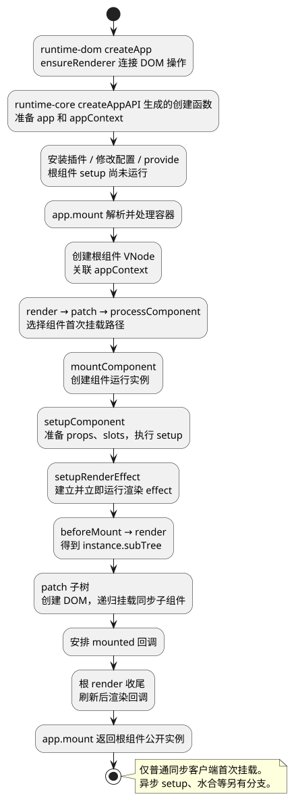
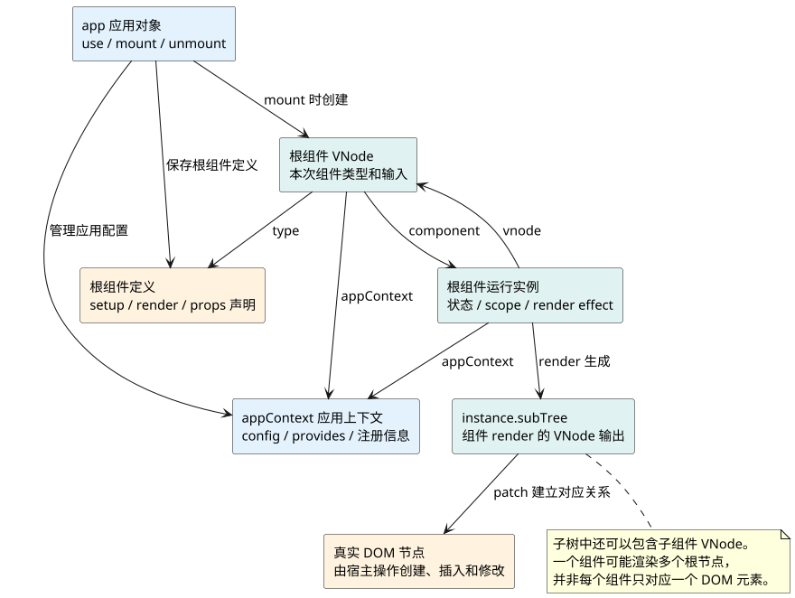

# createApp与首次挂载

**口述总览：** `createApp` 先创建应用和配置上下文；`app.mount` 才把根组件交给渲染器，创建组件实例、执行 setup、生成 VNode 子树并创建 DOM。应用对象、组件实例和 DOM 分属不同层，不能都叫“Vue 实例”。

源码基线：**Vue v3.5.43**。本篇只跟踪浏览器中普通同步组件的首次客户端挂载，不混入 SSR 水合、异步 setup 或热更新。先读 [源码地图与运行主线](01_源码地图与运行主线.md)，所有主流程观察都沿用同一个 [运行示例](examples/runtime-mainline.html) 和 [示例源码](examples/runtime-mainline.mjs)。

## 先看行为：创建应用后，页面为什么还没有内容

共同例子先调用 `createMainlineApp(record)`，拿到应用后记录 `app:created`，之后才调用 `app.mount(...)`。在两步之间暂停，你会看到：应用可以安装插件、修改配置，但根组件的 `root:setup` 尚未出现，页面也没有由它渲染的内容。

这不是“先执行 setup，但等到 mount 才显示”。根组件的运行实例还没有走到创建阶段；`createApp` 收到的是组件定义，用它保存后续挂载所需的信息。

下面这个独立短例用于检查两步的边界。在安装 Vue 3.5.43 的浏览器工程中运行，HTML 需有空的 `<div id="app"></div>`。不要同时把共同例子挂到同一容器。

<!-- example: v3line02-create-before-mount -->
```javascript
import { createApp, h, onMounted } from 'vue';

const events = [];
const Root = {
  setup() {
    events.push('setup');
    onMounted(() => events.push('mounted'));
    return () => h('p', '页面就绪');
  }
};

const app = createApp(Root);
events.push('app created');
console.log(events.slice()); // ['app created']

const rootPublicInstance = app.mount('#app');
events.push('mount returned');
console.log(events);
// ['app created', 'setup', 'mounted', 'mount returned']
console.log(rootPublicInstance === app); // false

app.unmount();
```

这里 `mounted` 出现在 `mount returned` 之前，是该版本普通同步根组件的实际路径。不要因此推广为所有后渲染回调都同步，也不要反过来背成“mounted 永远在下一个微任务”。

<a id="k01"></a>

## 创建应用：把浏览器能力接到通用渲染器

浏览器工程导入的 `createApp`，会经过 `runtime-dom` 提供的包装。先调用 `ensureRenderer()`，需要时创建适用于 DOM 的渲染器，再调用这个渲染器的 `createApp`。

这个分层解决的是职责问题：`runtime-core` 知道怎样处理组件和 VNode，但不把所有操作写死成 `document.createElement`；`runtime-dom` 提供创建元素、插入节点、修改属性等浏览器操作。`ensureRenderer` 可以复用渲染器，**每次创建的应用仍拥有各自的配置上下文**。

在 `runtime-core` 中，`createAppAPI(render, hydrate)` 是生成应用创建函数的工厂。它把渲染入口保存在闭包里，所以后来执行 `app.mount` 时，能够调用相应的 `render`。这里不是为每个应用启动一个独立浏览器线程。

每次调用生成的 `createApp`，主要准备：

- 根组件定义及根 props，告诉后续挂载“要渲染什么”。普通对象组件定义会在这里浅复制一份，不需要依赖它与传入对象引用相同。
- `appContext`，保存该应用的配置、全局组件、指令、provide 等信息。
- `app` 对象，提供 `use`、`provide`、`mount`、`unmount` 等公开管理入口。

此时没有进入根组件的 `setupComponent`，也没有执行根组件 render。把 `createApp` 理解成准备应用，比理解成“马上构造整个组件树”准确。

源码入口：[runtime-dom 的 createApp 与 ensureRenderer](https://github.com/vuejs/core/blob/v3.5.43/packages/runtime-dom/src/index.ts)、[createAppAPI 与 createAppContext](https://github.com/vuejs/core/blob/v3.5.43/packages/runtime-core/src/apiCreateApp.ts)。

## 挂载前配置：插件、应用配置和依赖注入放在哪里

常见的 `createApp(App).use(router).use(pinia)` 之所以能链式调用，是因为 `app.use` 返回应用对象。安装插件时，会当场调用插件函数或插件的 `install(app, ...)`，并记录安装状态，避免同一插件在同一应用中重复安装。

插件本身可以注册组件或产生副作用，不能说这一步“什么都不执行”；它只是还没有因为创建应用而执行根组件 setup。

`app.config.errorHandler` 等配置保存在应用上下文中；`app.provide(key, value)` 把依赖放进该应用的 provides。组件实例会关联应用上下文，再沿组件关系处理配置与注入。传一个普通对象给 `provide` 不会自动把它变为响应式对象，是否响应式取决于传入的值。

通常在 `mount` 前完成 Router、Pinia 等安装，因为组件初始化时可能立刻读取注入依赖。源码阅读时先认清它们进入了 `appContext`，暂时不用跟进 Router 或 Pinia 的内部实现。

<a id="k02"></a>

## 开始挂载：先处理容器，再创建根组件VNode

`runtime-dom` 会包装应用的 `mount`。这一层把 `'#app'` 这样的选择器转换成真实容器，确定 HTML、SVG 等命名空间，并处理容器内容。Vue 3 通常把组件结果放入该容器，**容器本身不等于根组件实例，也不等于根组件渲染出的根节点**。

如果组件没有 `render` 也没有 `template`，这层包装可能把容器原有 HTML 作为模板来源。但这不代表任意 Vue 构建都能编译字符串模板：真正的运行时编译还需要带编译器的构建。

常见 `.vue` 单文件组件由 Vite 等工具在构建时预编译模板，组件定义通常已经带有 render。本系列的共同例子直接提供渲染函数，不走模板编译路径；首次挂载更不是“把模板重新编译一遍 HTML”。

接着进入 `runtime-core` 的 `app.mount`。对本篇普通根组件路径，它通过 `createVNode(rootComponent, rootProps)` 创建**描述根组件的 VNode**，并把 `appContext` 放到它上面，再调用 `render(vnode, container)`。

根 VNode 此时主要描述组件类型和输入。它还不是组件 render 生成的元素子树，更不是已经插入页面的 DOM。

<a id="k03"></a>

## 首次渲染：从根VNode走到组件实例和DOM

`render` 发现容器尚无旧 VNode，就让 `patch` 处理“从无到有”的变化。`patch` 根据 VNode 类型选择路径，遇到组件进入 `processComponent`，首次组件挂载再进入 `mountComponent`。

这几个函数不是平级的待背术语，而是逐层缩小处理对象：从整个容器的渲染，走到一个 VNode，再走到一个需要创建运行实例的组件。

`mountComponent` 接下来的工作分为三部分：

- `createComponentInstance` 创建运行实例，记录父级、应用上下文、输入、渲染状态和作用域，并让组件 VNode 指向它。
- `setupComponent` 初始化 props、slots，并执行组件 setup；setup 返回值怎样成为状态或 render，留到下一篇展开。
- `setupRenderEffect` 建立组件渲染副作用，并立即执行首次渲染。这时才进入 `beforeMount → render → patch 子树` 的路径。

render 生成的 VNode 子树存到 `instance.subTree`，之后 `patch(null, subTree, ...)` 递归处理它：元素节点交给 DOM 操作，子组件节点则重复创建实例、初始化和渲染的流程。

<!-- understanding-flow: v3line02-first-mount:start -->
<details>
<summary>PlantUML 源码</summary>



</details>

<!-- understanding-flow: v3line02-first-mount:end -->

共同例子中，根 render 生成的子树里包含 `CounterValue` 的组件 VNode。只有 patch 走到那里，才会创建子实例并执行 `child:setup`。所以先有 `root:setup` 和根首次渲染，再有子组件初始化；不是先统一执行整棵树的 setup，再统一渲染。

源码入口：[render、patch、mountComponent 与 setupRenderEffect](https://github.com/vuejs/core/blob/v3.5.43/packages/runtime-core/src/renderer.ts)。

<a id="k04"></a>

## 对象关系：应用、组件定义、实例、子树和DOM各管什么

组件定义像一份说明：它声明 props、setup、render 等规则。同一个定义可以被多个组件实例使用，每个实例分别保存自己的运行状态。

应用对象负责应用级管理。根组件 VNode 表示“这次要渲染这个组件”；运行实例负责执行这份描述；实例的 subTree 表示“这个组件此次 render 得到了什么”。DOM 则是渲染器根据 VNode 实际创建和更新的页面节点。

<!-- understanding-flow: v3line02-object-roles:start -->
<details>
<summary>PlantUML 源码</summary>



</details>

<!-- understanding-flow: v3line02-object-roles:end -->

读源码时，看到 `instance.vnode` 先问“谁描述了这个组件”；看到 `instance.subTree` 再问“这个组件这次输出了什么”。这会直接帮助后续理解父级输入更新和组件自身状态更新为何有不同入口。

<a id="k05"></a>

## 挂载收尾：mounted何时运行，mount返回的是什么

首次 patch 完成后，Vue 把组件 mounted 钩子放入后渲染执行路径。Vue 3.5.43 的根 `render` 在收尾时会调用 `flushPostFlushCbs()`；因此，在本篇没有异步子树的普通首次挂载中，mounted 可以在 `app.mount()` 返回前执行。

共同例子中，先完成同步子组件挂载，再完成父组件挂载，因此观察到 `child:mounted` 在 `root:mounted` 之前。这里说的“完成”是 DOM 已创建并插入挂载容器，不是保证浏览器已经把这一帧绘制到屏幕。

以后调用 `increment()` 修改状态，走的是更新调度路径，不再重走 `createApp`。修改后的 DOM 通常要等待更新队列刷新，`await nextTick()` 等待的就是相关刷新；不要把这条规则反套到首次同步 mount 的每一步。

`app.mount()` 返回根组件的**公开实例**，内部通过 `getComponentPublicInstance` 获取；如果组件使用 expose，公开内容还会受到 expose 的限制。它不是原来的 app，也不是内部组件实例对象本身。后续调用 `unmount` 应保留应用变量，不要写成 `const app = createApp(App).mount('#app')` 后误以为拿到的仍是应用管理入口。

共同例子通过 expose 公开 `increment` 和 `readCount`，所以 mount 返回值可用于调用这两个组件接口；应用级卸载仍调用单独保存的 `app.unmount()`。

## 跟踪练习：验证边界，再继续进入setup

在共同例子中依次停在 `createApp` 返回后、根 setup、根首次 render、子 setup、mounted，观察它们先后出现的顺序。然后点击增加按钮，确认只有更新和 render 记录继续出现，普通 setup 不会因为 count 改变而重新执行。

调试器建议只设三个入口断点：`createAppAPI` 返回函数、`mountComponent`、`setupRenderEffect`。先确认“应用准备 → 组件初始化 → 渲染运行”三段，再进入 [组件初始化与 setup](03_组件初始化与setup.md)。

<a id="interview"></a>

## 试题

<a id="vsr16-01"></a>

### VSR16-01 [P0·原理] createApp和app.mount分别做什么？

**回答：** createApp 准备应用对象、根组件信息和应用配置上下文，让我们先安装插件、注册依赖。mount 才创建根组件 VNode 并进入渲染器，创建组件实例、执行 setup、首次 render，再把子树转换为 DOM。单独调用 createApp 不会因为创建了应用就执行根组件 setup 或 mounted。

对应讲解：[创建应用](#k01)、[开始挂载](#k02)。

<a id="vsr16-02"></a>

### VSR16-02 [P0·原理] 应用对象、组件实例与组件VNode有什么区别？

**回答：** 应用对象管理一棵应用树的配置和挂载；组件 VNode 描述某次渲染中的组件类型和输入；组件实例保存这个组件的状态、作用域和渲染副作用。实例执行 render 得到 subTree，再由渲染器处理为 DOM。同一组件定义可以有多个独立实例，不能把这些对象混称为一个 Vue 实例。

对应讲解：[对象关系](#k04)。

<a id="vsr16-03"></a>

### VSR16-03 [P0·原理] 为什么Vue要区分runtime-dom和runtime-core？

**回答：** 组件、VNode 和更新流程可以由通用运行时负责，具体怎样创建或插入页面节点由宿主环境提供。浏览器侧 runtime-dom 把 DOM 操作接给 runtime-core 渲染器，并补充容器解析等行为。这种分层让组件机制与具体 DOM API 分开，也支持其他宿主渲染器。

对应讲解：[创建应用](#k01)、[首次渲染](#k03)。

<a id="vsr16-04"></a>

### VSR16-04 [P0·原理] mounted一定在app.mount返回后的微任务中执行吗？

**回答：** 不一定。以 Vue 3.5.43 普通同步客户端挂载为例，mounted 会进入后渲染回调路径，但根 render 在收尾时同步刷新这些回调，所以 mounted 可以在 app.mount 返回前运行。异步组件、Suspense 和后续更新要分别讨论；mounted 也不等于浏览器已经完成屏幕绘制。

对应讲解：[挂载收尾](#k05)。

<a id="vsr16-05"></a>

### VSR16-05 [P0·原理] app.mount返回什么，为什么不能继续当app使用？

**回答：** 它返回根组件的公开实例，用于访问组件允许公开的成员；它不再是具有应用管理方法的 app 对象。应先保存 createApp 的返回值，用它安装插件、挂载和卸载，另一个变量保存 mount 的结果。如果组件限制了 expose，公开实例的可访问内容也随之收窄。

对应讲解：[挂载收尾](#k05)。

[上一篇：源码地图与运行主线](01_源码地图与运行主线.md) · [下一篇：组件初始化与 setup](03_组件初始化与setup.md) · [返回目录](00_目录.md)
