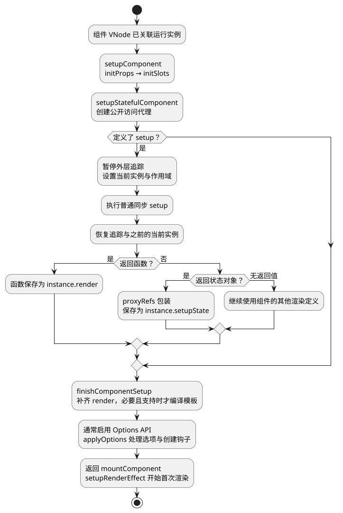
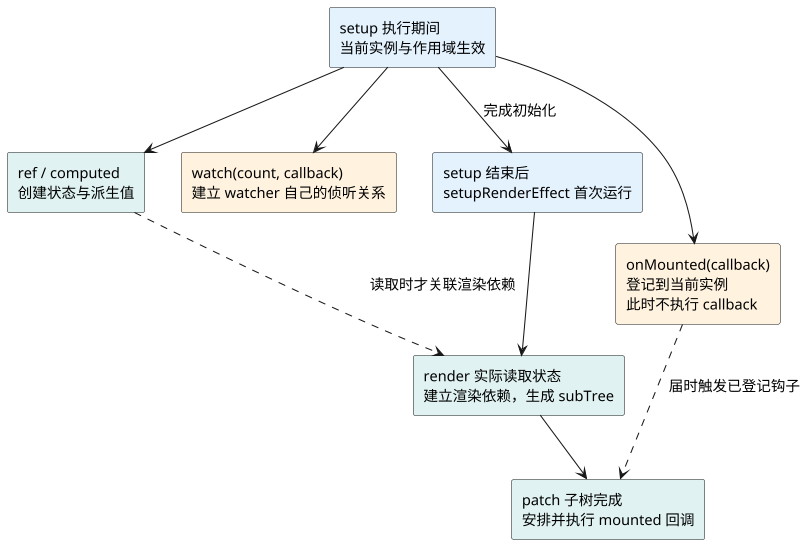

# 组件初始化与setup

**口述总览：** 组件实例创建以后，要先准备 props、slots 和访问代理，再执行 setup。setup 可以交出状态，也可以直接交出渲染函数；Vue 整理这些结果并应用 Options API，随后才建立组件渲染副作用。注册生命周期钩子、创建响应式状态和真正渲染页面，是不同的动作。

源码基线：**Vue v3.5.43**，普通同步客户端有状态组件。接着 [createApp 与首次挂载](02_createApp与首次挂载.md) 的 `mountComponent` 往里读。共同例子仍是 [计数器运行页面](examples/runtime-mainline.html) 和 [完整代码](examples/runtime-mainline.mjs)，本篇重点观察 `root:setup`、`child:setup` 与首次 render 之间发生了什么。

## 先看行为：setup拿到了输入，但页面还没有生成

共同例子的根 setup 创建 `count`、`doubled` 和 watcher，注册生命周期钩子，再返回渲染函数。这里可以使用 Vue 的状态 API，却还没有执行根 render，也没有把这份组件输出转换成 DOM。

随后根 render 把两倍计数 `doubled.value` 作为 `value` 传给 `CounterValue`。当 patch 走到子组件 VNode 时，才创建子实例并准备它的 props。因此子 setup 开始执行时，就能读取 `props.value`，不需要等到 mounted 才取得父级输入。

点击增加按钮时，计数变化，后续 render 可以再次执行，但当前这两个普通组件实例的 setup 不会反复执行。如果改变组件身份导致实例销毁并重建，新实例才会重新初始化。

<a id="k01"></a>

## 创建运行实例：先放好输入和运行状态的容器

上一篇的 `createComponentInstance` 已经创建内部实例，并让组件 VNode 的 `component` 指向它。此时实例知道组件定义、父实例和应用上下文，但它的 `setupState`、`render`、`subTree` 等成员还没有全部就绪。

根实例从根 VNode 取得 `appContext`；普通子实例沿父实例取得同一个应用上下文。每个实例还有自己的 props、slots、作用域和生命周期存储位置，所以共享应用配置不等于共享组件局部状态。

实例还会创建用于保存响应式副作用的 `scope`。它使同步初始化期间建立的 watcher 等资源能够归属于这个组件，并在真正卸载时停止。scope 并不负责自动关闭任意浏览器定时器、网络连接或第三方资源。

不要把内部实例当作业务状态仓库。读源码需要认识它，是为了理解 Vue 怎样维护组件；正常开发仍优先使用 props、emit、provide/inject 等公开接口。

## 准备输入：initProps和initSlots各做什么

`setupComponent` 首先从 `instance.vnode` 读取 props 和 children，再依次运行 `initProps`、`initSlots`。这两步先把输入整理好，后面的 setup 才有东西可读。

`initProps` 按组件声明区分输入：声明的 props 进入 `instance.props`，其他可透传属性进入 attrs；已声明的组件事件监听器等有相应处理，不能把所有非 props 键都简单认作 attrs。默认值、布尔值转换和开发环境校验也在这条路径中参与处理。

对于本篇客户端有状态组件，props 容器采用浅层响应式，父级更新时 Vue 会更新它。业务代码应遵守 props 单向输入约定；开发环境传给 setup 的 props 还会经过浅只读包装。浅层处理不等于把嵌套对象全部复制或变为深只读。

`initSlots` 把组件 VNode 的 children 整理成 slots，便于组件按名称和调用时机取得插槽内容。它不是马上把所有插槽渲染成 DOM：插槽内容通常以函数形式保存，在 render 实际使用时才调用。

共同例子中的 `CounterValue` 因为声明了 `value`，所以 setup 能通过 `props.value` 读取它。以后输入变化，更新流程会刷新这个实例的 props；不需要为了拿新输入重新运行 setup。

源码入口：[initProps](https://github.com/vuejs/core/blob/v3.5.43/packages/runtime-core/src/componentProps.ts)、[initSlots](https://github.com/vuejs/core/blob/v3.5.43/packages/runtime-core/src/componentSlots.ts)。

<a id="k02"></a>

## 执行setup：访问代理和当前实例解决不同问题

输入准备好以后，有状态组件进入 `setupStatefulComponent`。它先建立 `instance.proxy`，这个公开访问代理负责把常见的组件成员访问导向正确位置，例如 setup 返回状态、data、props，以及 `$el` 等公开属性。

这个代理不是 reactive 创建的业务数据代理，也不意味着 setup 内应该通过 `this` 访问实例。**setup 不以组件公开实例作为 this**，应直接使用参数、局部变量和组合式 API。

在调用 setup 前，Vue 会设置 `currentInstance`，并让该实例的作用域在此期间生效。这样，setup 同步调用的 `onMounted`、`provide` 等 API 才知道“当前操作属于哪个组件”，同步创建的 watcher 也能记录到对应作用域。

setup 调用结束后，要恢复之前的当前实例和作用域，避免后续组件误把钩子或副作用登记到这个组件上。这是运行时的临时上下文，不是一个永久指向“当前页面组件”的全局变量。

另外，Vue 调用普通 setup 时会暂停外层依赖追踪，再恢复。组件初始化可能发生在父组件渲染期间；如果不隔离，初始化中的读取可能错误地计入外层渲染依赖。setup 内部主动建立的 watch 或 watchEffect 有自己的追踪过程，这不与暂停外层追踪矛盾。

这里要分清两件事：`currentInstance` 解决 API 归属，响应式系统中的活动订阅者解决依赖归属。知道当前正在初始化哪个组件，并不等于当前每次读值都在收集该组件的渲染依赖。

源码入口：[setupComponent、setupStatefulComponent、setCurrentInstance](https://github.com/vuejs/core/blob/v3.5.43/packages/runtime-core/src/component.ts)。

<a id="k03"></a>

## 整理返回值：对象成为setupState，函数成为render

同步 setup 执行结束后，`handleSetupResult` 根据返回值分支处理。

返回对象时，Vue 将它经过 `proxyRefs` 保存到 `instance.setupState`。通过相应公开访问路径读取其中的 ref 时，可以自动解包；这不代表局部变量已经变成普通数值，也不代表每个嵌套对象都变成深层响应式。

返回函数时，Vue 直接把它设为 `instance.render`。共同例子使用这条路径：返回的函数通过闭包访问 setup 里的 `count` 和 `doubled`，普通 JavaScript 代码中仍使用 `.value`。

下面用一个独立短例比较两种返回方式。在有空 `<div id="app"></div>` 的 Vue 3.5.43 浏览器工程中运行，两种组件首次显示相同结果，但 Vue 安排它们状态和 render 的方式不同。

<!-- example: v3line03-setup-result -->
```javascript
import { createApp, h, ref } from 'vue';

const ObjectResult = {
  setup() {
    const count = ref(1);
    return { count };
  },
  render() {
    // 公开代理读取 setupState，count 在这条路径被解包。
    return h('p', `对象返回：${this.count}`);
  }
};

const FunctionResult = {
  setup() {
    const count = ref(1);
    // 返回的是函数，不是在 setup 中提前返回一个 VNode。
    return () => h('p', `函数返回：${count.value}`);
  }
};

const app = createApp({
  render() {
    return h('section', [h(ObjectResult), h(FunctionResult)]);
  }
});
app.mount('#app');
// 页面出现“对象返回：1”和“函数返回：1”。
// 用完该演示时调用 app.unmount()。
```

不能直接 `return h('p', ...)` 代替返回渲染函数；那只是提前生成了一个 VNode，不是以后可重新执行的 render。

如果 setup 没有返回值，Vue 还可以使用组件定义上的 render；并不是所有组件都必须从 setup 返回对象。`.vue` 中的 `<script setup>` 又有编译器参与，开发者不必手写 return；分析其源码时应先看编译结果，再判断走了哪条运行时路径。

## 完成初始化：确定render，再应用Options API

`handleSetupResult` 之后进入 `finishComponentSetup`。如果 setup 没有直接提供 render，Vue 尝试使用组件定义上的 render；只有存在运行时编译器、没有现成 render 且具备模板等条件时，才考虑运行时模板编译。

典型单文件组件的模板已经由构建工具编译为 render，不能把“挂载组件”理解成“每次重新解析模板”。后续 [Compiler 编译流程](14_Compiler编译流程.md) 会专门解释构建阶段与运行阶段怎样衔接。

在启用 Options API 的通常构建中，`finishComponentSetup` 还会调用 `applyOptions`，处理 `beforeCreate`、注入、methods、data、computed、watch、provide、created 等选项，并注册相应生命周期。

这解释了一个常见追问：**Vue 3 普通 setup 比 Options API 的 beforeCreate 和 created 更早执行**。不能套用 Vue 2 记忆，把 setup 放到 beforeCreate 与 created 之间；也不能指望在 setup 开始时通过 this 读取已经初始化好的 data。

下面的流程图只展开本篇同步路径。它的最后一步才接回渲染器，进入上一章已经看到的首次 render。

<!-- understanding-flow: v3line03-setup-pipeline:start -->
<details>
<summary>PlantUML 源码</summary>



</details>

<!-- understanding-flow: v3line03-setup-pipeline:end -->

源码入口：[handleSetupResult 与 finishComponentSetup](https://github.com/vuejs/core/blob/v3.5.43/packages/runtime-core/src/component.ts)、[applyOptions](https://github.com/vuejs/core/blob/v3.5.43/packages/runtime-core/src/componentOptions.ts)。

<a id="k04"></a>

## 接上响应式：创建ref不等于建立组件渲染依赖

共同例子中 `ref(0)` 创建可追踪状态，`computed` 创建派生值，`watch(count, ...)` 建立自己的侦听关系。这些动作发生在 setup，但不能据此说“组件的 render 已经订阅了 count”。

普通组件的渲染副作用要到 `setupRenderEffect` 才建立。首次运行 render 时，它读取 `count.value` 或 `doubled.value`，响应式系统才能把这些实际读取和当前渲染订阅者联系起来。

所以一个 ref 即使在 setup 中创建，如果从未被当前 render 读取，也没有通过 computed 等路径影响它，就不会仅因“属于这个 setup”而强制让组件更新。watch 也可以只观察数据、执行副作用，而不产生 DOM 更新。

computed 的求值还有自己的依赖关系：根 render 读取 doubled，computed 在需要时读取 count。可以先理解“render 依赖派生值，派生值依赖源状态”，不必在这一篇提前背内部链表字段。后续 [响应式系统总览](05_响应式系统总览.md) 会沿同一个例子继续拆开。

<a id="k05"></a>

## 接上生命周期：注册钩子与触发钩子不是同一时刻

setup 里的 `onMounted(fn)` 是登记：“这个组件挂载完成后请调用 fn”。Vue 利用当前实例把包装后的钩子存入该实例对应位置，而不是在调用 `onMounted` 的那一刻执行 fn。

`onBeforeMount` 同样先登记，随后由首次渲染分支触发；`onMounted` 则在子树 patch 后安排到后渲染执行路径。具体何时刷新，沿用上一篇对同步首次挂载的限定。

<!-- understanding-flow: v3line03-registration-and-tracking:start -->
<details>
<summary>PlantUML 源码</summary>



</details>

<!-- understanding-flow: v3line03-registration-and-tracking:end -->

这也说明为什么通常要在 setup 同步执行期间注册生命周期、创建希望由组件管理的 watcher。在任意定时器回调里才调用注册 API，不能假设 Vue 仍保留当时的当前实例。外部异步创建的副作用应明确管理停止和资源清理。

`<script setup>` 顶层 await 有编译器帮助恢复上下文的特殊处理，不能从普通异步回调规则直接推导它必然失效；涉及异步 setup 和 Suspense 的等待、占位、恢复，单独看 [Teleport 与 Suspense](16_Teleport与Suspense.md)。

源码入口：[生命周期注册与 injectHook](https://github.com/vuejs/core/blob/v3.5.43/packages/runtime-core/src/apiLifecycle.ts)。

## 跟踪练习：用一次挂载和一次点击串联本篇

第一次挂载，先确认根 setup 创建状态并登记钩子，再确认根 render 发生读取；走到子 VNode 后，检查子 props 已准备好，然后才看到 `child:setup` 和子 render。

点击增加按钮，观察 `watch:旧值->新值`、render 和更新钩子的后续记录。setup 没有重跑，但渲染仍拿到了新的 count 和 props。下一篇 [VNode 与 Renderer](04_VNode与Renderer.md) 继续追踪 render 的结果怎样交给渲染器。

<a id="interview"></a>

## 试题

<a id="vsr17-01"></a>

### VSR17-01 [P0·原理] setup为什么能直接读props，内部先做了什么？

**回答：** 创建组件实例后，setupComponent 先从组件 VNode 整理输入，初始化 props 和 slots，再调用 setup。因此 setup 开始时已能读到处理过的 props，后续父级更新会刷新同一实例的输入，不需要重新执行 setup。props 是单向输入，浅层响应式也不表示可以任意修改父级传来的对象。

对应讲解：[输入与运行状态](#k01)。

<a id="vsr17-02"></a>

### VSR17-02 [P0·原理] setup返回对象和返回函数，Vue分别怎样处理？

**回答：** 对象经过 proxyRefs 保存为 setupState，通过相应访问路径可解包 ref，再由组件 render 使用。函数则直接作为组件 render，通常通过闭包读取 setup 中的变量。局部 ref 在普通 JavaScript 中仍要使用 value；返回一个 VNode 本身不能代替返回渲染函数。

对应讲解：[setup 返回值](#k03)。

<a id="vsr17-03"></a>

### VSR17-03 [P0·原理] 在setup中创建ref，组件就已经收集它的渲染依赖了吗？

**回答：** 没有。创建 ref 只是准备可追踪状态，组件渲染副作用要稍后建立，render 执行并实际读取相关状态时才建立对应依赖。setup 中创建的 watch 或 watchEffect 可以先形成自己的依赖，但那与组件 render 的依赖不是一回事。

对应讲解：[接上响应式](#k04)。

<a id="vsr17-04"></a>

### VSR17-04 [P0·原理] onMounted怎样知道属于哪个组件，为什么不能随处注册？

**回答：** Vue 调用 setup 时临时设置当前组件实例，onMounted 据此把钩子登记到这个实例；setup 结束后会恢复上下文。任意异步回调执行时不保证仍有正确的当前实例，所以通常应同步注册。登记只是保存回调，真正触发由挂载流程负责，不是 onMounted 调用时立刻执行。

对应讲解：[当前实例](#k02)、[生命周期注册与触发](#k05)。

<a id="vsr17-05"></a>

### VSR17-05 [P0·原理] setup与beforeCreate、created是什么顺序？

**回答：** 对启用 Options API 的 Vue 3 普通同步组件，先准备 props 和 slots，再执行 setup；随后完成组件设置并应用 Options API，此时才处理 beforeCreate、data 等选项和 created。因此 setup 早于这两个创建钩子，不能在 setup 中依赖通过 this 访问已初始化好的 data。异步 setup 还有等待和恢复分支，需要另行说明。

对应讲解：[setup 返回值与初始化收尾](#k03)。

[上一篇：createApp 与首次挂载](02_createApp与首次挂载.md) · [下一篇：VNode 与 Renderer](04_VNode与Renderer.md) · [返回目录](00_目录.md)
