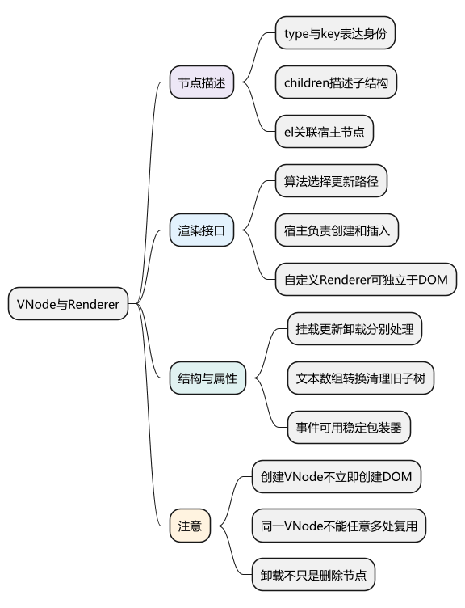
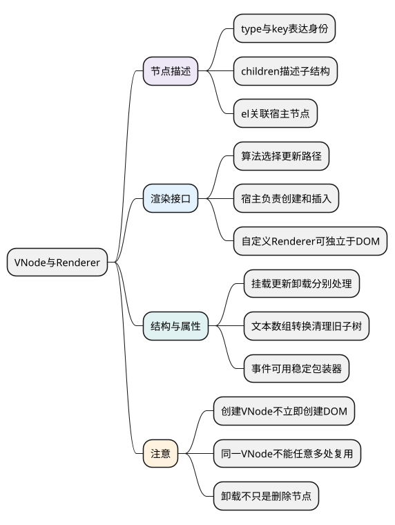
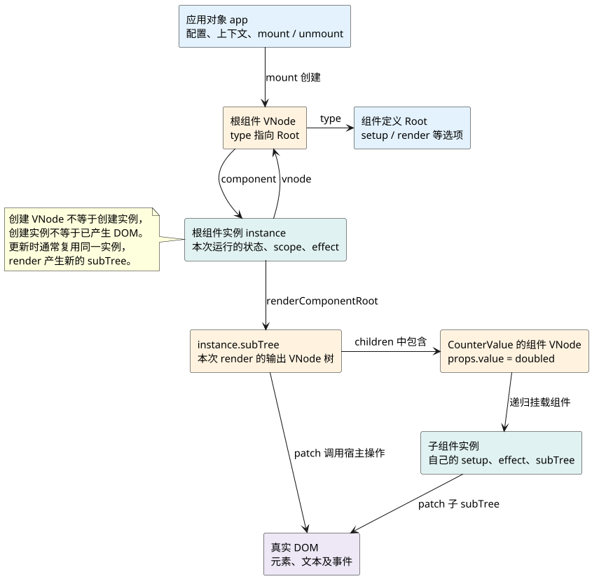
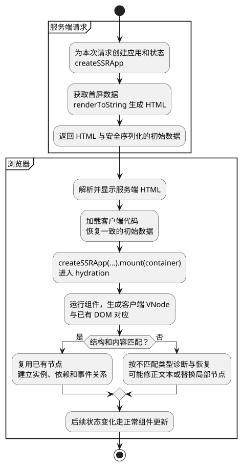

# VNode与Renderer

**主线位置：** 上一篇 [组件初始化与 setup](03_组件初始化与setup.md) 已经得到组件实例和渲染函数。本篇跟着根组件的第一次 render，分清它生成什么、谁把结果变成 DOM；下一篇 [响应式系统总览](05_响应式系统总览.md) 再回看 render 读取数据时怎样建立更新联系。

共同例子见 [运行主线演示](examples/runtime-mainline.html) 与 [示例源码](examples/runtime-mainline.mjs)：根组件保存 count，计算 doubled，并把 doubled 传给子组件 CounterValue。这里先看第一次 mount，不急着展开 Diff。

<!-- core-mindmap:start -->
[](examples/vsr07-mindmap.svg)

<details>
<summary>PlantUML 源码</summary>



</details>

<!-- core-mindmap:end -->

**口述总览：** VNode是描述，Renderer执行更新策略，宿主操作真正创建或修改节点。把这三层拆开，可以理解Vue为何支持自定义渲染器，也能避免把VNode直接当DOM。

源码基线：**Vue v3.5.43**。区分公开行为、这个版本的内部实现与本文教学模型；代码块各自独立，使用 Vue 包的例子在安装相应版本的 Node ESM 或前端工程中运行。

<a id="mainline-roles"></a>

## 同一个页面：区分六种对象

`createApp(Root)` 返回的 **app 是应用对象**，保存配置、插件、应用上下文，以及 mount/unmount 入口。传入的 **Root 是组件定义**，描述 setup、render 等选项；它可以用于创建多个实例，不保存每个实例各自的 count。

挂载时，`createVNode(Root)` 创建 **根组件 VNode**，表示“此处使用 Root”。随后创建的 **组件实例 instance** 保存这一次使用所需的 props、setup 结果、作用域、渲染 effect 和生命周期状态。首次 render 生成另一棵 **subTree**，描述这个实例此刻要显示的元素、文本与子组件；renderer 遍历它，才通过宿主操作创建 **真实 DOM**。

根实例的 subTree 内还可以有 CounterValue 的组件 VNode。处理到它时，运行时再创建子实例、执行子 setup、建立子渲染 effect，得到子 subTree。组件树、VNode 树与 DOM 树有关联，却不是三棵一一对应的同形树；Fragment、Teleport 等会使关系更复杂。

<!-- understanding-flow: v3line04-runtime-roles:start -->
<details>
<summary>PlantUML 源码</summary>



</details>

<!-- understanding-flow: v3line04-runtime-roles:end -->

### 观察入口：首次 render 为什么会走进子组件

主例第一次挂载的关键顺序是：根 setup → 根 beforeMount → 根 render → patch 根 subTree → 遇到 CounterValue → 子 setup / beforeMount / render → patch 子 subTree。`computed:evaluate` 在根 render 首次读取 doubled 时出现。创建子组件 VNode 的那一刻，还没有执行子 setup；执行发生在 renderer 处理该 VNode 的挂载路径。

浏览器工程中可以用下面的观察代码检查对象关系。`vm.$`、`instance.vnode` 和 `instance.subTree` 是本版本的内部调试入口，不作为业务开发依赖的公开契约。

<!-- example: v3line04-object-roles -->
```js
import { createMainlineApp } from './examples/runtime-mainline.mjs';

const events = [];
const { app } = createMainlineApp(event => events.push(event));
const container = document.createElement('div');
document.body.append(container);
const vm = app.mount(container);
const instance = vm.$;

console.log(instance.vnode.component === instance); // true
console.log(instance.vnode === instance.subTree); // false
console.log(events.indexOf('root:render') < events.indexOf('child:setup')); // true

app.unmount();
container.remove();
```

知道这几种对象的职责后，再读下面的字段与宿主接口；后面 [组件更新与卸载流程](11_组件更新与卸载流程.md) 会继续跟踪同一个实例怎样替换 subTree。

<a id="k01"></a>

## VNode：描述身份、结构与挂载关联

常见字段有type、props、key、children、el、component、shapeFlag、patchFlag、dynamicChildren。type/shapeFlag帮助区分元素、组件、文本或Fragment；el联系已挂载的宿主节点，component联系组件实例。

```js
import { h, isVNode } from 'vue';
const vnode = h('p', { id: 'message', key: 'one' }, 'hello');
console.log(isVNode(vnode), vnode.type, vnode.key, vnode.el); // true p one null
```

创建VNode不立即创建DOM。已挂载VNode包含运行状态，同一VNode对象不能随意在多处复用而期待el等字段代表多个节点；需要由框架正常克隆或新建。

源码：[createVNode/normalizeChildren/isSameVNodeType](https://github.com/vuejs/core/blob/v3.5.43/packages/runtime-core/src/vnode.ts)。key通常配合type判断是否同一节点种类，key本身不是HTML属性。

<a id="k02"></a>

## Renderer：用宿主接口执行平台操作

[createRenderer/baseCreateRenderer](https://github.com/vuejs/core/blob/v3.5.43/packages/runtime-core/src/renderer.ts)接收createElement、insert、remove、setElementText、patchProp等宿主函数。算法决定做什么，宿主负责怎么做。

```js
import { createRenderer, h } from 'vue';
const renderer = createRenderer({
  createElement: type => ({ type, children: [], text: '', parent: null, props: {} }),
  insert(node, parent, anchor = null) {
    if (node.parent) node.parent.children.splice(node.parent.children.indexOf(node), 1);
    const index = anchor ? parent.children.indexOf(anchor) : parent.children.length;
    parent.children.splice(index, 0, node); node.parent = parent;
  },
  remove(node) {
    if (node.parent) node.parent.children.splice(node.parent.children.indexOf(node), 1);
    node.parent = null;
  },
  setElementText(node, text) { node.text = text; node.children = []; },
  createText: text => ({ type: '#text', text, parent: null }),
  setText(node, text) { node.text = text; },
  createComment: text => ({ type: '#comment', text, parent: null }),
  parentNode: node => node.parent,
  nextSibling: node => node.parent?.children[node.parent.children.indexOf(node) + 1] ?? null,
  patchProp(node, key, oldValue, value) { node.props[key] = value; }
});
const root = { children: [] };
renderer.render(h('p', null, 'A'), root);
const original = root.children[0];
renderer.render(h('p', null, 'B'), root);
console.log(root.children[0] === original, original.text); // true B
```

这是有限宿主模型，只验证简单文本元素复用；非完整DOM和布局实现。生产宿主还需正确处理复杂子树、命名空间与事件。

<a id="k03"></a>

## mount、patch、unmount：处理结构转换和清理

首次patch(null,n2)挂载；同类型身份更新进入对应处理路径；不匹配则卸载旧节点再挂新节点。元素patch处理props与children，组件patch可能复用实例并更新其subTree。

children转换要覆盖空、文本、数组各组合：数组变文本先卸载旧子树，文本变数组先清空文本再挂载。直接innerHTML覆盖可能跳过组件effect和事件资源清理，所以运行时unmount不只是removeChild。

Fragment、组件和Teleport不一定对应一个简单DOM节点，移动/锚点必须按节点类别处理。

<a id="k04"></a>

## runtime-dom：区分属性、样式与事件更新

[ensureRenderer](https://github.com/vuejs/core/blob/v3.5.43/packages/runtime-dom/src/index.ts)把runtime-core算法与DOM操作拼接。真实patchProp需要区分class、style、事件、DOM property和attribute；input.value/checked等不能总用setAttribute。

事件通常可用稳定invoker包装更新回调值，避免每次props变化都重复解绑绑定；具体实现还处理事件时间戳等边界。迷你Vue篇仅支持常见事件和属性并写明限制，不冒充完整runtime-dom。

阅读路线：VNode创建→renderer.patch分流→元素/组件处理→宿主操作。

<a id="k05"></a>

## SSR 与 hydration：先生成 HTML，再接管已有 DOM（选读）

主线暂时采用普通客户端同步挂载，首次阅读可以先跳到文末试题；掌握主线后，再结合 [Teleport 与 Suspense](16_Teleport与Suspense.md) 阅读不同渲染路径的边界。

客户端首次渲染通常从空容器创建节点。服务端渲染（SSR）则先用组件和数据生成 HTML，让浏览器先显示内容；客户端水合（hydration）运行对应组件，把组件实例、VNode、响应式更新和事件处理与已有 DOM 连接起来。水合既不是只绑定几个事件，也不是默认删除所有服务端节点再重建。

Vue 服务端通常用 `createSSRApp` 创建应用，交给 `@vue/server-renderer` 的 `renderToString` 等接口生成 HTML；客户端用对应组件和一致的初始数据创建 SSR 应用，再 `mount` 到包含这些 HTML 的容器，由运行时进入水合路径。每个请求应有独立应用、路由和状态实例，避免把上一用户的数据共享给下一用户。

<!-- understanding-flow: vsr07-hydration:start -->
<details>
<summary>PlantUML 源码</summary>



</details>

<!-- understanding-flow: vsr07-hydration:end -->

图中的传输和状态恢复需要应用或框架实现，`renderToString` 不会自动替你安全嵌入所有状态。避免让服务端和客户端首屏分别读取随机数、不同的时间或仅浏览器可用的信息；非法 HTML 被浏览器修正结构，也可能造成不匹配。用客户端 mounted 阶段补充仅客户端内容时，应提供一致的首屏占位。

源码从 [createSSRApp](https://github.com/vuejs/core/blob/v3.5.43/packages/runtime-dom/src/index.ts) 进入带 hydration 能力的 renderer，再看 [hydrateNode/hydrateElement/handleMismatch](https://github.com/vuejs/core/blob/v3.5.43/packages/runtime-core/src/hydration.ts)。节点类型不匹配可卸掉局部旧节点再 patch，文本不匹配有文本修正路径；不是每类属性差异都保证自动修好。恢复有额外工作量，也可能扰动用户状态，不能依赖它替代首屏一致性。

数据隔离先看 [Pinia 与共享状态](../01_Vue3基础与应用/19_Pinia与共享状态.md)，渲染方式的选择与 Nuxt 接入继续看 [SSR、CSR、SSG 与混合渲染](../../06_Vite_Nuxt/04_SSR、CSR、SSG、Hybrid%20Rendering.md)。本文建立渲染机制的连接，不要求先通读 Nuxt 才能理解组件更新。

<a id="summary"></a>

## 复述要点

VNode描述身份和结构，Renderer选择挂载/更新/卸载，宿主接口执行平台操作。复用要同时保持节点身份与资源清理，不是只比较文本是否相同。

<a id="interview"></a>

## 试题

<a id="vsr08-01"></a>

### VSR08-01 [P0·原理] 创建VNode是否就创建了真实DOM？

**回答：** 没有，VNode先描述UI，renderer根据挂载或更新流程调用宿主操作才创建/修改节点。el在挂载后才关联宿主实体。

对应讲解：[VNode 的身份与字段](#k01)。

<a id="vsr08-02"></a>

### VSR08-02 [P1·源码] 自定义Renderer为什么能不依赖document？

**回答：** runtime-core通过宿主接口表达节点操作，调用方可用其他结构实现。只要接口语义正确，算法不必硬编码浏览器DOM；平台布局和事件仍需自己负责。

对应讲解：[Renderer 的宿主接口](#k02)。

<a id="vsr08-03"></a>

### VSR08-03 [P0·原理] 数组children切成文本为何不能只设textContent就结束？

**回答：** 旧子树可能有组件effect、钩子或其他资源，需要先走相应unmount清理，再改宿主内容。节点从屏幕消失不代表生命周期结束逻辑已执行。

对应讲解：[mount、patch、unmount](#k03)。

<a id="vsr08-04"></a>

### VSR08-04 [P0·原理] patchProp为何不能全部用setAttribute？

**回答：** class/style、事件、DOM property和HTML attribute的语义不同，表单当前状态也不等于初始属性。真实runtime-dom要分类处理，简化renderer必须声明限制。

对应讲解：[runtime-dom 与属性补丁](#k04)。

<a id="vsr08-05"></a>

### VSR08-05 [P1·原理] hydration 与普通客户端首次渲染有什么不同？

**回答：** 普通首次渲染通常创建 DOM，水合则利用服务端已输出的 DOM，运行客户端组件，把 VNode、实例、依赖和事件关联到这些节点。首屏组件与数据要保持一致；不匹配可能引发文本修正、局部替换或诊断，并非保证零恢复成本。SSR 还要求请求间隔离状态，避免用户数据串用。

对应讲解：[SSR 与 hydration](#k05)。
