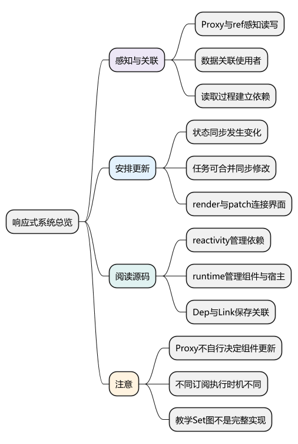
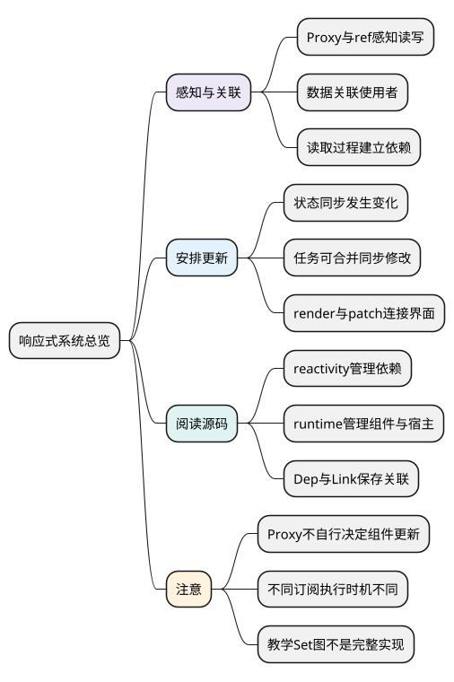

# 响应式系统总览

**本篇在主线中解释什么：** 前面已经从 `app.mount()` 追到组件渲染 effect。本篇回到它读取状态的地方，解释为什么一次读取能让后续赋值找到需要更新的组件。响应式包也可以独立于组件使用；只有把订阅者接到 Renderer 的调度器，变化才会成为组件更新。

在[运行主例](examples/runtime-mainline.mjs)中，`setup()` 创建 `count`、`doubled` 和 watch。watch 初始化时读取 `count`；首次根 render 直接读取 `count.value`，又通过 `doubled.value` 进入计算属性。它们会形成不同订阅，不能合并理解成“给 data 绑定一个组件”。

连续调用三次 `increment()`，状态立即变成 3，通知沿已经建立的关系传递；组件和默认 pre watcher 的后续执行交给调度器合并。子组件收到的是父 render 计算出的 `value` prop，不是直接持有父级的 `count` ref。

阅读前提：[VNode 与 Renderer](04_VNode与Renderer.md)。先对照[完整运行主线](01_源码地图与运行主线.md)确认当前停在“渲染时读取状态”，再展开下面的机制。

<!-- core-mindmap:start -->
[](examples/vsr01-mindmap.svg)

<details>
<summary>PlantUML 源码</summary>



</details>

<!-- core-mindmap:end -->

**口述总览：** 先把一条界面更新贯穿：状态由谁读取、依赖在哪登记、变化通知了谁、谁决定执行时机。响应式和渲染器分工明确，理解总线后再逐个读源码。

源码基线：**Vue v3.5.43**。区分公开行为、这个版本的内部实现与本文教学模型；代码块各自独立，使用 Vue 包的例子在安装相应版本的 Node ESM 或前端工程中运行。

<a id="k01"></a>

## 响应式分工：感知、关联与执行

Proxy/ref访问器负责感知读取和写入；依赖系统把数据与订阅者关联；scheduler决定某类工作何时运行。Proxy本身不知道哪个组件应该更新，微任务本身也不知道哪些字段改变。

```text
组件render读取 state.count
  → get → track(target,key) → 建立Dep与订阅者关联
写入 state.count
  → set → trigger → 通知订阅者
  → 组件effect.scheduler → queueJob
  → flushJobs → render新subTree → patch旧/新subTree
```

没有读取就未必有依赖，读到了也不意味着一定要完整重绘页面。computed可能重新确认后发现结果没变，组件任务可能被合并，DOM patch后还需浏览器布局绘制。

<a id="k02"></a>

## 运行观察：追踪一次状态变化

```js
import { reactive, watchEffect, nextTick } from 'vue';
const state = reactive({ count: 0 });
const seen = [];
const stop = watchEffect(() => seen.push(state.count));
state.count = 1;
state.count = 2;
console.log(state.count, seen); // 2 [0]
await nextTick();
console.log(seen); // [0,2]
stop();
```

watchEffect初次读取发生在建立观察时，后续默认调度合并同步改动；数据值立即变成2，观察执行并非每次写都同步发生。这里是公开watchEffect行为，不是证明裸effect、sync watcher和组件钩子全部同样执行。

<a id="k03"></a>

## 源码包职责：连接响应式与组件更新

- **reactivity**：主要责任：代理/ref、Dep/Link、订阅、computed/watch基础；入口：reactive.ts、dep.ts、effect.ts。
- **runtime-core**：主要责任：组件、Renderer、调度、内建组件；入口：renderer.ts、component.ts、scheduler.ts。
- **runtime-dom**：主要责任：DOM创建、属性/事件处理；入口：index.ts及宿主操作。
- **compiler-core/dom**：主要责任：模板解析、变换、render代码生成；入口：baseCompile、transform、generate。
- **compiler-sfc**：主要责任：.vue文件脚本/模板/样式协作；入口：SFC工具链。

源码定位：[setupRenderEffect](https://github.com/vuejs/core/blob/v3.5.43/packages/runtime-core/src/renderer.ts)中寻找new ReactiveEffect(componentUpdateFn)及effect.scheduler=()=>queueJob(job)；再看[queueJob/flushJobs](https://github.com/vuejs/core/blob/v3.5.43/packages/runtime-core/src/scheduler.ts)。这两处把响应式变化和DOM更新接到一起。

<a id="k04"></a>

## 教学模型：区分简图与3.5源码结构

WeakMap→Map→Set可以说明“对象、键、订阅集合”，但v3.5.43的真实Dep用Link维护多对多关系，并记录版本。[Dep与Link](https://github.com/vuejs/core/blob/v3.5.43/packages/reactivity/src/dep.ts)注释明确一条Link同时属于订阅者依赖链和Dep订阅链；[prepareDeps/cleanupDeps](https://github.com/vuejs/core/blob/v3.5.43/packages/reactivity/src/effect.ts)标记和移除未再访问的链接。

Vue3并没有“不再有Dep”，也不是删除Watcher后简单换一个名字。组件effect、computed订阅者与watch任务有不同职责。面试先说明关系，再限定源码版本，不将简化图当物理实现。

接下来分别看[对象访问入口](06_reactive与Proxy.md)和[ref 容器入口](07_ref与依赖追踪.md)，再用[effect 与依赖清理](08_effect_track_trigger与依赖清理.md)说明谁读取、关系怎样保留与移除。

<a id="summary"></a>

## 复述要点

先分感知、依赖关联和调度执行，再贯穿到render/patch。源码按职责追一次读写；图帮助理解，Dep/Link和版本机制才是本版本细节。

<a id="interview"></a>

## 试题

<a id="vsr02-01"></a>

### VSR02-01 [P0·原理] Proxy为何不能自己完成界面响应式？

**回答：** 它只提供对象操作拦截，还需记录哪个计算读取哪个数据，以及变化后如何重新计算和提交DOM。依赖关系、调度、组件生命周期不是Proxy自动提供的。

对应讲解：[三个独立问题：感知、关联、执行](#k01)。

<a id="vsr02-02"></a>

### VSR02-02 [P0·原理] 数据立即改变，为什么watchEffect稍后才看到？

**回答：** 数据写入和观察执行不同步，默认watchEffect后续任务可被排队合并，一轮结束读取最新结果。初次执行、sync watcher和裸effect的行为要分别限定。

对应讲解：[一次状态变化的可运行观察](#k02)。

<a id="vsr02-03"></a>

### VSR02-03 [P0·原理] 从响应式追到组件更新看哪两个入口？

**回答：** 看renderer的setupRenderEffect怎样创建ReactiveEffect并设置queueJob调度，再看scheduler如何flush任务，最终执行组件render与patch。只看get/set不能解释DOM更新时机。

对应讲解：[包的职责与读源码路线](#k03)。

<a id="vsr02-04"></a>

### VSR02-04 [P1·源码] Vue3.5源码是WeakMap→Map→Set吗？

**回答：** 它可作教学关系图，但具体依赖由Dep和Link等结构维护，含双向链与版本标记。不能声称Vue3没有Dep或完全按某个十行模型实现。

对应讲解：[教学图与3.5源码的区别](#k04)。
