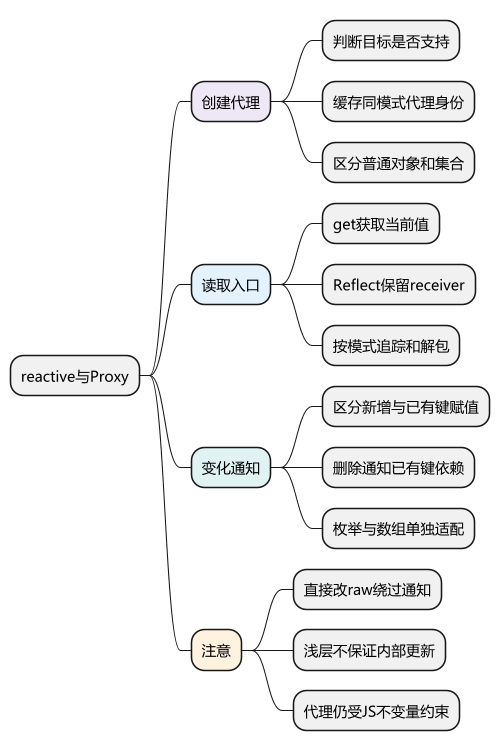
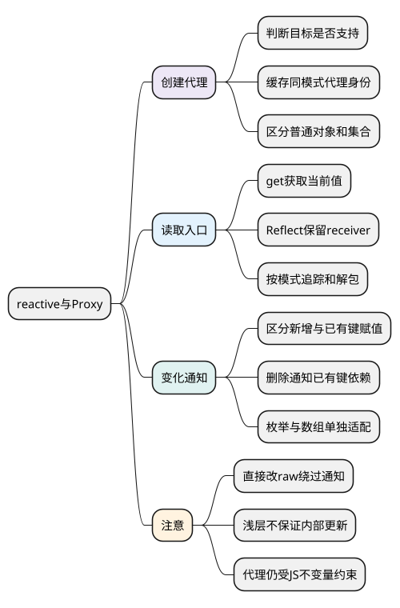

# reactive与Proxy

**本篇在主线中解释什么：** 主例使用 `ref(0)`；本篇研究同一计数状态改成 `reactive({ count: 0 })` 时，读取与写入怎样进入依赖系统。这里是主线旁的对象状态实验，不改动[统一主例](examples/runtime-mainline.mjs)。

对应改法是：render 读取 `state.count`，computed 读取 `state.count * 2`，watch 使用 `() => state.count`，点击时执行 `state.count++`。前两种读取只有在相应订阅者运行期间，才会登记它们与该属性的关系；watch 的 getter 也有自己的订阅者。

源码断点依次放在 `createReactiveObject`、`BaseReactiveHandler.get` 和可变代理的 `set`。先确认创建时得到哪个代理，再确认读取怎样到 `track`、写入怎样到 `trigger`；组件何时重新 render，要继续追 scheduler。

阅读前提：[响应式系统总览](05_响应式系统总览.md)。Map、Set 和数组是对象读写主线的适配分支，可以在普通对象路径理解后再读。

<!-- core-mindmap:start -->
[](examples/vsr02-mindmap.svg)

<details>
<summary>PlantUML 源码</summary>



</details>

<!-- core-mindmap:end -->

**口述总览：** reactive主要解决对象访问的响应式入口和身份缓存。沿创建代理、get、set、delete/枚举四条路径阅读，才能解释新增字段、receiver和数组行为。

源码基线：**Vue v3.5.43**。区分公开行为、这个版本的内部实现与本文教学模型；代码块各自独立，使用 Vue 包的例子在安装相应版本的 Node ESM 或前端工程中运行。

<a id="k01"></a>

## 创建代理：按目标类型选择并缓存身份

```js
import { reactive, toRaw, markRaw } from 'vue';
const raw = { nested: { count: 1 } };
const a = reactive(raw), b = reactive(raw);
console.log(a === b, a === raw, toRaw(a) === raw); // true false true
console.log(a.nested === raw.nested); // false
const external = markRaw({ token: 1 });
console.log(reactive(external) === external); // true
```

[createReactiveObject](https://github.com/vuejs/core/blob/v3.5.43/packages/reactivity/src/reactive.ts)按非对象、已有代理、SKIP/不可扩展、缓存及目标类别处理，再选择普通对象handler或集合handler。WeakMap缓存让同一模式下原对象复用相应代理，不等于所有readonly/shallow变体都是同一个代理。深层代理常在读取嵌套对象时建立，而不是必须初始化时递归改写所有属性。

<a id="k02"></a>

## get 与 receiver：保留读取接收者

普通get取得值，过滤不应追踪的内部入口，按可变/只读模式追踪，再处理浅层、ref解包和嵌套代理等规则。[BaseReactiveHandler.get](https://github.com/vuejs/core/blob/v3.5.43/packages/reactivity/src/baseHandlers.ts)是主入口；Reflect.get保留本次接收者语义，具体对ref目标还有版本内的特殊处理。

```js
const reads = [];
const raw = { n: 2, get double() { return this.n * 2; } };
const proxy = new Proxy(raw, {
  get(target, key, receiver) {
    reads.push(key);
    return Reflect.get(target, key, receiver);
  }
});
console.log(proxy.double, reads); // 4 ['double','n']
```

若改成target[key]，getter以raw为this读取n，内部访问绕过代理。proxy不只是“在外面多打一行日志”，接收者决定后续操作从哪里经过。

<a id="k03"></a>

## set、delete、has、ownKeys：按操作通知依赖

set需要区分旧键是否存在、旧新值是否变化、写入是否成功及receiver对应的真实目标，再通知ADD或SET等相关依赖。错误地对所有set都触发会产生重复更新或反馈循环。

deleteProperty只在成功删除已有属性时通知；has供in操作依赖；ownKeys让Object.keys等枚举可对键集合变化反应。新增与删除不只是影响某键值，也影响“有哪些键”。

数组添加索引、截短length、迭代与includes等不能仅复用普通对象单键逻辑，框架有数组方法适配和长度/迭代依赖。Map/Set则有集合handler，原生内部槽和迭代行为需专门处理。

### Map、Set 与数组：区分值变化、成员变化和长度变化

对 Map 的 `keys()` 迭代，修改已有键的值不改变键集合；对 `values()` 的迭代，同一操作却改变了读取结果。下面用裸 `effect` 同步观察，避免组件调度合并掩盖通知差异。

<!-- example: v3review-source02-map -->
```js
import { reactive, effect, stop } from 'vue';
const scores = reactive(new Map([['A', 1]]));
let keyRuns = 0, valueRuns = 0;
const keys = effect(() => { keyRuns++; return [...scores.keys()]; });
const values = effect(() => { valueRuns++; return [...scores.values()]; });
scores.set('A', 2);
console.log(keyRuns, valueRuns); // 1 2：键集合未变，值变了。
scores.set('B', 3);
console.log(keyRuns, valueRuns); // 2 3：新增键同时影响两者。
stop(keys); stop(values);
```

在这个版本，Map 键迭代用 `MAP_KEY_ITERATE_KEY`，值或条目迭代用 `ITERATE_KEY`。已有键的 SET 通知对应键和后者；ADD/DELETE 还影响键迭代。Set 没有“同一键换一个值”，添加已有成员通常不算变化，添加或删除成员才改变集合；`clear()` 则会通知已收集的相关依赖。

数组截短 `length` 不只改变长度，还会使被截掉的索引读取失效。迭代订阅也要更新，否则界面可能继续保留已不存在的项。

<!-- example: v3review-source02-array -->
```js
import { reactive, effect, stop } from 'vue';
const items = reactive(['A', 'B', 'C']);
const seen = [];
const runner = effect(() => seen.push(items[2]));
items.length = 1;
console.log(seen); // ['C', undefined]
stop(runner);
```

源码对应 [collectionHandlers.ts](https://github.com/vuejs/core/blob/v3.5.43/packages/reactivity/src/collectionHandlers.ts) 的集合访问适配、[arrayInstrumentations.ts](https://github.com/vuejs/core/blob/v3.5.43/packages/reactivity/src/arrayInstrumentations.ts) 的数组方法适配，以及 `dep.ts` 的 `trigger` 分支。不要把“每个读操作都有不同入口”误解为所有操作都维护完全独立的 Dep；本版本仍会按实际键和内部迭代键组织关系。

<a id="k04"></a>

## raw、readonly 与浅层代理：检查实际访问路径

直接改raw通常绕过代理通知；解构原始值属性保存快照；shallowReactive只处理根层，不保证内部对象更新；readonly限制该访问视图，不阻止外部原对象变化。

markRaw适合不应代理的外部实例，但嵌套对象另行进入响应式图时可能产生身份差异。不可配置/不可写属性和不变量仍由JS约束，Vue不能随意返回违背Proxy不变量的值。

源码阅读按[创建/缓存](https://github.com/vuejs/core/blob/v3.5.43/packages/reactivity/src/reactive.ts)→[读写拦截](https://github.com/vuejs/core/blob/v3.5.43/packages/reactivity/src/baseHandlers.ts)→[track/trigger](https://github.com/vuejs/core/blob/v3.5.43/packages/reactivity/src/dep.ts)。排错先看实际读写路径，再查调度。

回到统一主例，`count` 是 ref，并不经普通对象代理的 `get` 读取数字。下一篇看[RefImpl 的 value 访问器](07_ref与依赖追踪.md)，比较两类入口如何接到同一依赖系统。

<a id="summary"></a>

## 复述要点

创建时管理代理身份，读取时保留receiver并收集相关关系，写入按真实变化和操作类型通知。数组/集合/浅层/raw有自己的边界，不能只靠一个get/set万能模型。

<a id="interview"></a>

## 试题

<a id="vsr03-01"></a>

### VSR03-01 [P0·原理] reactive重复调用为什么通常返回相同代理？

**回答：** 对应模式用WeakMap缓存原对象到代理，避免每次创建新身份。raw与proxy仍不同，readonly和shallow等变体的缓存也有区别。

对应讲解：[创建代理与身份缓存](#k01)。

<a id="vsr03-02"></a>

### VSR03-02 [P0·原理] Reflect.get的receiver如何影响依赖追踪？

**回答：** 它决定访问器getter的this，保留代理接收者可让getter内部属性读取继续被拦截；target[key]可能改用raw而漏记内部读取。

对应讲解：[get 与 receiver](#k02)。

<a id="vsr03-03"></a>

### VSR03-03 [P0·原理] 新增字段为何可能让Object.keys相关计算更新？

**回答：** 枚举依赖键集合，ADD/DELETE要通知相应迭代依赖，而非只通知读取该键值的订阅者。has、ownKeys与get属于不同操作入口。

对应讲解：[set、delete、has 与 ownKeys](#k03)。

<a id="vsr03-04"></a>

### VSR03-04 [P1·排查] 对象改了却没更新应先看什么？

**回答：** 确认是否改raw、解构为原始快照、处于shallow/markRaw范围、写入失败或观察已停止，再看是否尚未flush。先定位访问路径比盲加nextTick有效。

对应讲解：[raw、readonly、浅层与排错](#k04)。

<a id="vsr03-05"></a>

### VSR03-05 [P1·原理] Map 修改已有键的值，为什么 keys 与 values 的观察次数不同？

**回答：** keys 依赖成员键集合，values 依赖迭代得到的值。已有键换值不改变键集合，却改变值，因此本版本按不同迭代依赖通知；新增和删除键会同时影响两者。类似地，数组截短 length 还必须通知被截掉的索引，不能把所有变化都简化为通知一个普通属性键。

对应讲解：[按操作通知依赖](#k03)。
