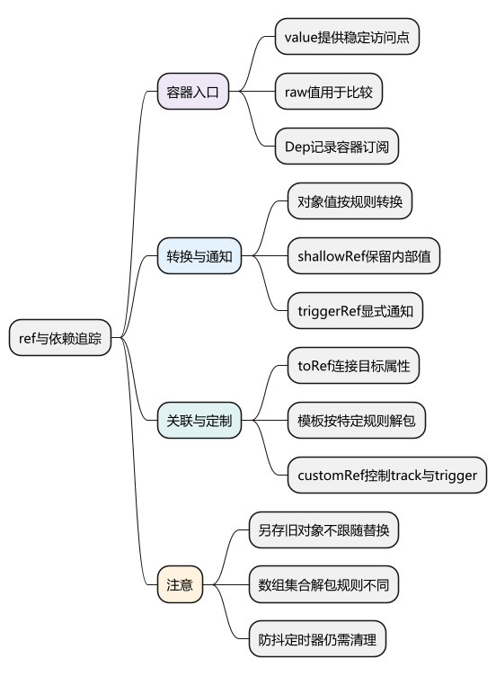
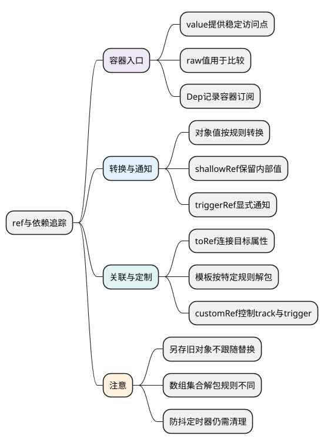
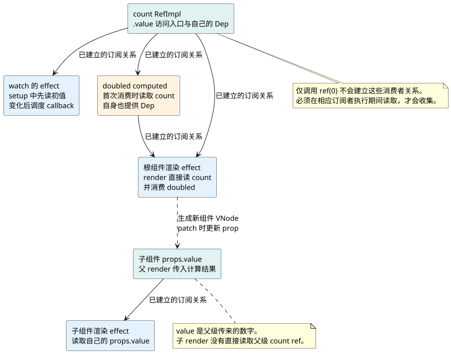

# ref与依赖追踪

**本篇在主线中解释什么：** [统一主例](examples/runtime-mainline.mjs)在根组件 `setup()` 中执行 `count = ref(0)`。这一步创建容器和它的 Dep，还没有因为“创建了 ref”就自动登记根组件渲染依赖。

随后 `watch(count, ...)` 为取得初值读取容器，建立 watcher 的关系；首次 render 执行时读取 `count.value`，才建立根渲染 effect 的关系。第一次读取 `doubled.value` 时，computed 的 getter 也读取 count，因此 count 又多了一个订阅者。

连续三次 `increment()` 都经过 `.value` setter；在主例没有插入其他读取的情况下，赋值会通知订阅者，而 DOM 更新等待调度。`readCount()` 若在组件执行之外单独调用，只读取当前值，不会凭空新增一个渲染订阅者。

阅读前提：[对象代理入口](06_reactive与Proxy.md)。本篇把观察点换成 `RefImpl` 的 getter/setter；后面再详细看 Dep 如何找到各自的使用者。

<!-- core-mindmap:start -->
[](examples/vsr03-mindmap.svg)

<details>
<summary>PlantUML 源码</summary>



</details>

<!-- core-mindmap:end -->

**口述总览：** ref通过.value这个稳定入口表达原始值或可整体替换状态。源码上ref有自己的Dep，不能把它简单说成一个包着value的reactive对象。

源码基线：**Vue v3.5.43**。区分公开行为、这个版本的内部实现与本文教学模型；代码块各自独立，使用 Vue 包的例子在安装相应版本的 Node ESM 或前端工程中运行。

<a id="k01"></a>

## RefImpl：区分比较值、对外值和订阅

在[RefImpl](https://github.com/vuejs/core/blob/v3.5.43/packages/reactivity/src/ref.ts)中，_rawValue用于比较原始输入，_value用于对外暴露（需要时转响应式），dep管理.value订阅。getter调用dep.track，setter根据浅层/只读等规则转换后用hasChanged判断，再更新并trigger。

```js
import { ref, isReactive, toRaw } from 'vue';
const raw = { count: 0 };
const value = ref(raw);
console.log(isReactive(value.value), toRaw(value.value) === raw); // true true
value.value = { count: 2 };
console.log(value.value.count); // 2
```

容器身份保持，内部对象可以替换；持有value这个ref的使用方仍经.value读取新结果。直接把旧value.value另存成变量则可能继续指向旧对象。

<!-- understanding-flow: v3line07-ref-mainline:start -->
<details>
<summary>PlantUML 源码</summary>



</details>

<!-- understanding-flow: v3line07-ref-mainline:end -->

图展示主例首次挂载后的关系。实线表示数据源与订阅者的关联，虚线表示父级把计算结果写入子 VNode 的 prop，再在 patch 中交给子实例；两种联系不是同一条 Dep。

<a id="k02"></a>

## shallowRef 与 triggerRef：控制浅层通知

```js
import { shallowRef, triggerRef, watchEffect } from 'vue';
const data = shallowRef({ n: 0 });
const seen = [];
const stop = watchEffect(() => seen.push(data.value.n), { flush: 'sync' });
data.value.n = 1;
console.log(seen); // [0]
triggerRef(data);
console.log(seen); // [0,1]
stop();
```

shallowRef不深转换内部值，triggerRef显式通知容器订阅；因此性能收益伴随更新责任。不能为了减少开销替换API后仍期待任意嵌套写入自动通知。

<a id="k03"></a>

## 解包与 toRef：保留正确的访问入口

模板顶层ref和组件setup状态通过编译/代理等路径提供解包便利，不是JS语言改变了ref语义。普通reactive对象属性中的ref与数组/Map元素中的ref也有不同规则。

toRef(object,key)使.value访问转回目标属性；toRefs为当前可枚举属性建立一组入口。toValue还可调用getter，unref不会把普通函数当getter执行。传递当前值、getter或ref分别表达快照、可重复读取和可写入口。

```js
import { reactive, toRef } from 'vue';
const state = reactive({ n: 1 });
const n = toRef(state, 'n');
n.value = 2;
console.log(state.n); // 2
```

源码沿RefImpl→ObjectRefImpl→proxyRefs等入口看各自职责，不把自动解包当所有场景的固定规则。

<a id="k04"></a>

## customRef：自定义追踪与触发时机

customRef把track/trigger控制交给用户get/set，适合特殊延迟提交等输入。定时器仍需清理，getter每次新建对象还可能使父子引用不稳定。

最小ref教学模型可用.value访问器加track/trigger说明，但真实实现还包括转换、标记、比较、调试和浅层行为。面试重点是解释为什么原始变量不能直接拦截，而容器属性可以。

图中每条订阅关系都需要记录、更新和清理。下一篇沿[ReactiveEffect.run、Dep 与 Link](08_effect_track_trigger与依赖清理.md)追踪这些关系如何建立，以及组件卸载后为什么应解除它们。

<a id="summary"></a>

## 复述要点

ref提供稳定.value入口，Dep关联订阅，raw值比较与对外值转换分工明确。解包是特定框架路径的便利，浅层和customRef都需要更新契约。

<a id="interview"></a>

## 试题

<a id="vsr04-01"></a>

### VSR04-01 [P0·原理] ref如何让number参与响应式？

**回答：** 把原始值放在可追踪.value访问器中，getter记录订阅，setter比较并通知，而不是拦截普通局部变量赋值。

对应讲解：[RefImpl 的两个值与 Dep](#k01)。

<a id="vsr04-02"></a>

### VSR04-02 [P1·源码] RefImpl为什么保存rawValue和value？

**回答：** 原始值适合做变化比较，对外值可能被转换为响应式代理；两者分开可避免代理包装造成错误变化判断，还要处理浅层和只读输入。

对应讲解：[RefImpl 的两个值与 Dep](#k01)。

<a id="vsr04-03"></a>

### VSR04-03 [P0·原理] triggerRef修改了内部对象吗？

**回答：** 它主要通知ref相关订阅，不替你修改内容。常用于浅层容器已经发生内部变更后显式触发，调用方仍负责时机与一致性。

对应讲解：[浅层与显式通知](#k02)。

<a id="vsr04-04"></a>

### VSR04-04 [P0·原理] toRef与直接赋值state.n有何不同？

**回答：** toRef建立会回到目标属性读取/写入的.value入口，直接赋原始值通常只是当时快照。选择取决于想传值还是保留属性关联。

对应讲解：[解包与属性关联](#k03)。

<a id="vsr04-05"></a>

### VSR04-05 [P1·工程取舍] customRef实现防抖需要补什么？

**回答：** 除get/set与通知，还要处理最后参数、定时器清理、作用域结束和返回对象身份；不因使用customRef就自动完成副作用生命周期。

对应讲解：[customRef 与公共契约](#k04)。
