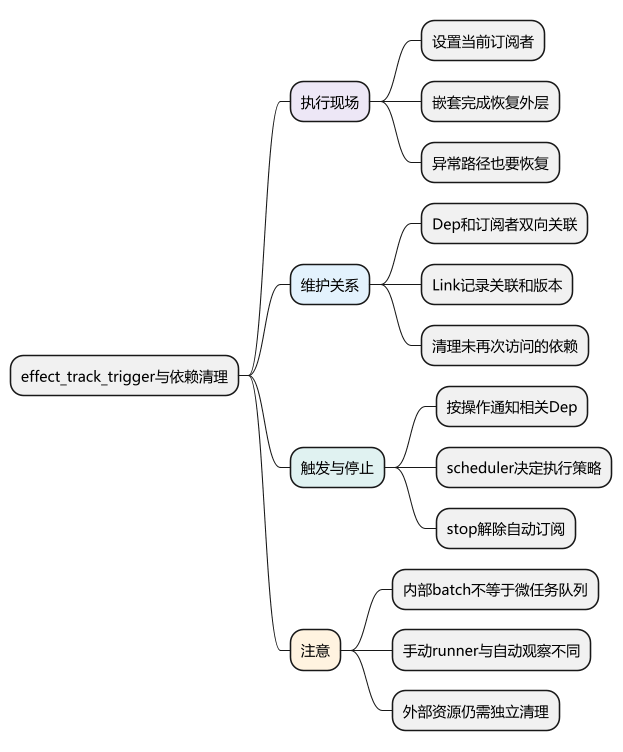
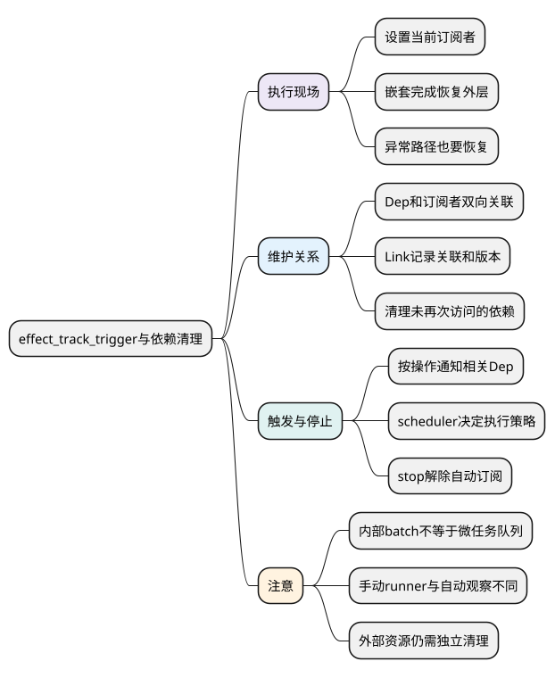
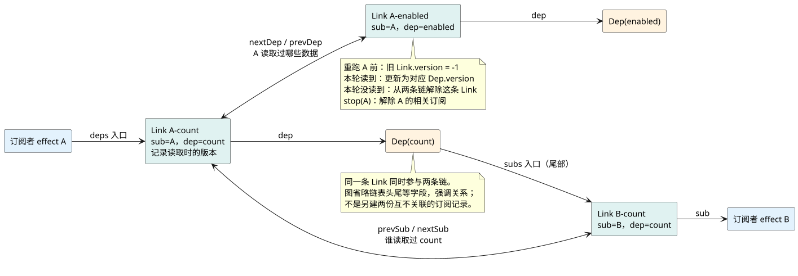

# effect_track_trigger与依赖清理

**本篇在主线中解释什么：** 前两篇解释了“读取从哪里进来”；本篇解释“这次读取属于谁”。在[统一主例](examples/runtime-mainline.mjs)中，同一个 count 被 watch、computed 和根组件 render 使用，它们的订阅关系必须分别保存。

当根渲染 effect 执行 render 时，它是当前订阅者；读取 `doubled.value` 又进入 computed 求值，当前订阅者会切换，求值后恢复。这样 count 的来源依赖属于 computed，doubled 的消费依赖属于根 render，根 render 直接读取 count 的关系也能同时保留。

看 `ReactiveEffect.run` 的追踪现场、`Dep.track` 的 Link，再看通知进入组件 scheduler 的位置。`prepareDeps` 与 `cleanupDeps` 使记录反映本次实际读取；版本检查帮助判断已通知的任务是否仍需执行，不能把收到通知直接等同于 render 一次。

阅读前提：[ref 与依赖追踪](07_ref与依赖追踪.md)。本例的同步 setup 观察与组件效果归属于组件作用域；`app.unmount()` 停止它们后，外部闭包即使仍握着 count，也不应继续驱动已卸载界面。

<!-- core-mindmap:start -->
[](examples/vsr04-mindmap.svg)

<details>
<summary>PlantUML 源码</summary>



</details>

<!-- core-mindmap:end -->

**口述总览：** 依赖图需要双向关系：从某数据找到订阅者，也从订阅者找到曾经读取的数据。这样才能重新收集分支、停止effect并避免无效通知。

源码基线：**Vue v3.5.43**。区分公开行为、这个版本的内部实现与本文教学模型；代码块各自独立，使用 Vue 包的例子在安装相应版本的 Node ESM 或前端工程中运行。

<a id="k01"></a>

## ReactiveEffect.run：建立并恢复追踪现场

[ReactiveEffect.run](https://github.com/vuejs/core/blob/v3.5.43/packages/reactivity/src/effect.ts)依次处理活动状态、清理、准备依赖，将activeSub设为当前订阅者，然后执行fn；finally清理未用依赖并恢复外层activeSub/shouldTrack。

只设一个全局变量而不恢复会让嵌套执行后外层读错订阅目标；异常同样必须恢复。run与runIfDirty不同，后者先判断依赖版本是否真正使结果脏。

```js
import { reactive, effect, stop } from 'vue';
const state = reactive({ n: 0 });
let runs = 0;
const runner = effect(() => { runs++; return state.n; });
state.n = 1;
stop(runner);
state.n = 2;
console.log(runs, runner()); // 2 2；手动runner仍可运行，已停止自动订阅。
console.log(runs); // 3
```

停止后的runner手动调用与继续自动观察是两回事。

<a id="k02"></a>

## Dep 与 Link：用双向关系记录依赖

本版本[Link](https://github.com/vuejs/core/blob/v3.5.43/packages/reactivity/src/dep.ts)表示一个Dep与一个订阅者之间的关系，同时参加两条双向链。一条从订阅者遍历其deps，一条从Dep遍历subs。

```text
effect A → Link(A,count) → Dep(count)
        → Link(A,enabled) → Dep(enabled)

Dep(count) → Link(A,count)、Link(B,count) 等订阅关系
```

prepareDeps将旧链接版本标为未使用；实际读取时恢复/更新版本；cleanupDeps移除仍未使用的链接。不是每轮必须删空全部Set再重新分配所有关系，教学实现与优化源码要分开。

<!-- understanding-flow: vsr04-dep-links:start -->
<details>
<summary>PlantUML 源码</summary>



</details>

<!-- understanding-flow: vsr04-dep-links:end -->

<a id="k03"></a>

## 分支切换：移除本轮未读取的旧依赖

```js
import { reactive, effect, stop } from 'vue';
const state = reactive({ enabled: true, left: 1, right: 10 });
const seen = [];
const runner = effect(() => seen.push(state.enabled ? state.left : state.right));
state.enabled = false;
state.left = 2;
state.right = 20;
console.log(seen); // [1,10,20]
stop(runner);
```

首次订阅enabled和left；切换后读取enabled和right，left旧关系被移除，所以left=2不重跑。若漏清理，结果也许看上去仍正确，但多出无用执行与保留链，性能和生命周期都受影响。

<a id="k04"></a>

## trigger、batch、scheduler：分开发现变化与执行

trigger按对象/键/操作类型找到需要通知的Dep，Dep版本和globalVersion帮助脏检查。notify会考虑RUNNING、ALLOW_RECURSE、NOTIFIED等标志，将工作纳入响应式批次。

响应式内部batch不是组件微任务队列的同义词：endBatch协调订阅通知，而有scheduler的effect交给scheduler；组件scheduler再queueJob，未配置scheduler的普通effect可能直接检查并执行。

不要从effect同步例子推断DOM同步更新，也不要从nextTick例子推断所有Dep通知一定延后一帧。

<a id="k05"></a>

## 实现验证：检查停止、恢复与资源归属

迷你Vue篇提供普通对象的最小依赖图实现，刻意使用Set便于理解；不复刻Link和版本优化。验证应包括分支清理、不同对象同名键、嵌套恢复、异常恢复、停止后不自动运行和同值赋值。

effectScope将一批效果关联到所有者；组件卸载会停止所属响应式效果，但自建timer/外部连接仍需清理。活动订阅与外部资源是相关而不同的两种生命周期。

### effectScope：按所有者一起停止观察与清理

在活动 scope 中同步创建的 watcher 可以一起停止；`onScopeDispose` 用于登记这个作用域结束时的资源清理。它适合组合式函数或组件外的一组相关观察，避免调用方分别记住很多停止函数。

<!-- example: v3review-source04-scope -->
```js
import { effectScope, onScopeDispose, ref, watchEffect } from 'vue';
const n = ref(0), events = [];
const scope = effectScope();
scope.run(() => {
  watchEffect(() => events.push(n.value), { flush: 'sync' });
  onScopeDispose(() => events.push('disposed'));
});
n.value = 1;
scope.stop();
n.value = 2;
console.log(events); // [0, 1, 'disposed']
```

`scope.run` 结束后会恢复外层作用域，普通 `await` 或 timer 之后再创建的观察不会自动回到先前的 scope。嵌套且未脱离的子 scope 跟随父级停止；`effectScope(true)` 创建脱离父级的 scope，需要自己管理。组件同步 setup 中的观察已有组件作用域，通常不用再手动包一层。

源码入口是 [EffectScope.run/stop](https://github.com/vuejs/core/blob/v3.5.43/packages/reactivity/src/effectScope.ts)。自动停止 watcher 并不等于浏览器能猜到需要关闭哪个 WebSocket；应在清理回调中明确取消自己创建的资源。

下一篇把这些关系落实到[computed 与 watch](09_computed与watch.md)：前者如何既订阅来源又被 render 订阅，后者为什么初次读值不等于初次调用回调。任务实际何时执行，接着由[Scheduler](10_Scheduler与nextTick.md)解释。

<a id="summary"></a>

## 复述要点

run建立追踪现场，track维护双向关系，清理移除失效分支，trigger通知，scheduler决定执行策略。源码优化关系存储，教学实现帮助证明必要行为。

<a id="interview"></a>

## 试题

<a id="vsr05-01"></a>

### VSR05-01 [P0·原理] 为什么依赖要能从effect反查？

**回答：** 分支变化或stop时需要找到这个effect曾订阅的所有Dep并解除关系。只有key→effect集合会让清理困难或被迫全图扫描。

对应讲解：[Dep、Link 与版本标记](#k02)。

<a id="vsr05-02"></a>

### VSR05-02 [P0·原理] 分支切换后为何不能保留所有旧依赖？

**回答：** 旧字段不再影响结果，却仍会触发计算并保留关系；应让依赖反映最近执行读取。示例中关闭左分支后修改left不应重跑。

对应讲解：[分支切换的推导](#k03)。

<a id="vsr05-03"></a>

### VSR05-03 [P1·源码] Vue3.5怎样知道哪条旧依赖未再次读取？

**回答：** 通过Link版本标记准备旧依赖，运行时访问更新，最后清掉未使用链接；这是具体版本机制，不等于所有实现都采用删空Set模型。

对应讲解：[Dep、Link 与版本标记](#k02)。

<a id="vsr05-04"></a>

### VSR05-04 [P1·源码] 内部batch与queueJob有何区别？

**回答：** batch协调响应式订阅通知，组件queueJob管理运行时更新队列和flush。effect可有不同scheduler，两层不能一概称为同一微任务。

对应讲解：[trigger、batch 与 scheduler](#k04)。

<a id="vsr05-05"></a>

### VSR05-05 [P0·原理] stop后为什么手动runner还执行？

**回答：** 停止自动订阅不等于删除函数，手动调用可以运行fn但不恢复原自动追踪契约。还要检查外部资源是否单独清理。

对应讲解：[ReactiveEffect.run 的执行现场](#k01)。

<a id="vsr05-06"></a>

### VSR05-06 [P1·验证] 最小依赖实现应怎样验证，而不只看计数器变了？

**回答：** 用不同对象同名键验证隔离，用分支切换验证旧依赖清理，用嵌套执行和异常验证活动订阅者恢复，再测同值赋值、stop和排队后停止。计数器单一成功例子无法暴露这些关系与生命周期错误。教学实现通过这些检查，也不代表实现了所有集合和源码优化。

对应讲解：[实现练习与停止验证](#k05)。

<a id="vsr05-07"></a>

### VSR05-07 [P1·工程取舍] effectScope 解决什么问题，为什么停止后还要清理外部资源？

**回答：** 它把一组同步创建的响应式观察关联到共同所有者，停止 scope 时一起停止，并执行登记的清理回调。框架能解除订阅，却不能自动推断任意定时器、连接或请求的归属，因此需要用 onScopeDispose 等明确清理。异步等待后新建的观察和脱离父级的 scope 也要单独管理。

对应讲解：[停止、恢复与资源归属](#k05)。
