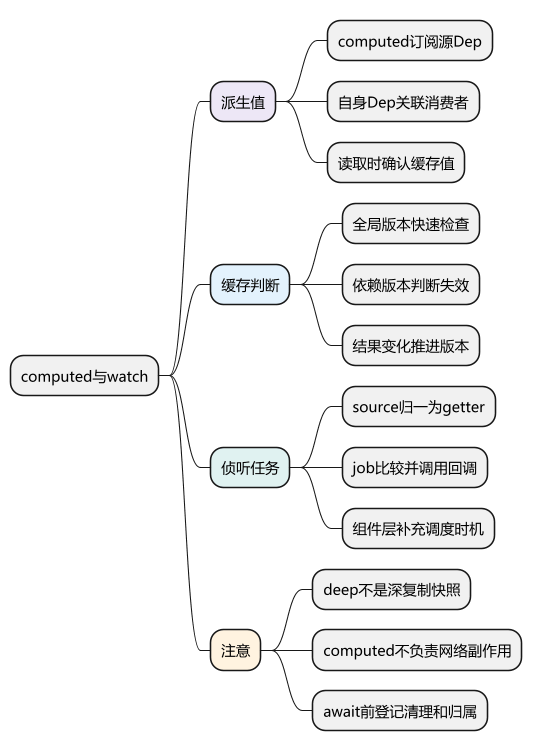
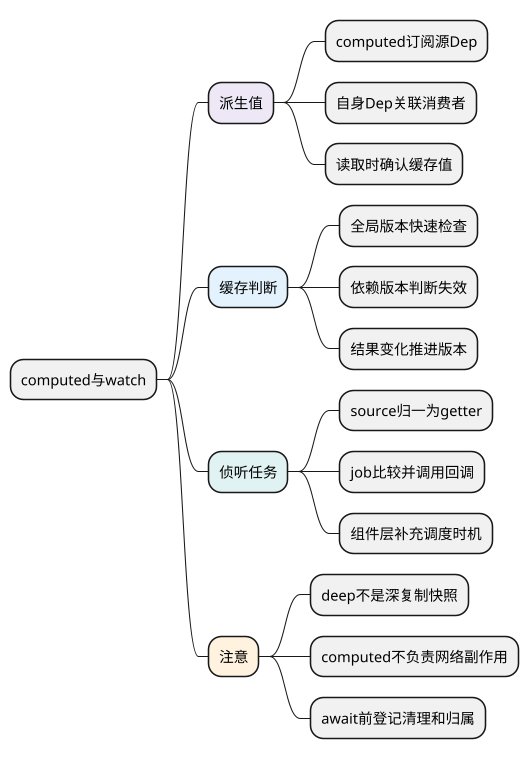
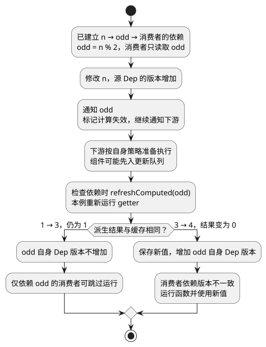

# computed与watch

**本篇在主线中解释什么：** [统一主例](examples/runtime-mainline.mjs)同时使用 `computed(() => count.value * 2)` 和 `watch(count, ..., { flush: 'pre' })`，可以直接比较两条路径。创建 computed 时尚未运行它的 getter；创建默认 watch 时会读来源取得旧值 0，但不会立即调用回调。

首次根 render 读取 `doubled.value`，才出现 `computed:evaluate`，并建立 count → doubled → 根 render 的关系。连续三次 `increment()` 后，count 已是 3；在没有其他插入读取的本例中，doubled 不会因每次赋值都立即计算一遍。

后续 flush 中，watch 回调记录 `watch:0->3`，在所属根组件更新前执行；根更新读取 doubled 时确认新结果 6，并把它作为子组件的 `value` prop。watch 初始化的 getter、更新时的 callback 和 computed getter，是三个不同执行点。

阅读前提：[effect 与依赖清理](08_effect_track_trigger与依赖清理.md)。主例的根 render 还直接读取 count，因此即使把计算改成结果不变的表达式，也不能据此断言整个根组件一定跳过更新；下面的缓存实验特意只消费 computed。

<!-- core-mindmap:start -->
[](examples/vsr05-mindmap.svg)

<details>
<summary>PlantUML 源码</summary>



</details>

<!-- core-mindmap:end -->

**口述总览：** computed产出派生值，watch管理副作用；它们都依赖追踪，却有不同失效、比较和调度流程。沿各自返回值与生命周期理解，而不把二者统称为一个自动回调。

源码基线：**Vue v3.5.43**。区分公开行为、这个版本的内部实现与本文教学模型；代码块各自独立，使用 Vue 包的例子在安装相应版本的 Node ESM 或前端工程中运行。

<a id="k01"></a>

## computed：同时订阅来源并提供依赖

本版本[ComputedRefImpl](https://github.com/vuejs/core/blob/v3.5.43/packages/reactivity/src/computed.ts)本身实现Subscriber，读取源数据时订阅源Dep，同时有自己的dep供使用者订阅。源码中的effect:this是兼容入口，不能说它内部必然包着旧教程那种独立ReactiveEffect实例。

```text
源state.n的Dep → computed订阅者
computed自己的Dep → 渲染effect/其他订阅者
```

.value getter先登记使用者，再refreshComputed确认值；setter只在可写computed提供时执行。源变化主要使计算失效，不代表立刻无条件重新渲染所有消费者。

<a id="k02"></a>

## 缓存与版本：确认结果是否真正变化

```js
import { ref, computed, effect, stop } from 'vue';
const n = ref(1);
let calculations = 0, runs = 0;
const odd = computed(() => { calculations++; return n.value % 2; });
const runner = effect(() => { runs++; return odd.value; });
n.value = 3;
console.log(calculations, runs); // 2 1：重新确认后派生结果相同。
n.value = 4;
console.log(calculations, runs); // 3 2
stop(runner);
```

[refreshComputed](https://github.com/vuejs/core/blob/v3.5.43/packages/reactivity/src/effect.ts)使用globalVersion快速路径，再结合具体依赖版本决定是否执行getter；新结果改变才推进其dep的版本。全局有变化不代表每个computed都必须重算，最终对象每次新建也会破坏值身份稳定性。

这是本版本普通非SSR观察场景。Date.now不是响应式源，computed也不应做网络副作用。

**通知与重新执行是两步。** 源数据变化时，computed 会先标记失效并向自己的订阅者传播通知；下游检查是否真的需要运行时，再通过 `refreshComputed` 确认结果。结果未变可以跳过下游函数，但不能说“从来没有通知过下游”。组件的检查还可能发生在已经排队的 job 执行时。

<!-- understanding-flow: vsr05-computed-validation:start -->
<details>
<summary>PlantUML 源码</summary>



</details>

<!-- understanding-flow: vsr05-computed-validation:end -->

图限定于上面的正常返回、仅消费 odd 的例子；如果消费者同时直接读取 n，它还会受到 n 的变化影响。getter 抛错、SSR 与未被消费的 computed 有自己的分支，不能把这张流程图当所有路径的完整源码。

<a id="k03"></a>

## watch：把数据源转换为getter和任务

[watch](https://github.com/vuejs/core/blob/v3.5.43/packages/reactivity/src/watch.ts)把ref、reactive、getter或多source归一为getter，建立ReactiveEffect。job读取newValue，检查deep/forceTrigger/变化规则，执行清理和callback，维护oldValue。

watch默认先执行getter获取初值而不调用cb，immediate改变首次回调。deep通过遍历接触属性形成更多依赖；new/old可能同一对象，它不是深复制快照。watchEffect则把副作用函数作为主要运行逻辑，自动收集同步读取。

[doWatch](https://github.com/vuejs/core/blob/v3.5.43/packages/runtime-core/src/apiWatch.ts)进一步接入组件错误处理与pre/post/sync scheduler，所以reactivity底层watch和组件层公开时机不能混为同一层。

<a id="k04"></a>

## cleanup：在失效前登记异步清理

```js
import { ref, watch, nextTick } from 'vue';
const source = ref(0), events = [];
const stop = watch(source, (n, old, onCleanup) => {
  events.push('run:' + n);
  onCleanup(() => events.push('clean:' + n));
});
source.value = 1; await nextTick();
source.value = 2; await nextTick();
stop();
console.log(events); // ['run:1','clean:1','run:2','clean:2']
```

清理在新副作用开始前或停止时执行。网络请求应在await前登记AbortController与active/version保护；取消不保证迟到结果不存在。onWatcherCleanup要求同步调用，回调参数onCleanup有绑定差异，但也应及早登记防错过失效时点。

到这里已经知道通知对象与派生值确认方式，下一篇进入[Scheduler 与 nextTick](10_Scheduler与nextTick.md)，按主例的三次同步赋值分析为什么只安排一批更新、pre watcher 为什么先于所属组件更新。

<a id="summary"></a>

## 复述要点

computed是可缓存的订阅者兼依赖源，watch是getter加副作用job。缓存看版本和结果，副作用看清理与归属，组件时机由runtime-core补齐。

<a id="interview"></a>

## 试题

<a id="vsr06-01"></a>

### VSR06-01 [P0·原理] computed为什么能成为另一个computed的依赖？

**回答：** 它既读取源Dep，也暴露自己的dep供消费者收集。.value读取先建立消费关系，再按需要刷新，因此可以组成依赖链。

对应讲解：[computed既订阅又被订阅](#k01)。

<a id="vsr06-02"></a>

### VSR06-02 [P1·源码] 源数据变了，为什么computed消费者可能不重跑？

**回答：** 本版本会按依赖版本刷新并比较派生结果，如果结果没变，可避免下游不必要执行。每次返回新对象则可能破坏这一稳定性，不能只看源赋值次数。

对应讲解：[缓存、版本与稳定结果](#k02)。

<a id="vsr06-03"></a>

### VSR06-03 [P0·原理] deep watch为什么newValue与oldValue可能相同？

**回答：** deep通过遍历建立依赖，不自动克隆数据；嵌套写入未替换根对象时两者可同引用。要历史差异需另设计快照或领域事件。

对应讲解：[watch 的 source、getter、job](#k03)。

<a id="vsr06-04"></a>

### VSR06-04 [P0·原理] watch cleanup应该放在await之后吗？

**回答：** 应在等待前登记，让失效能及时取消并阻止旧结果提交。onWatcherCleanup本身要求同步阶段，晚登记也可能错过本应清理的时点。

对应讲解：[cleanup 的登记时机与异步归属](#k04)。
