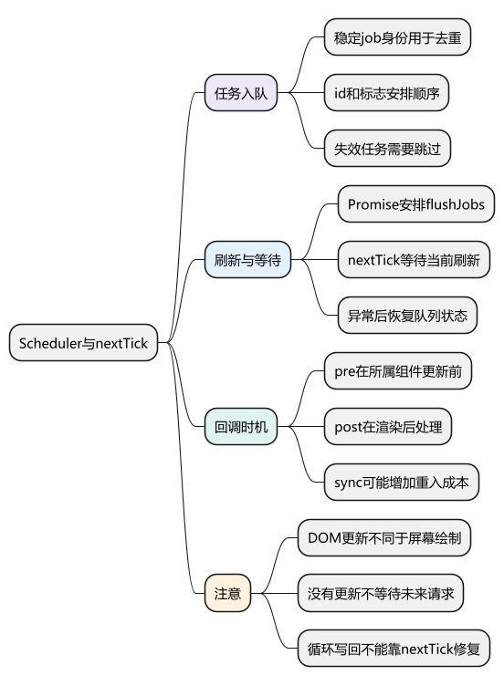
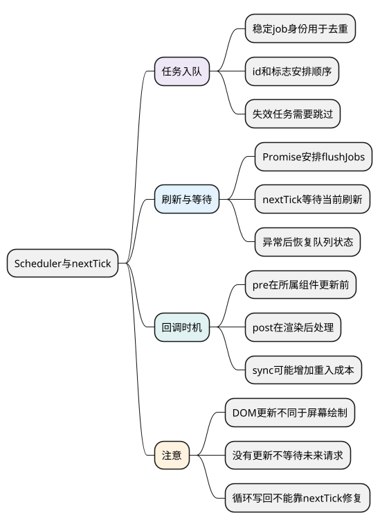
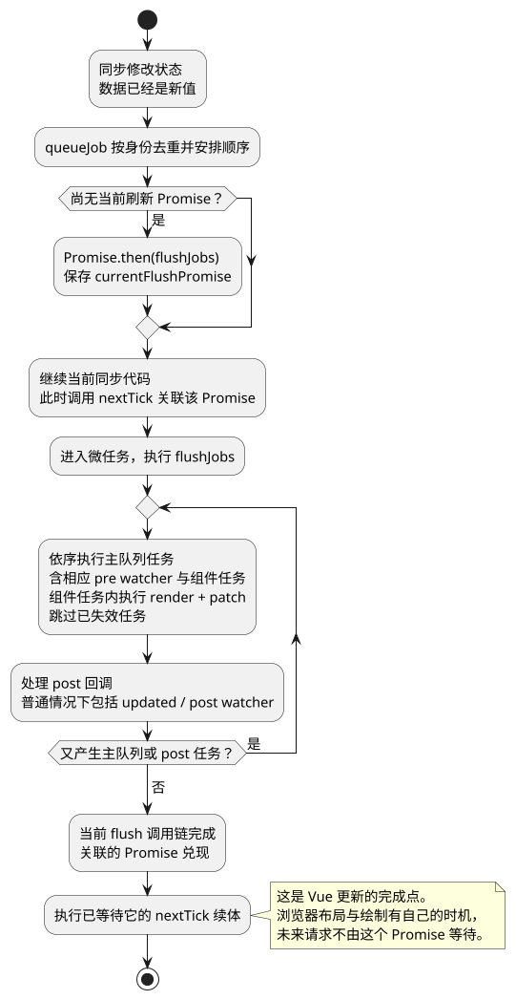

# Scheduler与nextTick

**主线位置：** 前一篇 [computed 与 watch](09_computed与watch.md) 已解释状态变化如何让订阅者需要工作。本篇继续追踪主例连续三次 increment 后，工作怎样合并并运行；下一篇 [组件更新与卸载流程](11_组件更新与卸载流程.md) 再进入组件 job 内部。

共同例子见 [运行主线演示](examples/runtime-mainline.html) 与 [示例源码](examples/runtime-mainline.mjs)。要区分“状态已写入”“更新已排队”“render 与 patch 已完成”“浏览器已绘制”，它们不是同一个时间点。

<!-- core-mindmap:start -->
[](examples/vsr06-mindmap.svg)

<details>
<summary>PlantUML 源码</summary>



</details>

<!-- core-mindmap:end -->

**口述总览：** 调度器组织的是带身份和顺序的任务，nextTick等待相应flush Promise。把代码中的队列、标志与Promise关联起来，才知道等待保证到哪一步。

源码基线：**Vue v3.5.43**。区分公开行为、这个版本的内部实现与本文教学模型；代码块各自独立，使用 Vue 包的例子在安装相应版本的 Node ESM 或前端工程中运行。

<a id="mainline-scheduling"></a>

## 主例连续加三次：从写入走到 DOM 更新

调用 increment 时，count 的 ref setter 先写入新值并通知依赖。这一段是同步执行的；响应式层通过 Dep、订阅者通知与 batch 协调触发，computed 会被标记需要检查，其订阅者也会获知变化。**响应式层的 batch 和运行时异步更新队列是不同层次的机制**：前者协调一轮通知，组件 effect 的 scheduler 才把稳定 job 交给 `queueJob`。

主例的 `watch(count, ..., { flush: 'pre' })` 也会安排任务。三次 increment 属于同一段同步代码，count 立即从 0 变成 3；相同的 watcher job 和组件 job 通过 QUEUED 标志去重，不会为了三个中间值逐次更新 DOM。随后调度器在 Promise 微任务中运行待办工作，主例观察到一次 `watch:0->3`，根 render 重新读取 doubled 得到 6，再通过 patch 把变化交给子组件。

这条线是 **写入 → 依赖通知 → queueJob → flushJobs → render / patch → 后渲染回调**。`nextTick()` 不是其中必须执行的一站，它只是让调用者等待当前刷新对应的 Promise；删除 nextTick，Vue 仍会更新，只是你的下一句代码没有等待。

<!-- example: v3line10-batched-update -->
```js
import { nextTick } from 'vue';
import { createMainlineApp } from './examples/runtime-mainline.mjs';

const events = [];
const { app, increment, readCount } = createMainlineApp(event => events.push(event));
const container = document.createElement('div');
document.body.append(container);
app.mount(container);
events.length = 0;

increment();
increment();
increment();
console.log(readCount()); // 3，写入已经完成
console.log(events.includes('root:render')); // false，组件尚未重新 render

await nextTick();
console.log(events.filter(event => event === 'watch:0->3').length); // 1
console.log(events.filter(event => event === 'root:render').length); // 1
console.log(events.includes('root:updated')); // true

app.unmount();
container.remove();
```

例子限于初始 count 为 0 的新实例、同步父子组件，且本轮没有其他代码继续修改 count。watch 的合并行为不能套到 `flush: 'sync'` 上，读取 computed 也可能提前触发计算；实际成本应结合访问位置和依赖关系判断。

接下来定位三个源码位置即可：响应式包中的 `Dep.notify` / batch、`setupRenderEffect` 设置的 `effect.scheduler`、调度器中的 `queueJob` / `flushJobs`。把这三个入口连起来，再看队列细节，比背“异步更新”四个字更容易解释行为。

<a id="k01"></a>

## queueJob：按任务身份去重并排序

[queueJob](https://github.com/vuejs/core/blob/v3.5.43/packages/runtime-core/src/scheduler.ts)检查QUEUED标志去重，通过job.id及PRE标志安排插入位置；常见组件任务id来自instance.uid，使父创建在前的更新有序。

pre watcher可使用所属组件uid和PRE标志，在相应组件更新前执行。父更新若卸载子组件，可以跳过子已失效任务。队列不是将函数源码相同就认为同一个任务，而依赖稳定job引用及标记。

最小Set队列可以展示去重，但缺少父子顺序、post回调、递归限制与失效处理；迷你Vue篇会明确这个差距。

<a id="k02"></a>

## flush 与 nextTick：连接队列和等待点

queueFlush在没有currentFlushPromise时设为resolvedPromise.then(flushJobs)。nextTick选取currentFlushPromise或一个已兑现Promise，再按需then回调。源码关键在[nextTick/queueFlush/flushJobs](https://github.com/vuejs/core/blob/v3.5.43/packages/runtime-core/src/scheduler.ts)。

```js
import { ref, watch, nextTick } from 'vue';
const n = ref(0), seen = [];
const stop = watch(n, v => seen.push(v));
n.value = 1; n.value = 2;
console.log(n.value, seen.length); // 2 0
await nextTick();
console.log(seen); // [2]
stop();
```

先修改状态再等待当前更新；没有排队更新时nextTick不会等一个未来的网络请求。flush期间新增任务需继续处理，异常路径也需复位队列标志，否则后续更新可能永远被误判为已入队。

<!-- understanding-flow: vsr06-flush-order:start -->
<details>
<summary>PlantUML 源码</summary>



</details>

<!-- understanding-flow: vsr06-flush-order:end -->

图描述普通组件更新主线，pre 与组件任务按所属实例关系组织，并非“先执行全站所有 pre，再更新全部组件”。post 期间新增的工作仍可能继续刷新；尚未就绪的 Suspense 边界也可能暂存后渲染效果，不能认为一次 nextTick 保证整个应用所有异步组件已完成。

<a id="k03"></a>

## pre、post、sync：限定回调执行阶段

组件 setup 中创建的默认 pre watcher 在所属组件 DOM 更新前的相应位置执行，post走后渲染回调路径，sync同步触发并可能承担高频和重入成本。[scheduler/augmentJob](https://github.com/vuejs/core/blob/v3.5.43/packages/runtime-core/src/apiWatch.ts)给watch job补齐这些行为。

“post先于updated还是某回调先”要按具体父子关系和入队位置分析，不能写一张对所有嵌套情况绝对成立的扁平顺序表。异步组件和Suspense也会影响后渲染效果队列。

内存中的state已改、组件render完成、DOM已patch、浏览器已paint是不同阶段。

<a id="k04"></a>

## 递归更新：修正数据循环而非增加延迟

Vue开发调度器有递归更新检查，但它不是业务循环的正确终止条件。updated中无条件改同一状态、watch相互写回可能产生循环，应修正数据来源而不是增加nextTick。

nextTick不减少重计算，也不保证浏览器绘制。需要帧时机用合适浏览器API并考虑后台暂停；需要等图片、动画、网络则使用各自完成信号。

排查读旧DOM先验证响应式依赖、目标是否存在与ref生命周期，再检查flush；乱加timer只会让错误暂时难复现。

<a id="summary"></a>

## 复述要点

queueJob用稳定身份与顺序组织工作，queueFlush安排Promise，nextTick连接flush完成点。公开保证是Vue更新时机，不是所有异步与浏览器绘制。

<a id="interview"></a>

## 试题

<a id="vsr07-01"></a>

### VSR07-01 [P0·原理] nextTick与setTimeout(0)为何不同？

**回答：** nextTick关联当前Vue flush Promise，timer只是宿主任务调度。二者碰巧常在更新后执行不等于保证相同，网络和绘制也不由nextTick包办。

对应讲解：[flush 与 nextTick 的连接](#k02)。

<a id="vsr07-02"></a>

### VSR07-02 [P1·源码] 为何调度器关心父子组件id顺序？

**回答：** 父先创建的uid通常较小，排序支持父先更新，父卸载子后可跳过无效子任务。pre标志还让所属watcher位于组件更新前。

对应讲解：[queueJob 与任务身份](#k01)。

<a id="vsr07-03"></a>

### VSR07-03 [P0·原理] sync watcher是不是更准确？

**回答：** 只是更早同步执行，缺少同样批处理优势，高频写入或互相触发成本更高。按副作用需要选时机，不以越早越好评价。

对应讲解：[pre、post、sync 的范围](#k03)。

<a id="vsr07-04"></a>

### VSR07-04 [P0·原理] nextTick之后是否一定已经看见屏幕新像素？

**回答：** 不保证，它等待Vue更新流程相关完成点，浏览器绘制、图片和动画有独立时机。DOM可读取与已经paint要分开。

对应讲解：[递归与误用排查](#k04)。
