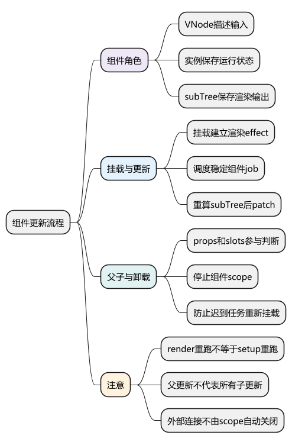
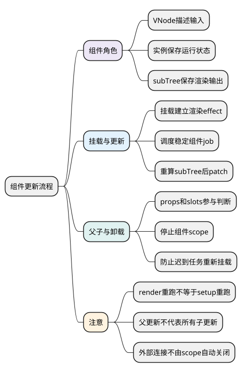
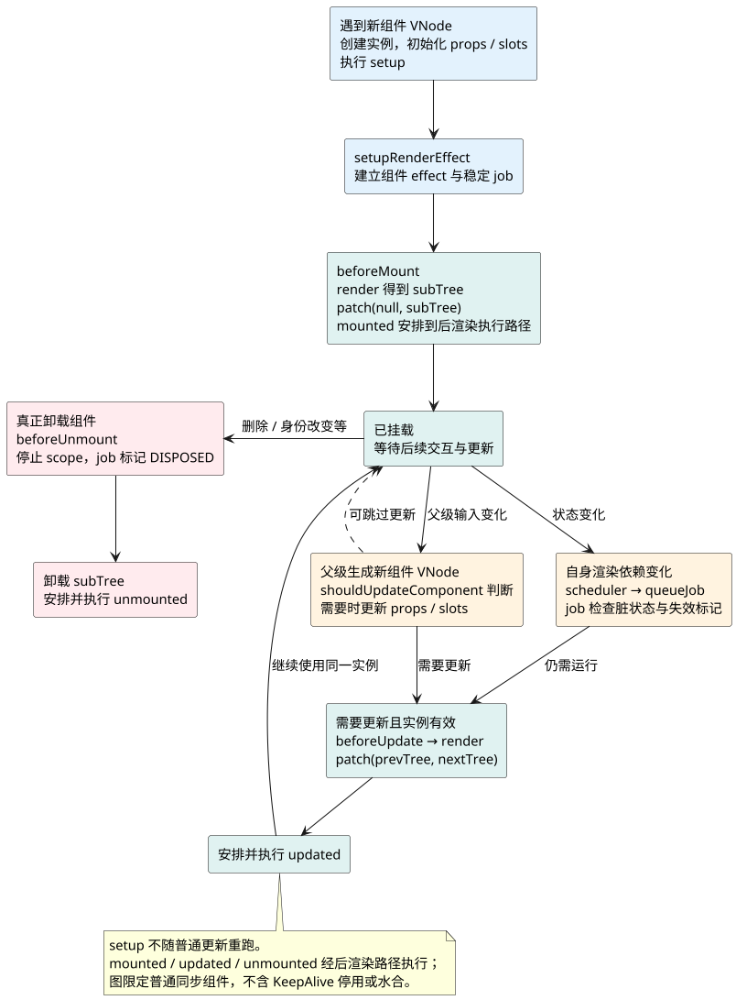

# 组件更新与卸载流程

**主线位置：** 上一篇 [Scheduler 与 nextTick](10_Scheduler与nextTick.md) 已经找到待执行的组件 job。本篇进入 job：沿同一个 componentUpdateFn 看首次、再次更新和最终卸载，再把旧、新子树交给下一篇 [Patch 与 Diff](12_Patch与Diff.md)。

共同例子见 [运行主线演示](examples/runtime-mainline.html) 与 [示例源码](examples/runtime-mainline.mjs)。根组件自身的 count 变化，与子组件收到新的 props.value，是本轮更新中的两种不同入口。

<!-- core-mindmap:start -->
[](examples/vsr09-mindmap.svg)

<details>
<summary>PlantUML 源码</summary>



</details>

<!-- core-mindmap:end -->

**口述总览：** 组件VNode、组件实例与渲染subTree是三个对象。跟踪首次挂载和再次更新怎样复用它们，就能解释setup次数、父子props变化与卸载清理。

源码基线：**Vue v3.5.43**。区分公开行为、这个版本的内部实现与本文教学模型；代码块各自独立，使用 Vue 包的例子在安装相应版本的 Node ESM 或前端工程中运行。

<a id="mainline-update"></a>

## 先找到分支：同一实例有首次和后续两条路径

`setupRenderEffect` 为实例创建 ReactiveEffect，将真正的工作函数设为 `componentUpdateFn`。它不是每次都创建组件：`instance.isMounted` 还为 false 时走首次挂载；已经挂载时走更新分支。实例初始化与 setup 的细节见 [createApp 与首次挂载](02_createApp与首次挂载.md)、[组件初始化与 setup](03_组件初始化与setup.md)，这里把注意力放在 effect 运行之后。

首次运行调用 `instance.update()`，由 effect.run 进入工作函数，读取状态时建立渲染依赖，得到并挂载 subTree。后续自身依赖变化时，scheduler 排队的是 `instance.job`，它绑定 effect.runIfDirty：任务执行前会先检查是否仍需要运行，组件卸载导致的 DISPOSED 标志则由调度器处理。`update` 与 `job` 都连接同一个 effect，但入口职责不同。

主例中，根 render 读取 count / doubled 并创建 CounterValue 的 VNode。更新后根的 prevTree 与 nextTree 是两次渲染结果；**根组件实例不变，setup 不重跑，子树描述会更新**。DOM 是否复用要等 patch 比较对应节点后决定，不能用“render 调用了”推断“DOM 全部重建”。

<a id="k01"></a>

## 首次挂载：区分组件VNode、实例和subTree

组件VNode描述父级给该组件的type、props、slots和key；组件实例保存运行状态、setup结果、作用域与effect；subTree是此组件render生成的子树。

```text
patch遇组件 → processComponent → mountComponent
  → createComponentInstance
  → setupComponent（props/slots/setup等）
  → setupRenderEffect
  → componentUpdateFn首次分支
  → renderComponentRoot → patch(null, subTree) → mounted相关任务
```

源码看[createComponentInstance/setupComponent](https://github.com/vuejs/core/blob/v3.5.43/packages/runtime-core/src/component.ts)及[mountComponent/setupRenderEffect](https://github.com/vuejs/core/blob/v3.5.43/packages/runtime-core/src/renderer.ts)。render函数可能多次运行，普通setup并不因每次状态修改重新执行。异步setup还有Suspense/占位等路径，不能把同步图覆盖全部情况。

<a id="k02"></a>

## 状态变化：进入稳定组件任务并重新渲染

setupRenderEffect创建实例的ReactiveEffect，组件render读取数据时收集它，scheduler将稳定job放队列。实例update绑定effect.run，job绑定runIfDirty并带uid等信息，支持调度和脏检查。

再次执行componentUpdateFn时，取得prevTree、重新render得到nextTree，再patch(prevTree,nextTree)。patch尽量复用宿主节点，不是setup全重跑或DOM整页重建。

mounted安排在初次挂载后，updated对应更新路径；钩子执行时还会暂停不应收集的追踪，不能把钩子里所有读取都当组件渲染依赖。

<a id="k03"></a>

## 父级输入变化：判断是否需要子组件更新

父render产生同类型/key的新组件VNode，updateComponent将实例关联到新VNode，并通过shouldUpdateComponent等检查props/slots和优化信息。需要时准备next并运行更新路径，刷新props和slots。

子组件自己的响应式变化不依赖父组件必须先render；父重新render也不代表每个子组件都完整更新。稳定props、编译标志与slots影响判断，不可用一句“父动子全动”解释。

如果props对象每次新建但含义一样，可能扩大更新；应该从数据契约改善身份，而不是到处强制缓存。

### 沿主例下钻：父更新怎样带动子组件

根组件的 job 开始后，先执行根 beforeUpdate，再 render 得到新的 CounterValue VNode，其中 value 从 0 变为 6。父子树 patch 到这个 VNode 时，`updateComponent` 先复用旧 VNode 关联的子实例；`shouldUpdateComponent` 确认输入需要更新后，设置 `instance.next`，并直接调用子实例的 `instance.update()`。

子更新分支看到 next，会先通过 `updateComponentPreRender` 刷新 vnode、props、slots，并处理该子组件待执行的 pre watcher，随后进入子 beforeUpdate → render → patch。这里不能画成“父 patch 完成后，必然把子组件再排进下一轮队列”：普通同步父级输入更新可以在当前 patch 调用链内推进。子组件自身依赖触发的任务若也已排队，还需要由去重和脏检查协调，避免把两种入口机械计为两次有效更新。

若父 render 重跑但传给子的 props 没变，slots 与编译标志也允许跳过，`shouldUpdateComponent` 可以返回 false，此时继续复用实例、更新 VNode 关联即可。若子组件有自己的 ref 并只在子 render 使用，子也可以自行更新，而不要求父 render 先运行。这就是“父级输入变化”和“自身依赖变化”必须分开讲的原因。

源码继续看 [updateComponent / updateComponentPreRender](https://github.com/vuejs/core/blob/v3.5.43/packages/runtime-core/src/renderer.ts) 以及 [shouldUpdateComponent](https://github.com/vuejs/core/blob/v3.5.43/packages/runtime-core/src/componentRenderUtils.ts)。

<a id="k04"></a>

## 卸载：停止作用域并使排队任务失效

unmount组件会调用相应beforeUnmount，停止组件scope内的effect，标记任务失效并卸载subTree，再安排unmounted。应将同步setup创建的watcher和自建资源归属区分：容器能停效果，不自动懂你启动的所有timer/连接。

源码在[unmountComponent](https://github.com/vuejs/core/blob/v3.5.43/packages/runtime-core/src/renderer.ts)查scope.stop与job DISPOSED等路径。若在任务排队后立刻卸载，不应让迟到job再挂回DOM；测试应覆盖这个窗口。

SSR、hydrate、异步组件和KeepAlive分别有扩展路径，先掌握同步普通组件再深入。

<!-- understanding-flow: vsr09-component-lifetime:start -->
<details>
<summary>PlantUML 源码</summary>



</details>

<!-- understanding-flow: vsr09-component-lifetime:end -->

父级输入驱动的更新和自身依赖驱动的 job 可能在同一轮中汇合，源码会协调它们；不是每一条箭头都产生一次额外 render。图关注生命周期位置和两种更新入口，具体调度顺序见 [Scheduler 与 nextTick](10_Scheduler与nextTick.md)。

### 验证迟到任务：先排队，再立即卸载

共同例子还要覆盖最后一条分支：increment 已经安排根组件更新，此时立即调用 `app.unmount()`。应用卸载入口让 renderer 对根树执行 unmount；根 beforeUnmount 执行后，scope.stop 停止这个实例收集的 effect，job 标记 DISPOSED，再递归清理 subTree。子组件有各自的 scope 与钩子，也要沿相同卸载路径处理，最后运行相应 unmounted。

**停止依赖与阻止旧队列项运行是两件事。** 停止 effect 解决以后还会不会接收通知；DISPOSED 解决已经排队的组件工作到达执行位置时必须跳过。否则页面已经卸载，旧任务仍可能访问无效 DOM。

<!-- example: v3line11-unmount-queued-job -->
```js
import { nextTick } from 'vue';
import { createMainlineApp } from './examples/runtime-mainline.mjs';

const events = [];
const { app, increment } = createMainlineApp(event => events.push(event));
const container = document.createElement('div');
document.body.append(container);
app.mount(container);
events.length = 0;

increment(); // 根组件更新已经排队
app.unmount(); // 同一段同步代码内立即卸载
await nextTick();

console.log(container.childNodes.length); // 0
console.log(events.includes('root:render')); // false
console.log(events.includes('root:beforeUnmount')); // true
console.log(events.includes('root:unmounted')); // true
container.remove();
```

这个验证限定普通同步组件、没有退出动画。浏览器定时器、全局事件监听和外部连接不会因为停止 scope 就自动消失，应由所属组件的清理逻辑释放。KeepAlive 停用保留实例，不能套用这条真正卸载路径，详见 [生命周期与 KeepAlive](13_生命周期与KeepAlive.md)。

<a id="summary"></a>

## 复述要点

组件VNode给输入，实例保存运行，subTree给输出。挂载建立effect，更新重算并patch，卸载停scope和任务；setup执行与render执行不要混淆。

<a id="interview"></a>

## 试题

<a id="vsr10-01"></a>

### VSR10-01 [P0·原理] 每次组件更新都会重新执行setup吗？

**回答：** 普通组件实例首次初始化执行setup，后续响应式更新主要运行render effect并patch subTree。key/type改变而重建实例、异步或热更新另需限定场景。

对应讲解：[三个角色与首次挂载](#k01)。

<a id="vsr10-02"></a>

### VSR10-02 [P0·原理] 组件实例的VNode与subTree有什么区别？

**回答：** 前者代表父级对这个组件的描述和输入，后者是该组件render生成的实际子树；实例连接两者并保存effect和生命周期状态。

对应讲解：[三个角色与首次挂载](#k01)。

<a id="vsr10-03"></a>

### VSR10-03 [P0·原理] 父组件render后子组件一定完整更新吗？

**回答：** 不一定，需看组件身份、props/slots以及shouldUpdateComponent等优化判断；子自身依赖变化又可独立调度。不要用父子树关系取代具体更新条件。

对应讲解：[父级props更新与是否更新判断](#k03)。

<a id="vsr10-04"></a>

### VSR10-04 [P1·源码] 卸载为什么要标记已排队job失效？

**回答：** 停止依赖不一定移除已经排队的回调；执行前必须能跳过失效任务，避免卸载后重新写DOM或访问已释放资源。

对应讲解：[卸载与停止](#k04)。

<a id="vsr10-05"></a>

### VSR10-05 [P0·原理] 为什么组件更新job用稳定函数引用？

**回答：** 调度器需要识别同一个更新工作来去重和排序，每次新建无关闭包容易失去这种身份。实际源码将job与instance/effect关联并附标志。

对应讲解：[自身状态变化如何进入组件任务](#k02)。
