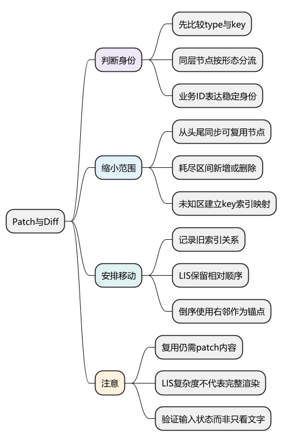
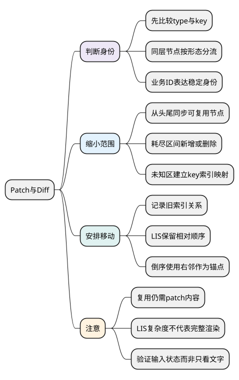
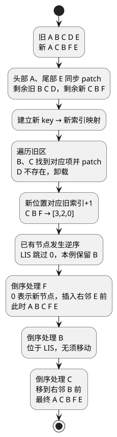

# Patch与Diff

**本篇在主线中解释什么：** [上一篇](11_组件更新与卸载流程.md)已经追到组件执行新 render 并把新旧子树交给 `patch`。本篇从这里继续：既然新旧 VNode 都有了，哪些真实节点能保留，哪些内容需要修改？

先看[统一主例](examples/runtime-mainline.mjs)：根 section 中仍是同位置的 button 和 CounterValue，更新后 button 的计数文本变化；子组件收到新的 value 后，自己的 p 文本变化。这里的节点类型与排列稳定，没有列表重排。

手写 render 的通用子节点比较可能进入 `patchKeyedChildren`，但本例能沿头部同步等简单路径完成，不会为了两个文本变化就进入未知区映射并计算 LIS。下文的 A、B、C 列表是刻意增加重排的扩展实验，用来解释主例没有触发的分支。

阅读前提：[VNode 与 Renderer](04_VNode与Renderer.md)、[组件更新与卸载流程](11_组件更新与卸载流程.md)。调试先停在 `patchElement`、`patchChildren`，观察实际分支后再进入列表算法。

<!-- core-mindmap:start -->
[](examples/vsr08-mindmap.svg)

<details>
<summary>PlantUML 源码</summary>



</details>

<!-- core-mindmap:end -->

**口述总览：** Diff要先判断身份，再对同层子节点选择复用、删除、新增与移动。这里跟随v3.5.43的patchKeyedChildren，用一个重排例子解释映射和最长递增子序列。

源码基线：**Vue v3.5.43**。区分公开行为、这个版本的内部实现与本文教学模型；代码块各自独立，使用 Vue 包的例子在安装相应版本的 Node ESM 或前端工程中运行。

<a id="k01"></a>

## 身份判断：按节点类型选择比较路径

patch并不是对任意整棵树直接跑LIS。元素、组件、Fragment等先分流，props和children采用对应路径；编译生成的标志可决定是否进入完整子节点比较。

[isSameVNodeType](https://github.com/vuejs/core/blob/v3.5.43/packages/runtime-core/src/vnode.ts)常用type与key判断身份，[patchChildren/patchKeyedChildren](https://github.com/vuejs/core/blob/v3.5.43/packages/runtime-core/src/renderer.ts)处理不同children形态。新旧type不同即使key相同也不能直接当同一元素复用。

稳定业务ID适合作为key，index在重排时表达位置而非业务身份，随机key导致频繁重建。

<a id="k02"></a>

## 头尾同步：缩小需要重排的未知区间

带key比较先从头同步可复用节点，再从尾同步。旧区间耗尽而新仍有剩余时新增；新耗尽而旧剩余时删除。只有两侧都存在未知区间才进入映射重排。

```text
旧：A B C D E
新：A C B F E
共同头A、共同尾E先处理
未知旧：[B C D]
未知新：[C B F]
```

建立新key→新索引映射后，遍历旧区：B对应新位置，C对应新位置，D不存在则卸载。记录新位置对应旧索引+1，0保留给全新节点F。已有节点依然需要patch内容，复用不是忽略属性变化。

<a id="k03"></a>

## LIS：保留可不移动的相对顺序

继续上一节的同一个例子。未知新区间是 C、B、F，按新顺序记录它们在旧完整列表中的索引+1，得到 `[3,2,0]`。0 表示新节点 F，不参与 LIS。这里递增子序列长度为 1，保留 B 或 C 都能只移动一个旧节点；下面的实现选中 B，于是移动 C。数字表示位置关系，不是节点文本大小。

下面返回LIS的索引，跳过0占位，仅用于理解序列步骤：

```js
function lisIndices(values) {
  const tails = [], previous = new Array(values.length).fill(-1);
  for (let i = 0; i < values.length; i++) {
    if (values[i] === 0) continue;
    let left = 0, right = tails.length;
    while (left < right) {
      const middle = (left + right) >> 1;
      if (values[tails[middle]] < values[i]) left = middle + 1;
      else right = middle;
    }
    if (left > 0) previous[i] = tails[left - 1];
    tails[left] = i;
  }
  const result = [];
  for (let i = tails.at(-1) ?? -1; i !== -1; i = previous[i]) result.push(i);
  return result.reverse();
}
console.log(lisIndices([3, 2, 0])); // [1]：新区间中索引1的B可以保留。
```

LIS部分为O(n log n)，不能把整个组件渲染、递归patch和浏览器布局都称作这个复杂度；无key回退查找也有不同成本。源码仅在检测到移动时计算序列。

<a id="k04"></a>

## 倒序处理：利用右侧锚点新增或移动

最后从新未知区尾部向前处理，右邻节点已确定，可作为插入锚点。0表示新节点，挂到锚点前；已有但不属于稳定序列的节点移动；属于序列的节点保留。

DOM insertBefore既可插入新节点，也能移动同一已有节点，不必先销毁再创建。移动组件要移动其实际子树，Fragment有范围，不能只拿一个el处理所有类型。

源码定位[newIndexToOldIndexMap/getSequence/move](https://github.com/vuejs/core/blob/v3.5.43/packages/runtime-core/src/renderer.ts)，跟踪patched、moved、maxNewIndexSoFar和anchor的意义，而不死记每行索引。

<!-- understanding-flow: vsr08-keyed-diff:start -->
<details>
<summary>PlantUML 源码</summary>



</details>

<!-- understanding-flow: vsr08-keyed-diff:end -->

图中的中间序列只展示宿主节点位置，B、C 的内容仍要各自 patch。若整个未知区已经有序，源码可以不计算 LIS；如果新节点与旧节点 key 相同但 type 不同，仍需按身份判断执行替换，不能套用这里“都可复用”的前提。

<a id="k05"></a>

## 验证Diff：同时检查顺序、身份与卸载

验证新增、删除、倒序、中间插入、同key不同type、重复key、表单内部状态与组件卸载。只检查最后文字顺序无法证明复用正确。

迷你Vue篇使用按key映射、倒序插入的较简单算法保留节点身份，不实现LIS最少移动。教学上先保证正确，再对照源码理解减少移动的优化，不把简化实现称为Vue完整Diff。

patch 的挂载、复用和卸载会触发生命周期安排。下一篇把它与[生命周期及 KeepAlive](13_生命周期与KeepAlive.md)对齐；随后[编译流程](14_Compiler编译流程.md)再解释模板怎样提供更精确的动态提示。

<a id="summary"></a>

## 复述要点

身份→头尾同步→未知区映射→patch/删除→LIS稳定序列→倒序新增移动。key服务正确复用，LIS减少部分移动，真实性能还包括其余patch和浏览器工作。

<a id="interview"></a>

## 试题

<a id="vsr09-01"></a>

### VSR09-01 [P0·原理] 为什么key应表示业务身份而非数组位置？

**回答：** 重排后位置会变化，index可能让旧组件或输入状态复用给另一条记录。稳定key使框架把状态留给同一业务对象。

对应讲解：[先类型身份，再进入子节点算法](#k01)。

<a id="vsr09-02"></a>

### VSR09-02 [P1·源码] newIndexToOldIndexMap为什么把旧索引加1？

**回答：** 0用于标记没有旧节点对应的新项，旧索引本身也可能为0，因此加1避免歧义。它按新顺序记录旧位置，为移动判定和LIS提供输入。

对应讲解：[头尾同步与剩余区间](#k02)。

<a id="vsr09-03"></a>

### VSR09-03 [P0·原理] LIS到底让哪些节点不移动？

**回答：** 按新列表顺序观察旧位置，递增子序列代表相对次序可保留的已有节点，其他节点围绕它们移动。它不找最长文本，也不保证整个渲染成本最小。

对应讲解：[LIS 为什么减少移动](#k03)。

<a id="vsr09-04"></a>

### VSR09-04 [P0·原理] 最后为什么倒序处理？

**回答：** 右侧邻居已处理好，能提供稳定anchor，把新增或移动节点插到它前面容易保证最终顺序。组件和Fragment的锚点需按真实宿主范围处理。

对应讲解：[倒序遍历与 anchor](#k04)。

<a id="vsr09-05"></a>

### VSR09-05 [P1·验证] 最终列表文字对了，Diff就验证完了吗？

**回答：** 还要验证节点/组件身份、输入状态、焦点、生命周期和清理，以及重复key和type变化。重建全部DOM也能得到同样文字，但复用契约不同。

对应讲解：[验证正确性与最小实现](#k05)。
