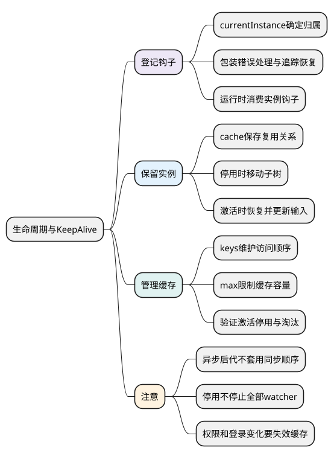
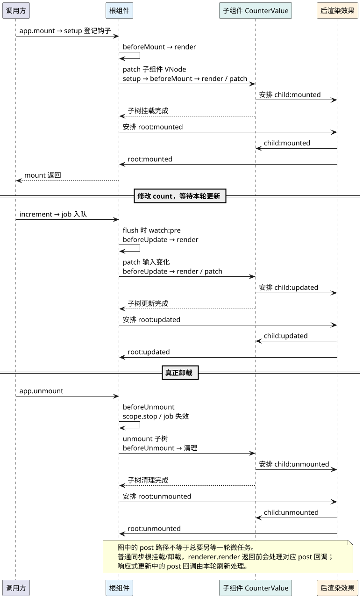
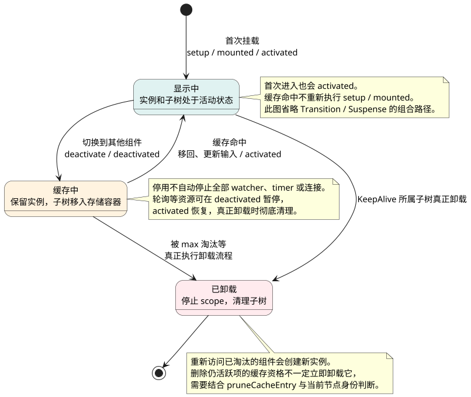

# 生命周期与KeepAlive

**主线位置：** 前面已经走过初始化、render、patch 和卸载。本篇把各生命周期钩子放回这些调用位置，解释为什么出现父子先后顺序，再看 KeepAlive 怎样改变“切走就卸载”的默认路径。生命周期不是挂载前独立执行的一整段流程。

共同例子见 [运行主线演示](examples/runtime-mainline.html) 与 [示例源码](examples/runtime-mainline.mjs)。先比较其中的根、子组件日志；下一篇 [Compiler 编译流程](14_Compiler编译流程.md) 会回到 render 的来源，解释模板怎样预先变成运行代码。

<!-- core-mindmap:start -->

PlantUML 源码

<!-- core-mindmap:end -->

**口述总览：** 生命周期钩子是注册到实例的函数，由渲染和调度路径在对应阶段调用。KeepAlive改变了切换时是否真正卸载，因此资源的暂停与销毁需要分别设计。

源码基线：**Vue v3.5.43**。区分公开行为、这个版本的内部实现与本文教学模型；代码块各自独立，使用 Vue 包的例子在安装相应版本的 Node ESM 或前端工程中运行。

## 钩子注册：关联当前实例并保护追踪现场

[injectHook/createHook](https://github.com/vuejs/core/blob/v3.5.43/packages/runtime-core/src/apiLifecycle.ts)以currentInstance或显式目标找到实例钩子数组，包装错误处理、当前实例和追踪暂停后登记。

通常在setup同步阶段注册；把onMounted放普通timer里，没有活动实例就无法按预期关联。script setup顶层await有编译恢复上下文等支持，不能推广为任意async函数await后都可随时注册。

钩子内部读取一般不应误收集进当时包围它的渲染effect，所以包装会pauseTracking并恢复。

### 注册与执行：onMounted 调用时还没有运行 mounted 回调

主例在根 setup 中调用 onMounted，此时运行时已将根实例设为 currentInstance，因此回调可以登记到这个实例的 m 数组。执行子 setup 时，当前实例切换为子实例，子 onMounted 登记在子的数组。离开各自的 setup 后恢复上下文，所以这不是一个“永远指着最后一个组件”的全局变量。

真正触发发生在 renderer 的对应路径：beforeMount / beforeUpdate 在相应 render 之前同步调用；mounted / updated 经后渲染效果路径处理；卸载在清理 scope 和子树前调用 beforeUnmount，之后安排 unmounted。钩子包装还会暂停依赖收集、设置当前实例、处理错误并恢复现场，避免一次钩子读取被误记为外层渲染依赖。

这里的“暂停收集”不是禁止读取响应式数据，更不是禁止在钩子中修改数据。钩子仍然可以读值，但应避免 updated 中无条件修改本次渲染依赖，造成循环更新。

## 父子生命周期：按同步场景分析调用时机

无异步组件/Suspense的典型父子挂载：父setup/beforeMount先进入，挂载子树时子先完成mounted相关路径，再完成父mounted。更新按队列和依赖推进，卸载则先执行相应beforeUnmount、停scope、卸载子树，再安排unmounted。

这是受场景限定的过程，不是所有异步组合都符合一条万能顺序表。SSR不执行客户端DOM挂载钩子；onServerPrefetch有不同用途。

源码在[setupRenderEffect/unmountComponent](https://github.com/vuejs/core/blob/v3.5.43/packages/runtime-core/src/renderer.ts)找bm/m/bu/u/bum/um这些实例字段消费点，再回到注册入口确认含义。

### 主例时序：把钩子插回首次挂载、更新和卸载

下图只描述主例的同步父子组件，没有异步 setup、Suspense、KeepAlive 和过渡动画。根 render 创建子的 VNode，父 patch 递归完成子挂载后，才完成父挂载；因此进入阶段通常父在前，完成阶段通常子在前。

<!-- understanding-flow: v3line13-hooks-in-runtime:start -->

PlantUML 源码

<!-- understanding-flow: v3line13-hooks-in-runtime:end -->

对主例日志分别筛选 mounted、updated、unmounted，可以观察三个完成阶段均是子在父前。beforeMount / beforeUpdate / beforeUnmount 的父先子后来自递归调用位置，不能据此推断“所有 pre watcher 都在所有组件之前”或“父 mounted 等待所有异步后代”。

特别注意第一次 `app.mount()`：普通同步根渲染在 `renderer.render` 返回前会调用 `flushPostFlushCbs`，所以本例 mount 返回时 mounted 已执行。后续响应式更新则由 scheduler 刷新，`await nextTick()` 等待该轮更新完成。**后渲染、异步微任务和浏览器已经绘制，是三个不同概念。**

定位源码时先在 [apiLifecycle.ts](https://github.com/vuejs/core/blob/v3.5.43/packages/runtime-core/src/apiLifecycle.ts) 看登记，再在 [renderer.ts](https://github.com/vuejs/core/blob/v3.5.43/packages/runtime-core/src/renderer.ts) 搜索 `bm`、`m`、`bu`、`u`、`bum`、`um` 的消费位置；读不懂队列时回看 [Scheduler 与 nextTick](10_Scheduler与nextTick.md)。

## KeepAlive：移动子树并保留实例

[cache/keys/activate/deactivate](https://github.com/vuejs/core/blob/v3.5.43/packages/runtime-core/src/components/KeepAlive.ts)通过cache保存可复用VNode/实例关联，以keys管理访问顺序和max淘汰。切走时将子树移动到storageContainer并标记停用；返回时移回、patch可能变化的props并调用activated相关钩子。

停用不是stop整个组件scope，不应假设watcher、timer和连接全暂停。max淘汰或真正卸载才有相应销毁路径。include/exclude按组件名等规则筛选，key影响缓存身份，不能无限缓存用户敏感页面。

<!-- understanding-flow: vsr12-keepalive-states:start -->

PlantUML 源码

<!-- understanding-flow: vsr12-keepalive-states:end -->

## 缓存管理：验证容量、淘汰和资源清理

cache命中会刷新访问顺序，超max淘汰旧项；当前仍活跃的项处理还需避免当场错误卸载。源码pruneCacheEntry与resetShapeFlag说明“从缓存移除”和“此刻卸载”需区分。

测试A→B→A观察setup次数、activated/deactivated，max=1时检查A是否真正卸载和重建。再验证停用期间watcher是否仍工作，主动决定轮询暂停策略。

缓存提升切换体验却增加内存，退出登录、权限变化和数据过期需要明确失效；KeepAlive不会自动清理所有业务缓存。

### 主线的分岔：切换页面时是停用，还是卸载

在主例外加 KeepAlive 并切换组件后，不能继续用“组件离开屏幕 → beforeUnmount → scope.stop”这条线推断。缓存命中需要保留同一个实例和状态，运行时转入 deactivate，把子树移动到存储容器；返回时 activate 恢复位置并处理输入，随后运行相应 activated。首次进入缓存组件也会 activated，缓存命中不会重新执行 setup 或 mounted。

资源按需求分工：显示时才需要的轮询在 deactivated 暂停、activated 恢复；允许后台继续的任务可以保留；真正淘汰和卸载时再彻底释放。业务自行创建的 timer、WebSocket、全局事件订阅，需要业务自己的停止函数。组件 watcher 并不因停用默认全部停止，不能把“看不见”当作“不会再执行”。

把 KeepAlive 理解为对正常卸载路径的一个保留实例分支，就能把缓存策略接回运行主线；它不是一套与生命周期无关的独立缓存 API。

## 复述要点

钩子登记在实例，运行时和调度器决定调用阶段。KeepAlive移动并保留实例，停用与卸载分开，缓存容量、业务失效和资源所有者一起管理。

## 试题

### VSR13-01 [P0·原理] 为什么onMounted通常要在setup同步注册？

**回答：** 注册需要明确活动组件实例，将回调加入它的钩子数组。任意异步回调中可能已无该上下文，不能靠函数名称自动找到组件。

对应讲解：[钩子注册到谁](#k01)。

### VSR13-02 [P0·原理] 父mounted能否保证所有异步后代已完成？

**回答：** 不能，典型同步子树顺序不能推广给异步组件或Suspense；需相应边界或完成信号。客户端mounted也不在SSR中照常执行。

对应讲解：[同步父子挂载、更新与卸载](#k02)。

### VSR13-03 [P0·原理] KeepAlive停用时为什么不等于卸载？

**回答：** 它保留实例关联并把子树移到存储容器，返回时复用；scope和业务资源未必停止。真正淘汰/卸载才走销毁逻辑，暂停工作由业务明确。

对应讲解：[KeepAlive如何保留实例](#k03)。

### VSR13-04 [P1·验证] 如何证明KeepAlive缓存和淘汰正确？

**回答：** 观察切换中的实例建立、激活、停用和卸载次数，改变max与key验证复用，再查保留资源和登录失效。只看页面内容能回来不足以证明生命周期。

对应讲解：[缓存容量、清理与测试](#k04)。
