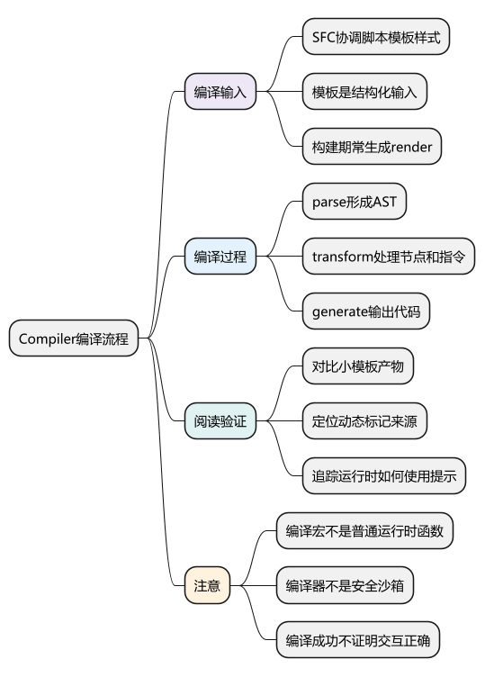
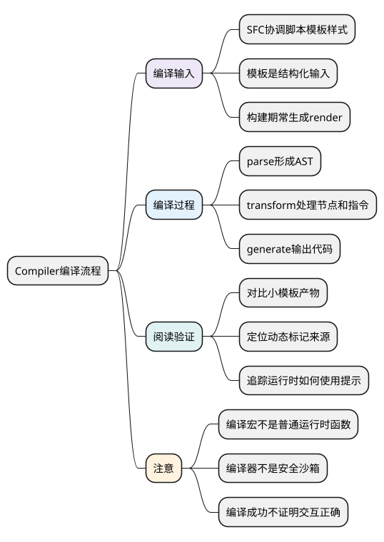
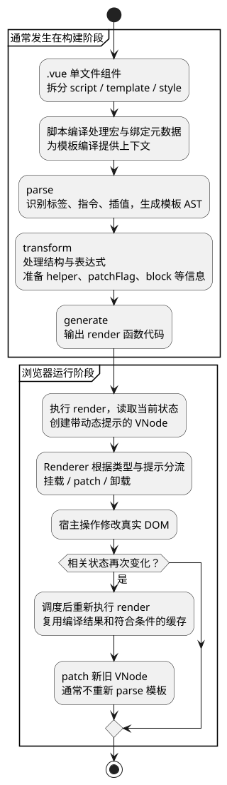

# Compiler编译流程

**本篇在主线中解释什么：** 前面的[统一主例](examples/runtime-mainline.mjs)手写 `h()` 并让 setup 返回 render，因此绕过了模板编译。这一篇回到常见项目里的 `.vue` 文件，解释同类界面的 render 是从哪里来的。

章节排在这里，是为了先理解 Renderer 会消费什么；实际执行时序不是“组件完成挂载后才开始编译”。常规 SFC 工程先由工具链编译组件，浏览器再运行模块中的 `createApp()` 和 `app.mount()`；开发服务通常按模块请求进行转换。

运行阶段复用编译得到的 render：首次读取状态建立依赖，后续状态变化再执行 render 并 patch。不会因为点了一次计数按钮，就重新 parse 整个模板。带运行时编译器且传入模板的构建，是需要另外辨认的入口分支。

阅读前提：[VNode 与 Renderer](04_VNode与Renderer.md)、[Patch 与 Diff](12_Patch与Diff.md)。下面用固定小模板观察产物，再回头看它如何接入已经走通的渲染主线。

<!-- core-mindmap:start -->
[](examples/vsr10-mindmap.svg)

<details>
<summary>PlantUML 源码</summary>



</details>

<!-- core-mindmap:end -->

**口述总览：** 模板是可分析的结构化输入。编译器把它解析成AST、施加变换并生成render代码，让运行时不必反复猜测哪些结构静态、哪些表达式动态。

源码基线：**Vue v3.5.43**。区分公开行为、这个版本的内部实现与本文教学模型；代码块各自独立，使用 Vue 包的例子在安装相应版本的 Node ESM 或前端工程中运行。

<a id="k01"></a>

## SFC 与模板编译：明确构建与运行职责

compiler-sfc先处理.vue文件中的script/template/style及宏，compiler-dom在compiler-core上增加DOM指令/平台变换，runtime-core执行生成的VNode操作。script setup宏处理不是简单把它们当运行时普通函数。

模板编译常发生在构建期，纯运行时构建并不包含完整模板编译器。运行时使用Vue包版本、构建形式与插件决定是否可动态编译；不可信模板不可拿来执行，框架编译器不是安全沙箱。

<a id="k02"></a>

## parse：把模板组织为带位置信息的AST

baseParse把元素、属性、指令、文本与插值等组织为AST，并维护位置、错误和上下文。{{ count }}不是一般HTML文本；v-if/v-for表达结构变化，需要编译器进一步处理。

[baseParse](https://github.com/vuejs/core/blob/v3.5.43/packages/compiler-core/src/parser.ts)与[baseCompile](https://github.com/vuejs/core/blob/v3.5.43/packages/compiler-core/src/compile.ts)对应入口。实际解析器还处理命名空间、空白、注释、转义和复杂语法，不能用/<(.+)>/正则演示就宣称完整HTML parser。

最小教学编译器可以只支持纯文本及简单插值，但要清晰拒绝或说明其余不支持语法。

<a id="k03"></a>

## transform：处理结构、表达式和指令

节点变换遍历AST，可登记退出阶段回调，在子节点处理后汇总；指令变换处理bind/on/model等。v-if/v-for改变结构，表达式前缀、helper收集和静态分析为生成提供信息。

[transform/traverseNode](https://github.com/vuejs/core/blob/v3.5.43/packages/compiler-core/src/transform.ts)看进入与退出变换，[transformElement/buildProps](https://github.com/vuejs/core/blob/v3.5.43/packages/compiler-core/src/transforms/transformElement.ts)看patchFlag和dynamicProps的生成。AST结构、codegenNode与最终字符串不是同一个阶段。

<a id="k04"></a>

## generate：输出可运行的render代码

```js
import { compile } from '@vue/compiler-dom';
import * as Vue from 'vue';
const source = '<p :class="tone">{{ message }}</p>';
const { code } = compile(source, { mode: 'function', prefixIdentifiers: true });
const render = new Function('Vue', code)(Vue);
const node = render({ tone: 'good', message: 'hello' }, []);
console.log(node.type, node.children, node.props.class, node.patchFlag);
// p hello good 3（TEXT | CLASS）
```

本例只对开发者固定字面量模板进行编译观察，不用于执行网络或模型输入。生产构建通常生成ESM render代码，编译器选项会改变形式，不用输出字符串做永久快照断言。

[generate](https://github.com/vuejs/core/blob/v3.5.43/packages/compiler-core/src/codegen.ts)负责拼装导入/helper、函数及表达式代码。词法变量读取、事件缓存等行为需结合SFC绑定元数据和选项理解，不是所有render都只用_ctx同一路径。

<!-- understanding-flow: vsr10-compile-runtime:start -->
<details>
<summary>PlantUML 源码</summary>



</details>

<!-- understanding-flow: vsr10-compile-runtime:end -->

这是客户端 SFC 的主线，样式还有独立处理流程。包含运行时编译器的构建可以在运行时编译模板，SSR 模板也有专用输出路径；这些差异不改变“编译代码”和“反复执行渲染代码”是两件事。

<a id="k05"></a>

## 观察产物：把编译提示连接到运行时

选择一个小模板，依次比较添加动态class、文本、动态键或分支后的AST/产物变化；再去runtime的patchElement/patchChildren查这些提示怎样使用。这样读源码有可验证因果链。

编译成功只说明语法与变换可处理，不证明接口数据正确、组件交互完整或样式表现无误。类型检查、DOM行为和真实浏览器仍需分别验证。

编译生成的 render 除了创建 VNode，还可以携带动态提示。下一篇追[PatchFlag 与 BlockTree](15_PatchFlag与BlockTree.md)，看这些信息怎样缩小比较范围；它们优化既有流程，不另起一套响应式机制。

<a id="summary"></a>

## 复述要点

SFC组织编译上下文，parse得到结构，transform形成语义与优化提示，generate输出render。看小模板前后产物，再追运行时消费，是更有效的源码阅读方式。

<a id="interview"></a>

## 试题

<a id="vsr11-01"></a>

### VSR11-01 [P0·原理] Vue模板为什么不是每次把字符串插进DOM？

**回答：** 它通常先编译为render函数，执行时产生VNode并由renderer更新，编译阶段还能利用静态与动态信息。动态HTML插入是另一种语义与安全边界。

对应讲解：[SFC与模板编译的边界](#k01)。

<a id="vsr11-02"></a>

### VSR11-02 [P0·原理] Parser和transform各解决什么？

**回答：** Parser识别模板结构和位置，transform处理指令、结构变化、表达式及优化信息，为codegen准备。不能把AST生成和所有语义处理都叫解析。

对应讲解：[parse：结构与表达式位置](#k02)。

<a id="vsr11-03"></a>

### VSR11-03 [P1·源码] 退出阶段的transform回调为什么有用？

**回答：** 某些父节点代码生成信息依赖子节点处理结果，进入时登记，退出时汇总能在正确时机完成转换。具体遍历与指令链需按版本源码追踪。

对应讲解：[transform：节点与指令](#k03)。

<a id="vsr11-04"></a>

### VSR11-04 [P0·原理] 如何证明动态class真的得到编译优化？

**回答：** 对固定小模板编译，检查生成VNode的patchFlag或相关产物，再对应runtime处理路径验证；不要只背数字或认为编译成功就无须运行检查。

对应讲解：[generate 与可运行产物](#k04)。

<a id="vsr11-05"></a>

### VSR11-05 [P0·原理] 最小插值编译器为何不能处理任意Vue模板？

**回答：** 它未实现完整语法、作用域、指令、平台属性、错误恢复和安全边界。应声明子集，和官方parse/transform/generate分工对照。

对应讲解：[用编译结果定位问题](#k05)。
