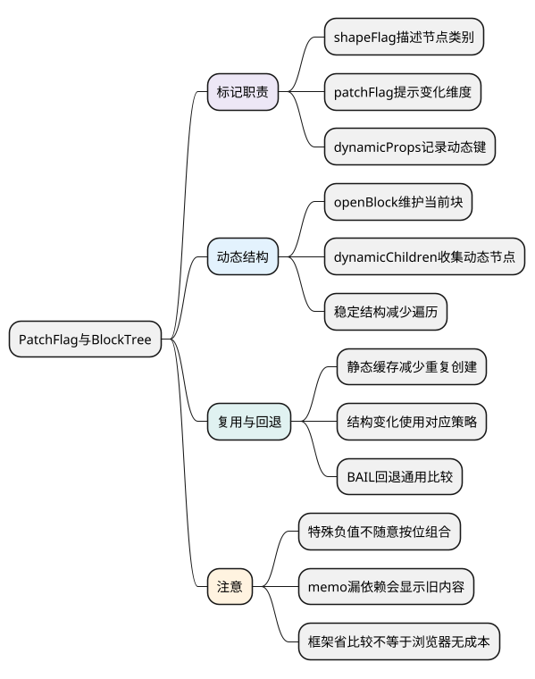

# PatchFlag与BlockTree

**本篇在主线中解释什么：** [编译篇](14_Compiler编译流程.md)已经说明 render 的来源；本篇继续追编译器留下的动态信息如何被 Renderer 使用。它是首次挂载与更新主线上的优化分支。

[统一主例](examples/runtime-mainline.mjs)直接调用 `h()`，没有由模板编译器自动生成的正值 patchFlag 和 block 动态节点列表；它仍可通过通用比较正确更新。把相同界面写成 SFC 模板后，编译器才有机会标出动态文本、动态 prop 等范围。

观察时要分开两类问题：count/doubled 的依赖关系决定哪个组件需要检查更新；patchFlag/dynamicChildren 决定进入渲染比较后，可以跳过哪些已知静态部分。后者不能代替前者，也不能证明浏览器布局绘制没有成本。

阅读前提：[Compiler 编译流程](14_Compiler编译流程.md)。先比较本篇固定模板产物，再到 `patchElement`、`patchBlockChildren` 对照使用位置。

<!-- core-mindmap:start -->
[](examples/vsr11-mindmap.svg)

<details>
<summary>PlantUML 源码</summary>



</details>

<!-- core-mindmap:end -->

**口述总览：** Patch Flag说明节点可能变哪部分，Block Tree组织哪些动态节点需要关注。这些是编译器与运行时共享的优化契约，不能只看成两个提速开关。

源码基线：**Vue v3.5.43**。区分公开行为、这个版本的内部实现与本文教学模型；代码块各自独立，使用 Vue 包的例子在安装相应版本的 Node ESM 或前端工程中运行。

<a id="k01"></a>

## Patch Flag：提示变化部分并区分特殊值

在[PatchFlags](https://github.com/vuejs/core/blob/v3.5.43/packages/shared/src/patchFlags.ts)中，TEXT、CLASS、STYLE、PROPS等正值可按位组合；FULL_PROPS用于动态键等需要完整属性比较的场景，dynamicProps帮助固定动态键列表。

CACHED=-1、BAIL=-2是特殊值，按相等判断，不与普通正标志随意按位混用。旧教程可能把-1称为HOISTED，阅读当前版本要匹配名称和实现，避免死记常量表。

shapeFlag主要描述VNode类别/children形态，patchFlag描述可用更新提示，二者不是同义位标记。

<a id="k02"></a>

## 编译观察：比较文本、样式类与动态属性键

```js
import { compile } from '@vue/compiler-dom';
import * as Vue from 'vue';
function compiled(template, context) {
  return new Function('Vue', compile(template, {
    mode: 'function', prefixIdentifiers: true
  }).code)(Vue)(context, []);
}
const fixed = compiled('<p :class="tone">{{ text }}</p>', { tone: 'a', text: 'b' });
const dynamic = compiled('<p v-bind="attrs">x</p>', { attrs: { title: 't' } });
console.log(fixed.patchFlag, dynamic.patchFlag); // 3 16
```

已知只变class/text时，runtime可以按提示走局部路径；动态props键集合可能增删，需要更完整比较。不是用了FULL_PROPS就完全关闭所有其他优化。编译选项和上下文也会影响标记。

<a id="k03"></a>

## Block Tree：记录稳定结构中的动态节点

[openBlock/setupBlock](https://github.com/vuejs/core/blob/v3.5.43/packages/runtime-core/src/vnode.ts)维护blockStack/currentBlock。创建动态VNode时按条件收集，block结束把列表赋给根VNode.dynamicChildren，再恢复父block。

一个稳定结构block可直接patchBlockChildren对应动态节点，避免反复走过大量静态祖先。v-if分支和v-for带结构不稳定性，需要各自block/fragment及keyed更新策略，不能拿一份固定dynamicChildren列表处理任意增删。

```js
import { compile } from '@vue/compiler-dom';
import * as Vue from 'vue';
const render = new Function('Vue', compile(
  '<div><span>static</span><p>{{ text }}</p></div>',
  { mode: 'function', prefixIdentifiers: true }
).code)(Vue);
const root = render({ text: 'A' }, []);
console.log(root.dynamicChildren.map(node => node.type)); // ['p']
```

源码再看[patchBlockChildren](https://github.com/vuejs/core/blob/v3.5.43/packages/runtime-core/src/renderer.ts)如何消费编译结果。

<a id="k04"></a>

## 静态复用与回退：保留优化前提和正确性

静态提升/缓存减少重复创建，不代表共享一份已挂载可变VNode在任意位置。v-once表示有意只算一次，v-memo按显式依赖控制复用，漏依赖会变成陈旧UI。

手写render或动态slot可能需要BAIL等回退完整比较；运行时不能假定所有VNode都有可靠编译提示。调试时确认模板是否经编译、当前flag与结构是否匹配，再评价优化。

省掉框架比较不等于省掉浏览器layout/paint，真实收益仍受DOM规模与业务计算影响。

普通同步组件、响应式与编译优化已连通。下一篇阅读[Teleport 与 Suspense](16_Teleport与Suspense.md)，把 DOM 落点改变和异步 setup 放回同一套挂载、更新与卸载流程。

<a id="summary"></a>

## 复述要点

shapeFlag分类，patchFlag提示变化，dynamicChildren提供结构内的动态列表。静态/动态协作成立依赖正确编译信息，特殊标志与回退保护通用路径。

<a id="interview"></a>

## 试题

<a id="vsr12-01"></a>

### VSR12-01 [P0·原理] Patch Flag和shapeFlag有什么不同？

**回答：** shapeFlag描述节点及children类别，patchFlag告知更新时可利用的动态维度。一个用于分流形态，一个用于优化比较，不能互换。

对应讲解：[变化维度与特殊标志](#k01)。

<a id="vsr12-02"></a>

### VSR12-02 [P0·原理] 为什么动态属性名需要FULL_PROPS？

**回答：** 键集合可能增删，不能只按预先已知动态键检查。运行时要比较更完整props，处理旧键移除；其他独立优化仍可能存在。

对应讲解：[在产物中观察 TEXT、CLASS 与 FULL_PROPS](#k02)。

<a id="vsr12-03"></a>

### VSR12-03 [P0·原理] Block Tree是不是把所有VNode拍平成一维数组？

**回答：** 不是，它在合适结构边界收集相关动态节点，结构变化仍有分支和列表处理。稳定block中的对应patch不能覆盖任意树增删。

对应讲解：[openBlock、dynamicChildren 与稳定结构](#k03)。

<a id="vsr12-04"></a>

### VSR12-04 [P1·源码] 为何不能把CACHED/BAIL当普通位标记？

**回答：** 它们是特殊负值，源码明确按相等分支解释。盲目按位可能误命中普通标志；名称和行为也需匹配版本。

对应讲解：[变化维度与特殊标志](#k01)。

<a id="vsr12-05"></a>

### VSR12-05 [P1·工程取舍] v-memo是否总能安全减少更新？

**回答：** 依赖必须覆盖真实变化条件，遗漏会留下陈旧UI。先有瓶颈证据，再检验正确性，不能只为减少render日志增加memo。

对应讲解：[静态复用、缓存与正确性](#k04)。
