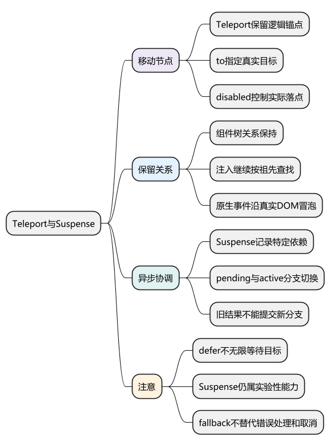
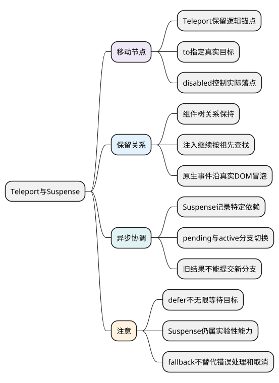
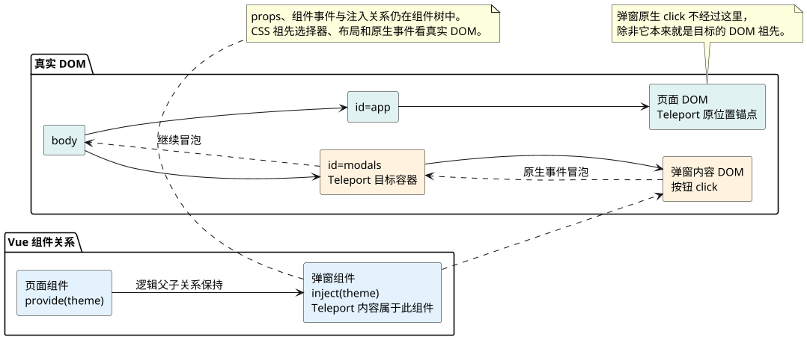
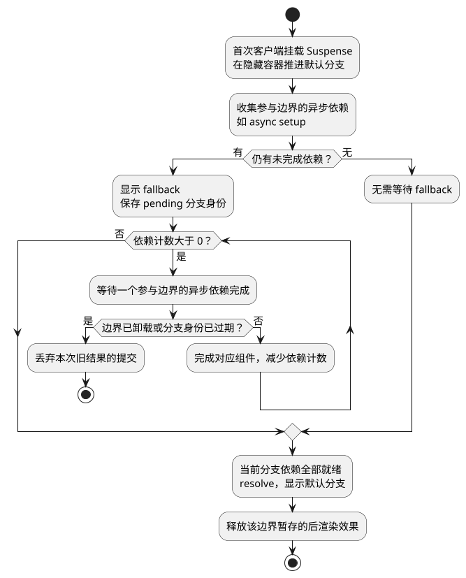

# Teleport与Suspense

**本篇在主线中解释什么：** [统一主例](examples/runtime-mainline.mjs)是同步 setup、普通 DOM 容器的客户端路径。本篇在已经理解的创建、patch 与卸载过程中增加两个分支：Teleport 改变真实 DOM 落点，Suspense 等待参与边界的异步依赖。

若把计数子组件包进 Teleport，仍要经过组件初始化和渲染 effect，count → doubled → prop 的数据关系也不因移动 DOM 自动断开；变化发生在 Renderer 处理 Teleport 节点与目标容器的位置。

若把子组件改成 async setup 并接入 Suspense，不能再照抄主例中同步父子钩子的顺序。异步依赖会先登记到边界，待有效分支就绪后完成挂载，并释放相应的后渲染效果；等待期间卸载或切换分支还要使旧结果失效。

阅读前提：[组件更新与卸载流程](11_组件更新与卸载流程.md)、[生命周期与 KeepAlive](13_生命周期与KeepAlive.md)。本篇的图分别聚焦落点和异步就绪，先保留普通主线，再观察新增分支。

<!-- core-mindmap:start -->

PlantUML 源码

<!-- core-mindmap:end -->

**口述总览：** Teleport改变真实节点的位置，Suspense协调纳入边界的异步依赖。两者都参与renderer，但影响的是不同维度：DOM落点与异步分支状态。

源码基线：**Vue v3.5.43**。区分公开行为、这个版本的内部实现与本文教学模型；代码块各自独立，使用 Vue 包的例子在安装相应版本的 Node ESM 或前端工程中运行。

## Teleport：维护逻辑锚点与目标范围

[TeleportImpl.process/resolveTarget](https://github.com/vuejs/core/blob/v3.5.43/packages/runtime-core/src/components/Teleport.ts)在逻辑位置保留占位锚点，解析to目标并维护目标范围锚点，children按disabled状态挂到原位置或目标。

更新时复用节点与目标信息，to/disabled变化需要移动正确范围；删除时清理两边锚点和子树。它不是把HTML复制两份，也不是创建另一个Vue应用。

Vue3.5的defer延后本次挂载周期中目标解析，可应对同次render稍后出现的目标，不是无限等待未来几秒才出现的容器。

## 组件关系与原生事件：区分两棵树

Teleport保留parentComponent等逻辑关联，因此props、provide/inject与组件事件契约仍按组件树工作；原生click沿实际DOM父链冒泡，祖先CSS选择器、布局和focus也受真实位置影响。

弹窗示例移到body可绕过部分祖先布局限制，但仍需焦点圈定、背景不可操作、关闭和滚动管理。不能把Teleport等同完整可访问Modal或绝对解决所有z-index问题。

<!-- understanding-flow: vsr13-teleport-trees:start -->

PlantUML 源码

<!-- understanding-flow: vsr13-teleport-trees:end -->

## Suspense：协调等待分支与已显示分支

[SuspenseImpl/createSuspenseBoundary/registerDep](https://github.com/vuejs/core/blob/v3.5.43/packages/runtime-core/src/components/Suspense.ts)管理hiddenContainer、pendingBranch、activeBranch及异步依赖计数。未完成分支先在相应隐藏环境推进，有未就绪依赖时显示fallback；依赖完成再resolve切换。

被识别的async setup/异步组件可参与，任意mounted里启动fetch不自动成为Suspense依赖。边界需区分请求身份/pendingId等，旧异步结果不能错误提交到新分支。

在本系列Vue3.5语境下，官方仍将Suspense作为实验性能力说明，工程上锁定版本与框架支持，不宣称稳定覆盖所有组合。

<!-- understanding-flow: vsr13-suspense-initial:start -->

PlantUML 源码

<!-- understanding-flow: vsr13-suspense-initial:end -->

图只表示首次客户端挂载的成功主线；默认分支已显示后的替换还有 `timeout`、旧 active 分支保留等规则，SSR 水合也有单独处理。异步失败必须走错误处理，不能把“某个 Promise 结束”直接等同于“所有内容成功加载”。

## 失败与取消：验证恢复和组合行为

Suspense不是完整错误边界，异步失败需onErrorCaptured等合适处理和产品恢复。fallback不是服务端任务状态，也不自动abort底层请求。

与Teleport/KeepAlive/Transition组合时，挂载目标、缓存激活和过渡时机相互影响；按官方推荐结构并测试pending期间切换、卸载和目标变化。SSR水合也有对应额外路径，不能从客户端一次演示推断所有环境。

基本验证包括目标容器实际位置、注入仍可用、原生事件真实冒泡、fallback切到内容、取消/卸载后不提交旧分支。

最后进入[手写迷你 Vue](17_手写迷你Vue.md)，用有限实现验证依赖、调度与 DOM 的连接。Teleport 和 Suspense 保留为真实源码的扩展路径，不要求在迷你实现中机械复刻。

## 复述要点

Teleport保留逻辑关系并移动宿主范围，Suspense跟踪特定异步分支与依赖。两者都不替代完整弹窗、错误恢复或请求取消协议。

## 试题

### VSR14-01 [P0·原理] Teleport会让provide/inject关系断开吗？

**回答：** 通常不会，它保留Vue逻辑父子关系，但真实DOM已移动，原生事件和CSS祖先关系按真实位置变化。需要区分组件树与DOM树。

对应讲解：[组件关系与原生事件](#k02)。

### VSR14-02 [P0·原理] defer是否等待任意未来时刻出现的目标？

**回答：** 不是，它在支持版本中延后相应挂载周期的解析，不能当异步轮询查目标。必须按实际渲染时机保证容器存在。

对应讲解：[Teleport 的锚点与目标容器](#k01)。

### VSR14-03 [P0·原理] Suspense为什么不能监听所有fetch？

**回答：** 它协调注册到边界的特定异步依赖，不会自动跟踪任何普通Promise或mounted请求。数据加载要接入支持机制并处理错误/取消。

对应讲解：[Suspense 的 pending 与 active 分支](#k03)。

### VSR14-04 [P1·工程取舍] fallback消失是否证明后台任务成功？

**回答：** 不代表所有业务成功，边界就绪与接口业务结局、权限、部分失败不同。还需明确错误展示、版本归属和真实服务状态。

对应讲解：[失败、取消和组合测试](#k04)。
