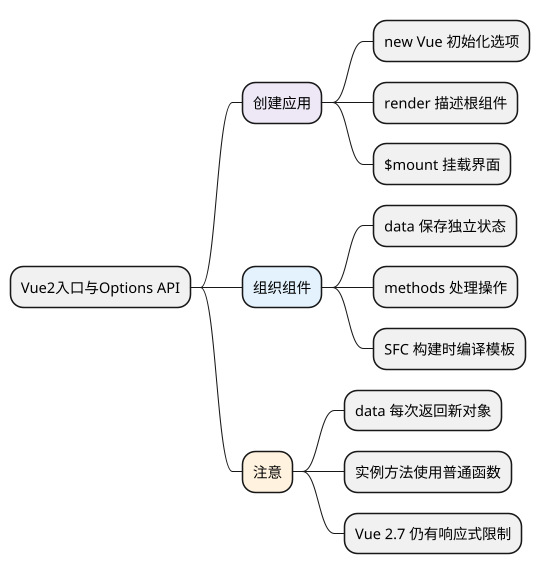

# Vue2入口与Options API

<!-- core-mindmap:start -->
[](examples/v2b01-mindmap.svg)

<details>
<summary>PlantUML 源码</summary>



</details>

<!-- core-mindmap:end -->

**口述总览：** Vue 2 用响应式数据描述界面，用组件组织功能。常见旧项目通过 `new Vue()` 创建根实例，在 `data` 中保存状态，在 `methods` 中处理操作，再把根组件挂载到页面。Options API 是按选项组织代码的方式，不是某种特定的响应式实现。

本系列使用 **Vue 2.7.16、Options API、普通 JavaScript** 验证示例，主要用法也适用于 Vue 2.6 项目。Vue 2.7 加入了 Composition API，但仍沿用 Vue 2 的响应式机制，不能因为出现 `ref`、`reactive` 就当作 Vue 3 的 Proxy 系统。

## new Vue()：创建实例并挂载界面

下面保存为 HTML 文件即可在浏览器打开。CDN 地址固定为 2.7.16，使用包含模板编译器的完整构建。

<!-- example: v2b01-browser-entry -->
```html
<!doctype html>
<html lang="zh-CN">
<meta charset="UTF-8">
<title>Vue 2 计数器</title>
<div id="app">
  <p>{{ message }}：{{ count }}</p>
  <button @click="increase">增加</button>
</div>
<script src="https://cdn.jsdelivr.net/npm/vue@2.7.16/dist/vue.js"></script>
<script>
const vm = new Vue({
  data() {
    return { message: '点击次数', count: 0 }
  },
  methods: {
    increase() {
      this.count += 1
    }
  }
})
vm.$mount('#app')
</script>
</html>
```

- `new Vue(options)`：初始化实例，处理数据、方法、计算属性和生命周期等选项。
- `data`：提供组件状态；Vue 将通常的公开数据属性代理到实例，因此可以写 `this.count`。
- `methods`：定义操作，模板可以直接使用方法名。
- `$mount('#app')`：开始挂载；也可以用 `el: '#app'` 自动发起挂载，选择一种即可。

`el` 与 `$mount()` 不是需要比较“优先级”的两种声明。提供 `el` 时，构造过程已经调用挂载，再手动挂载没有必要。

## 单文件组件与 render()：组织实际项目

已有 Vue 2 构建项目时，入口通常如下。页面需要提供 `<div id="app"></div>`，构建工具需要能够处理 `.vue` 文件。

<!-- project: v2b01-sfc-entry; file: main.js -->
```javascript
import Vue from 'vue'
import App from './App.vue'

new Vue({
  render: h => h(App)
}).$mount('#app')
```

<!-- project: v2b01-sfc-entry; file: App.vue -->
```vue
<template>
  <button class="counter" @click="increase">
    已点击 {{ count }} 次
  </button>
</template>

<script>
export default {
  name: 'App',
  data() {
    return { count: 0 }
  },
  methods: {
    increase() {
      this.count += 1
    }
  }
}
</script>

<style scoped>
.counter { padding: 8px 16px; }
</style>
```

`render` 返回虚拟节点，`h(App)` 表示渲染 `App` 组件。这里的箭头函数只使用参数 `h`，不需要组件 `this`，所以没有问题。

单文件组件中的 `template` 通常在构建时编译为渲染函数，浏览器可以使用不包含编译器的运行时构建。若直接把字符串 `template` 交给运行时构建，它没有能力现场编译，不能把这类错误归咎于 `$mount()`。

`scoped` 样式通过编译时添加属性标记约束选择器，并不是 Shadow DOM 的完全隔离；全局样式、继承样式，以及父组件对孩子根元素的样式仍可能产生影响。

## data() 与 this：让组件实例拥有独立状态

可复用组件的 `data` 应是返回新对象的函数。每次创建组件都会调用它，得到各自的状态；如果函数返回同一个外部对象，仍会共享状态，不能只看“是否写成函数”。

根实例允许 `data` 是对象，但统一使用函数更容易保持习惯。服务端渲染时还要保证每次请求创建自己的应用和状态，不能把根实例“通常只有一个”理解为永远可以共享用户数据。

需要访问组件实例的 `methods`、生命周期、`watch` 回调使用普通函数。把它们写成箭头函数会从外层捕获 `this`，Vue 无法替你改成组件实例。

组件名 `name` 有助于调试、递归引用和 KeepAlive 匹配；组件主要通过 `components` 局部注册后在模板使用，不必把所有组件都注册到全局。

## 注意：数据驱动与组件边界

- Vue 可以操作 DOM；通常让模板负责界面，聚焦、测量、第三方库接入等场景再使用模板引用。
- `v-model` 是特定属性与事件的语法糖，不意味着组件可以任意修改父级数据。
- 单页面应用是否首屏慢、是否满足 SEO，要结合内容获取与渲染方案判断，不能简单归为 Vue 的固定缺点。
- `this.$forceUpdate()` 不是修复响应式设计问题的常规方案，先检查字段声明、数组修改方式和组件边界。

<a id="interview"></a>

## 试题

<a id="v2b01-01"></a>

### V2B01-01 [P0·基础] Vue 2 的入口代码主要做了什么？

通过 `new Vue()` 创建根实例并初始化选项，用 `render` 描述根组件，再通过 `$mount()` 挂载到页面。后续状态变化时，Vue 会安排组件重新渲染，并把必要变化更新到 DOM。

<a id="v2b01-02"></a>

### V2B01-02 [P0·基础] 为什么组件的 data 要写成函数？

同一个组件定义可能创建多个实例。函数每次返回新对象，可以让每个实例拥有独立状态。独立性来自新对象，不是来自“形成闭包”这个说法；函数如果始终返回同一个对象，仍会共享数据。

<a id="v2b01-03"></a>

### V2B01-03 [P0·基础] 为什么 methods 不宜使用箭头函数，入口 render 却可以？

方法通常依赖 `this` 访问组件状态，箭头函数不能由 Vue 绑定 `this`。入口 `h => h(App)` 仅使用传入的 `h`，不依赖 `this`，所以可以使用箭头函数。判断依据是是否需要组件实例，不是箭头函数一律不可用。

<a id="v2b01-04"></a>

### V2B01-04 [P1·理解] 运行时构建为何也能使用单文件组件？

单文件组件的模板在构建阶段已经转成渲染函数，运行时负责执行渲染和更新，不需要再次编译模板。只有在浏览器中接收字符串或页面模板并进行编译的用法，才需要包含编译器的构建。

深入：[初始化与挂载流程](../04_Vue2原理与源码/01_初始化与挂载流程.md)。

参考：[Vue 2 实例](https://v2.vuejs.org/v2/guide/instance.html)、[不同构建版本](https://v2.vuejs.org/v2/guide/installation.html#Explanation-of-Different-Builds)、[Vue 2.7 迁移说明](https://v2.vuejs.org/v2/guide/migration-vue-2-7.html)。
